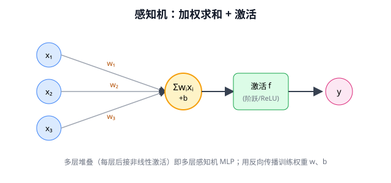
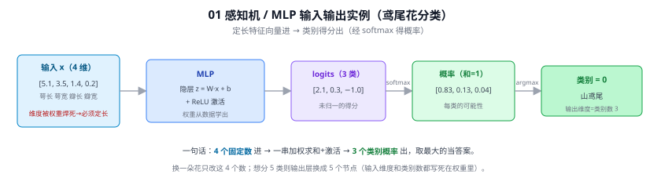

# 01 感知机与反向传播（Perceptron / MLP / Backpropagation）

> 定位：神经网络的起点。理解"什么是神经元、网络为什么能学习"的第一课。
> 关键人物：Rosenblatt（感知机，1958）、Minsky & Papert（批判，1969）、Rumelhart/Hinton/Williams（反向传播，1986）。
> **输入 / 输出**：定长特征向量 x∈ℝⁿ → 类别得分 / 回归值（分类经 softmax 得概率）

---



> 📥📤 **输入/输出实例（看一组具体数值）**：以鸢尾花分类为例，输入是**定长 4 维向量** $x=[5.1,3.5,1.4,0.2]$（萼长/萼宽/瓣长/瓣宽）→ MLP 算 $W{\cdot}x{+}b$ 加激活 → 3 类 logits $[2.1,0.3,-1.0]$ → softmax 得概率 $[0.83,0.13,0.04]$ → argmax = **类别 0（山鸢尾）**。换一朵花只改这 4 个数；输入维度与类别数都被权重矩阵焊死（Q44）。



## 一、提出背景

20 世纪中叶，人们希望用数学模型模拟大脑神经元的工作方式。1943 年 McCulloch & Pitts 提出了第一个数学化神经元模型（M-P 神经元）：多个输入加权求和后，与阈值比较，输出 0 或 1。它能实现与、或、非等逻辑，但**权重需要人工设定，不能学习**。

Rosenblatt 在 1958 年提出**感知机（Perceptron）**，第一次让"权重可以从数据中自动学习"，这是机器学习思想的雏形。

---

## 二、单层感知机原理

### 2.1 前向计算

对输入向量 $\mathbf{x}=(x_1,\dots,x_n)$，感知机计算：

$$
y = f\left(\sum_{i=1}^{n} w_i x_i + b\right),\qquad
f(z)=\begin{cases}1 & z\ge 0\\ 0 & z<0\end{cases}
$$

- $w_i$：权重，表示每个输入的重要程度
- $b$：偏置，相当于可调的阈值
- $f$：激活函数（这里是阶跃函数）

几何意义：$\sum w_i x_i + b = 0$ 是一个**超平面**，感知机就是用这个超平面把空间切成两半做二分类。

### 2.2 感知机学习规则

对每个被分错的样本，按下式更新权重（$\eta$ 是学习率，$t$ 是真实标签，$y$ 是预测）：

$$
w_i \leftarrow w_i + \eta (t - y) x_i,\qquad b \leftarrow b + \eta (t - y)
$$

直觉：预测偏小就把权重往输入方向加一点，预测偏大就减一点。**感知机收敛定理**保证：若数据线性可分，该规则一定能在有限步内找到分隔超平面。

---

## 三、第一次寒冬：异或问题

1969 年 Minsky & Papert 在《Perceptrons》中指出致命缺陷：**单层感知机无法表示异或（XOR）**。

```
XOR 真值表（线性不可分）：
 x1  x2 | y
  0   0 | 0
  0   1 | 1        在二维平面上，
  1   0 | 1        正负样本无法用一条直线分开
  1   1 | 0
```

这个结论被过度解读为"神经网络没前途"，直接导致了 AI 第一次寒冬，研究经费大幅削减。

**破解之道**：增加隐藏层，构成**多层感知机（MLP）**。两层网络即可表示 XOR——本质上是先把输入映射到一个新的特征空间，在那里就线性可分了。但当时缺少训练多层网络的有效算法。

---

## 四、多层感知机（MLP）与万能逼近

MLP = 输入层 + 一个或多个隐藏层 + 输出层，层间全连接，每层后接非线性激活：

```
x ──[W1,b1]──► h1 ──σ──► [W2,b2] ──► h2 ──σ──► ... ──► y
```

**万能逼近定理（Universal Approximation Theorem, Cybenko 1989）**：含单个隐藏层、足够多神经元、带非线性激活的 MLP，可以以任意精度逼近任意连续函数。这从理论上奠定了神经网络的表达能力——但"能表示"不等于"能学到"，关键还差一个训练算法。

---

## 五、反向传播（Backpropagation）—— 真正的转折点

> 💡 常见疑问"反向传播是不是就是复合函数求导？"见 答疑 Q1。

1986 年 Rumelhart、Hinton、Williams 在 *Nature* 发表反向传播算法，让多层网络的训练成为可能。

### 5.1 核心思想

反向传播 = **链式法则 + 动态规划**。目标是计算损失 $L$ 对每个参数的偏导数 $\partial L/\partial w$，然后用梯度下降更新。

直接对每个参数求导计算量爆炸；反向传播的聪明之处是：**从输出层往输入层逐层传递"误差信号"，复用前面算过的中间结果**。

### 5.2 两个阶段

```
前向传播：x → 逐层计算 → 预测 ŷ → 损失 L
反向传播：L → 逐层回传梯度 δ → 得到每层 ∂L/∂W、∂L/∂b
更新：    W ← W − η·∂L/∂W
```

对第 $l$ 层，定义误差项 $\delta^{(l)} = \partial L/\partial z^{(l)}$，则有递推：

$$
\delta^{(l)} = \left(W^{(l+1)}\right)^\top \delta^{(l+1)} \odot \sigma'\!\left(z^{(l)}\right)
$$

$$
\frac{\partial L}{\partial W^{(l)}} = \delta^{(l)} \left(a^{(l-1)}\right)^\top
$$

后一层的误差，乘上权重矩阵转置，再乘当前层激活函数的导数，就得到本层误差——逐层往回"反向传播"。

### 5.3 梯度消失问题

当激活函数用 Sigmoid/Tanh 时，其导数最大仅 0.25。多层连乘后梯度指数级衰减——这就是**梯度消失**，深层网络底层几乎学不动。这是 1990s 第二次沉寂的技术原因，直到 **ReLU**（见 06 AlexNet）、**残差连接**（见 09 ResNet）、Batch Normalization 等手段才被系统性解决。

---

## 六、历史地位

- 感知机：证明"权重可学习"，机器学习思想的源头
- XOR 困境：说明深度（隐藏层）的必要性
- 反向传播：所有现代深度网络训练的通用引擎——今天 YOLOv8、CLIP 的训练，底层仍是反向传播 + 梯度下降的变体（Adam、SGD with momentum）

---

## ✏️ 具体实例（动手算一遍）

**例 1：单个感知机实现 AND 逻辑门**
设权重 $w=[1,1]$、偏置 $b=-1.5$，阶跃激活（加权和 >0 输出 1，否则 0）：

| 输入 (x₁,x₂) | 加权和 $w\cdot x+b$ | 输出 |
|---|---|---|
| (0,0) | 0+0−1.5 = −1.5 | 0 |
| (1,0) | 1+0−1.5 = −0.5 | 0 |
| (0,1) | 0+1−1.5 = −0.5 | 0 |
| (1,1) | 1+1−1.5 = +0.5 | **1** |

恰好实现"两个都为 1 才输出 1"。把 $b$ 改成 −0.5 就变成 OR。但单层感知机**学不了 XOR**（线性不可分）——这正是要多层 + 反向传播的原因。

**例 2：一次反向传播更新（纯手算）**
单神经元 $y=\sigma(wx+b)$，取 $x=2,\,w=0.5,\,b=0$，目标 $t=1$，学习率 $\eta=0.1$，损失 $L=\tfrac12(y-t)^2$：
- **前向**：$z=0.5\times2=1$ → $y=\sigma(1)=0.731$ → $L=\tfrac12(0.731-1)^2=0.036$
- **反向（链式）**：$\frac{\partial L}{\partial y}=y-t=-0.269$；$\frac{\partial y}{\partial z}=y(1-y)=0.197$；$\frac{\partial z}{\partial w}=x=2$
  $$\frac{\partial L}{\partial w}=(-0.269)\times0.197\times2=-0.106$$
- **更新**：$w\leftarrow0.5-0.1\times(-0.106)=0.511$ → $w$ 变大，下次 $y$ 更接近目标 1 ✓

这就是 Q1 说的"链式法则 + 逐层回传"在最小例子上的体现。

---

## 八、参考文献

- Rosenblatt F. *The perceptron: a probabilistic model for information storage and organization in the brain.* Psychological Review, 1958.
- Minsky M, Papert S. *Perceptrons.* MIT Press, 1969.
- Rumelhart D E, Hinton G E, Williams R J. *Learning representations by back-propagating errors.* Nature, 1986.
- Cybenko G. *Approximation by superpositions of a sigmoidal function.* 1989.
