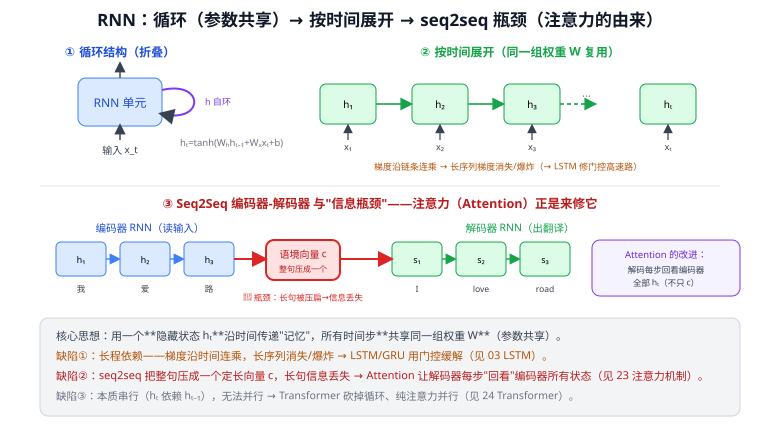
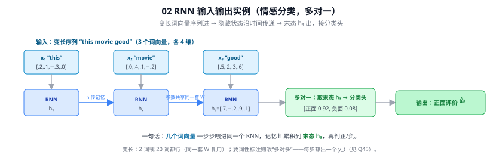
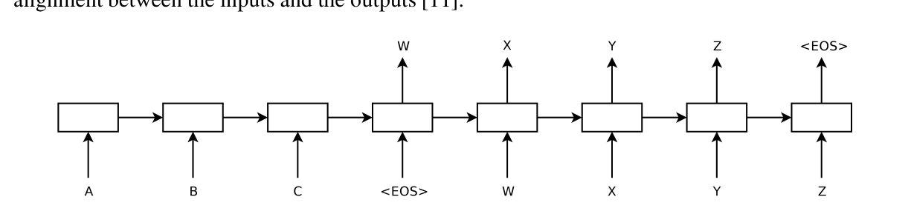
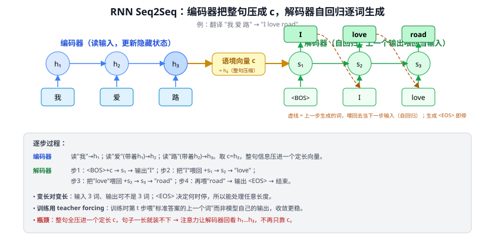
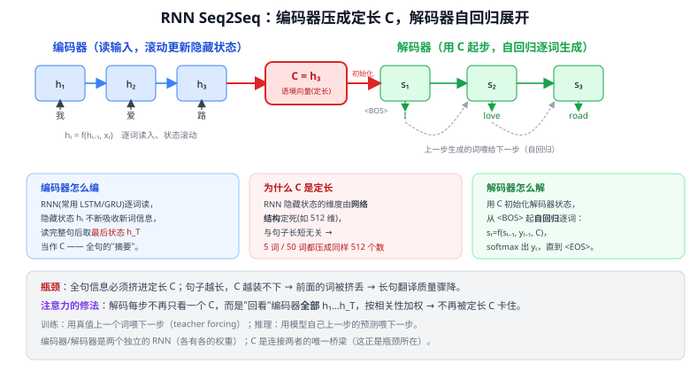
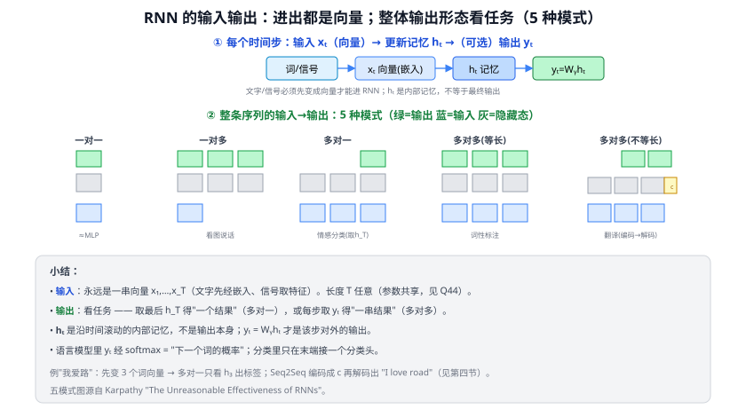
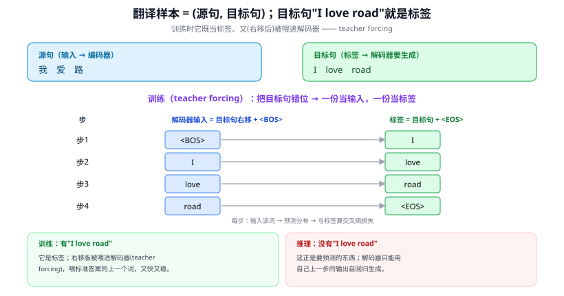

# 02 RNN（循环神经网络，Recurrent Neural Network）

> 定位：处理**序列数据**的基础网络，用"隐藏状态沿时间传递记忆 + 参数共享"建模上下文。是 03 LSTM、Seq2Seq、以及**注意力机制**（27 注意力机制）的共同根基。
> 作者：Elman（1990，Elman Network）等；BPTT 训练算法 Werbos/Rumelhart 1980s。
> **输入 / 输出**：变长向量序列 x₁…x_T → 末态 h_T（多对一）或每步 y_t（多对多），见 Q45

---



> 📥📤 **输入/输出实例（看一组具体数值）**：情感分类，输入是**变长词向量序列** “this movie good” → $x_1,x_2,x_3$（各 4 维）依次喂进**同一个** RNN，隐藏状态 $h$ 累积传递：$h_t=\tanh(W_x x_t + W_h h_{t-1})$ → 末态 $h_3=[0.7,-0.2,0.9,0.1]$ →（多对一）分类头 → $[\text{正面 }0.92,\text{负面 }0.08]$ → **输出"正面"**。变长：2 词或 20 词都行（同一套 $W$ 复用）；若要词性标注则改"多对多"，每步出一个 $y_t$（Q45）。



> 📄 **论文原图对照**（图源：Sutskever et al., *Sequence to Sequence Learning with Neural Networks*, [arXiv:1409.3215](https://arxiv.org/abs/1409.3215) Figure 1，原文 [PDF](../papers/02_Seq2Seq_1409.3215.pdf)；仅笔记内学习引用，论文写作须自绘）：



> 图为 seq2seq：LSTM 读入 "ABC" 压成定长向量、再展开生成 "WXYZ"——正是 Q32 的编码-解码两段式与定长 C 瓶颈。

## 一、提出背景：普通网络处理不了"序列"

MLP/CNN 都假设输入是**定长、各样本独立**的。但语言、语音、时间序列有两个特点普通网络处理不了：
- **变长**：句子长短不一，没法用固定输入层。
- **顺序与上下文相关**："我爱路面检测"里每个字的含义依赖前文；打乱顺序意义就变了。

RNN 的思路：**像人读句子一样，一个一个读，边读边在脑子里维护一个"记忆"**，用这个记忆理解当前词。

---

## 二、核心原理：循环 + 参数共享

RNN 用一个**隐藏状态 $h_t$**（记忆）在时间步之间传递。每读一个输入 $x_t$，就结合上一步记忆 $h_{t-1}$ 更新成新记忆 $h_t$：

$$
h_t = \tanh(W_h h_{t-1} + W_x x_t + b),\qquad y_t = W_y h_t
$$

**两个关键点**：
1. **循环（recurrent）**：$h_t$ 依赖 $h_{t-1}$，记忆沿时间一路传下去——理论上 $h_t$ 能携带任意早期信息。
2. **参数共享**：所有时间步用**同一组权重** $W_h, W_x$。无论序列多长都只有这一组参数（和 CNN 在空间上共享卷积核异曲同工，见 04 CNN 原理）——这让 RNN 能处理变长序列，参数量不随长度增长。

**按时间展开（unfold）**：把循环沿时间"摊平"成一条链，就能像普通深层网络那样用反向传播训练——称 **BPTT（Backpropagation Through Time，沿时间反向传播）**。

```
折叠：  x_t →[RNN(自环 h)]→ y_t
展开：  x1→h1→x2→h2→x3→h3→ ... →h_t   （同一组 W 复用）
```

---

## 三、致命缺陷①：长程依赖（梯度消失/爆炸）

BPTT 把梯度沿时间链**连乘**回传（见 Q1、Q2）。序列一长，连乘就出问题：
- **梯度消失**：早期信息被指数级遗忘。经典例子 "The cat, which …, **was** tired" —— was 与 cat 隔很远，普通 RNN 学不到单复数一致。
- **梯度爆炸**：偶尔梯度炸裂，训练不稳定（可用梯度裁剪缓解）。

**→ 解法：03 LSTM / GRU** 用门控 + 细胞状态加法高速路，让梯度在长序列中稳定流动（与 09 ResNet 残差 +x 同源——都是"给梯度修高速路"，见 Q3）。

---

## 四、致命缺陷②：Seq2Seq 信息瓶颈 —— 注意力的由来 ⭐

RNN 做机器翻译用 **Seq2Seq（编码器-解码器，Encoder-Decoder）**架构（Sutskever 2014）：用**两个 RNN**，一个负责"读懂输入"，一个负责"生成输出"。

**编码器（Encoder）怎么编**
编码器是一个 RNN，按第二节的递推**逐词读入源句**，每读一个词更新一次隐藏状态；读完最后一个词，取**最后的隐藏状态**作为整句的摘要——**定长语境向量 $c$**：
$$h_t=\tanh(W_h h_{t-1}+W_x x_t),\qquad c=h_T$$
它把"变长的句子"压成"一个定长向量"，相当于把整句话读完后在脑子里留下的一个"中心思想"。

**解码器（Decoder）怎么解**
解码器是另一个 RNN，从 $c$ 出发**一个词一个词地生成**译文，且是**自回归（autoregressive）**的——**把自己上一步吐出的词，喂回去当下一步的输入**：
$$s_t=\tanh(W'_h s_{t-1}+W'_y\,y_{t-1}），\qquad \hat y_t=\arg\max \text{softmax}(W_o s_t)$$
- 起步：用特殊起始符 `<BOS>` + $c$ 算出第一个词；
- 之后每步：把"刚生成的词"作为输入，结合状态生成下一个词；
- 直到生成结束符 `<EOS>` 才停——所以**输出长度不必等于输入长度**（变长对变长）。

**完整实例：翻译 "我 爱 路" → "I love road"**



| 阶段 | 步 | 输入 | 状态 | 输出 |
|------|----|------|------|------|
| 编码 | 1 | 我 | $h_1$ | — |
| 编码 | 2 | 爱（带着 $h_1$） | $h_2$ | — |
| 编码 | 3 | 路（带着 $h_2$） | $h_3$ | 取 $c=h_3$ |
| 解码 | 1 | `<BOS>` + $c$ | $s_1$ | **I** |
| 解码 | 2 | **I**（上一步输出喂回）| $s_2$ | **love** |
| 解码 | 3 | **love**（喂回）| $s_3$ | **road** |
| 解码 | 4 | **road**（喂回）| $s_4$ | `<EOS>` → 停 |

> 看清两件事：① **编码器**把"我爱路"三步滚动压成一个 $c$（呼应本篇末 ✏️ 的隐藏状态手算——每步都把上一步记忆累加进来）；② **解码器**靠"上一个词喂回当下一个输入"链式生成，`<EOS>` 决定何时收尾。
> 补充：训练时常用 **teacher forcing**——第 $t$ 步不喂模型自己的输出，而喂"标准答案的上一个词"，避免一步错步步错，收敛更稳；推理时才真的用自己的输出。
> 更细的问答（为什么 $c$ 是定长、编码/解码再追问）见 [Q32](#q32-rnn-seq2seq语境向量-c-为什么是定长编码器怎么编解码器怎么解)。

**瓶颈在哪**：无论输入多长，全句信息都被**塞进一个定长向量 $c$**（编码器只把 $h_T$ 交给解码器）。句子一长，$c$ 装不下 → 前面的信息被挤丢 → 长句翻译质量骤降。这就是著名的"**信息瓶颈**"。

**→ 解法：注意力机制（27 注意力机制，Bahdanau 2015）**。核心改动：**解码器生成每个词时，不再只看一个 $c$，而是"回看"编码器的全部隐藏状态 $h_1,\dots,h_T$，按相关性加权求和**，动态地为当前要翻译的词聚焦到输入中最相关的部分。这直接催生了后来的 28 Transformer（"Attention is All You Need"——干脆把循环也扔掉，只留注意力）。

> 这正是"**注意力是对 RNN 的改进**"的确切含义：注意力最初是为修补 **RNN Seq2Seq 的定长瓶颈**而提出的，后来才独立成 Transformer 的核心。理解 RNN 瓶颈，才懂注意力解决的究竟是什么问题。

---

## 五、致命缺陷③：本质串行（无法并行）

$h_t$ 必须等 $h_{t-1}$ 算完才能算 → 训练**无法在时间维并行**，慢，难扩展到超大规模。**→ 解法：28 Transformer** 砍掉循环链条，用自注意力让任意两位置一步直连，整序列并行计算（见 Q3）。

---

## 六、变体与历史地位

- **Elman / Jordan 网络**：最早的 RNN 形式（隐藏态/输出态回灌）。
- **LSTM（1997）/ GRU（2014）**：门控变体，缓解长程依赖，是 RNN 时代真正可用的主力（见 03 LSTM）。
- **双向 RNN（BiRNN）**：正反向各读一遍，捕捉双向上下文。

RNN（及其门控变体）统治序列建模近 20 年（语音识别、机器翻译、文本生成），直到 2017 年 Transformer 凭"并行 + 无长程衰减"全面取代。今天纯 RNN 仅用于轻量时序、小数据、边缘场景。

---

## ✏️ 具体实例（动手算一遍）

**例：手算两步 RNN 隐藏状态更新（取 2 维便于演示）**
设输入投影 $W_x=[0.5,0.5]^\top$、循环权重 $W_h=0.1\cdot I$、$b=0$，初始 $h_0=[0,0]$，输入序列 $x_1=1,\,x_2=1$：

- **第 1 步**：$h_1=\tanh(W_x x_1+W_h h_0)=\tanh([0.5,0.5])=[0.462,0.462]$
- **第 2 步**：$h_2=\tanh(W_x x_2+W_h h_1)=\tanh([0.5+0.046,\,0.5+0.046])=\tanh([0.546,0.546])=[0.497,0.497]$

可见 $h_2$ 比 $h_1$ 更大——**第 2 步把第 1 步的"记忆"也累加了进来**（通过 $W_h h_1$ 那一项）。这就是"隐藏状态沿时间滚动传递"。注意 $W_x,W_h$ 两步完全相同（**参数共享**）。

**例：为什么会梯度消失（直观）**
若把 10 步的梯度沿时间连乘，每步 tanh 导数最大才 1、通常 0.x，$0.5^{10}\approx0.001$ → 早期信息梯度几乎归零（详见 Q2）。这正是 03 LSTM 要用门控加法路径解决的。

---

## 八、参考文献

- Elman J L. *Finding Structure in Time.* Cognitive Science, 1990.
- Sutskever I, et al. *Sequence to Sequence Learning with Neural Networks.* NeurIPS 2014.（Seq2Seq）
- Bahdanau D, et al. *Neural Machine Translation by Jointly Learning to Align and Translate.* ICLR 2015.（注意力，修 RNN 瓶颈）

---

## 📋 模型答疑（来自模型详解问答）

> 以下问答原属"答疑记录"系列，因专属本模型已并入此处便于集中查阅；跨模型的通用问答仍留在答疑分册。

---

## Q32. RNN Seq2Seq：语境向量 C 为什么是定长？编码器怎么编、解码器怎么解？

> 接 02 RNN 第四节、Q31：把 Seq2Seq 的编码/解码与"定长瓶颈"讲透。

**简答**：① **编码器**是一个 RNN（常用 LSTM/GRU），逐词读入 $x_1,\dots,x_T$，隐藏状态 $h_t=f(h_{t-1},x_t)$ 不断把新词信息揉进状态里，读完整句后取**最后的隐藏状态 $h_T$ 当作语境向量 $C$**——它是全句的"摘要"。② **C 之所以是定长**，是因为 **RNN 隐藏状态的维度由网络结构定死（如 512 维），与句子长短无关**：无论输入 5 个词还是 50 个词，$h_T$ 永远是同样大小的向量 → 整句被压进固定的 512 个数。这是结构上的必然，也正是瓶颈所在。③ **解码器**是另一个 RNN，用 $C$ 初始化它的状态，从 `<BOS>` 起**自回归**逐词生成：$s_t=f(s_{t-1},y_{t-1},C)$，再 softmax 出当前词 $y_t$，把它喂给下一步，直到生成 `<EOS>`。



**展开**：

**① 编码器：把变长句子滚成一个状态**
编码器 RNN 从左到右读，每读一个词就更新隐藏状态：
$$h_t=f(h_{t-1},x_t)\quad(f \text{ 是 RNN/LSTM/GRU 单元})$$
$h_t$ 像一个"边读边记的笔记本"，不断把新词信息累积进去。读完最后一个词得到 $h_T$，令
$$C=h_T$$
此时 $C$ 浓缩了整句话的信息（理论上）。

**② 为什么 C 必然是定长（关键）**
RNN 的隐藏状态是一个**固定维度**的向量，这个维度（如 256/512/1024）是**建网络时就设死的超参数**，不随输入长度变化。所以：
- 输入"我爱路" → $h_3$ 是 512 维；
- 输入一段 50 词长句 → $h_{50}$ 还是 512 维。

$C=h_T$ 自然永远是这固定的 512 维。**换句话说，编码器的工作就是把"任意长度的句子"硬压进"固定大小的向量"**——这既是它能处理变长输入的本事，也是它的死穴：512 个数装一句短话绰绰有余，装一段长文就会丢信息。

**③ 解码器：用 C 起步，自回归逐词吐**
解码器是**另一个独立的 RNN**（自己的权重）。流程：
1. **初始化**：把 $C$ 作为解码器的初始隐藏状态 $s_0=C$（也有做法是每步都把 $C$ 拼进输入）。
2. **逐词生成**：从起始符 `<BOS>` 开始，每步
   $$s_t=f(s_{t-1},\,y_{t-1},\,C),\qquad y_t=\text{softmax}(W s_t)$$
   即结合"上一步状态 + 上一步生成的词 + 语境 C"，预测当前词。
3. **自回归**：把刚生成的 $y_t$ 当作下一步的输入 $y$，循环下去，直到生成结束符 `<EOS>`。

> **训练 vs 推理的小差别**：训练时第 t 步喂的"上一个词"用**真值**（teacher forcing，收敛快、稳）；推理时没有真值，只能喂**模型自己上一步的预测**。

**④ 编码器和解码器是两个网络，C 是唯一的桥**
它们各有各的权重，互不共享；**整段输入信息只能通过 $C$ 这一个定长向量传给解码器**。这就解释了瓶颈的根源——独木桥太窄。

**⑤ 瓶颈 → 注意力的修法**
句子越长，定长 $C$ 越装不下，早期词信息被挤丢 → 长句翻译质量骤降。**注意力**（02 RNN 第四节、Bahdanau 2015）的修法：解码器每生成一个词，不再只靠一个 $C$，而是**回看编码器的全部隐藏状态 $h_1,\dots,h_T$，按当前需要的相关性加权求和**，动态取用输入里最相关的部分 → 不再被定长 $C$ 卡住。再往后，Transformer 用**点积自注意力**把这套做成可并行的矩阵运算（见 Q31）。

**⑥ 与本项目**：本项目不做机器翻译/序列生成，但这条"定长瓶颈 → 注意力 → Transformer"的逻辑，是理解 CLIP 文本编码器（Transformer）与 ViT 的前提（33 CLIP、31 ViT），也是第二章相关工作叙事的起点。

---

## Q45. RNN 的输入和输出到底是什么？

**简答**：RNN 不直接吃文字或原始信号，而是吃**向量**——文本要先查嵌入表变成词向量，时序数据取每时刻的特征向量。每步把当前向量 $x_t$ 和上一步记忆 $h_{t-1}$ 合成新记忆 $h_t$，并可由 $h_t$ 算出该步输出 $y_t$。整条序列层面，输入永远是 $x_1,\dots,x_T$，**输出则看任务**：要"一个结果"就取最后的 $h_T$（多对一，如分类），要"一串结果"就每步取 $y_t$（多对多，如标注/生成）。

**展开**：

**① 每个时间步的进与出**
| 量 | 是什么 | 角色 |
|----|--------|------|
| $x_t$ | 当前元素的**向量**（词向量/特征向量） | **输入** |
| $h_t=\tanh(W_h h_{t-1}+W_x x_t)$ | 沿时间滚动的**记忆** | **内部**（不等于输出） |
| $y_t=W_y h_t$ | 该步对外输出（如经 softmax 得下一个词概率） | **输出**（可选、按需取） |

注意 $h_t$ 是内部状态，**不是**最终答案；很多任务只在末端取 $h_T$，或每步才取 $y_t$。

**② 整条序列：5 种输入→输出模式**
| 模式 | 输入 → 输出 | 例子 | 取哪个输出 |
|------|------------|------|-----------|
| 一对一 | 单个 → 单个 | 退化（≈MLP） | $y_1$ |
| 一对多 | 单个 → 序列 | 看图说话（图→句子） | 每步 $y_t$ |
| 多对一 | 序列 → 单个 | 情感分类 | 只用 $h_T$ |
| 多对多（等长） | 序列 → 等长序列 | 词性标注、逐帧标注 | 每步 $y_t$ |
| 多对多（不等长） | 序列 → 不等长序列 | 机器翻译 Seq2Seq | 编码器→$c$→解码器（见 02 RNN 第四节） |



**③ 三个易混点**
- **进出都是向量**：文字必须先 embedding 才能进 RNN（和 Q44 说的"网络只处理数值张量"一致）。
- **$h_t$ ≠ 输出**：它是记忆；分类只取 $h_T$，生成才每步取 $y_t$。
- **变长靠参数共享**：同一套 $W$ 处理任意长度 $T$（Q44），所以输入序列可长可短。

**④ 例："我 爱 路"**
先变成 3 个词向量 $x_1,x_2,x_3$。① 做**情感分类**（多对一）：只看 $h_3$ → 输出一个标签；② 做**翻译**（Seq2Seq 多对多）：编码成 $c$ → 解码逐词生成 "I love road"（02 RNN 第四节的实例）。

**⑤ 与本项目**
本项目不做序列建模，但理解"RNN 输入=向量序列、输出按任务取 $h_T$ 或 $y_t$"，是看懂 Transformer/ViT/CLIP 的基础——它们同样是"token 向量进、按任务取某些位置的输出"（如 ViT 取 [CLS] token 做分类，类比这里的"多对一取 $h_T$"，见 31 ViT）。

---

## Q46. 做翻译时，解码端的"I love road"也是样本（标签）吗？

**简答**：seq2seq 翻译的训练数据是大量**双语句对（平行语料）**，每对是一个样本：源句"我爱路"喂编码器，目标句"I love road"是解码器要学着生成的**监督信号（标签）**。训练时用 **teacher forcing**——把目标句**右移一位、前补 `<BOS>`** 作为解码器每步输入，把目标句**左移、末补 `<EOS>`** 作为每步要预测的标签，逐步算交叉熵。所以"I love road"在训练里身兼两职（输入 + 标签）；但**推理**时它正是要预测的东西、并不给，解码器只能用自己上一步输出自回归生成。

**展开**：

**① 一条样本 = (源句, 目标句) 对**
| | 内容 | 角色 |
|---|------|------|
| 源句 | 我 爱 路 | 输入 → 编码器 |
| 目标句 | I love road | **标签** → 解码器要生成 |

**② 训练（teacher forcing）：目标句错位成"输入"和"标签"两份**
| 步 | 解码器输入（目标句右移 + `<BOS>`） | 标签（目标句 + `<EOS>`） |
|----|-----------------------------------|--------------------------|
| 1 | `<BOS>` | I |
| 2 | I | love |
| 3 | love | road |
| 4 | road | `<EOS>` |

每步：输入该词 → 解码器输出一个词分布 → 与该位置标签算**交叉熵损失**。**teacher forcing** = 第 $t$ 步喂的是"标准答案的上一个词"（来自目标句），而非模型自己上一步的输出——避免一步错步步错，训练又快又稳。

> **辨析：标签错位 ≠ teacher forcing**（容易混）。
> - **标签错位**是**数据对齐格式**：输入(右移+`<BOS>`) 与 标签(左移+`<EOS>`) 差一位，定义"用前面的词预测下一个词"。它**始终存在**，跟喂什么无关。
> - **teacher forcing**是**输入策略**：把"错位后的**真值**那份"当解码器输入。若改喂模型**自己上一步的输出**（自由运行 / scheduled sampling），错位关系不变，但就**不是** teacher forcing 了。
> - 一句话：teacher forcing 一定用到错位；但错位本身不等于 teacher forcing（同样错位也可喂模型自产输出）。实践中默认 teacher forcing，"错位准备 + 喂真值"一气呵成，才常被当成一回事。



**③ 训练 vs 推理：目标句在不在**
| | "I love road" 在吗 | 解码器每步输入 |
|---|---|---|
| 训练 | **在**（既是标签，又被 teacher forcing 喂入） | 标准答案的上一个词 |
| 推理（译新句） | **不在**（正是要预测的） | 模型自己上一步的输出（自回归） |

这正是训练与推理的差异来源（exposure bias）：训练总喂对的词，推理只能用自己（可能错的）输出，故有时会"一步错、后面跟着歪"。

**④ 与本项目**
本项目不做翻译，但"成对样本 + 标签错位 + teacher forcing"是理解一切**自回归生成式训练**的通用范式——GPT（30 GPT系列）、图像描述、乃至扩散模型的文本条件，都建立在"用已知目标序列做监督、推理时自回归"之上。也帮助分清：[Q45](#q45-rnn-的输入和输出到底是什么) 的"多对多不等长"在**训练**时其实是有目标句标签的。

