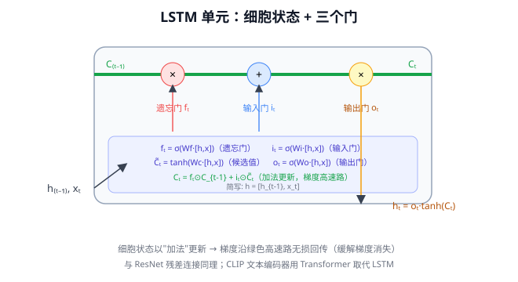
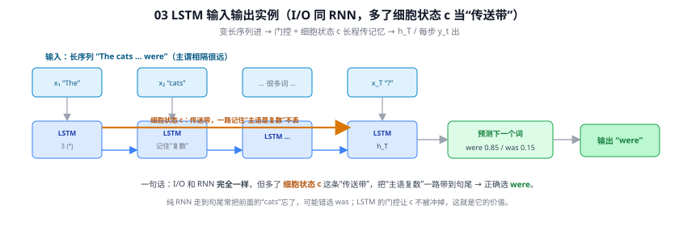

# 03 LSTM（长短期记忆网络，Long Short-Term Memory）

> 定位：解决 RNN"记不住长序列"的门控循环网络。Transformer 出现前，序列建模的统治架构。
> 作者：Hochreiter & Schmidhuber，1997。
> **输入 / 输出**：变长向量序列 → h_T / 每步 y_t（同 RNN，门控 + 细胞状态记忆）

---

> 📥📤 **输入/输出实例（看一组具体数值）**：I/O 与 RNN **完全相同**（变长序列进、$h_T$ 或每步 $y_t$ 出），区别在内部多了**细胞状态 $c$** 这条"传送带"。例：长句 “The cats … were”，主语与谓语相隔很远——LSTM 用门控让 $c$ **一路记住"主语是复数"不被冲掉**，走到句尾预测下一个词时正确给出 $[\text{were }0.85,\text{was }0.15]$ → **输出 "were"**。纯 RNN 走到句尾常把前面的 “cats” 忘了、可能错选 “was”，这正是 LSTM 的价值（Q3）。

## 一、提出背景：RNN 的长程依赖困境

普通循环神经网络（RNN）处理序列时，用一个隐藏状态 $h_t$ 在时间步之间传递信息：

$$
h_t = \tanh(W_h h_{t-1} + W_x x_t + b)
$$

理论上 $h_t$ 能携带任意早期信息，但实际上存在**长程依赖问题**：当序列很长时，早期信息的梯度在反向传播（沿时间展开，称 BPTT）中要经过多次连乘，导致：

- **梯度消失**：早期信息被指数级遗忘——"The cat, which ... , **was** tired" 中，was 与 cat 隔很远，普通 RNN 学不到单复数一致性
- **梯度爆炸**：偶尔梯度炸裂，训练不稳定

LSTM 的设计目标就是让网络**有选择地记住或遗忘信息**，使梯度能在长序列中稳定流动。

---

## 二、核心机制：细胞状态 + 三个门

LSTM 引入一条贯穿始终的**细胞状态（cell state）$C_t$**，像一条传送带，信息在上面以最少干扰流动。三个**门（gate）**控制信息的增删。门是一个 Sigmoid 层，输出 0~1，表示"放行多少"。

### 2.1 遗忘门（Forget Gate）—— 该丢掉什么

$$
f_t = \sigma(W_f \cdot [h_{t-1}, x_t] + b_f)
$$

$f_t$ 接近 0 表示"忘掉细胞状态里的这部分"，接近 1 表示"保留"。例如读到新主语时，可遗忘旧主语的性别信息。

### 2.2 输入门（Input Gate）—— 该写入什么

$$
i_t = \sigma(W_i \cdot [h_{t-1}, x_t] + b_i),\qquad
\tilde{C}_t = \tanh(W_C \cdot [h_{t-1}, x_t] + b_C)
$$

$\tilde{C}_t$ 是候选新信息，$i_t$ 决定写入多少。

### 2.3 更新细胞状态

$$
C_t = f_t \odot C_{t-1} + i_t \odot \tilde{C}_t
$$

旧状态按遗忘门衰减 + 新候选按输入门加入。**关键**：这里是加法而非连乘，梯度可以沿 $C$ 这条"高速路"近似无损地回传——这正是 LSTM 缓解梯度消失的核心（与 ResNet 残差连接异曲同工）。

### 2.4 输出门（Output Gate）—— 该输出什么

$$
o_t = \sigma(W_o \cdot [h_{t-1}, x_t] + b_o),\qquad
h_t = o_t \odot \tanh(C_t)
$$

---

## 三、变体与发展

- **GRU（2014，Cho）**：把遗忘门和输入门合并为"更新门"，去掉独立细胞状态，参数更少、速度更快，效果常与 LSTM 相当。
- **双向 LSTM（BiLSTM）**：同时正向和反向读序列，捕捉上下文，常用于 NER、序列标注。
- **Seq2Seq + Attention（2015）**：LSTM 编码器-解码器加注意力，是机器翻译的里程碑，也直接启发了后来的 Transformer（见 27 注意力机制）。

---

## 四、历史地位与被取代

LSTM 统治序列建模近 20 年（语音识别、机器翻译、文本生成）。但它有两个无法回避的弱点：

1. **本质串行**：$h_t$ 依赖 $h_{t-1}$，无法并行，训练慢，难以扩展到超大规模
2. **超长依赖仍吃力**：几百步以上信息仍会衰减

2017 年 **Transformer**（28 Transformer）用自注意力一次性建模任意两个位置的关系，既能并行又无衰减，彻底取代了 LSTM 在主流 NLP/多模态中的地位。今天 LSTM 仍用于轻量级时序任务、边缘设备、小数据场景。

---

## ✏️ 具体实例（动手算一遍）

**例：细胞状态的"加法高速路"如何保住信息**
假设上一刻细胞状态 $C_{t-1}=0.8$（记着"主语是单数"这条信息）。某一步各门取值：遗忘门 $f_t=0.9$（基本保留）、输入门 $i_t=0.1$、候选 $\tilde C_t=0.5$：
$$C_t=f_t\odot C_{t-1}+i_t\odot\tilde C_t=0.9\times0.8+0.1\times0.5=0.72+0.05=0.77$$
信息几乎无损（0.8→0.77）。**关键**：这是**加法**更新，梯度沿 $C$ 回传时近似 ×1，不会像普通 RNN 那样每步乘一个 <1 的导数而连乘消失（对比 02 RNN 的例子、[Q3](#q3-lstm-的变种为何治标不治本只适用于轻量级任务)）。

**例：遗忘门"换主语"**
读到新主语时，可让 $f_t\approx0$ → $C_t\approx i_t\odot\tilde C_t$，旧的单复数信息被清掉、写入新的。门控让网络**有选择地记/忘**，这是普通 RNN 做不到的。

---

## 六、参考文献

- Hochreiter S, Schmidhuber J. *Long Short-Term Memory.* Neural Computation, 1997.
- Cho K, et al. *Learning Phrase Representations using RNN Encoder-Decoder.* EMNLP 2014.（GRU）
- Sutskever I, et al. *Sequence to Sequence Learning with Neural Networks.* NeurIPS 2014.

---

## 📋 模型答疑（来自模型详解问答）

> 以下问答原属"答疑记录"系列，因专属本模型已并入此处便于集中查阅；跨模型的通用问答仍留在答疑分册。

---

## Q3. LSTM 的变种为何治标不治本，只适用于轻量级任务？

**简答**：方向对，需校准两点：① LSTM 解决遗忘靠的是"门控 + 细胞状态加法高速路"，不是"加隐藏层"；② 本质瓶颈确实没被 LSTM 系变种解决，但根因不只是"链条长会忘"，更致命的是"**串行无法并行**"——这是循环结构的胎记。真正解决本质问题的不是变种，而是**换架构（Transformer 砍掉循环链条）**。"只适用于轻量级任务"的结论成立。

**展开**：

**校准1：解决遗忘靠"门控 + 细胞状态"，不是加层**
普通 RNN→LSTM 的关键是引入细胞状态 $C_t$（传送带）+ 三个门，信息以加法更新 $C_t=f_t\odot C_{t-1}+i_t\odot\tilde C_t$，梯度沿加法路径近似无损回传——与 ResNet 残差 +x 是同一招（09 ResNet）。"加隐藏层"通常指 stacked LSTM（增强表达力），与解决遗忘是两码事。

**校准2：LSTM 是"大幅缓解"遗忘**
普通 RNN 几十步就忘 → LSTM 能记几百步，统治序列建模近 20 年，并非没用。

**本质瓶颈有两个（第二个更致命）**：

| 瓶颈 | 说明 | 变种能解决吗 |
|------|------|------------|
| ① 超长依赖仍衰减 | 几百步以上加法高速路也扛不住 | GRU/BiLSTM/stacked 只缓解，治标 |
| ② **串行无法并行** | $h_t$ 须等 $h_{t-1}$，训练逐步进行 | **完全无解**，循环结构胎记 |

GRU（简化提速）、BiLSTM（双向）、stacked（加深）、LSTM+Attention（打补丁）——没有一个动摇"沿时间串行传递"的根本结构，故治标不治本。

**真正的解 = Transformer 换架构**
Transformer 直接砍掉循环链条，用自注意力让任意两位置**一步直连**（路径长度 O(n)→O(1)）：长依赖不再衰减（解决①）、整序列并行计算（解决②）。所以不是"变种解决了"，而是"放弃循环、改用注意力"。

**结论：只适用于轻量级任务——成立**
今天 LSTM 退居二线，适用：短序列（几十步）、小数据/边缘设备（Transformer 数据胃口大、$O(n^2)$ 贵）、轻量实时时序。主流长依赖/大数据场景全是 Transformer。
> 对本项目：不用 LSTM；若将来做"在线滑动预警"（连续帧时序），轻量场景可能用 GRU/LSTM，大场景上时序 Transformer。

