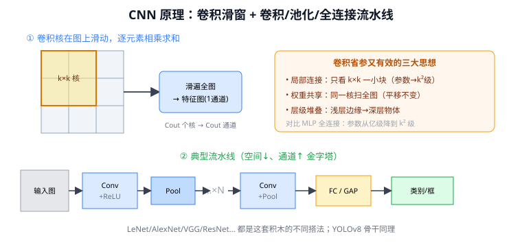
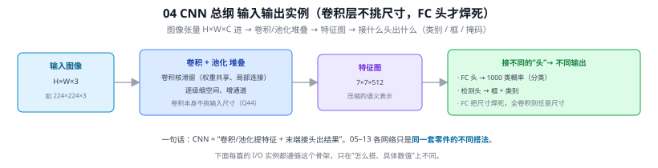

# 04 CNN 卷积神经网络原理（总纲）

> 定位：本章（CNN 骨干 04—12）的总纲。先讲清"卷积是什么、为什么适合图像"，再看 LeNet/AlexNet/…… 这些具体网络就只是同一套零件的不同搭法。
> 配套答疑：Q4 通道、Q5 卷积核是学出来的、Q6 感受野、Q7 1×1 卷积。
> **输入 / 输出**：图像张量 H×W×C → 特征图 → 类别 / 检测框等（卷积层本身不挑尺寸，见 Q44）



> 📥📤 **输入/输出实例（看一组具体数值）**：输入图像张量 **H×W×3**（如 224×224×3）→ 卷积+池化堆叠（卷积核滑窗、权重共享、逐级缩空间增通道）→ 特征图 **7×7×512** → 接什么"头"出什么：FC 头 → 1000 类概率（分类）、检测头 → 框+类别。注意卷积层本身**不挑输入尺寸**，是末端 FC 把尺寸焊死（Q44）。下面 05–13 各网络只是**同一套零件（卷积/池化/连接方式）的不同搭法**，I/O 都遵循这个骨架。



---

## 一、为什么图像不能直接用全连接（MLP）？

把一张 224×224×3 的图拉平接全连接层，第一层就有 224×224×3 × 1000 ≈ **1.5 亿** 个权重——参数爆炸、极易过拟合，且**丢掉了图像的空间结构**（拉平后像素的上下左右关系没了）。

CNN 的出发点：图像有两个先天结构特性，应该利用而非无视——

1. **局部相关性**：一个像素只和周围像素关系紧密（边缘、纹理是局部的）。
2. **平移不变性**：一只猫出现在左上还是右下，都是猫；同一个特征检测器应该在全图通用。

卷积正是为这两点量身定做的。

---

## 二、卷积运算：到底在算什么

一个**卷积核（kernel/filter）**是个小窗口（如 3×3），它在输入图上**滑动**，每滑到一处就把覆盖区域与核做**逐元素相乘再求和**，得到一个输出值；滑遍全图就得到一张**特征图（feature map）**。

```
输入(局部 3×3)        卷积核 3×3         输出一个数
┌─────────┐        ┌─────────┐
│ a b c   │        │ w1 w2 w3│   →  a·w1+b·w2+...+i·w9  = 该位置响应
│ d e f   │   ⊙    │ w4 w5 w6│
│ g h i   │        │ w7 w8 w9│
└─────────┘        └─────────┘
```

三个关键超参（见 Q6）：
- **核大小 k**：决定单步看多大范围（感受野）。
- **步长 stride**：核每次移动几格；>1 则输出尺寸缩小（下采样）。
- **填充 padding**：在边缘补零，控制输出尺寸（pad 合适可保持 H×W 不变）。

输出尺寸公式：$\text{out} = \lfloor (\text{in} + 2p - k)/s \rfloor + 1$。

---

## 三、卷积为什么省、为什么有效——三大思想

| 思想 | 含义 | 好处 |
|------|------|------|
| **局部连接** | 每个输出只看输入的一小块（k×k），不连全图 | 参数从"亿级"降到"k²级" |
| **权重共享** | 同一个核扫过整张图，到处用同一组权重 | 参数再大降；天然平移不变 |
| **层级堆叠** | 浅层小感受野→深层大感受野（Q6） | 浅层学边缘、深层学物体（Q5） |

> 对比 MLP：全连接每个输出连所有输入；卷积只连局部且共享权重——这就是 CNN 参数少又适合图像的根本原因。

**通道（channel）**：一个核产出一张特征图 = 一个输出通道；用 $C_{out}$ 个核就得 $C_{out}$ 个通道（Q4）。卷积核的权重不是设计的，是**训练学出来的**（Q5）。

---

## 四、CNN 的标准积木与典型结构

```
输入图像
  │
[卷积 Conv] → [激活 ReLU] → [池化 Pool]   ← 重复若干次（提特征 + 降分辨率）
  │
  ...（越深：空间↓、通道↑，金字塔）
  │
[全连接 FC] 或 [全局平均池化 GAP]
  │
输出（类别 / 检测框 / ...）
```

- **卷积层**：提取局部特征，增加通道。
- **激活函数**：引入非线性（ReLU 等，见 Q2），否则多层等于一层线性。
- **池化层（下采样）**：取局部最大/平均，降分辨率、扩感受野、增强平移不变、减计算。
- **全连接 / GAP**：把高度抽象的特征汇总成最终输出。

**金字塔规律**（贯穿 LeNet→YOLOv8）：越深，**空间尺寸递减、通道数递增**——"用通道换分辨率"（Q4）。

---

## 五、处理任意尺寸输入：GAP、FCN、SPP

第四节末尾的 **FC（全连接）** 把特征图拍平成定长向量，这就是 CNN 要求**固定输入尺寸**（如 224×224）的根源——卷积本身不挑尺寸，是 FC 头把尺寸钉死了（详见 Q44）。下面三种技术专门用来**去掉这个定长约束**，是现代 CNN/检测/分割的标配。

**① 全局平均池化 GAP（Global Average Pooling）**
把每个通道**整张特征图求一个平均值**：$H\times W\times C \to 1\times1\times C$，得到一个 $C$ 维向量，**与 $H,W$ 多大无关**。它直接替代 FC 当分类头：无参数、不过拟合、且天然接受任意尺寸输入。
- 来历：NiN（2014）提出，08 GoogLeNet、09 ResNet 末端都用它替代 FC。
- 例：$7\times7\times512$ 特征图 → GAP → 512 维向量（每个数 = 该通道 49 个值的平均）；若输入更大变成 $10\times10\times512$，GAP 仍输出 512 维——**长度恒定**，再接一个 $512\to$类别数 的小 FC 即可。
- 注：15 SENet/16 CBAM 的通道注意力也用 GAP 把每个通道压成一个标量来算权重。

**② 全卷积网络 FCN（Fully Convolutional Network）**
把网络里**所有 FC 都换成卷积**（一个 FC 等价于一个覆盖全图的卷积，1×1 卷积更是逐像素的 FC，见 Q39）。于是输出不再是一个向量，而是一张**空间热力图**——任意尺寸输入 → 对应尺寸的稠密输出，天然做**像素级预测**。
- 来历：Long 等（2015）用于语义分割，是 38 U-Net 的直接前身；检测头、分割头本质都是全卷积的。
- 例：把分类网末端的 `FC-1000` 换成 `1×1 卷积，1000 个核` → 输出 $H'\times W'\times1000$ 的类别热力图，每个空间位置一组类别得分。

**③ 空间金字塔池化 SPP（Spatial Pyramid Pooling）**
对特征图在**多个网格分辨率**上分别池化再拼接：如分成 $4\times4$、$2\times2$、$1\times1$ 三档，各档把特征图划成对应格子、每格取最大值，得 $16+4+1=21$ 个值/通道，拼成 $21\times C$ 的**定长向量**——无论输入多大都固定长度，且同时捕捉多尺度上下文。
- 来历：SPPNet（He 等，2014），介于 18 R-CNN 与 19 Fast R-CNN 之间，直接启发了 RoI Pooling。
- **本项目最相关**：YOLOv8 用其变体 **SPPF**（Spatial Pyramid Pooling-Fast，串联几个 MaxPool 等效多尺度池化），放在骨干末端**融合多尺度感受野**（详见 25 YOLO 演进）。注意 YOLO 里 SPPF 主要为"多尺度上下文"，定长输入靠的是输入端 resize。

| 技术 | 一句话 | 作用 | 典型出处 |
|------|--------|------|---------|
| **GAP** | 每通道求一个平均 → 定长 $C$ 向量 | 替代 FC 当分类头 | NiN / GoogLeNet / ResNet |
| **FCN** | 把 FC 全换成卷积 → 输出空间图 | 任意尺寸、像素级稠密预测 | 分割 / U-Net / 检测头 |
| **SPP** | 多分辨率池化拼成定长向量 | 定长 + 多尺度上下文 | SPPNet / YOLOv8 的 SPPF |

> 一句话归纳：**FC 把尺寸钉死；GAP/FCN/SPP 各用一种方式拆掉这颗钉子**——GAP 求平均、FCN 全卷积、SPP 多尺度池化。

---

## 六、本章地图：具体网络只是积木的不同搭法

理解了上面的零件，后面每个网络其实是在回答"怎么搭更好"：

| 网络 | 它改进了什么积木 |
|------|------------------|
| 05 LeNet | 最早把"卷积+池化+FC"跑通 |
| 06 AlexNet | ReLU、Dropout、GPU、数据增强 |
| 07 VGGNet | 用 3×3 小核堆叠替代大核（Q6） |
| 08 GoogLeNet | 并行多尺度 + 1×1 降维（Q7） |
| 09 ResNet | 残差连接，让网络能很深 |
| 10 DenseNet | 密集拼接，特征复用 |
| 11 MobileNet | 深度可分离卷积，做轻 |
| 12 EfficientNet | 复合缩放，怎么放大 |
| 13 ConvNeXt | 现代化配方，追平 Transformer |

---

## 七、与本项目的关系

- 本项目检测骨干 **YOLOv8 的 Backbone/Neck 全是卷积积木**（3×3、1×1、池化、残差、concat）。看懂本篇，就看懂了 YOLOv8 骨干在做什么。
- 第三章改进（加 P2 层、CBAM）本质是在这套积木上**增改卷积/注意力模块**——理解卷积运算与感受野（Q6）是改检测头的前提。
- CNN 与 Transformer 路线之争见 13 ConvNeXt：本项目选 CNN 系（YOLOv8）正因其轻量、部署友好。

---

## ✏️ 具体实例（动手算一遍）

**例 1：一次 3×3 卷积（边缘检测）**
输入一个左亮右暗的 3×3 图像块，用竖边检测核：
$$\text{patch}=\begin{bmatrix}10&10&0\\10&10&0\\10&10&0\end{bmatrix},\quad \text{kernel}=\begin{bmatrix}1&0&-1\\1&0&-1\\1&0&-1\end{bmatrix}$$
输出 = 逐元素相乘再求和 = 每行 $(10\cdot1+10\cdot0+0\cdot(-1))=10$，三行共 $10+10+10=\mathbf{30}$ → **强响应**（检测到竖边）。
若换成全是 10 的均匀块（无边）：每行 $10-10=0$ → 输出 **0**（无响应）。这就是"卷积核 = 特征探测器"（呼应 Q5：核里的数是训练学出来的）。

**例 2：输出尺寸与感受野**
输入 32×32，核 5×5、步长 1、无填充 → 输出边长 $32-5+1=28$ → 28×28。再接 2×2 池化 → 14×14（空间减半）。堆两层 3×3 卷积，一个输出点能"看到"原图 5×5 区域（感受野，见 Q6）。

**例 3：参数量（权重共享的威力）**
一个 5×5 卷积、输入 3 通道、输出 64 通道：参数 $=5\times5\times3\times64+64=4864$。无论图像多大，这套核**全图共享**——这就是 CNN 比全连接省参数的根本（一张 224×224 图做全连接要上亿参数）。

---

## 八、参考文献

- LeCun Y, et al. *Gradient-based learning applied to document recognition.* Proc. IEEE, 1998.（卷积网络奠基）
- Goodfellow I, Bengio Y, Courville A. *Deep Learning.* 2016，第 9 章 Convolutional Networks（卷积原理系统阐述）。
