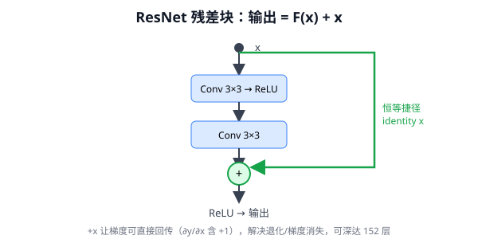
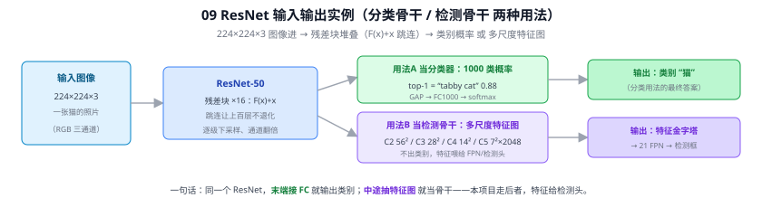
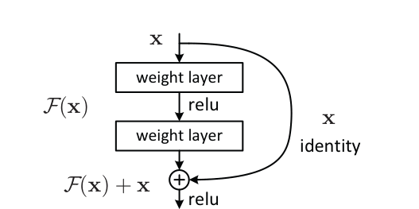
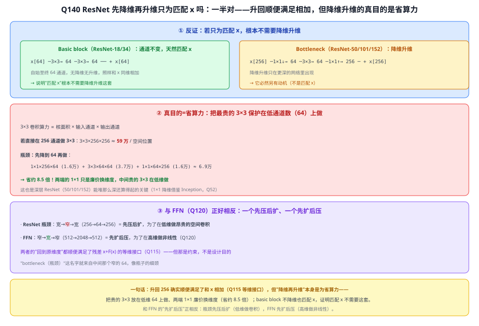
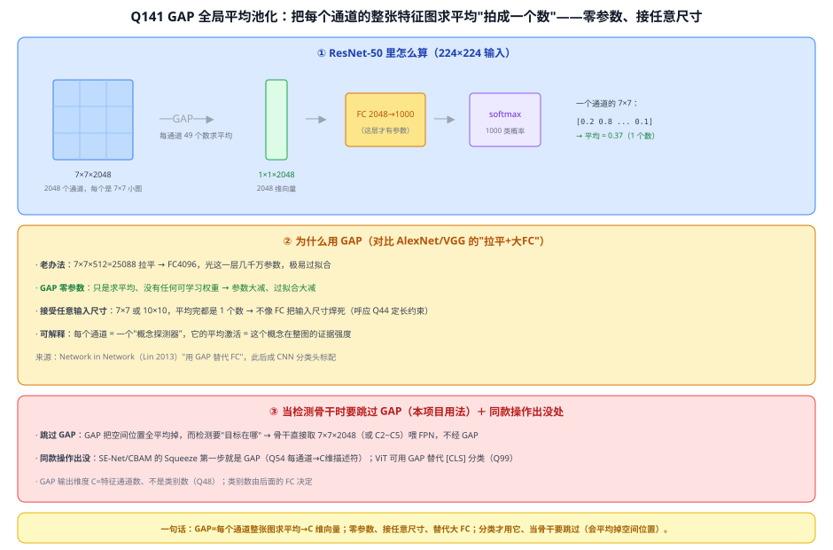
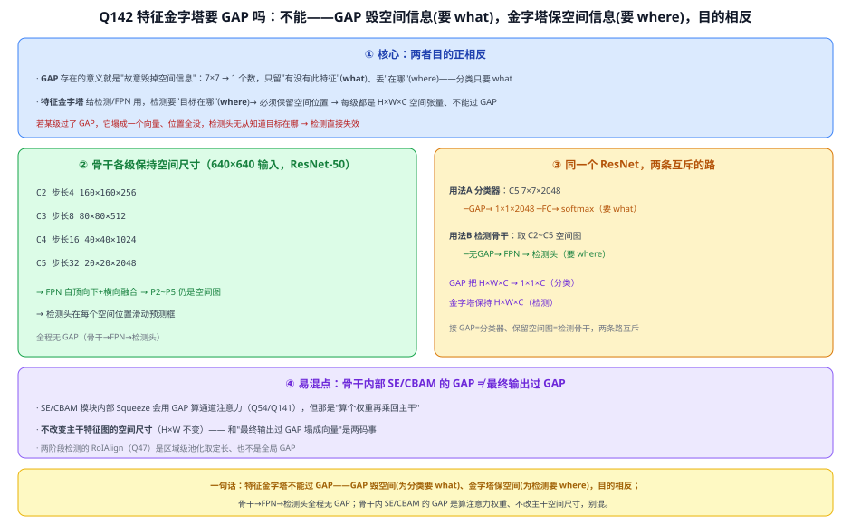

# 09 ResNet（残差网络）⭐

> 定位：现代深度学习的"地基"。残差连接让网络可以做到上百上千层，是此后十年最常用的骨干。
> 作者：何恺明（Kaiming He）等（微软亚洲研究院），CVPR 2016（最佳论文）。
> 战绩：ImageNet 2015 冠军，Top-5 错误率 **3.57%**，首次超越人类水平（约 5.1%）。
> **输入 / 输出**：224×224×3 图像 → 1000 类 / 特征向量（最常用骨干，输出特征供下游）

---



> 📥📤 **输入/输出实例（看一组具体数值）**：输入 **224×224×3** 图像 → ResNet-50（16 个残差块，每块算 $F(x){+}x$）。**两种用法**：① 当**分类器**——末端 GAP + FC1000 + softmax → top-1 "tabby cat" 0.88；② 当**检测骨干**（本项目用法）——抽中间多尺度特征图 C2 56²×256 / C3 28²×512 / C4 14²×1024 / C5 7²×2048，不出类别，喂给 21 FPN 与检测头。同一个 ResNet，末端接 FC 就出类别，中途抽特征就当骨干。



> 📄 **论文原图对照**（图源：He et al., *Deep Residual Learning for Image Recognition*, [arXiv:1512.03385](https://arxiv.org/abs/1512.03385) Figure 2，原文 [PDF](../papers/09_ResNet_1512.03385.pdf)；仅笔记内学习引用，论文写作须自绘）：



> 残差块：恒等捷径 x 越过两层权重与 F(x) 相加——"残"在只学差值 F(x)=H(x)−x（Q9）。

## 一、提出背景：退化问题（Degradation）

VGG 证明"深"有益，但实践发现：网络加到一定深度后，**继续加层，训练误差反而上升**——这不是过拟合（训练误差也变差），而是"退化问题"：深层网络难以优化。

理论上，深网络至少不该比浅网络差（多出来的层学成恒等映射即可），但实际优化器找不到这个解。ResNet 的洞见：**与其让网络直接学习目标映射 $H(x)$，不如让它学习残差 $F(x)=H(x)-x$**，因为把残差压到 0（即学恒等映射）比直接学恒等映射容易得多。

---

## 二、核心创新：残差连接（Residual / Skip Connection）⭐

### 2.1 残差块

```
        x ───────────────┐ (恒等捷径 identity shortcut)
        │                │
     [Conv 3×3]          │
        │ ReLU           │
     [Conv 3×3]          │
        │                │
        +◄───────────────┘
        │
      ReLU
        ↓
  输出 = F(x) + x
```

数学表达：

$$
y = F(x, \{W_i\}) + x
$$

**为什么有效**：反向传播时，梯度可以通过捷径 $+x$ 直接回传（$\partial y/\partial x = \partial F/\partial x + 1$，那个 **+1** 保证梯度不会消失）。这给梯度修了一条"高速公路"——与 LSTM 细胞状态、YOLOv8 C2f 的设计同源。

### 2.2 Bottleneck 结构（深层版）

为节省计算，ResNet-50/101/152 用 1×1→3×3→1×1 的瓶颈块：

```
256维 ─1×1→ 64 ─3×3→ 64 ─1×1→ 256
      降维      卷积      升维
```

1×1 先降维再升维（借鉴 08 Inception），大幅减少 3×3 卷积的计算量。

### 2.3 家族

| 型号 | 层数 | 参数量 | 用途 |
|------|------|--------|------|
| ResNet-18/34 | 18/34 | 11M/21M | 轻量、嵌入式 |
| ResNet-50 | 50 | 25M | 最常用骨干 |
| ResNet-101/152 | 101/152 | 44M/60M | 高精度任务 |

---

## 三、深远影响与后续变体

- **残差连接成为深度网络的"默认配置"**：Transformer、YOLO、CLIP 的图像编码器无一例外都用残差。
- **后续变体**：
  - **ResNeXt**：引入分组卷积（cardinality 维度）
  - **Wide ResNet**：加宽而非加深
  - **SE-Net**（15 SE-Net）：在残差块里加通道注意力
  - **DenseNet**：把残差的"相加"换成"密集拼接"
- **Pre-activation ResNet**：把 BN/ReLU 移到卷积前，训练更稳。

---

## 四、历史地位

ResNet 是深度学习史上引用量最高的论文之一。它解决了"网络能做多深"的根本障碍，让"超深网络"从此成为常态。今天几乎所有视觉模型的骨干，要么是 ResNet，要么用了它的残差思想（包括 Transformer 内部的残差连接）。

---

## 五、与本项目的关系 ⭐

- **YOLOv8 骨干的残差思想**：YOLOv8 的 C2f 模块本质是带多分支残差连接的结构，直接继承自 ResNet。理解残差，才能理解 C2f 为什么对梯度流和小目标有利（见 25 YOLO 演进 与 `paper_notes_yolov8.md`）。
- **CLIP 图像编码器**：CLIP 可选 ResNet（RN50/RN50x64）或 ViT 作图像编码器（见 33 CLIP），ResNet 版正是这里的 ResNet。
- **改进检测头**：本项目第三章加 P2 层、加 CBAM，都建立在"残差结构不破坏梯度流"的前提上——新增模块要保证梯度仍能顺畅回传。

---

## ✏️ 具体实例（动手算一遍）

**例 1：残差块的前向与"+1 梯度高速路"**
一个残差块输出 $y=F(x)+x$。设某通道 $x=2$，两层卷积学到的残差 $F(x)=0.3$：
$$y=F(x)+x=0.3+2=2.3$$
反向时 $\dfrac{\partial y}{\partial x}=\dfrac{\partial F}{\partial x}+1$——那个 **+1** 保证梯度至少能原样穿过去，不会消失（与 03 LSTM 细胞状态加法、Transformer 残差同源，见 [Q9](#q9-残差到底残在哪为何学-fx0-比学恒等映射更容易)）。

**例 2：为什么"学 F(x)=0"比"学恒等映射"容易**
若最优是"原样输出"（$H(x)=x$）：
- 普通网络要让两层卷积凑出 $W_2\,\text{ReLU}(W_1x)=x$——一个稀有的特殊非零解，难找；
- ResNet 只要让 $F(x)=0$，即权重压到 0 附近即可——而权重衰减/初始化天然就往 0 推，**易如反掌**。

所以残差让"什么都不做"成了默认行为，网络只学"在 x 上添多少增量"，于是能堆到 100+ 层仍训得动。

**例 3：1×1 调维的捷径**
当 $F(x)$ 输出通道与 $x$ 不一致（如 64→128）无法直接相加时，捷径上加一个 1×1 卷积把 $x$ 也变成 128 通道再相加（投影捷径）。

---

## 六、参考文献

- He K, Zhang X, Ren S, Sun J. *Deep Residual Learning for Image Recognition.* CVPR 2016.
- He K, et al. *Identity Mappings in Deep Residual Networks.* ECCV 2016.（pre-activation）
- Xie S, et al. *Aggregated Residual Transformations for Deep Neural Networks.* CVPR 2017.（ResNeXt）

---

## 📋 模型答疑（来自模型详解问答）

> 以下问答原属"答疑记录"系列，因专属本模型已并入此处便于集中查阅；跨模型的通用问答仍留在答疑分册。

---

## Q9. 残差到底"残"在哪，为何学 F(x)=0 比学恒等映射更容易？

**简答**：① "残差"是 residual 的译名，意为"**残**留的"**差**"（偏正：残留的差额），来自统计学（残差 = 真实值 − 预测值）。ResNet 让网络学 $F(x)=H(x)-x$，即"目标 $H(x)$ 减去白送的输入 $x$，**剩下还差多少**"。② "学 $F(x)=0$ 比学恒等容易"——因为把权重**压到 0** 是优化器最自然的事（权重衰减天然往 0 推），而让两层卷积+ReLU **精确复制**输入 $x$，需要凑一个稀有的特殊非零权重组合，优化器找不到。③ "越往后越抽象 + 补充 x"直觉对一半：每个残差块的捷径加回来的是**该块输入**（已积累到当前抽象层次），不是最原始的图——是"逐层端着已有特征、再添一小笔"。

**展开**：

**① 残差 = 残留的差额（命名来源）**
"残差"不是"残"和"差"两个近义字叠加，而是偏正结构"**残留的差**"。统计学老词：线性回归里 `残差 = 真实值 − 预测值`，即模型没拟合到、剩下的误差。落到 ResNet（09 ResNet）：

$$F(x)=H(x)-x$$

- $H(x)$：真正想要的目标映射（理想答案）
- $x$：输入，由捷径**白送**到输出，不用学
- $F(x)$：目标减去白送的，**剩下需要网络学的那块差** = 残差

所以两层卷积学的不是完整答案 $H(x)$，而是"答案与输入还差多少"；最后 $F(x)+x$ 把差补回 $x$ 凑成 $H(x)$。

**② 为什么"学 F(x)=0"远比"学恒等映射"容易**
设最优解是"别动"（$H(x)=x$）：

| | 目标 | 优化器要把权重调成 | 难度 |
|---|------|------------------|------|
| 普通网络 | 输出 $=x$ | 让 $W_2\,\text{ReLU}(W_1x)=x$，某个**精确配合**的特殊非零组合（还隔着 ReLU 非线性） | 难，找不到（退化问题） |
| ResNet | $F(x)=0$ | $W_1,W_2$ 全压到 **0** 附近即可 | 易，**权重衰减/初始化天然趋 0** |

关键：两者效果一样（都"别动"），但要求权重达到的状态完全不同。普通网络要"精确复制"=凑稀有特殊解；ResNet 只要"什么都别加"=权重清零。$x$ 已被捷径白送，网络无须重新"造一个 $x$"，只决定"在 $x$ 上**加什么增量**"；最优是"啥也别加"时把残差归零即可。现实中最优常是"在 $x$ 上微调一点点"，残差 $F(x)$ 是**小量**，学小修正也远比从零造出整个 $H(x)$ 容易——这是残差网络能堆几百层仍训得动的根本。

**③ 校正"再给个原样 x 补充"的直觉——加回来的不是原图**
残差块是**逐块堆叠**，每个块的捷径只跨它**自己内部那两层**，不是从最开头拽原图：
```
原图 → [块1] → 特征A → [块2] → 特征B → [块3] → 特征C → ...
         ↑捷径加原图     ↑捷径加特征A    ↑捷径加特征B
```
- 块1 捷径加回**原图**；块2 加回**特征A**（已抽象一轮）；块3 加回**特征B**（更抽象）

所以每个块加回的 $x$ 是"**到此为止积累到的那个抽象程度的特征**"，不是最原始那张图。正确画面：

> 不是"抽象到很深了回头补一张原图"；而是"**每往前一步，把刚到手的特征原样端着，再往上添一笔残差**"。一路端着、一路添，信息只增不减、抽象层层累加。

| 你的说法 | 校正 |
|---|---|
| 越往后越抽象 | ✅ 特征确逐层变抽象 |
| 再给个原样 x 补充 | ⚠️ 不是"原始 x"，是"**当前块输入原样保留**" |
| 补充你 | ✅ 准确说是"**在已有基础上叠加一个小增量**" |

**④ 为什么这点重要——"信息只增不减"**
每块默认把输入完整传下去（$+x$），最坏情况"啥也没加"（残差为 0），**绝不会比上一层更差**。网络永远可选择"不破坏已有特征"，只在有用时叠加新东西——抽象是逐层累积而非某层突然从原图重抽，残差保证这个累积过程不中途丢信息。

**⑤ 与本项目 / 同源设计**
- **梯度高速路**：$\partial y/\partial x=\partial F/\partial x+1$，那个 **+1** 让梯度不消失（Q1、Q2）。与 LSTM 细胞状态加法更新（Q3）、Transformer 残差连接同源。
- **YOLOv8 C2f**：带多分支残差，理解残差才懂它为何利于梯度流与小目标。
- **第三章改进**：加 P2、加 CBAM 都建立在"残差不破坏梯度流"前提上——新增模块要保证梯度仍能顺畅回传（呼应 Q8 提的实测延迟）。

---

## Q140. ResNet 瓶颈块先降维再升维，就是为了和之前的 x 匹配上吗？

**简答**：升回 256 确实附带满足了和 x 相加（残差要同维）；但"降维再升维"本身是为省算力——把昂贵的 3×3 放在低通道数 64 上做，两端用便宜的 1×1 换维度。basic block 不降维也能匹配 x，说明匹配 x 不需要这套。

**展开**：

**① 反证：只为匹配 x 的话，根本不需要降维升维**
- **Basic block**（ResNet-18/34）：`x[64] ─3×3→ 64 ─3×3→ 64 ─ + x[64]`——通道自始至终不变，天然和 x 同维相加，**无降维无升维**。
- **Bottleneck block**（ResNet-50/101/152）：`x[256] ─1×1↓→ 64 ─3×3→ 64 ─1×1↑→ 256 ─ + x[256]`——降维升维只在更深的网络里出现。

既然 basic block 不降维也照样匹配 x，那 bottleneck 的降维升维**必然另有动机**——不是为了匹配 x。

**② 真目的：省算力，把最贵的 3×3 保护在低维**
3×3 卷积算力 ∝ 核面积 × 输入通道 × 输出通道：
- 若**直接在 256 通道做 3×3**：3×3×256×256 ≈ **59 万** / 空间位置；
- **瓶颈先降到 64 再做**：1×1×256×64（1.6万）+ 3×3×64×64（3.7万）+ 1×1×64×256（1.6万）≈ **6.9 万**。

**省约 8.5 倍**。两端的 1×1 只是廉价地换维度，把中间那个贵的 3×3 保护在低维 64 上——这是深层 ResNet 能堆到 50/101/152 层还算得起的关键（1×1 降维手法借鉴自 Inception，Q52）。

**③ 与 FFN（Q120）正好相反**
| | 形状 | 中间为什么变维 | 回到原维度的原因 |
|---|------|--------------|----------------|
| **ResNet 瓶颈** | 宽→**窄**→宽（256→64→256）**先压后扩** | 在**低维**做昂贵的**空间卷积**（省算力） | 顺便满足残差 x+F(x) 同维 |
| **FFN** | 窄→**宽**→窄（512→2048→512）**先扩后压** | 在**高维**做**非线性**（表达力） | 顺便满足残差 x+F(x) 同维 |

两者"回到原维度"都只是顺便满足残差的**等维接口**（Q115）——那是**约束**，不是设计目的。"bottleneck（瓶颈）"这名字就来自中间那个窄的 64，像瓶子的细颈。



**④ 一句话**
升回 256 顺便满足了和 x 相加（Q115 等维接口），但"降维再升维"本身是为**省算力**——贵的 3×3 放低维 64 做、两端 1×1 廉价换维度（省约 8.5 倍）；basic block 不降维也匹配 x，证明匹配 x 不需要这套；和 FFN 的"先扩后压"正相反（瓶颈先压后扩做卷积、FFN 先扩后压做非线性）。

---

## Q141. ResNet 末端的 GAP 是什么？

**简答**：GAP 就是把每个通道的整张特征图（如 7×7）求平均，变成 1 个数——C 个通道→C 维向量。它零参数、接受任意尺寸，用来替代老式的"拉平+大 FC"分类头。ResNet 分类时用它，当检测骨干时跳过它（会把空间位置平均没）。

**展开**：

**① 怎么算（ResNet-50，224×224 输入）**
最后卷积阶段输出 **7×7×2048** 特征图。GAP 对**每个通道**把它那 **7×7=49 个数求平均** → 1 个数；2048 个通道 → **2048 维向量**（形状 1×1×2048）。举例某通道的 7×7 是 `[0.2, 0.8, …, 0.1]`，平均 = 0.37 就是这个通道的输出。接着 FC(2048→1000)+softmax → 1000 类概率（**参数都在 FC 里，GAP 本身没有**）。

**② 为什么用 GAP（对比"拉平+大 FC"）**
- **老办法**（AlexNet/VGG）：7×7×512=25088 拉平 → FC4096，光这一层几千万参数、极易过拟合；
- **GAP 零参数**：只求平均、无可学习权重 → 参数大减、过拟合大减；
- **接受任意输入尺寸**：7×7 或 10×10 平均完都是 1 个数 → 不像 FC 把输入尺寸焊死（Q44）；
- **可解释**：每个通道 = 一个"概念探测器"，其平均激活 = 该概念在整图的证据强度。

来源：Network in Network（Lin 2013）提出"用 GAP 替代 FC"，此后成 CNN 分类头标配。

**③ 当检测骨干时跳过 GAP（本项目用法）＋ 同款操作出没处**
- **跳过 GAP**：GAP 把空间位置全平均掉，而检测需要"目标在哪" → 骨干直接取 7×7×2048（或多尺度 C2/C3/C4/C5）喂 FPN，**不经过 GAP**。这就是"同一个 ResNet，末端接 GAP+FC 就出类别、中途抽特征就当骨干"的分野。
- **同款操作**：SE-Net/CBAM 的 Squeeze 第一步就是 GAP（Q54：每通道 GAP → C 维描述符）；ViT 可用 GAP 替代 [CLS] 做分类（Q99）。
- GAP 输出维度 C = 特征通道数、**不是类别数**（Q48）；类别数由后面的 FC 决定。



**④ 一句话**
GAP = 每个通道的整张特征图求平均 → C 维向量；**零参数、接任意尺寸**，替代老式大 FC 做分类头；ResNet 分类时用它、当检测骨干时**跳过**（会平均掉空间位置）——SE-Net 的 Squeeze、ViT 的可选池化都是同一个操作。

---

## Q142. ResNet 用法 B（检测骨干）最终输出的特征金字塔也要 GAP 吗？

**简答**：不要，也不能。特征金字塔的每一级都必须保持空间尺寸（H×W×C），因为检测靠空间位置定位目标；GAP 恰恰会把空间维度平均没。这正是 [Q141](#q141-resnet-末端的-gap-是什么) 说的"当骨干要跳过 GAP"的正面展开。

**展开**：

**① 核心：两者目的正相反**
- **GAP** 的意义就是"毁掉空间信息"：把每个通道的 7×7 平均成 1 个数，只留"有没有此特征"（what）、丢"在哪"（where）——分类只要 what，用它合适（[Q141](#q141-resnet-末端的-gap-是什么)）。
- **特征金字塔** 给检测/FPN 用，检测核心之一是"目标在哪"（where），必须保留空间位置 → 每级都是空间张量，不能过 GAP。

**② 骨干各级保持空间尺寸（640×640 输入，ResNet-50）**
| 层 | 步长 | 尺寸 |
|---|------|------|
| C2 | 4 | 160×160×256 |
| C3 | 8 | 80×80×512 |
| C4 | 16 | 40×40×1024 |
| C5 | 32 | 20×20×2048 |

FPN（Q15）拿这些空间图做自顶向下+横向融合 → P2~P5 仍是空间图；检测头在**每个空间位置**滑动预测框（稠密预测，Q21）。**全程无 GAP**（骨干→FPN→检测头）。

**③ 同一个 ResNet，两条互斥的路**
- **用法 A 分类器**：C5 `7×7×2048` ─GAP→ `1×1×2048` ─FC→ softmax（要 what）；
- **用法 B 检测骨干**：取 C2~C5 空间图 ─无 GAP→ FPN → 检测头（要 where）。

接 GAP 就成分类器、保留空间图就成检测骨干——两条路互斥。

**④ 易混点：骨干内部 SE/CBAM 的 GAP ≠ 最终输出过 GAP**
- SE/CBAM 模块内部 Squeeze 会用 GAP 算通道注意力（Q54/[Q141](#q141-resnet-末端的-gap-是什么)），但那是"算个权重再乘回主干"、**不改变主干特征图的空间尺寸**（H×W 不变）——和"最终输出过 GAP 塌成向量"是两码事；
- 两阶段检测的 RoIAlign（Q47）是**区域级**池化取定长，也不是全局 GAP。



**⑤ 一句话**
特征金字塔**不能过 GAP**——GAP 毁空间（为分类要 what）、金字塔保空间（为检测要 where），目的相反；骨干→FPN→检测头全程无 GAP；骨干内 SE/CBAM 的 GAP 是算注意力权重、不改主干空间尺寸，别混。

---
