# 11 MobileNet 系列（轻量级网络）⭐

> 定位：面向移动端/边缘设备的轻量 CNN，核心是"深度可分离卷积"。与本项目"轻量可部署"目标高度契合。
> 作者：Howard 等（Google），MobileNet v1（2017）、v2（2018）、v3（2019）。
> 📌 **2.0（2026-07-14 升级）**：第三节扩成 v1/v2/v3 逐代讲透（α/ρ 缩放旋钮、1×1=速度瓶颈、倒残差+线性瓶颈、NAS+SE+h-swish）。参考消化自 R.JD《轻量级神经网络"巡礼"(二)—— MobileNet 从V1到V3》（用自己的话重写，见文末延伸阅读）。
> **输入 / 输出**：224×224×3 图像 → 1000 类 / 特征（轻量骨干）

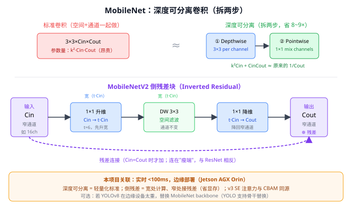

> 📥📤 **输入/输出实例（看一组具体数值）**：I/O 与 09 ResNet **完全相同**（**224×224×3** 图进、1000 类概率 / 特征出），区别只在"怎么算更省"——核心是把标准 3×3 卷积拆成 **depthwise（3×3 逐通道）+ pointwise（1×1 跨通道）**。举个数：一层 $3\times3\times256\to256$ 的标准卷积乘加量约 **5.9 亿**，换成深度可分离后约 **0.7 亿**（≈1/8）。参数量 ~4M（VGG ~138M），所以适合边缘部署——契合本项目"轻量可部署"目标。

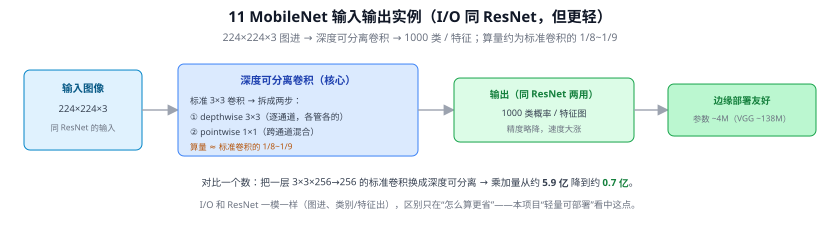

---

> 📄 **论文原图对照**（图源：Howard et al., [arXiv:1704.04861](https://arxiv.org/abs/1704.04861) Figure 2（[PDF](../papers/11_MobileNetV1_1704.04861.pdf)）；Sandler et al., [arXiv:1801.04381](https://arxiv.org/abs/1801.04381) Figure 3（[PDF](../papers/11_MobileNetV2_1801.04381.pdf)）；仅笔记内学习引用，论文写作须自绘）：

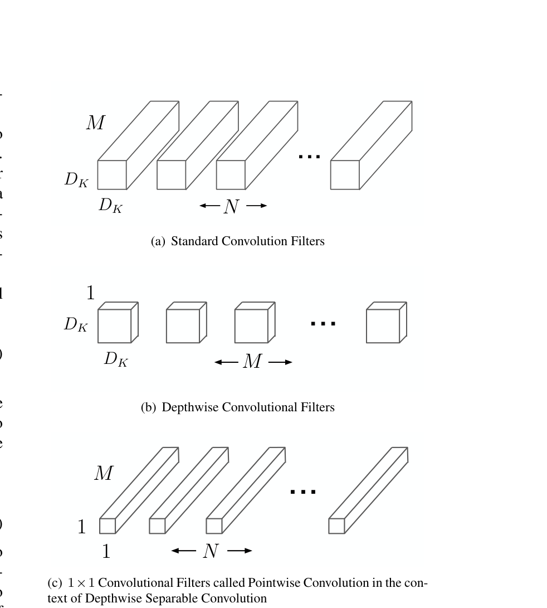

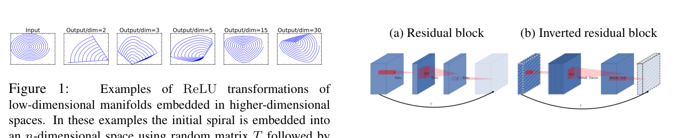

> 上=v1 深度可分离卷积（标准核拆成 depthwise+pointwise）；下=v2 倒残差（两头窄中间宽，对照普通残差块）。

## 一、提出背景

VGG/ResNet 等精度高但太重，无法在手机、嵌入式、边缘设备上实时跑。MobileNet 的目标：**在精度损失尽量小的前提下，把计算量和参数量砍一个数量级**，让 CNN 能在算力受限设备上落地。

---

## 二、核心：深度可分离卷积（Depthwise Separable Conv）⭐

把一次标准卷积**拆成两步**，大幅降低计算：

### 省了多少？
标准卷积参数 $k^2 \cdot C_{in} \cdot C_{out}$（见 Q6）；深度可分离 = $k^2 \cdot C_{in} + C_{in}\cdot C_{out}$。计算量约降为原来的 $\frac{1}{C_{out}} + \frac{1}{k^2}$——对 3×3 卷积约**省 8~9 倍**。

---

## 三、各代演进 ⭐（2.0：逐代讲透）

| 版本 | 年份 | 一句话关键改进 |
|------|------|----------|
| v1 | 2017 | 深度可分离卷积把标准卷积换掉；两个缩放旋钮 α（宽度）、ρ（分辨率） |
| v2 | 2018 | **倒残差（Inverted Residual）+ 线性瓶颈**：两头窄中间宽，残差连在"瘦"端，瓶颈末端去掉 ReLU |
| v3 | 2019 | NAS 搜出结构 + **SE 通道注意力**（15 SE-Net）+ **h-swish** 激活 + 手工重设计头尾 |

### 3.1 v1：把 VGG 的标准卷积全换成深度可分离

一句话概括 v1：**把 VGG 里的标准 3×3 卷积逐层换成"depthwise 3×3 + pointwise 1×1"**，别的骨架照旧。深度可分离本身见上面第二节 + [Q145](#q145-深度可分离卷积具体是怎么算的怎么就省了算力)。v1 额外给了两个**缩放旋钮**，让同一套结构能按算力预算伸缩：

- **宽度乘子 α（width multiplier，典型 1.0/0.75/0.5/0.25）**：把每层通道数 $C\to\alpha C$。计算量、参数量都约按 **α²** 缩小（因为大头是 pointwise 的 $C_{in}\cdot C_{out}$，两项都乘 α）。α=0.5 → 算力≈1/4。
- **分辨率乘子 ρ（resolution multiplier）**：把输入分辨率 224 降到 192/160/128。只影响**计算量**（按 ρ² 缩），不影响参数量（卷积核大小与分辨率无关）。

> **一个反直觉但重要的事实（本项目部署相关）**：v1 里 **约 95% 的计算量和 75% 的参数集中在 1×1 逐点卷积上**，depthwise 那部分反而很便宜。原因是 1×1 卷积可以直接套 **im2col + GEMM（矩阵乘）** 高速库，甚至 1×1 连 im2col 重排都省了、"拿起来就能算"——所以 MobileNet 快不快，很大程度取决于底层 1×1（GEMM）优化得好不好。这解释了为什么在有的定制硬件（如 FPGA 直接实现 3×3 单元）上，深度可分离的理论优势不一定完全兑现。

### 3.2 v2：倒残差 + 线性瓶颈（两头窄、中间宽）

v2 要解决 v1 的一个痛点:**depthwise 卷积在低维通道上做，若前面又刚被 ReLU 砍过，信息容易丢**。两招:

- **倒残差（Inverted Residual）**：普通 ResNet 瓶颈是"**两头宽、中间窄**"（1×1 降维→3×3→1×1 升维，见 Q140）。v2 反过来——"**两头窄、中间宽**"：先用 1×1 **升维**（扩张因子 t=6，通道 ×6）→ 在**高维**上做 depthwise 3×3（此时通道多、depthwise 提取空间特征更充分且仍便宜）→ 再用 1×1 **降维**回瘦通道。残差捷径连在**瘦的两端**（通道少 → 相加省内存/带宽）。所以叫"倒（inverted）"残差。
- **线性瓶颈（Linear Bottleneck）**：瓶颈**降维后的那个 1×1 输出不加 ReLU**（保持线性）。直觉：ReLU 会把负值全拍成 0，在**低维**空间上这种信息破坏很致命（高维时还有别的通道能"绕过去"，低维时绕不过）。所以在窄通道处去掉激活，避免把刚压缩好的信息又砍掉。
- **ReLU6**：激活用 $\min(\max(x,0),6)$（把上限截到 6）。为**低比特定点量化**友好——输出范围有界，量化误差小，利于移动端 int8 部署。

> 记忆钩子:**ResNet 瓶颈"先压后扩省算力"、MobileNetV2"先扩后压保信息"**，形状正好相反（对照 Q140）；末端"去 ReLU"是全篇最反常识、最该记住的一点。

### 3.3 v3：让机器搜结构 + 三个手工优化

v3 不再纯手工设计，而是**NAS（神经架构搜索）搜出主体 + 人工精修头尾**：

- **NAS + NetAdapt**：用平台感知的 NAS 搜整体结构、再用 NetAdapt 逐层微调通道数，直接把"在目标硬件上的实测延迟"作为优化目标（不是只看理论 FLOPs）。
- **SE 通道注意力**（15 SE-Net）：在倒残差块里插入 Squeeze-and-Excitation，给每个通道学一个重要性权重再加权——小代价换精度。与本项目第三章的 **CBAM（16）同源**。
- **h-swish / h-sigmoid**：swish=$x\cdot\text{sigmoid}(x)$ 精度好但 sigmoid 含指数、移动端慢。v3 用**分段线性近似** $\text{h-swish}(x)=x\cdot\frac{\text{ReLU6}(x+3)}{6}$ 替代——几乎同样精度、只用加法和 ReLU6，量化也友好。
- **重设计昂贵层**：手工把网络**头部**（首个卷积核数 32→16）和**尾部**（分类头前的层）改小，这两处对精度影响小、却占了不少延迟。
- 出两个尺寸：**MobileNetV3-Large / -Small**，分别面向高/低算力预算。

> **其他轻量网络**（同一赛道，作了解）：ShuffleNet（分组卷积 + 通道混洗）、GhostNet（廉价生成冗余特征）、EfficientNet（12，复合缩放，思想上承接 v1 的 α/ρ 旋钮）、RepVGG（训练多分支、推理重参数化为单分支，部署极友好）。

---

## 四、与本项目的关系 ⭐

- **直接相关**：本项目要求**实时推理 < 100ms、可边缘部署（Jetson）**，MobileNet 系列是"轻量骨干"的标准答案之一。
- **可选用途**：若 YOLOv8 默认骨干在边缘设备太重，可换 **MobileNet 作 backbone**（YOLO 支持替换骨干）做轻量化对比实验。
- **深度可分离卷积**是理解"如何把网络做轻"的核心，呼应 Q8 对延迟的关注——它是少数"参数少且确实更快（对移动端友好）"的设计。
- v3 用的 **SE 注意力**与本项目第三章的 CBAM（16）同源。

---

## ✏️ 具体实例（动手算一遍）

**例：深度可分离卷积省了多少算力（在 H×W 特征图上，输入 C_in=64、输出 C_out=128、核 3×3）**

标准卷积一次干两件事（空间滤波 + 跨通道混合），计算量（每像素乘加）：
$$3\times3\times64\times128=73{,}728$$

深度可分离把它拆成两步：
- **逐通道卷积（Depthwise）**：每个输入通道单独做 3×3，不跨通道 → $3\times3\times64=576$
- **逐点卷积（Pointwise，1×1）**：再用 1×1 跨通道混合到 128 → $1\times1\times64\times128=8{,}192$
- 合计 $576+8{,}192=8{,}768$

**省约 8.4 倍**（$73728/8768\approx8.4$）。这就是 MobileNet 能在手机/边缘设备实时跑的关键。代价是略损精度，但对延迟敏感场景非常划算——与本项目"边缘部署/实时 <100ms"目标直接相关。

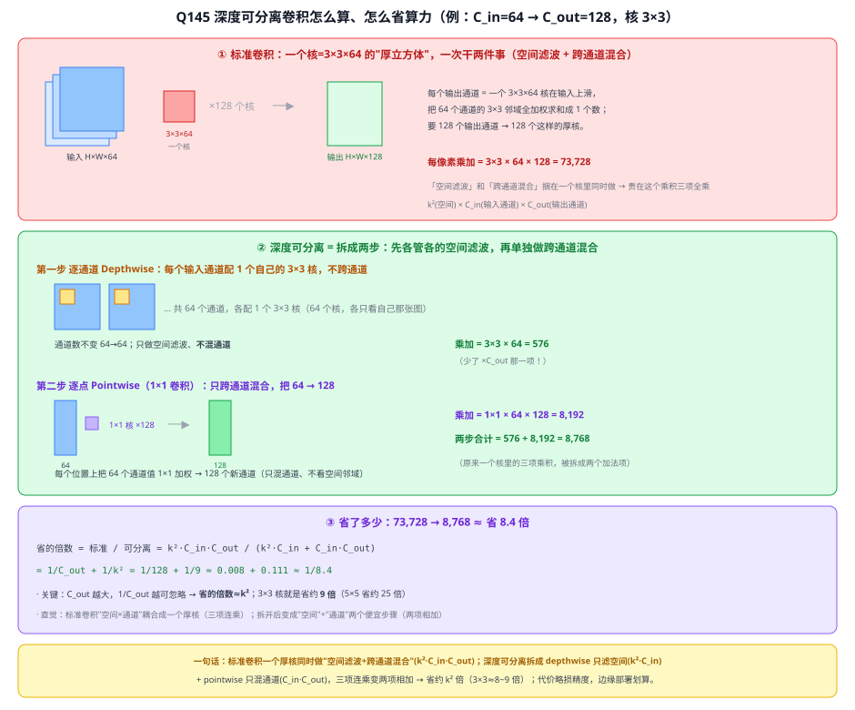

> 图解（详细拆解见 [Q145](#q145-深度可分离卷积具体是怎么算的怎么就省了算力)）：① 标准卷积一个"厚核"3×3×64 同时做空间滤波+跨通道混合，每像素乘加 k²·C_in·C_out=73,728；② 拆成 depthwise（每通道各配一个 3×3 核只滤空间、不混通道，k²·C_in=576）+ pointwise（1×1 只混通道 64→128，C_in·C_out=8,192）；③ 三项连乘变两项相加 → 省 8.4 倍，倍数=1/C_out+1/k²≈1/k²（3×3 约省 9 倍）。

---

## 五、参考文献

- Howard A, et al. *MobileNets: Efficient Convolutional Neural Networks for Mobile Vision Applications.* 2017.（[arXiv:1704.04861](https://arxiv.org/abs/1704.04861)）
- Sandler M, et al. *MobileNetV2: Inverted Residuals and Linear Bottlenecks.* CVPR 2018.（[arXiv:1801.04381](https://arxiv.org/abs/1801.04381)）
- Howard A, et al. *Searching for MobileNetV3.* ICCV 2019.（[arXiv:1905.02244](https://arxiv.org/abs/1905.02244)）

**延伸阅读（本次 2.0 消化来源）**：
- R.JD，《轻量级神经网络"巡礼"（二）—— MobileNet，从V1到V3》，知乎专栏，2019。<https://zhuanlan.zhihu.com/p/70703846>（本笔记 v2/v3 讲解与"1×1=速度瓶颈/im2col+GEMM"洞见参考自此文，已用自己的话重写，未转载原文）

---

## 📋 模型答疑（来自模型详解问答）

> 专属本模型的问答集中在此；跨模型的通用问答见答疑总目录。

---

## Q145. 深度可分离卷积具体是怎么算的？怎么就省了算力？

> 📌 **本条讲"怎么算、省多少 + 手把手最小例子"**；更深的"为什么连乘/为什么相加/为什么效果不变 + 空间与通道 + 逐点 1×1 矩阵账与用途"见下一条 [Q147](#q147-从标准卷积算起为什么标准卷积是连乘拆开后变相加参数少了效果却基本不变)（已并入原 Q148）。两条同讲深度可分离卷积这一个概念。

**简答**：标准卷积把"空间滤波"和"跨通道混合"捆在一个 k×k×C_in 的厚核里一次做完，代价 k²·C_in·C_out。深度可分离把这两件事**拆开**：先 depthwise 逐通道只滤空间（k²·C_in），再 pointwise 用 1×1 只混通道（C_in·C_out）。原来的三项连乘变成两项相加，所以省下约 k² 倍。

**展开**：

**① 标准卷积为什么贵：一个厚核，三项连乘**
要产生**一个**输出通道，就用一个 3×3×64 的"厚立方体"核在输入上滑，把 64 个输入通道的 3×3 邻域**全部加权求和**成 1 个数——空间滤波（3×3）和跨通道混合（64→1）**同时**做。要 128 个输出通道就要 128 个这样的厚核。每像素乘加：
$$k^2 \times C_{in} \times C_{out} = 3\times3\times64\times128 = 73{,}728$$
贵就贵在 **k²（空间）、C_in（输入通道）、C_out（输出通道）三项全乘**在一起。

**② 拆成两步：各管一件事**
- **第一步 Depthwise（逐通道）**：每个输入通道**只配 1 个** 3×3 核、只在自己那张图上滤空间，**不跨通道** → 64 个通道各做各的、输出仍是 64 通道。乘加 = k²·C_in = 3×3×64 = **576**（**少了 ×C_out 那一项**）。
- **第二步 Pointwise（逐点，1×1 卷积）**：在每个空间位置上，把 64 个通道值用 1×1 卷积**加权混合**成 128 个新通道，**只混通道、不看空间邻域**（就是 Q39 的"1×1=对所有通道线性组合"）。乘加 = C_in·C_out = 64×128 = **8,192**。
- 合计 576 + 8,192 = **8,768**。

**③ 省了多少：三项连乘 → 两项相加**
$$\frac{\text{标准}}{\text{可分离}} = \frac{k^2 C_{in} C_{out}}{k^2 C_{in} + C_{in} C_{out}} = \frac{1}{C_{out}} + \frac{1}{k^2} = \frac{1}{128}+\frac{1}{9} \approx \frac{1}{8.4}$$
**C_out 越大，1/C_out 越可忽略 → 省的倍数 ≈ k²**：3×3 核省约 **9 倍**、5×5 省约 25 倍。直觉：标准卷积把"空间×通道"耦合成一个厚核（三项连乘），拆开后变成"空间"+"通道"两个便宜步骤（两项相加）。

> 对照 Q140：ResNet 瓶颈用 1×1 降维把 3×3 保护在低通道数上省算力，MobileNet 更彻底——直接把 3×3 从"跨通道"里解放出来（depthwise 不混通道），跨通道的活全交给便宜的 1×1。两者都在"少乘一项 C"上做文章。


**④ 手把手算一遍（最小例子，跟着数就懂"计算过程"）**

前面讲的是"省多少"的公式；这里用一个**能用手指头数完**的最小例子，把每一次乘加都摆出来。**输入 2 个通道、每个 3×3；要算 2 个输出通道 A、B；核 3×3**：
```
通道1 X1（全1）      通道2 X2（全2）
1 1 1               2 2 2
1 1 1               2 2 2
1 1 1               2 2 2
```

**先看标准卷积（一个"厚核"一次吃掉两个通道的 9 格）**：
产生输出 A 用一对核（通道1核 K1 全1、通道2核 K2 全1）：
$$A=\underbrace{(1{\times}1+\dots\text{共9个})}_{\text{X1×K1}=9}+\underbrace{(2{\times}1+\dots\text{共9个})}_{\text{X2×K2}=18}=27$$
数一下乘法：通道1 用 9 次、通道2 用 9 次 → **一个输出数 A 花 18 次乘法**（=k²·C_in）。再用另一对核算输出 B（K1'全1、K2'全0）：B=9+0=9，又 18 次。**两个输出通道合计 18+18=36 次**（=k²·C_in·C_out=9×2×2）。关键：厚核把"空间 9 格"和"跨 2 通道"**揉在一次求和**里。

**再看深度可分离（拆成两步）**：
- **第一步 Depthwise**：通道1、通道2 各配 1 个自己的 3×3 核、**各算各的不混**：
  - 通道1：dw1 = X1 的 9 格 × D1(全1) = 1×9 = **9**（只碰通道1，9 次乘法）
  - 通道2：dw2 = X2 的 9 格 × D2(全1) = 2×9 = **18**（只碰通道2，9 次乘法）
  - → 得 2 个中间值 **[9, 18]**，彼此没混；乘法 = 9+9 = **18**。
- **第二步 Pointwise（1×1）**：把 [dw1,dw2] 这 2 个值加权混成输出、**不看空间邻域**：
  - 输出 A：权重[1,1] → 1×9+1×18 = **27**（2 次乘法）
  - 输出 B：权重[1,0] → 1×9+0×18 = **9**（2 次乘法）
  - → 输出 A=27、B=9（**和标准卷积一模一样**）；乘法 = 2+2 = **4**。
- **合计 depthwise 18 + pointwise 4 = 22 次** vs 标准 36 次。

> 为何这个小例子只省一点点？因为 C_out 太小（=2）。**depthwise 的 18 是"固定开销"、被所有输出通道共享**，只有 pointwise 那部分随 C_out 涨（每个输出通道才 2 次）——真实网络 C_out=128/256 时，标准是 18·C_out 直线猛涨、可分离是 18+2·C_out 几乎平，所以省到约 k²≈9 倍。这也解释了公式里为什么有个 1/C_out 项（C_out 小时省得少、大时才逼近 k²）。

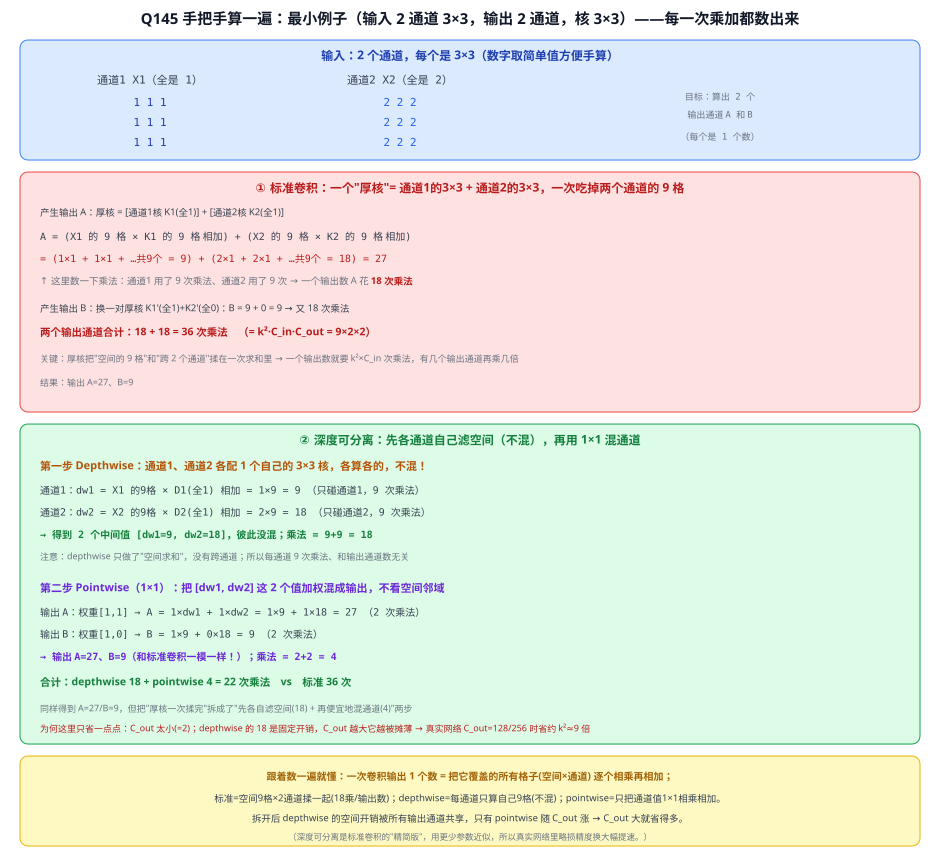

**⑤ 一句话**
标准卷积一个厚核同时做"空间滤波+跨通道混合"（k²·C_in·C_out）；深度可分离拆成 **depthwise 只滤空间**（k²·C_in）+ **pointwise 只混通道**（C_in·C_out），三项连乘变两项相加 → 省约 **k² 倍**（3×3≈8~9 倍）；略损精度换大幅提速，边缘部署划算。**一次卷积输出 1 个数 = 把它覆盖的所有格子（空间×通道）逐个相乘再相加**——标准把空间和通道揉一起、深度可分离把这两件事拆成两个便宜步骤。

---

## Q147. 从标准卷积算起：为什么标准卷积是"连乘"、拆开后变"相加"、参数少了效果却基本不变？

**连乘 = 三层嵌套循环**（输出通道×输入通道×空间窗，三件事捆一个厚核）、**相加 = 拆成"只滤空间"+"只混通道"两个操作顺序执行**（各自只背两个因子）、**参数少效果不变 = 对过参数化且空间/通道近似可分的标准卷积做低秩近似**（精度只掉约 1%）。

**① 为什么连乘**：标准卷积用一个厚核把"空间滑动×跨通道混合×多输出通道"三件事耦合在一次操作，三因子只能连乘。数字：3×3×64×128 = **73,728**。

**② 为什么拆完变相加**：
- **Depthwise（只滤空间）**：C_in 个 k×k 核、一核只卷自己通道、不混通道 → 循环剩 C_in×k²（丢 C_out）= 3×3×64 = **576**；
- **Pointwise（1×1，只混通道）**：C_out 个 1×1×C_in 核、每像素把 C_in 值线性组合成 C_out、不看空间 → 循环剩 C_out×C_in（丢 k²）= 64×128 = **8,192**；
- 三因子嵌套（连乘）→ 拆成两操作先后做、谁都不同时背三因子 → 代价**相加** 576+8192 = **8,768**（省 8.4 倍），参数量同理。

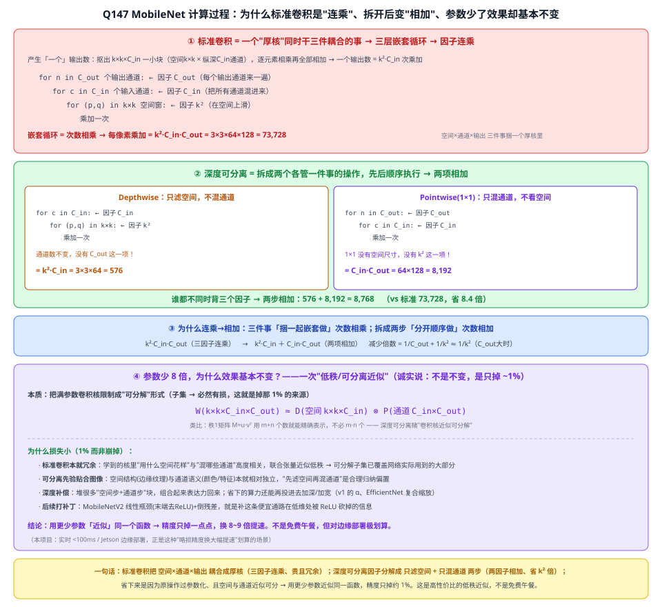

**③ 为什么效果基本不变（低秩/可分离近似）**：不是完全不变、是掉约 1% top-1 换 8~9 倍算力。本质是把满参数核限制成可分解形式 $W\approx D_{空间}\otimes P_{通道}$（严格子集、必然有损=那 1%）。损失小因：①标准卷积本就冗余（空间花样与通道混合高度相关、联合张量近似低秩）；②可分离先验贴合图像（空间结构与通道语义相对独立）；③深度补偿（堆多块表达力回来、省下算力再投加深加宽）；④V2 线性瓶颈+倒残差打补丁。对本项目"实时<100ms/Jetson 边缘"极划算。

> 对照 ResNet 瓶颈（1×1 降维把 3×3 保护在低通道）：两者都在"少乘一个 C 因子"上做文章，MobileNet 更彻底（depthwise 丢 C_out、跨通道全交便宜的 1×1）。

**④ 空间 vs 通道（地基）**：张量 H×W×C = **C 张 H×W 胶片叠一摞**。**空间** = 单张胶片内"在哪（位置）"、卷积滑窗/池化动它；**通道** = "第几张胶片（哪种特征）"、每通道 = 一个特征探测器的整张响应图。所以 **Depthwise = 只在空间动**（每张胶片各自 k×k 滤波、不跨胶片）、**Pointwise = 只在通道动**（一根针扎穿、把 C 个通道值加权组合、不看邻域）、**标准卷积 = 空间和通道同时动**（三因子连乘的来源）。

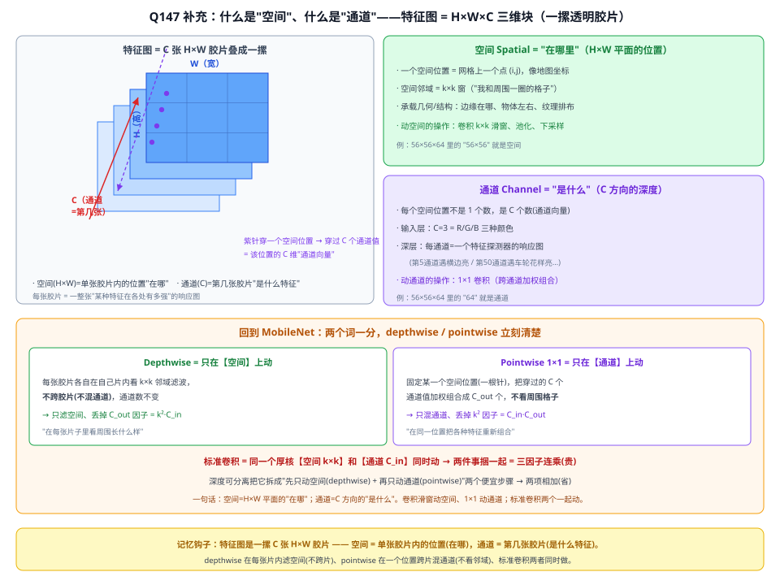

**⑤ 逐点 1×1 矩阵账（64→128）**：一个像素 (1×64)×(64×128)=(1×128)——输入 x=该像素 64 通道值行向量、W=64×128（64 行输入通道、128 列输出通道、第 n 列=第 n 个 1×1×64 滤波器）、输出 y=xW 新 128 维通道向量，每个输出数是一次 64 维点乘，乘加=8192。整张图**同一个 W 在每像素复用**（权重共享）→ 摊平成 (H·W×64)×(64×128)= 一次 **GEMM 大矩阵乘**（GPU 飞快、连 im2col 都不用），这就是 MobileNet ~95% 算力压在 1×1 的由来。

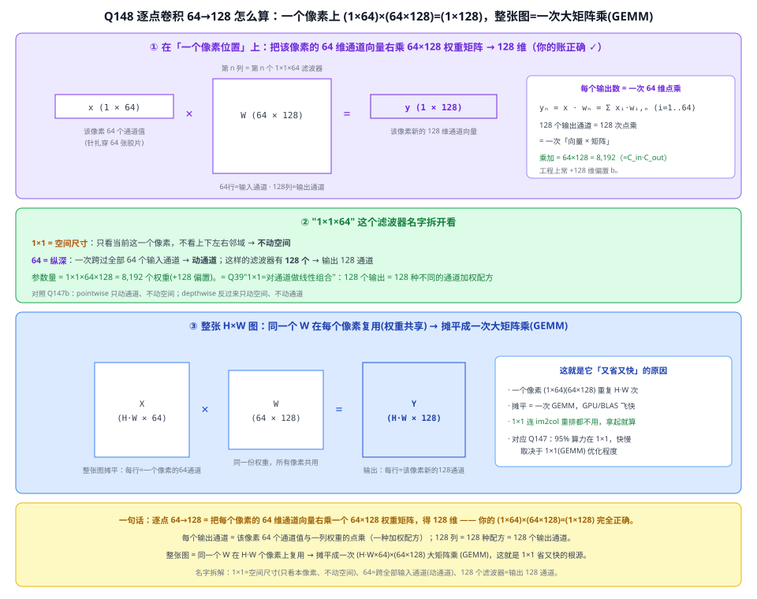

**⑥ 1×1 到底干嘛**：= 在通道维度做全连接（线性重组）、只混通道不看空间。例：某像素 4 通道 [横边缘2,竖边缘0,红3,纹理1]，2 个 1×1 滤波器 [1,1,0,0]→2（边缘类）、[0,0,1,1]→4（外观类）→ 输出 [2,4]（4 通道重配成 2 主题通道）。四大用法：降维省算力（ResNet/GoogLeNet 瓶颈）、升维扩张（V2 倒残差 24→144）、depthwise 后混通道（本例）、通道对齐/注意力 FC（SE）。**depthwise 通道间完全不通气，必须靠后面 1×1 把通道搅拌一遍**——这两步分工就是深度可分离卷积。

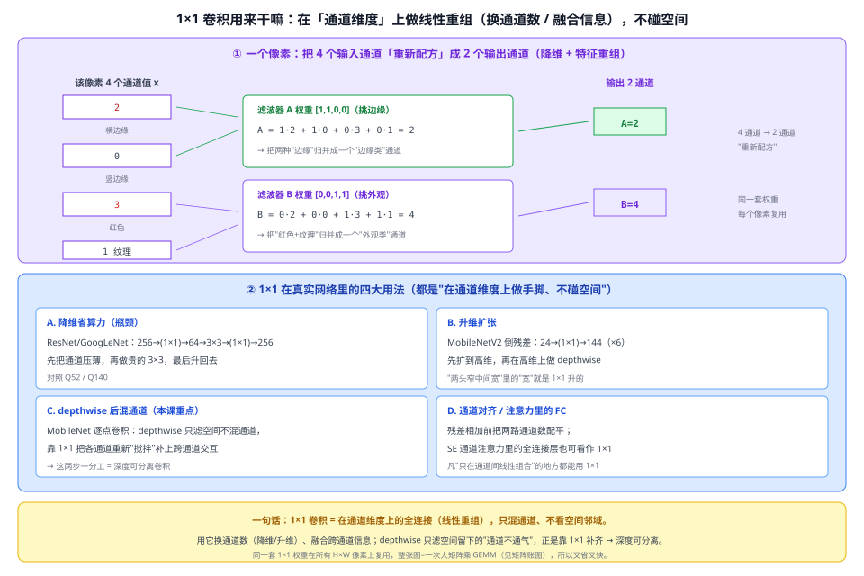

## Q152. MobileNetV2 的"倒残差（Inverted Residual）"是什么？

**简答**：倒残差把 ResNet 瓶颈的"两头宽中间窄"倒成"两头窄中间宽"：先 1×1 升维到高维、在高维做 depthwise 3×3、再 1×1 降回窄通道，残差连窄端。目的是让便宜的 depthwise 在通道充足的高维上充分提特征，同时残差在窄端相加省内存。再配"线性瓶颈"（降维末端去 ReLU 保住低维信息）和 ReLU6（量化友好）。

**展开**：

**① 形状：两头窄、中间宽（与 ResNet 镜像）**
- ResNet 瓶颈：`宽(256) → 1×1降维 → 窄(64) → 3×3 → 1×1升维 → 宽(256)`，残差连**宽**端。目的是把贵的 3×3 保护在低通道上省算力（Q140）。
- V2 倒残差：`窄(24) → 1×1升维(×6) → 宽(144) → depthwise 3×3 → 1×1降维 → 窄(24)`，残差连**窄**端。

**② 为什么这样倒**
- depthwise 卷积很便宜，但在**低维**通道上做，能提取的信息有限；先 1×1 升到高维再做 depthwise，让它在**通道充足**处充分滤空间。
- 残差捷径连在窄的两端：通道少 → 相加时的张量小 → **省内存/带宽**（移动端很关键）。

**③ 线性瓶颈：降维末端为什么去 ReLU**
瓶颈把高维压回低维后，若再加 ReLU，会把负值全拍成 0——在**低维**空间这种破坏是致命的（维度少，没有多余通道"绕过"被砍掉的信息）。所以在这个窄输出处**保持线性**，避免把刚压缩好的信息又砍掉。这也是 V2 论文名字"Linear Bottleneck"的由来。

**④ ReLU6：为量化友好**
把激活上限截到 6（$\min(\max(x,0),6)$）。输出范围有界 → 低比特定点量化（int8）时量化误差小，利于移动端部署。

> 与本项目：MobileNet 系列是"轻量骨干"的候选（[§四](#四与本项目的关系-)），倒残差块是 V2/V3 的基本积木；理解它有助于在边缘部署（Jetson、实时<100ms）时做骨干轻量化对比。v3 在倒残差块里还塞了 SE 注意力（15）+ h-swish（见 [§3.3](#33-v3让机器搜结构--三个手工优化)）。

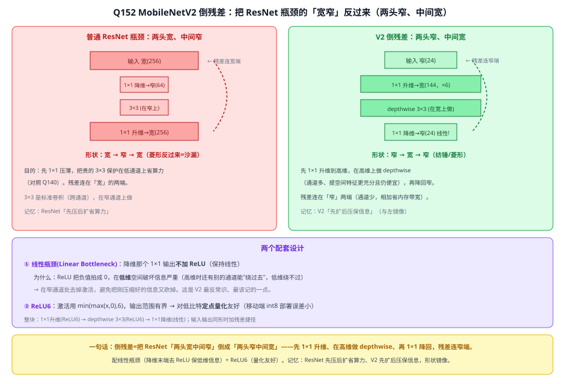

---
