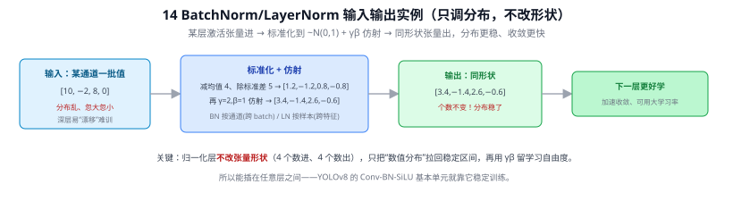
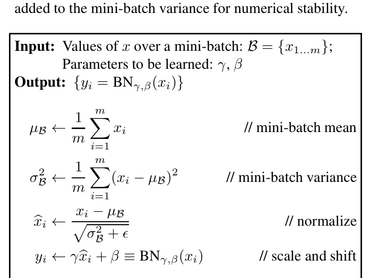
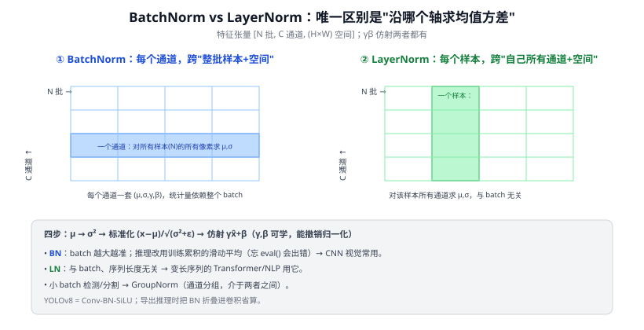
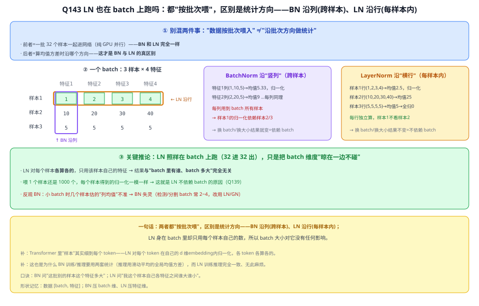
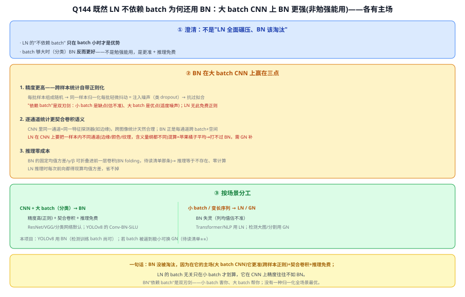
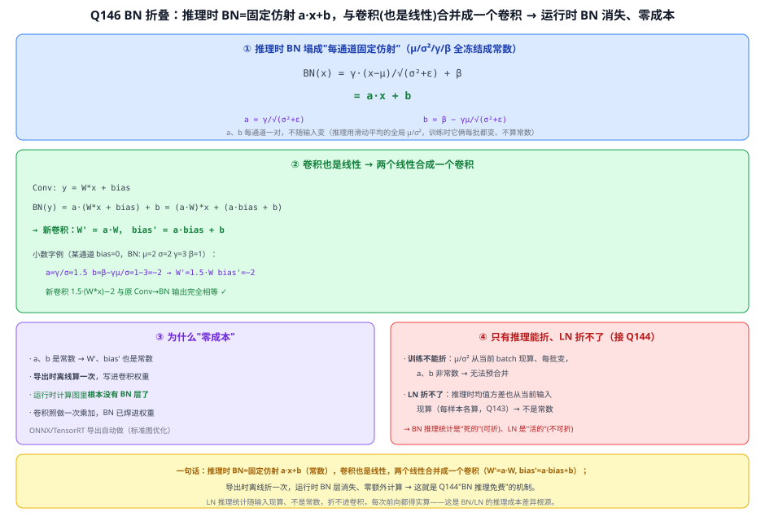

# 14 批归一化：BatchNorm 与 LayerNorm

> 即插即用模块与组件 · 之一　|　⬅ 返回目录
> 关键词：内部协变量偏移 / 标准化 / γβ 仿射 / 训练-推理双模式 / BN vs LN
> **输入 / 输出**：某层激活张量 → 同形状的归一化张量（+γβ 仿射，不改形状）

---

> 📥📤 **输入/输出实例（看一组具体数值）**：输入某层激活（取某通道一批值 $[10,-2,8,0]$，分布忽大忽小、深层易漂移难训）→ 标准化（减均值 4、除标准差 5 → $[1.2,-1.2,0.8,-0.8]$）→ γβ 仿射（$\gamma{=}2,\beta{=}1$ → $[3.4,-1.4,2.6,-0.6]$）→ 输出**同形状**（4 个数进 4 个数出），只是分布拉回稳定区间。**不改张量形状、只调分布**，所以能插在任意层之间；BN 按通道（跨 batch）、LN 按样本（跨特征）。YOLOv8 的 Conv-BN-SiLU 基本单元就靠它稳定训练、加速收敛。



> 📄 **论文原图对照**（图源：Ioffe & Szegedy, *Batch Normalization*, [arXiv:1502.03167](https://arxiv.org/abs/1502.03167) Algorithm 1，原文 [PDF](../papers/14_BatchNorm_1502.03167.pdf)（LayerNorm 原文 [PDF](../papers/14_LayerNorm_1607.06450.pdf) 以公式为主无架构图）；仅笔记内学习引用，论文写作须自绘）：



> BN 变换原始算法框：算 mini-batch 均值方差→标准化→γ、β 缩放平移（可学习，保留表达力）。

## 一、提出背景：深层网络为什么难训

2015 年以前，训练很深的网络要小心翼翼地调学习率、做权重初始化，稍有不慎就梯度爆炸或停滞。Ioffe & Szegedy（2015）把症结归纳为 **内部协变量偏移（Internal Covariate Shift, ICS）**：每一层的输入分布会随着前面层参数更新而不断漂移，后面的层永远在追一个"移动的靶子"，收敛因此很慢。

> 注：后续研究（Santurkar 2018）指出 BN 真正起作用的原因更可能是"**让损失曲面更平滑**"，而非消除 ICS。但无论机制解释如何，BN 的工程效果是确凿的。

归一化的核心思想：**把每一层的输入强行拉回一个稳定的分布（均值 0、方差 1），再用两个可学习参数让网络自己决定要不要偏移回去。** 这样后层看到的输入分布稳定，可以用更大的学习率、对初始化不敏感，训练又快又稳。

---

## 二、核心原理：标准化 + 仿射

对一批激活值 $x$，BatchNorm 做四步：

$$\mu=\frac1m\sum_{i=1}^m x_i,\qquad \sigma^2=\frac1m\sum_{i=1}^m (x_i-\mu)^2$$
$$\hat{x}_i=\frac{x_i-\mu}{\sqrt{\sigma^2+\epsilon}},\qquad y_i=\gamma\,\hat{x}_i+\beta$$

- 前两步算这批数据的**均值、方差**；
- 第三步**标准化**成均值 0、方差 1（$\epsilon$ 防除零）；
- 第四步用**可学习的缩放 $\gamma$ 和平移 $\beta$** 仿射变换——这一步至关重要：它让网络有能力"撤销"归一化（若 $\gamma=\sqrt{\sigma^2},\beta=\mu$ 就还原了），即**是否归一化、归一化到什么程度，交给网络自己学**，而不是强制写死。

$\gamma,\beta$ 是参数（训练学、推理固定），$\mu,\sigma$ 是由当前输入算出的统计量——这点和注意力权重"由输入现算"有相通之处（见 42 答疑 对"参数 vs 现算量"的区分）。

### 在"沿哪个轴求统计量"上分流：BN vs LN

这是理解各种归一化的钥匙。一个 CNN 特征张量形状是 `[N, C, H, W]`（批、通道、高、宽）：

```
BatchNorm：对每个通道 C，沿 (N,H,W) 求均值方差  → 统计量跨"整批样本"
LayerNorm：对每个样本 N，沿 (C,H,W)/(特征维) 求 → 统计量只在"单个样本内"
```

- **BatchNorm**：每个通道一套 $(\mu,\sigma,\gamma,\beta)$，统计量**依赖整个 batch**。批越大估计越准。
- **LayerNorm**：对**单个样本自己的所有特征**做归一化，**与 batch 无关**。



---

## 三、训练与推理的双模式（最易踩坑）

BN 在训练和推理时行为**不同**，这是工程上最常见的 bug 来源：

| | 训练 | 推理 |
|---|------|------|
| $\mu,\sigma$ 来源 | 当前 mini-batch 实时算 | **训练阶段累积的滑动平均**（running mean/var） |
| 为什么 | 要让梯度能传 | 推理常单张图、无"批"可言，且需结果确定 |

训练时一边用 batch 统计量、一边用动量更新 `running_mean = (1-m)·running_mean + m·μ_batch`；推理时冻结这套全局统计量。**忘记切到 eval 模式**（PyTorch 的 `model.eval()`）会让推理结果错乱——这是初学者最常见的坑。

### BN 的副作用与局限
- **依赖 batch size**：batch 太小（如检测/分割常见的 1~2）时统计量噪声大，性能掉。→ 催生 GroupNorm、LN。
- **训练/推理不一致**：上面的双模式。
- **不适合变长序列**：RNN/Transformer 每个时间步长度不一，BN 的"跨批同位置"统计没意义 → NLP 改用 LN。

---

## 四、为什么 Transformer 用 LayerNorm

Transformer（28 Transformer）处理变长序列、且常用大模型小 batch，BN 的"跨样本统计"既不稳也不合适。LN **对每个 token 自己的特征向量做归一化**，与 batch、与序列长度都无关，天然契合。所以：

- **CNN 视觉** → 多用 **BatchNorm**（batch 较大、空间结构规整）
- **Transformer/NLP** → 用 **LayerNorm**
- **小 batch 检测/分割** → 常用 **GroupNorm**（把通道分组求统计，介于 BN 和 LN 之间）

近年 Pre-LN（把 LN 放在残差子层之前）比原始 Post-LN 更稳，是大模型的标配。

---

## ✏️ 具体实例（动手算一遍）

设某层一个通道在一个 batch 上有 4 个激活值 $x=[2,\ 4,\ 6,\ 8]$，$\gamma=2,\ \beta=1,\ \epsilon\approx0$：

1. 均值 $\mu=\frac{2+4+6+8}{4}=5$
2. 方差 $\sigma^2=\frac{(2-5)^2+(4-5)^2+(6-5)^2+(8-5)^2}{4}=\frac{9+1+1+9}{4}=5$，$\sigma=\sqrt5\approx2.236$
3. 标准化 $\hat{x}=\frac{x-5}{2.236}=[-1.342,\ -0.447,\ 0.447,\ 1.342]$（均值 0、方差 1）
4. 仿射 $y=2\hat{x}+1=[-1.684,\ 0.106,\ 1.894,\ 3.684]$

可见：原始数据被拉到标准分布后，再由 $\gamma,\beta$ 重新缩放平移。若网络发现"不归一化更好"，它可以学到 $\gamma=\sigma=2.236,\beta=\mu=5$ 把数据还原回 $[2,4,6,8]$——**归一化与否是可学的**。

> 参数量：BN 每个通道仅 2 个可学参数（$\gamma,\beta$）+ 2 个 buffer（running mean/var，不参与梯度）。相对卷积层参数（06 答疑 Q41：$k^2 C_{in}C_{out}$）几乎可忽略，却能显著加速收敛。

---

## 五、与本项目的关系

- **YOLOv8 全身都是 `Conv-BN-SiLU`**：每个卷积后接 BN，是训练能收敛、能用大学习率的关键。理解 BN 才看得懂为什么导出 ONNX 时要做"**BN 折叠（fold BN into Conv）**"——推理时 BN 是固定线性变换，可合并进前一个卷积省算（呼应 25 YOLO演进 的部署优化）。
- **第三章加 CBAM/P2 后**：新模块同样要配 BN 才稳；小目标检测若 batch 偏小，需留意 BN 统计噪声，必要时换 GroupNorm。
- **CLIP 的 ViT 用 LayerNorm**：用 CLIP（33 CLIP）时，明白 ViT 内部是 LN 而非 BN，才理解它为何对 batch 大小不敏感、可单张图稳定推理。

---

## 参考文献

1. Ioffe S, Szegedy C. **Batch Normalization: Accelerating Deep Network Training by Reducing Internal Covariate Shift.** ICML 2015.
2. Ba J L, Kiros J R, Hinton G E. **Layer Normalization.** arXiv 2016.
3. Wu Y, He K. **Group Normalization.** ECCV 2018.
4. Santurkar S, et al. **How Does Batch Normalization Help Optimization?** NeurIPS 2018.

---

## 📋 模型答疑（来自模型详解问答）

> 专属本模型的问答集中在此；跨模型的通用问答见答疑总目录。

---

## Q139. LayerNorm 是每个样本归一化，最初就是"一个一个样本训练"这样吗？BatchNorm 怎么发现的？GroupNorm 是把 batch 分成多个 group 吗？

**简答**：① LN 的"每样本独立"是被 BN"依赖 batch"的缺陷**逼出来的补丁**（2016 晚于 BN 2015），不是深度学习早期默认——早期压根没有归一化层。② BN 来自"内部协变量偏移"的观察：强制把每层输入分布钉在均值0方差1，用 γ/β 保留表达力。③ GN 分的是**通道不是 batch**、**不跨样本**，是 LN↔InstanceNorm 之间的连续谱，与"把 batch 再分组"无关。

**展开**：

**① LayerNorm 的"每样本归一化"不是历史起点，是对 BN 的补丁**
真实时间线：**BN(Ioffe & Szegedy, 2015)** 先出现，沿 batch 方向统计 → 天生依赖"一批多个样本"；**LN(Ba et al., 2016)** 后出现，为摆脱 BN 对 batch 的依赖，改成"每个样本在自己的特征维度内归一化、不跨样本"。早期感知机/MLP 时代没有归一化层这个东西，靠调学习率和小心初始化硬训。"一个一个样本训练"（batch=1 的 SGD）早期确实常见，但那时**没有归一化**——不能说成"用了 LN"。

**② BatchNorm 是怎么发现的：钉住漂移的输入分布**
动机 = **Internal Covariate Shift（内部协变量偏移）**：训练时每层参数都在更新，导致该层输出的分布**一直在变**，下一层就得反复适应这个漂移的输入——像追一个一直移动的靶子，训练慢、易梯度爆炸/消失。解法很直接：在每个 mini-batch 上，把该层每个通道的激活减均值除标准差拉成均值0方差1，再用两个可学习参数 **γ、β 缩放平移回去**（万一标准正态不是最优，网络能学着调回来）——这就是原文 **Algorithm 1** 四步（入库图）。效果：能用大得多的学习率、收敛快数倍、自带轻微正则。
> 科学史补注：后来 Santurkar et al.(2018) 发现 BN 真正起作用的原因**可能不是**"消除 covariate shift"，而是**让损失曲面更平滑**、梯度更稳——"BN 为何有效"至今有争论，但"确实有效"没争议。这是深度学习常态：先经验发现管用，理论解释慢慢补。

**③ 分家的本质：沿什么方向统计**
BN 的硬伤：沿 batch 方向统计 → **batch 小时几个样本估的均值方差不准** → BN 失灵。而检测/分割（图大显存紧、batch 常 2~4，**本项目会遇到**）和 RNN/Transformer（序列变长难对齐）恰恰 batch 小。于是分化：

| 方法 | 沿什么方向算均值方差 | 依赖 batch | 典型场景 |
|------|--------------------|-----------|---------|
| **BatchNorm** | 每通道，跨 **batch 内所有样本**+空间 | **是** | CNN 分类、大 batch |
| **LayerNorm** | 每样本，跨**它自己所有特征** | 否 | Transformer/NLP |
| **GroupNorm** | 每样本，把通道分 G 组、**每组内**算 | 否 | 检测/分割、小 batch |

**④ GroupNorm 的关键修正：分 channel 不分 batch、不跨样本**
你问"GN 是不是把 batch 再分成多个 group"——**不是**。GN 分的是**通道**：每个样本自己有 C 个通道（如 256），GN 把它们分成 G 组（如 32 组、每组 8 通道），在每组的通道+空间内算均值方差。整个过程**一个样本一个样本独立做**，不看 batch 里的别人 → 与 batch 大小无关、batch=1 也能用。把 GN 看成 **LN↔InstanceNorm 之间的连续谱**（都不依赖 batch）：
- **G=1**（所有通道一组）→ 就是 **LayerNorm**；
- **G=C**（每通道自己一组）→ 就是 **InstanceNorm**；
- **G=32 等中间值** → GroupNorm。

所以：GN **不是"分 batch"是"分 channel"**，**不是"小批量的 BN"反而是"把 LN 的一整块特征切成几组"**。你"不依赖 batch"的直觉方向对（GN 就是为小 batch 救场），但机制上 BN 靠跨样本、GN 靠切通道，是两条路。

**⑤ 一句话**
LN 的每样本归一化是 2016 年为救 BN 依赖 batch 的毛病才出现的（不是早期默认，早期没有归一化）；BN(2015) 因"内部协变量偏移"而生、靠 mini-batch 统计+γβ 缩放；GN 分的是**通道不是 batch**、完全不跨样本，是 LN 与 InstanceNorm 之间的连续谱，与"把 batch 分组"无关。

---

## Q143. 训练时数据都是按批次处理的，那 LayerNorm 到底怎么进行？

**简答**：LN 也在 batch 上跑，只是它不沿 batch 方向统计——对 batch 里每个样本**独立地**在该样本自己的特征维度内算均值方差归一化，样本之间互不参与。所以 batch 只是"数据一起流过"的容器，LN 根本不碰这个维度。

**展开**：

**① 别混两件事**
- **"数据按批次喂入"**：一批 32 个样本一起进网络，纯为 GPU 并行——BN 和 LN 都这样；
- **"沿批次方向做统计"**：算均值方差时沿哪个方向——这才是 BN 与 LN 的真区别。

**② 用一个 batch（3 样本 × 4 特征）看清方向**
```
        特征1  特征2  特征3  特征4
样本1:    1     2     3     4
样本2:    10    20    30    40
样本3:    5     5     5     5
```
- **BatchNorm 沿"竖列"（跨样本）**：特征1列 (1,10,5)→均值5.33 归一化、特征2列 (2,20,5)→均值9……**每列用到 batch 所有样本** → 样本1的特征1 结果依赖样本2/3（同批）。这是 BN 依赖 batch 的根源。
- **LayerNorm 沿"横行"（每样本内）**：样本1行 (1,2,3,4)→均值2.5 归一化这一行、样本2行 (10,20,30,40)→均值25、样本3 (5,5,5,5)→均值5→全归0。**每行独立算，样本1从头到尾不看样本2**。

**③ 关键推论：LN 把 batch 维度晾在一边**
LN 照样 32 进 32 出，只是对每个样本各算各的、只用该样本自己的特征 → 结果**与"batch 里有谁、batch 多大"完全无关**。喂 1 个样本还是 1000 个，每个样本得到的归一化一模一样 → 这就是 LN 不依赖 batch（Q139）。反观 BN：小 batch 时几个样本估的"列均值"不准 → BN 失灵（检测/分割 batch 常 2~4，改用 LN/GN）。

**④ 两个连带结论**
- **Transformer 里"样本"细到每个 token**：LN 对每个 token 在自己的 d 维 embedding 内归一化，各 token 各算各的（Q120 的 position-wise 同理，都是"逐 token 独立"）。
- **BN 需要训练/推理两套统计**（推理用滑动平均的全局均值方差，否则单张图没法算 batch 统计），而 **LN 训练推理完全一致、无此麻烦**——因为它压根不用 batch 统计（呼应本文第三节双模式）。



**⑤ 一句话**
两者都"按批次喂"，区别是统计方向——**BN 沿列（跨样本）、LN 沿行（每样本内）**；LN 身在 batch 里却只用每个样本自己的数，所以 batch 大小对它没有任何影响。口诀：**BN 压 batch 维、LN 压特征维**。

---

## Q144. 既然 LN 不依赖 batch、还没有那些麻烦，为什么还用 BatchNorm？

**简答**：LN 的 batch 无关只在小 batch 才划算；在大 batch CNN 分类里 BN 反而更准（跨样本统计带来正则化 + 逐通道契合卷积）、而且推理时能折叠进卷积零成本。所以按场景分工，不是谁淘汰谁。

**展开**：

**① 先纠一个预设：不是"LN 全面碾压 BN"**
LN 的"不依赖 batch"**只在 batch 小时才是优势**；batch 够大时 BN 反而更好——不是勉强能用，是更准 + 推理免费。

**② BN 在大 batch CNN 上赢在三点**
1. **精度更高——跨样本统计自带正则化**：BN 用整批样本估均值方差，每批样本组成随机 → 同一样本的归一化结果每批轻微抖动 = 给训练注入噪声（类似 dropout）→ 抗过拟合、泛化更好。LN 对每个样本确定性地算、没有 batch 噪声 → 少了这份免费正则。**"依赖 batch"是双刃剑**：小 batch 时估不准是缺点（Q143），大 batch 时适度噪声是优点。
2. **逐通道统计更契合卷积语义**：CNN 里同一通道 = 同一特征探测器（如"边缘探测器"），它在不同图像上的响应本就该放一起统计——BN 正是"每通道跨 batch+空间"归一化，天然合理。LN 在 CNN 上要把一个样本内**所有不同通道**（边缘/颜色/纹理，含义量纲都不同）混在一起算均值，像苹果橘子平均，不自然 → 直接用在 CNN 上往往打不过 BN，要用 GN 按通道分组来补（Q139）。
3. **推理零成本**：BN 推理时那套固定的均值方差、γ、β 可**折叠进前一层卷积**（BN folding），推理时等于不存在、零额外计算；LN 推理时每次前向都要现算均值方差，省不掉。

**③ 按场景分工**
| 场景 | 用什么 | 为什么 |
|------|-------|-------|
| **CNN + 大 batch（分类）** | **BN** | 精度高（正则）+ 契合卷积 + 推理免费 → ResNet/VGG/分类网络默认；YOLOv8 的 Conv-BN-SiLU |
| **小 batch / 变长序列**（检测大图、分割、NLP、Transformer） | **LN / GN** | BN 失灵（列均值估不准）→ Transformer/NLP 用 LN、检测/分割用 GN |

> 本项目：YOLOv8 用 BN（检测训练 batch 尚可，BN 的好处成立）；若某场景把 batch 逼到极小，可考虑换 GN（待读清单 ⭐⭐ 那条）。

**④ 一句话**
BN 没被淘汰，是因为在它的主场（大 batch CNN）它**更准**（跨样本正则）+ 契合卷积 + **推理免费**；LN 的 batch 无关只在小 batch 才划算，它在 CNN 上精度往往不如 BN。BN"依赖 batch"是把双刃剑——小 batch 害你、大 batch 帮你；**没有一种归一化全场景最优**，按场景选。



---

## Q146. "BN 推理可折叠进卷积、零成本"如何理解？

**简答**：推理时 BN 每个通道就是"乘一个常数 a 再加一个常数 b"，而卷积也是线性运算。把这个常数仿射并进前面卷积的权重（W'=a·W、bias'=a·bias+b），BN 层就被"吸收"掉了，运行时不再有 BN 这一步——所以零成本。这个合并在模型导出（ONNX/TensorRT）时离线做一次。

**展开**：

**① 推理时 BN 塌成"常数仿射"**
训练时 BN 用当前 batch 的均值方差（每批都变）；推理时用**冻结的全局统计**（滑动平均的 μ、σ²）和学好的 γ、β——全是常数。展开：
$$\text{BN}(x)=\gamma\cdot\frac{x-\mu}{\sqrt{\sigma^2+\varepsilon}}+\beta=\underbrace{\frac{\gamma}{\sqrt{\sigma^2+\varepsilon}}}_{a}\,x+\underbrace{\Big(\beta-\frac{\gamma\mu}{\sqrt{\sigma^2+\varepsilon}}\Big)}_{b}$$
所以推理时 **BN(x)=a·x+b**，每通道一对常数 (a,b)，不随输入变。

**② 卷积也是线性 → 两个线性合成一个**
BN 几乎总紧跟卷积（Conv→BN→激活）。卷积 `y=W*x+bias`，再套 BN：
$$\text{BN}(y)=a(W*x+\text{bias})+b=(a\cdot W)*x+(a\cdot\text{bias}+b)$$
这就是一个**新卷积**：**W'=a·W，bias'=a·bias+b**。小数字例（某通道 bias=0，BN: μ=2、σ=2、γ=3、β=1）：a=γ/σ=1.5、b=β−γμ/σ=1−3=−2 → W'=1.5·W、bias'=−2；新卷积 `1.5·(W*x)−2` 与原 Conv→BN 输出**完全相等**。

**③ 为什么"零成本"**
a、b 是常数 → W'、bias' 也是常数，可**在导出时离线算一次**写进卷积权重。运行时计算图里**根本没有 BN 这个层了**——卷积照常做一次乘加，BN 的活已"焊"进卷积权重，不增加任何计算。ONNX/TensorRT 导出时这一步是标准图优化（自动做），也是部署后模型更快的原因之一（本项目 ONNX→TensorRT 导出路径直接受益）。

**④ 为什么只有推理能折、LN 折不了（接 Q144）**
- **训练不能折**：μ、σ² 从当前 batch 现算、每批都变，a、b 不是常数 → 无法预合并；
- **LN 折不了**：LN 的均值方差在推理时**也从当前输入现算**（每个样本各算各的，Q143），不是冻结常数 → 折不进卷积、每次前向都得实算。这正是 Q144"BN 推理免费、LN 推理省不掉"的根源——**BN 推理统计是死的（可折）、LN 是活的（不可折）**。



**⑤ 一句话**
推理时 BN=固定仿射 **a·x+b**（常数），卷积也是线性，两个线性合并成一个卷积（**W'=a·W、bias'=a·bias+b**）；导出时离线折一次，运行时 BN 层消失、零额外计算——这就是"BN 推理免费"的机制；LN 推理统计随输入现算、不是常数，折不进去，所以省不掉。

---
