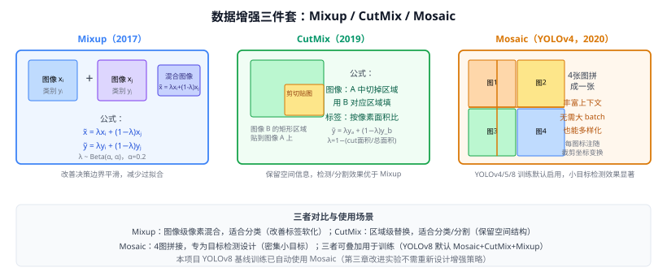

# 14d Mixup / CutMix / Mosaic（数据增强三件套）

> 定位：通过**图像级混合**（Mixup）、**区域级剪贴**（CutMix）、**多图拼接**（Mosaic）扩充训练分布，改善模型泛化和边界样本处理能力。
> Mixup — Zhang et al.，ICLR 2018；CutMix — Yun et al.，ICCV 2019；Mosaic — Bochkovskiy et al.（YOLOv4），arXiv 2020。
> 效果：CutMix 在 ImageNet Top-1 提升 2.1%（vs 标准训练）；Mosaic 对 YOLOv5 小目标 mAP50 提升 ~5 点。
> **输入 / 输出**：原始训练批次 → 增强批次（图像变形 + 标签软化/坐标变换）

---



## 一、提出背景

过拟合和对边界样本的脆弱性是训练分类/检测模型的常见问题。三种增强从不同角度解决：

- **Mixup**：直接**线性插值**两个样本，软化决策边界。
- **CutMix**：保留两图的空间结构，只在**矩形区域**级别混合。
- **Mosaic**：面向检测的增强，**4 图拼接**在不增加 batch 大小的情况下让模型同时看到多个场景。

---

## 二、Mixup

### 2.1 公式

对批内任意两样本 $(x_i, y_i)$ 和 $(x_j, y_j)$，采样 $\lambda \sim \text{Beta}(\alpha, \alpha)$（$\alpha$ 典型取 0.2）：

$$\tilde{x} = \lambda x_i + (1-\lambda) x_j$$
$$\tilde{y} = \lambda y_i + (1-\lambda) y_j$$

图像像素线性插值；标签变为两个 one-hot 的加权平均（软标签）。

### 2.2 效果

- 改善决策边界（不同类之间的过渡更平滑），减少模型对特定像素的记忆。
- 与知识蒸馏的"软标签"思想一脉相承——都在避免 one-hot 的极端性。
- 对目标检测效果有限（两图叠加后检测目标变模糊）；主要用于分类。

---

## 三、CutMix

### 3.1 公式

随机采样矩形区域 $B = (r_x, r_y, r_w, r_h)$：

$$\tilde{x} = \mathbf{M} \odot x_i + (1-\mathbf{M}) \odot x_j$$

其中 $\mathbf{M}$ 是掩码（矩形区域为 0，其余为 1）。标签按像素面积比分配：

$$\tilde{y} = \lambda y_i + (1-\lambda) y_j,\quad \lambda = 1 - \frac{r_w \cdot r_h}{W \cdot H}$$

### 3.2 相比 Mixup 的优势

- 保留完整的局部纹理和空间结构，不会产生像素叠影；
- 对目标检测更友好——矩形区域清晰，不产生模糊目标；
- 可自然扩展到**标签级 CutMix**（把检测框一起变换）。

---

## 四、Mosaic（4 图拼接）

### 4.1 机制

4 张训练图随机裁剪后拼接成 1 张大图，各图的边界框坐标同步变换。特点：

- **不增加 batch 大小**，却让每张图同时包含 4 个场景的目标（有效 batch 大小 ×4）。
- 强迫模型识别部分可见目标（边缘目标被切割），提升对遮挡/截断目标的鲁棒性。
- 显著提升小目标检测（4 图拼接后小目标相对变大），对路面抛洒物等小目标场景特别有效。

### 4.2 YOLOv5/8 中的使用

```yaml
# YOLOv8 hyp.yaml 默认值
mosaic: 1.0      # Mosaic 概率（1.0=每次都用）
mixup: 0.0       # 混合图像（检测任务默认关闭）
cutmix: 0.0      # 区域混合（可选开启）
copy_paste: 0.0  # 复制粘贴（需分割掩码）
```

YOLOv8 在训练后期（最后 10 epoch）**自动关闭 Mosaic**，让模型适应自然分布（Ultralytics 代码 `close_mosaic=10`）。

---

## 五、比较总结

| 方法 | 操作单元 | 适合任务 | 效果 |
|------|---------|---------|------|
| Mixup | 像素级线性混合 | 分类 | 软化边界 |
| CutMix | 矩形区域替换 | 分类/检测/分割 | 保留空间结构 |
| Mosaic | 4 图拼接 | 目标检测（专用）| 小目标+多场景 |
| RandAugment | 随机 AutoAugment | 分类/ViT 训练 | 自动搜索增强策略 |
| Copy-Paste | 实例掩码级拼贴 | 实例分割 | 需分割标注 |

DeiT（31d）用 Mixup + CutMix + RandAugment 训练 ViT，本项目 YOLOv8 默认用 Mosaic。

---

## 六、与本项目的关系

- **基线已用**：YOLOv8 训练框架默认开启 Mosaic；本项目 EXP-001 基线实验自动受益，无需额外配置。
- **实验设计**：若后续单独研究增强策略，可关闭 Mosaic 做对照并按目标尺寸分层报告；当前 EXP-004 的主消融对象是 P2、CBAM 和 CLIP，不把 Mosaic 混入结构消融。
- **合成数据对接**：第三章用 ControlNet 生成的合成图像（稀缺类），可通过 Copy-Paste 增强与真实标注混合，对 YOLOv8 训练有增益效果。
- **第三章写作**：数据预处理/增强一节，说明"YOLOv8 默认 Mosaic + 本文额外 ControlNet 合成数据"的增强策略。

---

## 参考文献

- Zhang H, et al. *Mixup: Beyond Empirical Risk Minimization.* ICLR 2018.
- Yun S, et al. *CutMix: Training Strong Classifiers Using Feature Mix of Training Samples.* ICCV 2019.
- Bochkovskiy A, Wang C Y, Liao H Y M. *YOLOv4: Optimal Speed and Accuracy of Object Detection.* arXiv 2020.（Mosaic 首次提出）
