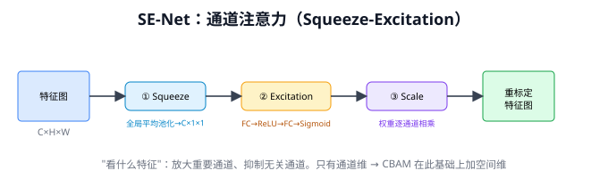
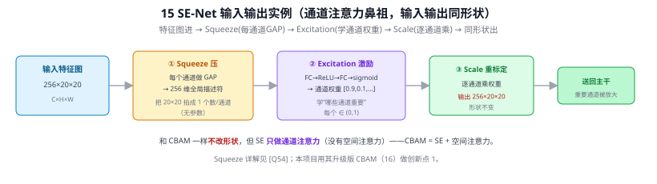
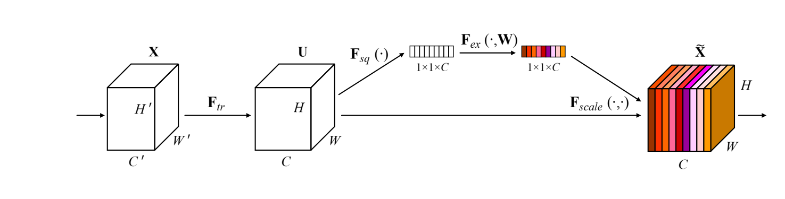
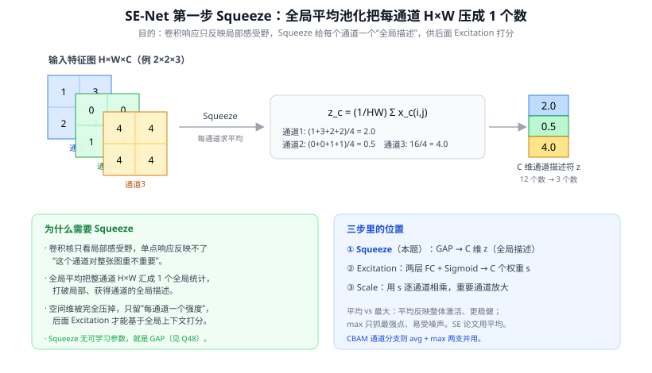

# 15 SE-Net（Squeeze-and-Excitation Networks）

> 定位：通道注意力的开山之作，让网络学会"哪些特征通道更重要"。CBAM 的前身。
> 作者：Hu Jie 等（Momenta），CVPR 2018（ImageNet 2017 冠军方案）。
> **输入 / 输出**：特征图 H×W×C → 同形状（通道被重标定）——通道注意力

---



> 📥📤 **输入/输出实例（看一组具体数值）**：输入特征图 **256×20×20** → ① **Squeeze**：每个通道做 GAP，把 20×20 拍成一个数 → 256 维全局描述符（无参数）→ ② **Excitation**：FC→ReLU→FC→sigmoid → 通道权重 $[0.9,0.1,\dots]$（每个 ∈(0,1)，学"哪些通道重要"）→ ③ **Scale**：逐通道乘权重 → 输出**仍 256×20×20**（形状不变），重要通道被放大、无关通道被抑制。SE **只做通道注意力**，CBAM = SE + 空间注意力（16）；Squeeze 详解见 Q54。本项目用其升级版 CBAM 做创新点 1。



> 📄 **论文原图对照**（图源：Hu et al., *Squeeze-and-Excitation Networks*, [arXiv:1709.01507](https://arxiv.org/abs/1709.01507) Figure 1，原文 [PDF](../papers/15_SENet_1709.01507.pdf)；仅笔记内学习引用，论文写作须自绘）：



> SE 块：GAP 压出通道描述符（Squeeze，Q54）→ 两层 FC 打分（Excitation）→ 逐通道加权回乘。

## 一、提出背景

CNN 的卷积对所有输出通道**一视同仁**，但不同通道捕捉的特征重要性其实不同（有的通道对当前目标关键，有的是噪声）。SE-Net 的想法：**显式建模通道之间的关系，自适应地给每个通道分配重要性权重**——即"通道注意力"。

---

## 二、核心方法：Squeeze-and-Excitation

SE 模块是一个即插即用的小单元，三步走：

```
输入特征图 [C×H×W]
   │
① Squeeze（压缩）：全局平均池化 → [C×1×1]
   把每个通道的全图信息压成一个数，获得通道的全局描述
   │
② Excitation（激励）：两层全连接（FC→ReLU→FC→Sigmoid）→ [C×1×1]
   学习每个通道的权重（0~1），中间降维减少参数（reduction ratio r）
   │
③ Scale（重标定）：用权重逐通道乘原特征图
   重要通道放大，不重要通道抑制
   │
输出：重标定后的特征图 [C×H×W]
```

### 公式

$$
s = \sigma(W_2 \,\delta(W_1 \, z)),\qquad \tilde{x}_c = s_c \cdot x_c
$$

其中 $z$ 是全局平均池化结果，$\delta$ 是 ReLU，$\sigma$ 是 Sigmoid，$s_c$ 是第 $c$ 通道的注意力权重。

---

## 三、优点与意义

- **即插即用**：可嵌入任何 CNN（ResNet → SE-ResNet）
- **开销极小**：参数和计算量增加很少（靠降维比 r 控制），却稳定涨点
- **开创通道注意力**：证明"自适应通道加权"有效，启发了一大批注意力工作（CBAM、ECA-Net、SK-Net）

**局限**：只有**通道**注意力（"看什么特征"），没有**空间**注意力（"在哪里看"）。对需要空间定位的任务（如小目标检测）不够——这正是 CBAM 要补的。

---

## 四、与本项目的关系

- SE-Net 是本项目改进组件 **CBAM（16）的直接前身**。CBAM = SE 的通道注意力 + 额外的空间注意力。
- 理解 SE 的"squeeze（池化压缩）→ excitation（FC 学权重）→ scale（加权）"三步，就理解了 CBAM 通道分支的工作方式。
- **选型对比**：本项目选 CBAM 而非 SE，是因为路面抛洒物检测**既需要选对特征通道，也需要定位低对比度小目标的空间位置**——空间注意力对此有额外价值。但若计算预算极紧，SE 是更轻量的备选。

---

## ✏️ 具体实例（动手算一遍）

**例：SE 模块给通道"打分加权"（Squeeze→Excitation→Scale）**
设某层特征图 $H\times W\times C$，$C=4$ 个通道：
```
① Squeeze（全局平均池化）：每个通道压成 1 个数
   → 通道描述 z = [0.2, 0.9, 0.1, 0.6]   （各通道的"平均激活强度"）
② Excitation（两个全连接 + Sigmoid）：学出每个通道的重要性权重
   → s = [0.3, 0.95, 0.2, 0.8]
③ Scale（逐通道相乘）：用 s 给原特征图各通道重新加权
   通道2(权重0.95)被强调，通道3(权重0.2)被抑制
```
**本质**：让网络**自适应地决定"该重视哪些通道"**（通道注意力）。参数极少（两个小 FC），几乎不增延迟却能涨点。

**例：与本项目**
SE 是 16 CBAM 的前身（CBAM = 通道注意力 SE 思想 + 空间注意力）。本项目第三章用 CBAM 强化小目标/低对比度抛洒物的关键通道与空间位置——理解 SE 的"squeeze-excitation"才懂 CBAM 的通道分支。

---

## 五、参考文献

- Hu J, Shen L, Sun G. *Squeeze-and-Excitation Networks.* CVPR 2018.

---

## 📋 模型答疑（来自模型详解问答）

> 以下问答原属"答疑记录"系列，因专属本模型已并入此处便于集中查阅；跨模型的通用问答仍留在答疑分册。

---

## Q54. SE-Net 的第一步 Squeeze（压缩）具体在做什么？

**简答**：SE 模块三步 `Squeeze → Excitation → Scale`，第一步 Squeeze 就是把每个通道的 $H\times W$ 个值求平均，压成一个标量。设输入 $H\times W\times C$，输出长度为 $C$ 的向量 $z$，第 $c$ 个分量 $z_c=\frac{1}{HW}\sum_{i,j}x_c(i,j)$。这一步把"空间"完全压掉，只留"每个通道一个全局强度"，作为后续打分的依据。

**展开**：

**① 为什么需要 Squeeze（动机）**
卷积核只看**局部感受野**，输出特征图每个位置只反映局部信息。但"这个通道对当前图像整体是否重要"是一个**全局判断**——必须把整张图的信息汇总起来看。Squeeze 就是用一个最简单的全局算子（求平均），把每个通道 $H\times W$ 个值"挤压（squeeze）"成 1 个代表值，**打破局部性、获得通道的全局描述**。没有这一步，Excitation 就只能盯着局部、给不出"这个通道在全图层面重不重要"的判断。

**② 具体怎么做：全局平均池化（GAP）**
$$z_c=\frac{1}{H\times W}\sum_{i=1}^{H}\sum_{j=1}^{W}x_c(i,j)\qquad(c=1,\dots,C)$$
对第 $c$ 个通道的全部 $H\times W$ 像素求平均 → 1 个数；$C$ 个通道 → $C$ 维向量 $z$。这正是 Q48 讲过的 GAP（输出 $C$ 维、$C$=特征通道数），SE 只是把它当成"通道全局描述器"来用。

**③ 数值例子（$C=3$，每通道 $2\times2$）**
```
通道1 = [[1,3],         通道2 = [[0,0],        通道3 = [[4,4],
         [2,2]]                  [1,1]]                 [4,4]]
Squeeze（求平均）:
  z₁ = (1+3+2+2)/4 = 2.0
  z₂ = (0+0+1+1)/4 = 0.5
  z₃ = (4+4+4+4)/4 = 4.0
→ 通道描述符 z = [2.0, 0.5, 4.0]
```
原本 $2\times2\times3=12$ 个数，被压成 **3 个数**：空间维彻底消失，只剩"每个通道的全局激活强度"。直觉上，通道3（全 4）整体激活最强、通道2（多为 0）最弱——这正是交给下一步 Excitation 去判断"该不该重视"的原始线索。



**④ 为什么用"平均"而不是"最大"**
- **平均**反映通道的**整体激活水平**（全局统计），对单点噪声更稳健；
- **max** 只抓最强响应的那一个点，易被局部尖峰带偏。

SE 论文实验显示平均池化略优，故 Squeeze 默认用 GAP。（16 CBAM 的通道注意力分支则**同时用 avg-pool 和 max-pool 两支**再融合，信息更全。）

**⑤ 在三步里的位置（别和 Excitation 混）**
| 步骤 | 做什么 | 有无可学习参数 |
|------|--------|--------------|
| **① Squeeze**（本题） | GAP，每通道 → 1 个数，得 $C$ 维 $z$ | **无**（纯池化） |
| ② Excitation | 两层 FC（先降维 $r$ 再升回）+ Sigmoid → $C$ 个权重 $s$ | 有（学"哪个通道重要"） |
| ③ Scale | 用 $s$ 逐通道乘回原特征图，重要通道放大 | 无 |

关键区分：**Squeeze 只负责"汇总全局信息"，不做判断**；真正学"哪个通道更重要"的是 Excitation 里那两层 FC。Excitation 中间的降维（如 $C\to C/r\to C$）用的就是 1×1 卷积/全连接（Q52）。

**⑥ 与本项目**
- 本项目第三章用 **CBAM**（16 CBAM），其通道注意力分支直接继承 SE 的"squeeze→excitation"思想——理解 Squeeze 这一步（用全局池化拿通道描述），就懂了 CBAM 通道分支为何先池化再学权重。
- SE/CBAM 给"哪些通道重要"打分，对路面抛洒物这种**低对比度小目标**尤其有用：让网络自适应放大关键特征通道、抑制背景噪声通道。

