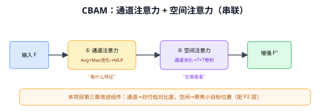
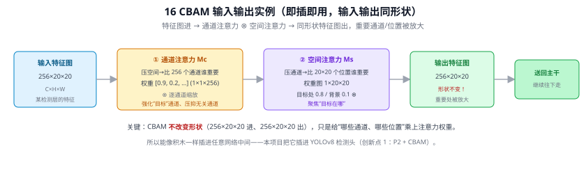
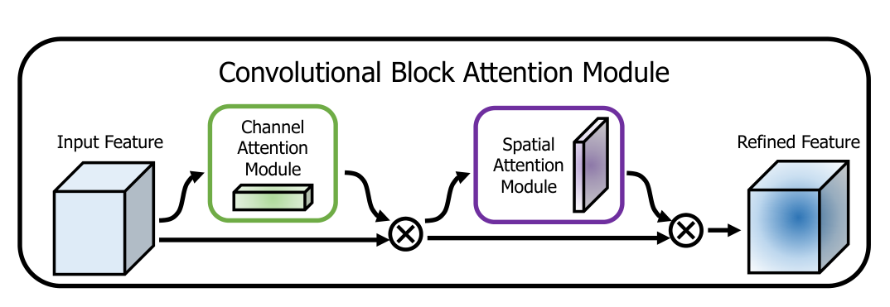
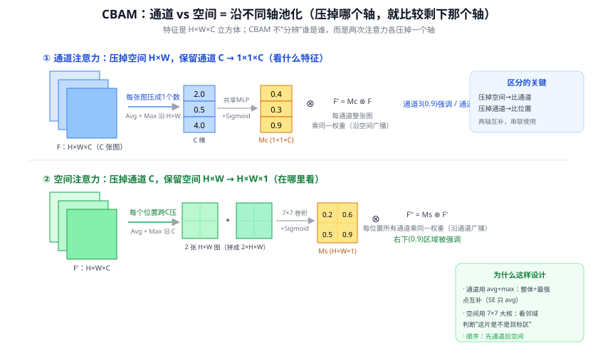
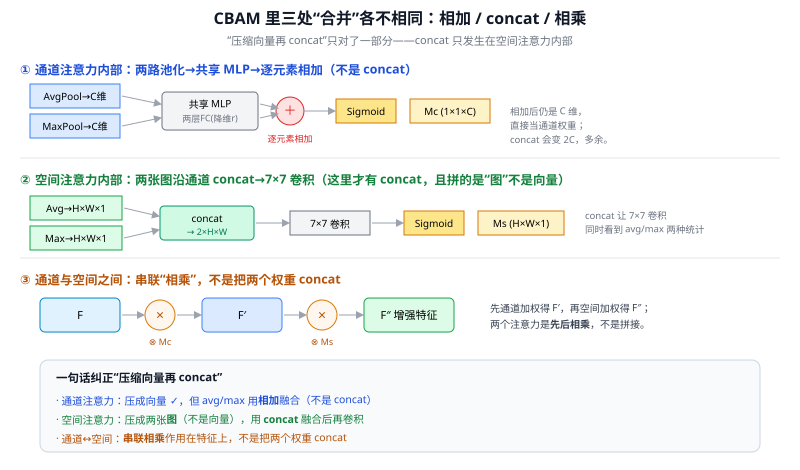
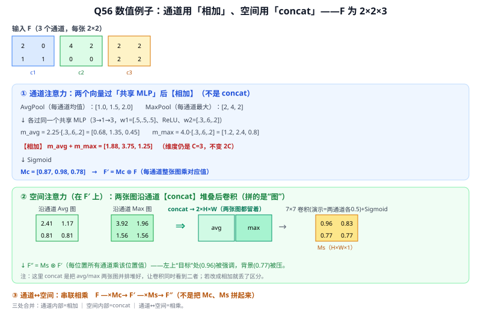
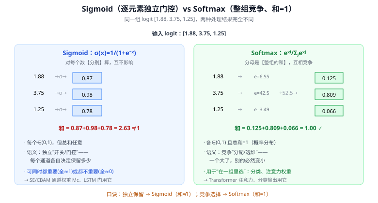

# 16 CBAM（Convolutional Block Attention Module）⭐

> 定位：**本项目第三章改进组件（创新点 1）**。在 SE 的通道注意力基础上增加空间注意力，即插即用。
> 作者：Woo 等，ECCV 2018。
> **输入 / 输出**：特征图 → 同形状（通道 + 空间被加权）

---



> 📥📤 **输入/输出实例（看一组具体数值）**：输入一张特征图 **256×20×20**（C×H×W）→ ① **通道注意力 Mc**：压掉空间、比较 256 个通道谁重要 → 权重 $[0.9,0.2,\dots]$（1×1×256）逐通道缩放；② **空间注意力 Ms**：压掉通道、比较 20×20 个位置谁重要 → 权重图（目标处 0.8 / 背景 0.1，1×20×20）逐位置缩放 → 输出**仍是 256×20×20**（形状不变），只是重要的通道/位置被放大。正因**输入输出同形状**，它能像积木一样插进网络任意位置——本项目把它插进 YOLOv8 检测头（创新点 1：P2 + CBAM）。



> 📄 **论文原图对照**（图源：Woo et al., *CBAM: Convolutional Block Attention Module*, [arXiv:1807.06521](https://arxiv.org/abs/1807.06521) Figure 1，原文 [PDF](../papers/16_CBAM_1807.06521.pdf)；仅笔记内学习引用，论文写作须自绘）：



> CBAM 总览：特征图先过通道注意力、再过空间注意力，串联相乘（Q55/Q56）——本项目创新点 1 采用的模块。

## 一、提出背景

SE-Net（15）证明了通道注意力（"看什么特征"）有效，但它忽略了**空间维度**（"在图像的哪个位置看"）。对目标检测——尤其是路面抛洒物这种**小目标、低对比度**场景——"在哪里看"和"看什么"同样重要。CBAM 把两种注意力**串联**起来，全面提升特征表达。

---

## 二、核心方法：通道注意力 + 空间注意力（串联）

```
输入特征图 F [C×H×W]
   │
① 通道注意力 Mc：告诉网络"看什么特征"
   F' = Mc(F) ⊗ F
   │
② 空间注意力 Ms：告诉网络"在哪里看"
   F'' = Ms(F') ⊗ F'
   │
输出增强特征图 F''
```

### 2.1 通道注意力模块（CAM）

比 SE 多用了一路 MaxPool（SE 只有 AvgPool）：

```
F ──┬─ 全局平均池化 ─┐
    └─ 全局最大池化 ─┤→ 共享 MLP → 相加 → Sigmoid → 通道权重 Mc [C×1×1]
```

直觉：平均池化捕捉整体统计，最大池化捕捉最显著特征，两者互补。

### 2.2 空间注意力模块（SAM）

```
F' ──沿通道维── 平均池化 + 最大池化 → 拼接 [2×H×W] → 7×7 卷积 → Sigmoid → 空间权重 Ms [1×H×W]
```

直觉：在每个空间位置上，跨通道做池化，得到"这个位置有多重要"的热力图，突出目标所在区域、抑制背景。

### 公式
$$
M_c(F) = \sigma\!\big(\text{MLP}(\text{AvgPool}(F)) + \text{MLP}(\text{MaxPool}(F))\big)
$$
$$
M_s(F') = \sigma\!\big(f^{7\times7}([\text{AvgPool}(F'); \text{MaxPool}(F')])\big)
$$

---

## 三、优点

- **即插即用**：可插入 CNN 任意位置（如 C2f 模块后、检测头前）
- **开销小**：参数和计算量增加很少
- **通道 + 空间双重增强**：比纯通道（SE）更全面，对检测/小目标更友好
- 论文在多个分类/检测任务上稳定涨点

---

## 四、与本项目的关系 ⭐⭐（第三章核心）

CBAM 是本项目**创新点 1（改进小目标检测头）**的两大组件之一（另一个是 P2 层，见 21 FPN）：

### 4.1 为什么选 CBAM
路面抛洒物的两大检测难点，正好对应 CBAM 的两种注意力：
| 难点 | CBAM 对策 |
|------|-----------|
| 低对比度（抛洒物与路面颜色接近） | **通道注意力**：放大区分性强的特征通道 |
| 小目标、易被背景淹没 | **空间注意力**：聚焦目标所在位置，抑制大面积路面背景 |

### 4.2 插入位置（实验设计）
计划在 YOLOv8 的 **C2f 模块之后 / 检测头之前**插入 CBAM（具体位置通过 EXP-002/EXP-004 消融确定）。详见 `paper_notes_yolov8.md` 的"第三章改进方向"表。

### 4.3 实验验证
- **EXP-002**：YOLOv8 + P2 + CBAM，目标 mAP@0.5 相对基线提升 ≥ 15%
- **EXP-004 消融**：分别去掉 P2 / 去掉 CBAM，验证 CBAM 的独立贡献（delta mAP）

### 4.4 注意事项
- CBAM 加在哪一层、加几个，需消融——加太多会拖慢推理（影响 < 100ms 目标）
- 要确保插入后梯度仍顺畅（残差思想，见 09 ResNet）

---

## 五、技术谱系

```
[20 注意力机制] → [30 SE-Net]（通道注意力）→ CBAM（通道 + 空间）
                                              ↘ ECA-Net、CoordAttention 等后续变体
```

> 写第三章时，CBAM 论文的 Figure 1（模块结构）、消融实验（通道+空间 > 单一）是必引内容。

---

## ✏️ 具体实例（动手走一遍）

**例：CBAM 串联两步注意力（通道 → 空间）**
输入特征 $F$（H×W×C）：
```
① 通道注意力 Mc（"看哪些通道重要"）：
   对 F 做全局平均池化 + 全局最大池化 → 各得 C 维 → 共享 MLP → 相加 → Sigmoid
   → Mc (1×1×C)，逐通道乘回：F' = Mc ⊙ F
② 空间注意力 Ms（"看图上哪些位置重要"）：
   对 F' 沿通道做平均 + 最大 → 2 张 H×W 图 → 拼接 → 7×7 卷积 → Sigmoid
   → Ms (H×W×1)，逐位置乘回：F'' = Ms ⊙ F'
输出 F''：重要通道 + 重要位置 都被增强
```
比 15 SE-Net（只有通道）多了**空间分支**：不仅"重视哪些特征通道"，还"重视图上哪块区域"。

**例：本项目第三章为什么用 CBAM**
路面抛洒物常**小、低对比度**，关键信息集中在局部。CBAM 的空间注意力能让网络聚焦"疑似抛洒物的位置"、通道注意力强化相关特征 → 提升小目标召回。代价：多一条支路，FLOPs 增不多但可能拖慢推理 → **必须实测延迟**（Q8，EXP-002）。

---

## 六、参考文献

- Woo S, et al. *CBAM: Convolutional Block Attention Module.* ECCV 2018.
- Hu J, et al. *Squeeze-and-Excitation Networks.* CVPR 2018.（前身）

---

## 📋 模型答疑（来自模型详解问答）

> 以下问答原属"答疑记录"系列，因专属本模型已并入此处便于集中查阅；跨模型的通用问答仍留在答疑分册。

---

## Q55. CBAM 如何区分通道和空间、再分别做相应的注意力？

特征图是 H×W×C 立方体。CBAM 做两次注意力，区别只在**沿哪个轴把信息压扁**：
- **通道注意力**：沿**空间**压（每张图汇成 1 个数）→ 剩 C 个数 → 比"哪个通道重要" → 权重 1×1×C，沿空间广播乘回（每通道整张图乘同一权重）。看**什么**特征。
- **空间注意力**：沿**通道**压（每个位置跨 C 通道汇成 1 个数）→ 剩一张 H×W 图 → 比"哪个位置重要" → 权重 H×W×1，沿通道广播。在**哪里**看。

压掉空间就只能比通道、压掉通道就只能比位置——这就是"区分"的来历，两者维度正交、互补。

细节：① 通道注意力同时做 avg+max 池化（比 SE 多一路 max：avg 看整体、max 抓最强点），过共享 MLP 相加 Sigmoid；② 空间注意力用 **7×7 大核**（判断"是否目标区域"要看周围一片邻域）；③ 默认**通道在前、空间在后**（先选重要通道再定位重要区域，论文实验略优，顺序非关键）。



> 本项目：两大难点正对应两支路——**低对比度**→通道注意力放大区分性强的通道；**小目标易被背景淹没**→空间注意力聚焦目标、抑制路面背景（创新点1）。多两支路 FLOPs 增不多但可能拖慢推理→必须实测延迟（EXP-002/004 消融定位置与数量）。

---

## Q56. 通道注意力和空间注意力，是"压缩成向量再 concat"的吗？

要分清三处不同的合并动作：

| 位置 | 合并的是什么 | 操作 |
|---|---|---|
| 通道注意力**内部** | avg 向量 + max 向量（各 C 维） | 共享 MLP 后**逐元素相加** ⊕（没有 concat） |
| 空间注意力**内部** | avg 图 + max 图（各 H×W） | **沿通道 concat** → 2×H×W，再 7×7 卷积 |
| 通道↔空间**之间** | 特征与权重 | **逐元素相乘** ⊗（串联，先通道后空间） |

- **通道注意力**：$M_c=\sigma(\text{MLP}(\text{Avg})+\text{MLP}(\text{Max}))$——两个 C 维向量各过同一共享 MLP 后**相加**（不 concat：相加后仍是 C 维可直接当权重，concat 变 2C 还要再降维，多余）。
- **空间注意力**：$M_s=\sigma(f^{7\times7}([\text{Avg图};\text{Max图}]))$——两张 H×W 图**沿通道 concat 成 2×H×W**、过 7×7 卷积（concat 让卷积同时看到 avg/max 两种统计、自己学融合）。
- **通道↔空间**：$F'=M_c\otimes F$、$F''=M_s\otimes F'$——两权重**先后相乘**作用在特征上，不是把 $M_c/M_s$ 拼起来。



数值走一遍（2×2×3，见下图）：通道注意力 avg=[1,1.5,2]/max=[2,4,2] 过共享 MLP **相加**得 $M_c$；空间注意力对 F′ 沿通道 avg/max 得两张图**concat** 后 7×7（演示用 1×1）卷积+Sigmoid 得 $M_s$；两步**相乘**增强。



> 三处各一操作：**通道内部=相加**（维度不变）、**空间内部=concat**（并排保留 avg/max 给卷积）、**通道↔空间=相乘**（串联）。SE 通道注意力只用 avg 一路，CBAM 升级为 avg+max 两路相加并补空间分支。写第三章画 CBAM 模块图时别把融合方式画错。

## Q57. Mc 不是已经过 Sigmoid 了吗，为什么三个值之和不是 1？

**简答**：$M_c=[0.87,0.98,0.78]$ 和为 2.63，这是对的。因为 Sigmoid $\sigma(x)=\frac1{1+e^{-x}}$ 是**逐元素函数**：对向量 $[1.88,3.75,1.25]$ 是**分别**算 $\sigma(1.88)=0.87$、$\sigma(3.75)=0.98$、$\sigma(1.25)=0.78$，三次互不相干的运算，自然不会凑成 1。会让和为 1 的是 Softmax，它分母用了整组的和。

**展开**：

**① Sigmoid 是逐元素函数，不跨维度归一化**
$\sigma(x)$ 输入一个数、输出一个数 $\in(0,1)$。把它作用在向量上，只是对每个分量**各算一次**，分量之间没有任何耦合——所以输出各自落在 $(0,1)$，但**总和是多少都行**。

**② 想让"和为 1"的是 Softmax（对比同一组数）**
$$\text{Softmax}(x_i)=\frac{e^{x_i}}{\sum_j e^{x_j}}$$
分母是**整组的和**，把一组数变成一个"概率分布"（非负、和为 1、互相竞争）。对 $[1.88,3.75,1.25]$：
$$e^{1.88}{=}6.55,\ e^{3.75}{=}42.5,\ e^{1.25}{=}3.49,\ \text{和}{=}52.5\Rightarrow[0.125,\ 0.809,\ 0.066]\ (\text{和}=1)$$

| | Sigmoid | Softmax |
|---|---------|---------|
| 作用范围 | **每个元素独立** | **整组一起** |
| 输出 | 各 $\in(0,1)$，和任意 | 各 $\in(0,1)$，**和=1** |
| 元素间关系 | 互不影响 | 此消彼长（竞争） |
| 语义 | 独立"门控/开关" | 概率分布 / "选哪个" |



**③ 为什么通道注意力要 Sigmoid（独立门控）而非 Softmax（竞争）**
- 通道的重要性**不是互斥**的：可能很多通道都有用（边缘、颜色、纹理都想保留），也可能很多都没用。要的是"**每个通道各自保留多少**"，不是"在通道间分一块固定蛋糕"。
- 若用 Softmax，$C$ 个通道被迫争"总和=1"：通道越多每个越被稀释，还强行此消彼长——不符合"通道各管各的"。
- Sigmoid 让每个通道独立落在 $[0,1]$：$M_c=[0.87,0.98,0.78]$ 读作"c1 留 87%、c2 留 98%、c3 留 78%"，三者无须相关。空间注意力 $M_s$ 同理——**每个位置一个独立门控**（[Q55](#q55-cbam-如何区分通道和空间再分别做相应的注意力)），所以 $M_s$ 各元素也不求和为 1。

**④ 同源记忆：门控用 Sigmoid，分配/选择用 Softmax**
- **独立门控 → Sigmoid**：LSTM 的输入/遗忘/输出门、SE/CBAM 的注意力门——"每个单元独立开多大"。
- **竞争分配 → Softmax**：Transformer 注意力权重（对一组 token 选谁，Q31/Q33）、分类输出层——"在一组里分概率"，和为 1。
- 口诀：**独立保留 → Sigmoid（和≠1）；竞争选择 → Softmax（和=1）**。

**⑤ 与本项目**：读 $M_c$、$M_s$ 时别期待和为 1——它们是一排独立的"保留比例"旋钮；只有看 YOLOv8 的类别概率、Transformer 的注意力分布时才该是"和为 1"。

