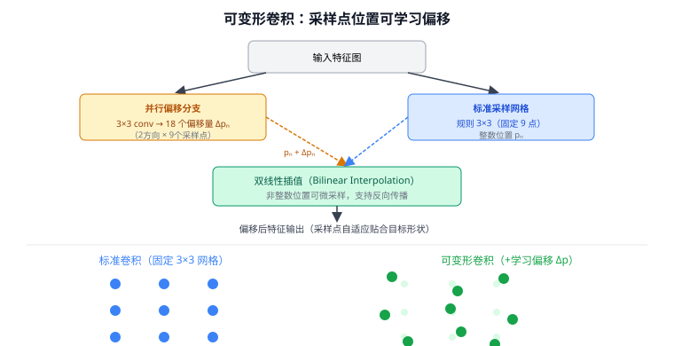
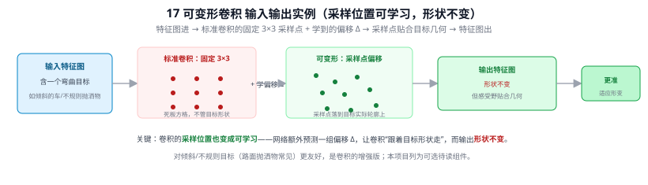
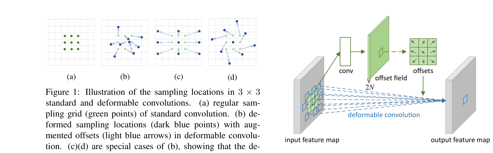

# 17 Deformable Convolution（可变形卷积）

> 定位：让卷积的采样位置可学习、可形变，以适应不规则形状和几何变化的目标。
> 作者：Dai 等（微软亚研院），DCN v1（ICCV 2017）、DCN v2（CVPR 2019）。
> **输入 / 输出**：特征图 → 特征图（采样位置可学习，形状不变）

---



> 📥📤 **输入/输出实例（看一组具体数值）**：输入一张含**弯曲/倾斜目标**的特征图 → 标准卷积本来用**固定 3×3 方格**采样（死板，不管目标形状）；可变形卷积额外**学一组偏移 Δ**，把 9 个采样点**挪到目标的实际轮廓上** → 输出特征图**形状不变**，但感受野贴合目标几何。一句话：**卷积的采样位置也变成可学习的**，让卷积"跟着目标形状走"。对倾斜/不规则目标（路面抛洒物常见）更友好，是卷积的增强版（本项目列为可选待读组件）。



> 📄 **论文原图对照**（图源：Dai et al., *Deformable Convolutional Networks*, [arXiv:1703.06211](https://arxiv.org/abs/1703.06211) Figure 2，原文 [PDF](../papers/17_DeformableConv_1703.06211.pdf)；仅笔记内学习引用，论文写作须自绘）：



> 可变形卷积：3×3 采样点不再是固定网格，由学出来的偏移量把采样位置"贴合"到目标形状上。

## 一、提出背景

标准卷积的采样点是**固定的规则网格**（3×3 就是规规矩矩的 9 个点）。但真实目标形状各异、有形变、有视角变化——固定网格难以贴合不规则物体。可变形卷积的想法：**让卷积核的每个采样点都能学习一个偏移量，主动"挪"到更有信息的位置**。

---

## 二、核心方法

### 2.1 可学习偏移（DCN v1）

数学上，标准卷积在位置 $p_0$ 的输出：

$$
y(p_0) = \sum_{p_n \in R} w(p_n)\, x(p_0 + p_n)
$$

可变形卷积加入可学习偏移 $\Delta p_n$：

$$
y(p_0) = \sum_{p_n \in R} w(p_n)\, x(p_0 + p_n + \Delta p_n)
$$

偏移 $\Delta p_n$ 通常是小数，用**双线性插值**取对应位置的值（保证可微，能反向传播）。这样卷积的感受野不再是方块，而是能自适应贴合目标轮廓。

### 2.2 DCN v2 的改进
- 增加每个采样点的**调制权重（modulation）**，不仅能挪位置，还能调节每个采样点的重要性（甚至置 0 忽略某点）
- 更好地聚焦目标、排除无关区域

---

## 三、优点与局限

**优点**：
- 自适应几何形变，对不规则、多姿态目标更鲁棒
- 即插即用，可替换标准卷积，常用于检测/分割提升精度

**局限**：
- 实现较复杂，部署（ONNX/TensorRT）支持不如标准卷积成熟——**对本项目是关键顾虑**
- 计算和访存不规则，速度优化难
- 训练可能不稳定

---

## 四、与本项目的关系

- **不作为主要改进采用**：本项目改进检测头优先选 **P2 + CBAM**（21 FPN + 16 CBAM），因为它们部署友好（ONNX 导出顺畅，满足 < 100ms、可推理系统的目标）。可变形卷积的部署复杂度与本项目"轻量可部署"目标有冲突。
- **备选/对比价值**：
  - 路面抛洒物形状不规则（碎裂的塑料、扭曲的金属），可变形卷积理论上有适配优势，可作为**第三章的备选改进方案或消融对比项**（"为什么选 CBAM 而非 DCN"）。
  - 若 P2 + CBAM 提升不达预期（mAP 相对提升 < 15%），可考虑引入 DCN 作为补充——但需先验证 ONNX 导出可行性。
- 写论文时，DCN 是"检测头改进"相关工作的一个分支，提及可体现对改进方案选型的全面考量。

---

## ✏️ 具体实例（动手走一遍）

**例：普通卷积 vs 可变形卷积的采样点**
普通 3×3 卷积在固定的规整网格上采样（相对中心的 9 个点）：
$$\{(-1,-1),(-1,0),\dots,(1,1)\}$$
可变形卷积**额外学一组偏移** $\Delta p_k$，让采样点能"挪到"物体真实形状上：
```
普通：    □ □ □          可变形：  □   □     □
          □ ■ □     →            □  ■   □       （采样点贴着弯曲/倾斜的物体轮廓）
          □ □ □                □     □  □
```
偏移 $\Delta p_k$ 由一个并行卷积从输入特征学出（小数坐标用双线性插值取值）。

**例：为什么对本项目可能有用**
路面抛洒物**形状不规则、姿态各异**（碎玻璃、扭曲塑料、不规则砂石）。可变形卷积让感受野自适应贴合不规则轮廓，理论上利于这类目标。但它实现复杂、对部署（ONNX/TensorRT）不够友好、增加延迟——本项目以 P2+CBAM 为主，可变形卷积作为"可选增强/未来工作"了解（呼应实时 <100ms 与部署约束）。

---

## 五、参考文献

- Dai J, et al. *Deformable Convolutional Networks.* ICCV 2017.（DCN v1）
- Zhu X, et al. *Deformable ConvNets v2: More Deformable, Better Results.* CVPR 2019.
