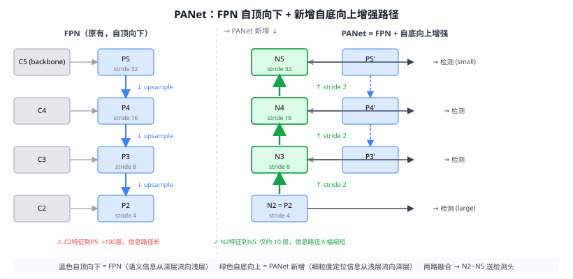

# 17a PANet（Path Aggregation Network）⭐

> 定位：在 FPN 自顶向下路径之上，新增**自底向上的增强路径**，将浅层精细定位信息"再次向上"传给高层语义特征，大幅缩短信息路径。
> 作者：Liu et al.，CUHK + SIAT，CVPR 2018（Best Paper Finalist）。
> 战绩：COCO 实例分割 Mask AP 38.4（当时 SOTA）；检测 AP 也超过 Mask R-CNN 同等骨干；COCO 2017 实例分割冠军方案基础。
> **输入 / 输出**：图像 → 多尺度特征图 N2~N5（替换 FPN 的 P2~P5，送检测/分割头）

---



## 一、提出背景

21 FPN 的自顶向下路径解决了"浅层缺语义"问题，但引入了一个新问题：**浅层的精细定位信息要经过上百层才能流到高层**（C2 经过骨干几十层才能到 P5），在此过程中可能被"淡化"。

PANet 的核心观察：让信息"两次流动"——先从上（高语义）向下，再从下（高定位）向上，缩短任意两点之间的最大信息路径长度，让检测头在所有尺度都能获得"丰富语义 + 精准定位"的融合特征。

---

## 二、核心创新

### 2.1 自底向上路径增强（Bottom-up Path Augmentation）

在 FPN 输出（P2~P5）基础上，新建第二条路径，从 N2（=P2）开始，每步做 **stride 2 下采样 + lateral connection（加 FPN 对应层）**，逐级向上生成 N3、N4、N5：

```
N2 = P2                     ← 直接用 FPN 最浅层
N3 = 3×3(stride 2)(N2) ⊕ P3'   ← 下采样再融合
N4 = 3×3(stride 2)(N3) ⊕ P4'
N5 = 3×3(stride 2)(N4) ⊕ P5'
```

信息路径从 FPN 的"C2→…→P5：>100 步"缩短到"N2→N5：4 步"。

### 2.2 自适应特征池化（Adaptive Feature Pooling）

Mask R-CNN 的 RoI Align 只从单一 FPN 层取特征（由目标大小决定级别）。PANet 改为：**对每个候选框，从所有尺度 N2~N5 分别做 RoI Align，然后按元素取 max（或 sum）融合**，让小目标也能利用高层语义。

### 2.3 全连接融合的 Mask 分支

mask 分支同时使用全卷积路径和两层全连接路径，最后融合——全卷积捕捉空间细节，全连接提供全局感知。（本项目不需要实例分割，此部分了解即可。）

---

## 三、优点与局限

**优点**：
- 信息路径更短 → 浅层精细定位信息更容易抵达高层 → 大目标检测也受益。
- 自适应特征池化 → 不再"只挑一层"，小目标精度提升最明显。
- 结构简洁，可与任意骨干（ResNet、ResNeXt）+ FPN 组合。

**局限**：
- 增加了两倍特征图计算量（两条路径都要 forwarding）；后续 BiFPN（EfficientDet）改用加权融合进一步精简。
- 自适应特征池化对每个候选框都要 RoI Align ×4 次，推理速度稍慢。

---

## 四、历史地位

PANet 是 FPN 之后检测/分割颈部设计的重要里程碑：

- **YOLOv4/v5 的 PAN 颈部**直接采用 PANet 底向上路径（简化版，去掉自适应池化），成为 YOLO 家族颈部的标准配置（见 25b YOLOv4/v5）。
- **YOLOv8** 同样继承 PAN 颈部（25d YOLOv8）——本项目的第三章改进就建在这个颈部之上。
- **BiFPN**（EfficientDet, 2020）在 PANet 基础上加权多尺度融合，进一步改进。

放进脉络：FPN（自顶向下）→ **PANet（双向路径）** → BiFPN（加权双向）→ YOLOv8 PAN 颈部。

---

## 五、与本项目的关系

- **直接来源**：本项目 YOLOv8 的颈部是 PANet 的简化版（C2f + PAN），**第三章"为什么加 P2 层有效"的论述需要引用 FPN + PANet 的信息流理论**。
- **相关工作写作**：检测颈部演进一节，FPN（多尺度语义）→ PANet（双向路径）→ YOLOv8 PAN 是标准叙事链。
- 不直接使用 PANet 本体；作原理引用。

---

## 参考文献

- Liu S, Qi L, Qin H, Shi J, Jia J. *Path Aggregation Network for Instance Segmentation.* CVPR 2018.
- （配套）Lin T Y, et al. *Feature Pyramid Networks for Object Detection.* CVPR 2017.（见 21 FPN）
