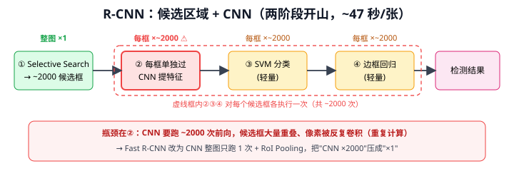
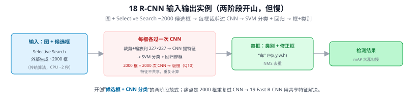
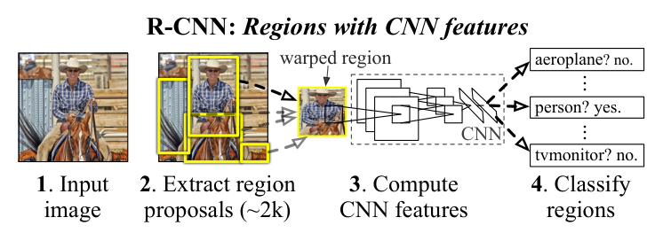
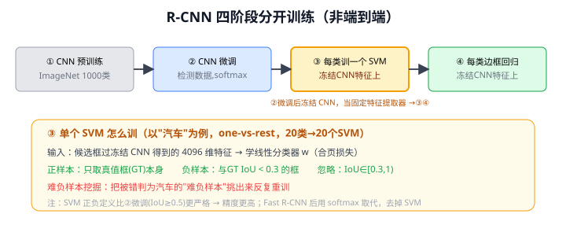
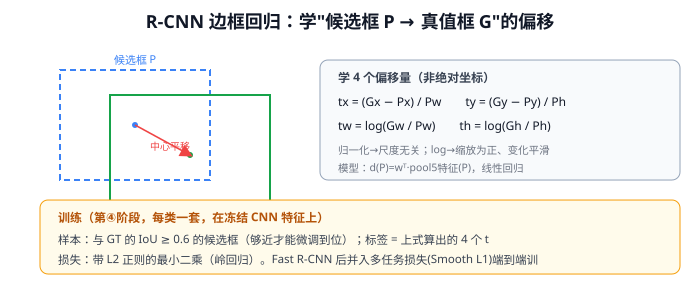
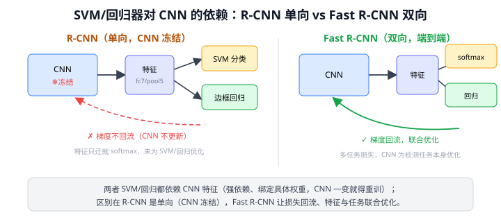

# 18 R-CNN（Regions with CNN features）

> 定位：把 CNN 引入目标检测的开山之作，开创"两阶段检测"范式。
> 作者：Ross Girshick 等，CVPR 2014。
> 战绩：PASCAL VOC 2012 mAP 从传统方法的 ~33% 跃升到 53.3%。
> **输入 / 输出**：图像 + Selective Search ~2000 候选框 → 每框：类别 + 修正框

---



> 📥📤 **输入/输出实例（看一组具体数值）**：输入图像 + Selective Search 外部生成的 **~2000 个候选框** → 每个框裁剪+缩放到 227×227 各过一次 CNN 提特征 → SVM 分类 + 回归修框 → 输出每框"类别 + 修正框"（如"车" @(x,y,w,h)）→ NMS。开创"**候选框 + CNN 分类**"的两阶段范式（VOC mAP 33%→53%），但痛点是 **2000 框 = 2000 次 CNN、特征不共享**、极慢（Q10）→ 19 Fast R-CNN 用共享特征解决。



> 📄 **论文原图对照**（图源：Girshick et al., *Rich feature hierarchies*, [arXiv:1311.2524](https://arxiv.org/abs/1311.2524) Figure 1，原文 [PDF](../papers/18_RCNN_1311.2524.pdf)；仅笔记内学习引用，论文写作须自绘）：



> R-CNN 四步流水线：候选区域→逐个缩放过 CNN→SVM 分类+框回归（Q10/Q11）。

## 一、提出背景

AlexNet（2012）证明 CNN 在**分类**上极强，但**检测**（定位 + 分类多个目标）当时仍靠手工特征（HOG、DPM）。R-CNN 的核心问题：**如何把 CNN 的强分类能力用到检测上？** 难点在于目标位置和数量未知，不能像分类那样直接喂整图。

R-CNN 的答案：**先生成一堆可能含目标的候选区域，再对每个区域用 CNN 分类**——"区域 + CNN"故得名。

---

## 二、流程（四个阶段）

- **Selective Search**：基于颜色、纹理、尺寸相似度的传统算法，把图像过分割后逐步合并，给出可能的物体区域。不是神经网络。
- **为什么用 SVM 而非 CNN 自带的 softmax**：当时作者发现单独训练 SVM 精度更高（正负样本定义不同）。

---

## 三、贡献与致命缺陷

**贡献**：
- 首次证明 CNN 特征 >> 手工特征，检测精度大幅提升
- 确立"候选区域 → CNN 特征 → 分类 + 回归"的两阶段框架，影响深远

**致命缺陷**：
1. **极慢**：约 2000 个候选框，每个都单独过一次 CNN，**重复计算**严重，单张图推理约 **47 秒**
2. **训练繁琐**：CNN、SVM、回归器三者分开训练，不是端到端
3. **占用磁盘大**：要把所有候选框特征存到硬盘

这些缺陷直接催生了 19 Fast R-CNN（共享整图特征）和 20 Faster R-CNN（用 RPN 替代 Selective Search）。

---

## 四、历史地位

R-CNN 是深度学习检测的"祖师爷"，开启两阶段检测路线。虽然本身已被淘汰，但它定义的问题分解方式（候选 + 分类）一直延续。理解它的"慢在哪里"，就理解了之后整条优化主线的动机。

---

## 五、与本项目的关系

- 本项目用单阶段的 YOLOv8（更快），但 R-CNN 是相关工作里"两阶段 vs 单阶段"对比的必备背景。
- R-CNN 的"裁剪候选框 → 单独提特征/分类"流程，与本项目 **CLIP 模块的工作方式高度相似**：YOLOv8 出框 → 裁剪 → 送 CLIP 分类（见 33 CLIP）。可以说本项目的 CLIP 开放类识别，在结构上是"R-CNN 式裁剪分类"的现代 VLM 版本——只不过分类器从 SVM 换成了零样本的 CLIP。这是写第四章时一个很好的类比。

---

## ✏️ 具体实例（走一张图）

**例：一张街景图怎么过 R-CNN（VOC 20 类）**
```
① Selective Search   整图跑 1 次 → ~2000 个候选框（大小不一）
② 逐框：裁剪 + 缩放到 227×227 → 过 CNN → 4096 维特征   ← 跑 ~2000 次！(瓶颈)
③ 每框 4096 维 → 20 个二分类 SVM 打分（每类一个）
④ 每框 → 每类一个边框回归器，微调位置 (t_x,t_y,t_w,t_h)
⑤ 逐类 NMS 去重 → 输出
```
一张图约 **47 秒**（②的 2000 次 CNN 前向是元凶，候选框大量重叠、像素被反复卷积，见 [Q10](#q10-r-cnn-的-2000-个候选框是否每个都要逐阶段各过一遍)）。

**例：边框回归学的是"相对偏移"而非绝对坐标**
候选框 $P=(P_x,P_y,P_w,P_h)$，真值 $G$，学的目标是
$$t_x=\frac{G_x-P_x}{P_w},\quad t_w=\log\frac{G_w}{P_w}$$
如 $P$ 中心偏左、偏小，则 $t_x>0,t_w>0$，回归器输出正值把框右移、放大去贴合 $G$（详见 [Q11](#q11-r-cnn-的-svm-与边框回归器如何训练与-cnn-是何依赖)）。这套参数化被后续所有检测器沿用。

---

## 六、参考文献

- Girshick R, et al. *Rich feature hierarchies for accurate object detection and semantic segmentation.* CVPR 2014.

---

## 📋 模型答疑（来自模型详解问答）

## Q10. R-CNN 的 2000 个候选框是否每个都要逐阶段各过一遍？

是的，②③④ 三阶段对每个候选框各跑一遍（~2000 次）；但真正瓶颈是 **② CNN 提特征**——要跑约 2000 次前向，且候选框大量重叠、像素被反复卷积（重复计算），这是 R-CNN 慢到 ~47 秒/张的根因。（① Selective Search 只整图跑 1 次；③ SVM 分类、④ 边框回归都在已算好的特征向量上做，轻量。）

**这正是 Fast R-CNN 的改进动机**：让 CNN 只在整图跑 1 次得特征图，2000 个框到特征图上用 RoI Pooling "取"对应区域 →"CNN×2000"压成"CNN×1"，提速上百倍。Faster R-CNN 再把候选框生成也换成 RPN。

> 本项目 CLIP 模块（YOLOv8 出框→裁剪→送 CLIP）结构上类似"R-CNN 式裁剪分类"，但检测框远少于 2000、CLIP 文本特征可预缓存，无重复计算瓶颈。

---

## Q11. R-CNN 的 SVM 与边框回归器：如何训练、与 CNN 是何依赖？

R-CNN 训练 **4 阶段分开**：① CNN 在 ImageNet 预训练 → ② CNN 在检测数据微调（softmax）→ ③ 冻结 CNN、每类训一个 SVM（输入 fc7 特征）→ ④ 冻结 CNN、每类训一个边框回归器（输入 pool5 特征）。



**边框回归学"怎么挪"、非绝对坐标**：$t_x=(G_x-P_x)/P_w$（中心平移，宽高归一→尺度无关）、$t_w=\log(G_w/P_w)$（缩放取 log→为正平滑）；只选与 GT IoU≥0.6 的框、岭回归训。这套"相对偏移 + log 缩放"参数化被 Fast/Faster、SSD、YOLOv2/v3 的 anchor 回归沿用，到 YOLOv8 anchor-free+DFL 才换。



**强依赖、但单向**：SVM/回归器输入就是 CNN 特征，绑定具体权重（换网络或重新微调 → 特征分布变 → 原 SVM/回归器失效须重训）；训 ③④ 时 CNN 已冻结、梯度只前向提特征不反向更新 CNN——这是"非端到端"的根源。



**两个毛病 + 解法**：① 特征未为最终目标优化（CNN 用 softmax 微调，实际分类器却是 SVM、回归又是另一目标）→ 精度损失；② 分开训、特征落硬盘，CNN 一动全重来。**Fast R-CNN** 把分类+回归并进多任务损失（softmax+Smooth L1）与 CNN 端到端联训、损失反传回 CNN，去掉 SVM、简化流程、精度更高。

> 本项目 CLIP 开放类识别**无需为每类训分类器**——用预训练图文对齐，写个文本 prompt 就能零样本识别新类，这正是相对 R-CNN"每类训 SVM/回归器"的根本进步。
