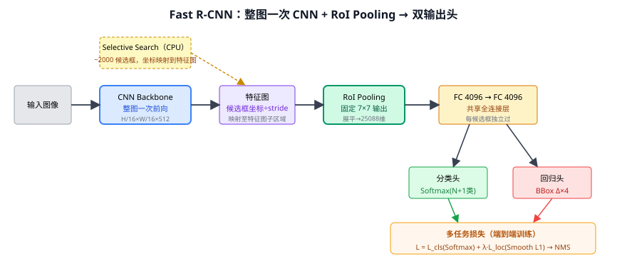
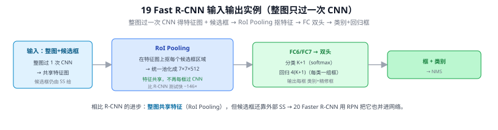
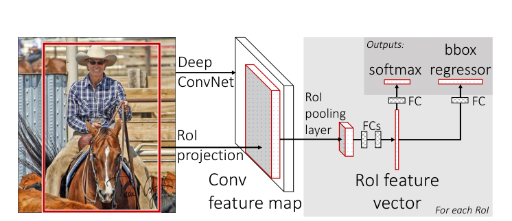
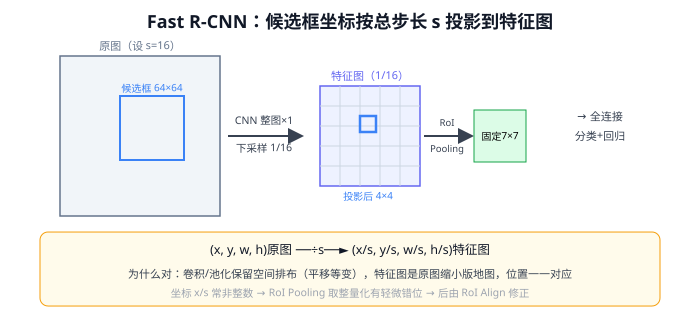
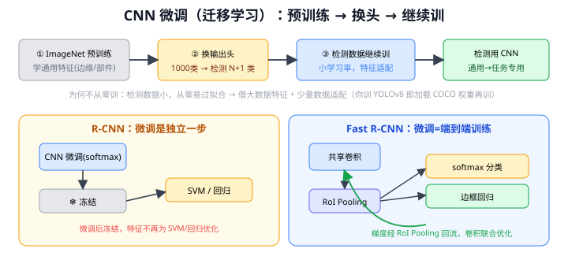
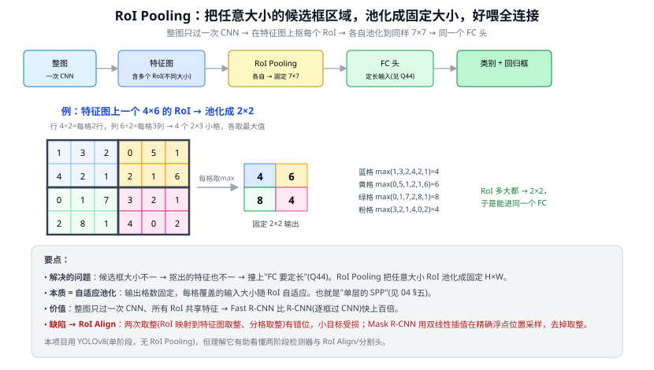
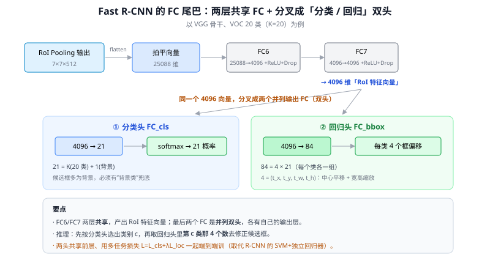

# 19 Fast R-CNN

> 定位：解决 R-CNN"重复计算"的痛点，用 RoI Pooling 让整图只过一次 CNN。
> 作者：Ross Girshick，ICCV 2015。
> 提速：相比 R-CNN，训练快 9×，测试快 ~146×（不含候选框生成）。
> **输入 / 输出**：整图 + 候选框 → 类别 + 回归框（RoI Pooling 共享整图特征）

---

> 📥📤 **输入/输出实例（看一组具体数值）**：输入**整图**（只过一次 CNN 得共享特征图）+ 候选框（仍由 SS 给）→ **RoI Pooling** 在特征图上抠每个候选框区域、统一池化成 **7×7×512** → FC6/FC7 → 双头：分类 K+1（softmax）+ 回归 4(K+1)（每类一组框）→ 输出每框"类别 + 精修框"→ NMS。相比 R-CNN，**整图共享特征、不再每框过 CNN**，测试快 ~146×（Q47/Q58）；但候选框还靠外部 SS → 20 Faster R-CNN 用 RPN 并进网络。

> 📄 **论文原图对照**（图源：Girshick, *Fast R-CNN*, [arXiv:1504.08083](https://arxiv.org/abs/1504.08083) Figure 1，原文 [PDF](../papers/19_Fast_RCNN_1504.08083.pdf)；仅笔记内学习引用，论文写作须自绘）：

> 整图一次卷积，RoI 投影到特征图上池化成定长（Q12/Q47），FC 后分类+回归双头（Q58）。

## 一、提出背景

R-CNN（18）最大的问题是：2000 个候选框各自单独过 CNN，**绝大部分计算是重复的**（候选框互相重叠，同一块像素被反复卷积）。Fast R-CNN 的核心想法：**让整张图只过一次 CNN 得到特征图，候选框直接在特征图上"取"对应区域的特征**，从而消除重复。

---

## 二、核心创新

### 2.1 共享卷积 + RoI Pooling ⭐

**RoI Pooling** 解决了一个关键问题：候选框大小不一，但全连接层要求固定输入。它把任意尺寸的 RoI 自适应地池化成固定 H×W（如 7×7）输出，使不同大小的框都能接到同一个分类头。

### 2.2 多任务损失（端到端单网络）

Fast R-CNN 把分类和边框回归统一进一个网络，用**多任务损失**联合训练：

$$
L = L_{cls}(p, u) + \lambda [u \ge 1] L_{loc}(t^u, v)
$$

- $L_{cls}$：分类损失（softmax 交叉熵，取代 R-CNN 的 SVM）
- $L_{loc}$：边框回归损失（Smooth L1）
- 两个任务共享卷积特征，一起反向传播

这去掉了 R-CNN 中"CNN + SVM + 回归器"三段式训练，简化为一个网络一次训练（候选框生成除外）。

---

## 三、优点与残留瓶颈

**优点**：
- 整图共享卷积，消除重复计算，大幅提速
- 单阶段训练（除候选框），分类回归统一
- 精度也优于 R-CNN（联合优化的好处）

**残留瓶颈**：
- **候选框仍由 Selective Search 生成**，这是 CPU 上的传统算法，约占每张图推理时间的 90%（~2 秒）。这成了新的速度天花板。

→ 这个瓶颈由 20 Faster R-CNN 的 RPN 彻底解决。

---

## 四、历史地位

Fast R-CNN 是承上启下的关键一步：它贡献的 **RoI Pooling** 和**多任务联合训练**被后续所有两阶段检测器继承（Faster R-CNN、Mask R-CNN）。RoI Pooling 后来被 **RoI Align**（Mask R-CNN）改进，解决了量化取整带来的精度损失。

---

## 五、与本项目的关系

- **RoI Pooling 的"从特征图裁剪固定尺寸特征"思想**，与本项目把 YOLOv8 检测框对应区域裁剪后送 CLIP 的做法逻辑相通——都是"在已有特征/图像上，按框取局部"。
- 写第二章相关工作时，Fast R-CNN 是说明"两阶段如何从慢变快"的关键节点。
- 不直接使用。

---

## ✏️ 具体实例（动手算一遍）

**例：候选框坐标如何投影到特征图 + RoI Pooling**
用 VGG 骨干，总步长 $s=16$（4 次 stride-2 池化，$2^4=16$），特征图是原图的 1/16。
原图上一个候选框 $(x,y,w,h)=(160,320,64,64)$：
$$\text{除以 }s\Rightarrow(10,\,20,\,4,\,4)\ \text{在特征图上}$$
即取特征图上 $(10,20)$ 处一块 4×4 区域。再 **RoI Pooling**：把这块（不论原大小）划成 7×7 网格、每格取最大值 → 固定 **7×7** 输出，喂给后面全连接。

**关键对比（省在哪）**：
| | R-CNN | Fast R-CNN |
|---|---|---|
| CNN 跑几次 | ~2000（每框一次） | **整图 1 次** |
| 取特征 | 原图裁 2000 块各过 CNN | 在共享特征图上按投影坐标"取" |

CNN 从"×2000"变"×1"，提速上百倍（详见 [Q12](#q12-fast-r-cnn-为何能直接在特征图上选取候选框)）。小代价：$x/s$ 常非整数、RoI Pooling 取整有轻微错位 → Mask R-CNN 的 RoI Align 用插值修正。

---

## 六、参考文献

- Girshick R. *Fast R-CNN.* ICCV 2015.
- He K, et al. *Mask R-CNN.* ICCV 2017.（RoI Align 改进）

---

## 📋 模型答疑（来自模型详解问答）

## Q12. Fast R-CNN 为何能直接在特征图上选取候选框？

因为卷积/池化**保留空间排布**（平移等变），特征图就是原图的"缩小版地图"，位置一一对应。候选框只需把原图坐标**除以总步长 s**（VGG s=16）就投影到特征图对应区域，再 RoI Pooling 取出。本质："在特征图上裁"≡"在原图裁那块再提特征"，但 CNN 只需整图跑一次（vs R-CNN 每框×2000）。

候选框仍由 Selective Search 在原图生成，变的只是"到共享特征图上取特征"。小代价：x/s 常非整数，RoI Pooling 取整量化 → 轻微错位，Mask R-CNN 的 RoI Align 用双线性插值修正。

---

## Q13. Fast R-CNN 中的 CNN 微调（迁移学习）如何理解？

"微调(fine-tuning)"= 拿 ImageNet 预训练好的 CNN 当起点、换输出头、在检测数据上小学习率继续训，让特征从"通用物体"适配到"检测任务"（检测数据小、从零易过拟合）。**你训 YOLOv8 即此**——加载 `yolov8s.pt`（COCO 预训练）再在路面抛洒物数据上训。

R-CNN 的微调是独立一步（softmax）训完就冻结、交给 SVM；**Fast R-CNN 的微调就是训练本身**——分类(softmax)+回归多任务一起端到端训，且梯度通过 RoI Pooling 回流更新共享卷积、特征为检测联合优化（去掉了单独 SVM 阶段）。

---

## Q47. 什么是 RoI Pooling？它解决什么问题？

整图只过一次 CNN 得特征图后，在特征图上抠每个候选框（RoI）——但 RoI 大小不一 → 抠出的特征块大小不一 → 撞上"FC 要定长输入"。**RoI Pooling 把任意大小的 RoI 划成固定 H×W 个格子、每格取最大值，输出固定 H×W**（如 7×7），所有 RoI 都变同样大小、能进同一个头。

三步：① 映射（RoI 坐标÷总步长定位到特征图）→ ② 分格（均分成固定 H×W 个 bin，bin 大小自适应）→ ③ 每 bin 取 max。本质 = **自适应池化 = 单层 SPP**（输出格数固定、窗口随输入变）。

**缺陷 → RoI Align**：RoI Pooling 有两次取整（坐标映射、分 bin），让特征与原图错位，对小目标/像素级分割伤害明显；RoI Align（Mask R-CNN）用**双线性插值**在精确浮点位置采样、不取整，是分割/精细检测标配。本项目用 YOLOv8（单阶段无 RoI），但理解它有助看懂两阶段来龙去脉与"任意尺寸→定长"这条主线。

---

## Q58. Fast R-CNN 最后的全连接层（FC）具体包含什么？

RoI Pooling（7×7×512）后：拍平 25088 → **FC6(→4096) → FC7(→4096)**（两头共享的"RoI 特征向量"）→ 分叉成 **cls 头(→K+1，softmax 出类别含背景)** 和 **bbox 头(→4(K+1)，每类一组框偏移)**。VOC(K=20)：分类 21 维、回归 84 维。

- **分类 K+1**：多一个**背景类**把"框的是背景"的候选判掉（取代 R-CNN 的 SVM）。
- **回归 4(K+1)**：每类各学一组 (tx,ty,tw,th)（不同类修框规律不同，人瘦高/车扁宽）；推理时先分类选出类别 c、再取第 c 类那 4 个数精修框。
- 两头用**多任务损失**端到端联训（softmax CE + Smooth L1，背景框不计回归损失）——这正是相对 R-CNN 三段式的简化。

> 对比 YOLOv8：全卷积、anchor-free、每网格点直接稠密预测，没有"RoI 特征→两个 FC 头"结构。两阶段先抠 RoI 特征再 FC 双头；一阶段跳过 RoI 直接在网格回归。
