# 20 Faster R-CNN

> 定位：两阶段检测的标杆与集大成者。用 RPN 把候选框生成也交给神经网络，实现真正端到端。
> 作者：Ren Shaoqing, He Kaiming 等，NeurIPS 2015。
> 意义：检测从此进入"全神经网络、可端到端训练"时代。
> **输入 / 输出**：图像 → 框 + 类别（RPN 自产候选框，端到端）

---

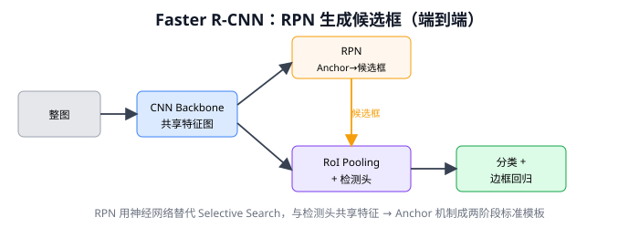

> 📥📤 **输入/输出实例（看一组具体数值）**：输入一张图（无需外部候选框）→ CNN 骨干出**共享特征图**（两个头共用，这是"Faster"的关键）→ ① **RPN**（第一阶段）：~2 万 anchor 筛到 **~300 候选**，类别无关只判"有没有物体"，替代 Selective Search → ② **检测头**（第二阶段，= Fast R-CNN 头）：RoI Align → FC → 分类 K+1 + 回归 4(K+1)，精分类+精修框 → 输出"框 + 类别"→ NMS。全神经网络、端到端，是两阶段精度标杆（本篇 Q14 等深度精读）。

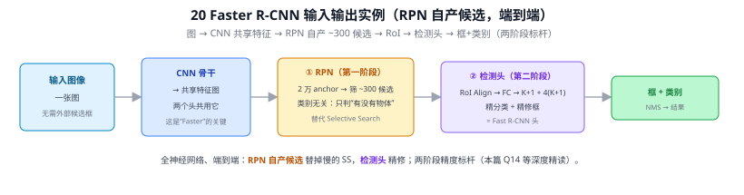

> 📄 **论文原图对照**（图源：Ren et al., *Faster R-CNN*, [arXiv:1506.01497](https://arxiv.org/abs/1506.01497) Figure 2，原文 [PDF](../papers/20_Faster_RCNN_1506.01497.pdf)；仅笔记内学习引用，论文写作须自绘）：

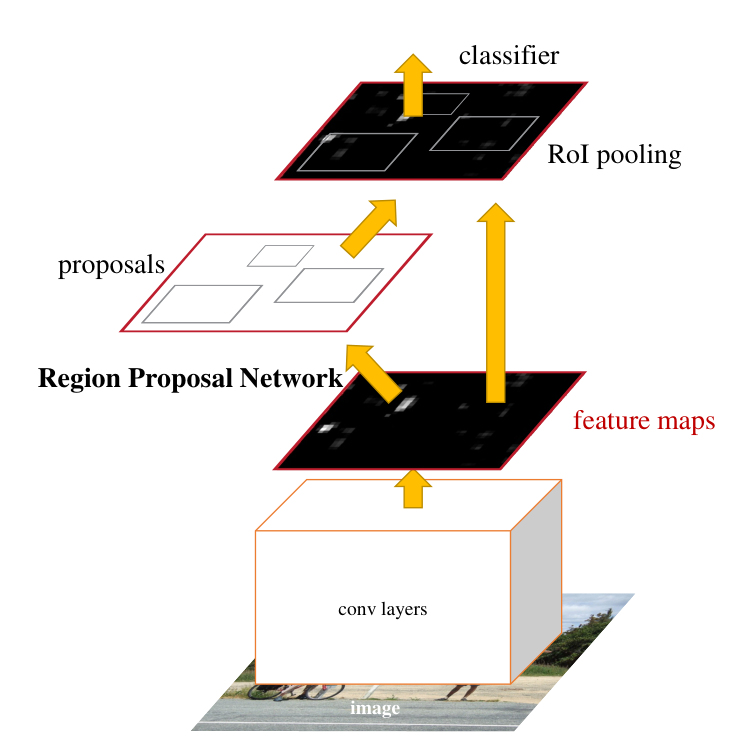

> 统一网络：共享卷积特征上挂 RPN 产生候选（Q14/Q69），RoI 头精修出最终框（Q62）。

## 一、提出背景

Fast R-CNN（19）把检测加速到接近实时，但**候选框生成（Selective Search）仍是 CPU 上的传统算法**，占了推理时间的大头。Faster R-CNN 的核心贡献：**用一个神经网络（RPN）来生成候选框**，与检测网络共享卷积特征，把"候选框生成"也纳入深度学习，实现端到端。

---

## 二、整体结构

```
整图 ──► CNN Backbone（如 VGG/ResNet）──► 共享特征图
                                            │
                          ┌─────────────────┴─────────────────┐
                          ▼                                   ▼
                  RPN（候选框生成）                    RoI Pooling
                  输出 region proposals  ───────────►  + 检测头
                                                     分类 + 边框回归
```

两个阶段共享同一张特征图：第一阶段 RPN 提候选，第二阶段对候选精细分类回归。

---

## 三、核心创新：RPN（Region Proposal Network）⭐

RPN 是一个小型全卷积网络，在共享特征图上滑动，每个位置预测候选框。

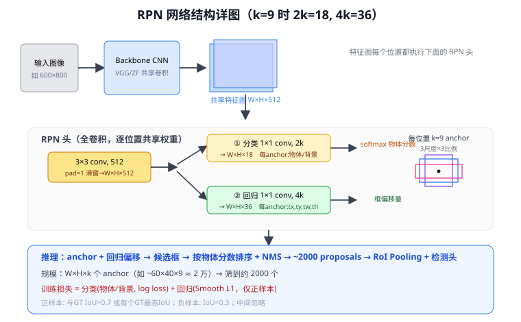

> 结构详解：主干 CNN 输出共享特征图（W×H×512）→ **3×3 卷积滑窗**（pad=1，保持 W×H，输出 512 维）→ 两个并列的 **1×1 卷积头**：① 分类头输出 W×H×2k（每个 anchor 一对"物体/背景"分数）、② 回归头输出 W×H×4k（每个 anchor 的 $t_x,t_y,t_w,t_h$ 偏移）。每个位置 k=9 个 anchor，全图约 2 万个 → 解码 + NMS 筛到 ~2000 个候选框，交给 RoI Pooling 与检测头。整个 RPN 是全卷积、逐位置共享权重。

### 3.1 Anchor 机制 ⭐

在特征图每个位置预设 $k$ 个**锚框（anchor）**——不同尺度、不同长宽比的参考框（论文用 3 尺度 × 3 比例 = 9 个）：

```
特征图每个点 ─► 9 个 anchor（3 种大小 × 3 种长宽比）
每个 anchor 预测：
  ├─ 2 个分类分数（前景/背景）
  └─ 4 个回归值（相对 anchor 的中心偏移 + 宽高缩放）
```

**Anchor 的意义**：把"在连续空间里找框"的难题，转化为"对一组预设参考框做分类 + 微调"的简单任务。这个思想被几乎所有后续检测器沿用，直到 anchor-free 方法（FCOS、YOLOv8）才反过来去掉它。

### 3.2 损失

RPN 同时优化：
- **分类损失**：anchor 是前景还是背景（与真值 IoU > 0.7 为正）
- **回归损失**：Smooth L1，微调 anchor 到真值

### 3.3 训练策略

原论文用"四步交替训练"（RPN 与检测头交替微调），后简化为**近似联合训练**，一次反向传播同时更新 RPN 和检测头。

---

## 四、优点与局限

**优点**：
- 全神经网络，端到端，候选框生成快（GPU 上 RPN 仅约 10ms）
- 精度高，长期是检测精度标杆
- 框架通用，催生 Mask R-CNN（加分割分支）、Cascade R-CNN（多级精修）等

**局限**：
- **两阶段本质上仍比单阶段慢**（约 5—17 fps），难做实时
- Anchor 超参（尺度、比例、数量）需手工设计，对不同数据集敏感
- 对极小目标、密集目标仍不够好

→ 追求实时的场景转向单阶段（22 YOLO、23 SSD）。

---

## 五、历史地位

Faster R-CNN 是检测领域引用量最高的工作之一，**Anchor + RPN + RoI** 成为两阶段检测的标准模板。它代表"精度优先"路线的巅峰，与 YOLO 的"速度优先"路线长期并行。FPN（21 FPN）最初就是嫁接在 Faster R-CNN 上提升多尺度能力的。

---

## 六、与本项目的关系

- **Anchor 思想**是理解 YOLOv8 为何采用 **anchor-free** 的对照基准。本项目基线 YOLOv8 已去掉 anchor，但要讲清"为什么去掉"，必须先懂 Faster R-CNN 的 anchor 机制及其超参困扰。
- **两阶段 vs 单阶段**是第二章相关工作的核心对比维度：本项目选单阶段 YOLOv8 是为了实时（< 100ms），代价是对密集小目标略弱——而这正是本项目用 P2 + CBAM 改进检测头要弥补的。
- 不直接使用。

---

## ✏️ 具体实例（动手算一遍）

**例：RPN 一张图产生多少 anchor、怎么筛到 2000**
设共享特征图 40×60，每个位置预设 **9 个 anchor**（3 尺度 × 3 长宽比）：
$$40\times60\times9=21{,}600\ \text{个 anchor}$$
RPN 在每个位置用 3×3 滑窗 → 两个 1×1 头：分类头出 $2\times9=18$ 个"物体/背景"分数、回归头出 $4\times9=36$ 个偏移。然后：
```
21600 个 anchor → 按"含物体"分数排序 → 取 top-N → NMS 去重 → ~2000 个候选
```
这 2000 个候选再送第二阶段（RoI Align + 分类/回归精修）——把 R-CNN 的 Selective Search 换成了**可学习、与检测头共享特征**的 RPN（详见 [Q14](#q14-rpn-的结构来历与替代-selective-search-的原理以及-anchor-超参可不可以不管)）。

**例：为什么 anchor 尺寸要覆盖数据分布**
若数据里全是细长目标（如电线杆），而 anchor 只有方形 → 没有 anchor 与真值 IoU 够大 → 拿不到正样本 → 漏检。所以 anchor 的尺度/比例要匹配数据（YOLOv2 起用 k-means 在真值框上聚类选），这也是后来 anchor-free 想摆脱的麻烦。

---

## 七、参考文献

- Ren S, He K, Girshick R, Sun J. *Faster R-CNN: Towards Real-Time Object Detection with Region Proposal Networks.* NeurIPS 2015.
- He K, et al. *Mask R-CNN.* ICCV 2017.
- Cai Z, Vasconcelos N. *Cascade R-CNN.* CVPR 2018.

---

## 📋 模型答疑（来自模型详解问答）

> 按主题分四组（编号保持原顺序作稳定 ID）：**甲 RPN 结构与设计** Q14/Q69/Q70｜**乙 候选筛选** Q63/Q64｜**丙 第二阶段检测头** Q62/Q65/Q66｜**丁 两阶段为何准** Q68。新手先读 Q14（入口）+ Q68（全局）。

---

## Q14. RPN 的结构、来历与替代 Selective Search 的原理，以及 anchor 超参可不可以不管？

**RPN**（Region Proposal Network）= Faster R-CNN 自产候选框、取代 Selective Search 的小网络：在骨干共享特征图上用 3×3 卷积滑窗，每位置接两个 1×1 头——cls 头判每个 anchor "有没有物体"（2k 通道）、reg 头预测框偏移（4k 通道），端到端训练。k=9（3 尺度×3 比例），整图约 2 万 anchor → 打分+回归 → NMS 选 ~300。

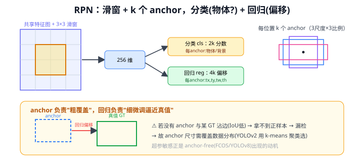

**为什么能替代 SS**：SS 在原始像素上做超像素合并（CPU 串行、~2 秒/图、不可学、不共享骨干）；RPN 在深层特征图上做——每个位置的大感受野（VGG conv5_3 约 228×228）已被骨干"看完"并编码进特征，RPN 只需轻量分类+回归，~10ms/图、可学、复用骨干特征。

**anchor 超参必须管**：回归只能在 anchor 附近微调，anchor 与数据物体分布对不上（IoU 都低）就拿不到正样本 → 漏检。所以 anchor 尺度/比例要覆盖数据分布（YOLOv2 起用 k-means 聚类选）。这也是 anchor-free（FCOS/YOLOv8）的动机：嫌超参烦，干脆直接回归框边距离。

补两个常被问的点：
- **每 anchor 是「2 分类 + 4 回归」= 6，不是 8**：那个"2"是 objectness（前景/背景）不是类别；回归是**类别无关**的一组 (tx,ty,tw,th)，对任何物体都一样表达。真正"每类一组回归"是第二阶段的 4(K+1)。
- **anchor 预设、学的是偏移**：anchor 固定不动，被学的是 reg 偏移；输出 = anchor + 偏移 ≈ GT，逼近 GT 的是偏移参数；"逐渐逼近"在训练，推理是单次前向一步出框（多步细化是 Cascade R-CNN）。

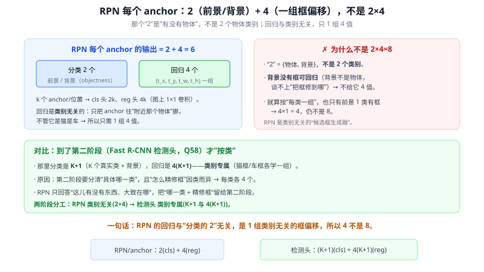

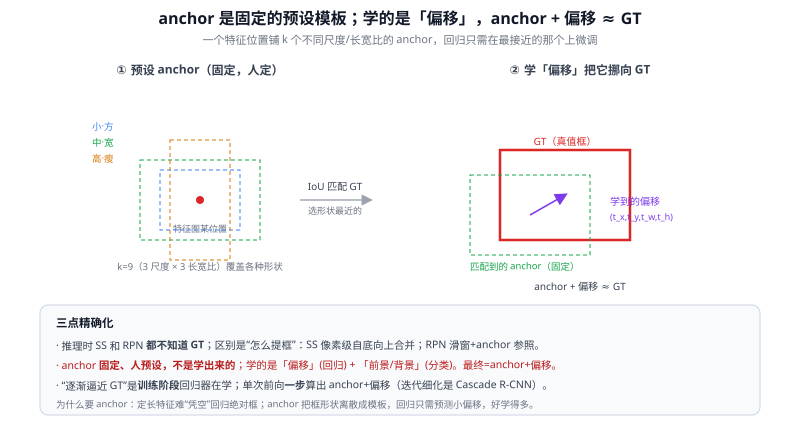

---

## Q62. Faster R-CNN 的检测头是什么？

检测头 = **第二阶段**，接过 RPN 的 ~300 候选框：每个框 RoI Align 成固定 7×7×512 → FC6/FC7 得 4096 维 RoI 向量 → 分叉成**分类头**（K+1，softmax 含背景）和**回归头**（4(K+1)，每类一组框偏移）→ NMS。一句话：**Faster 的检测头 = Fast R-CNN 的头**，Faster 的创新只是把候选框来源从 Selective Search 换成 RPN，检测头原样复用。

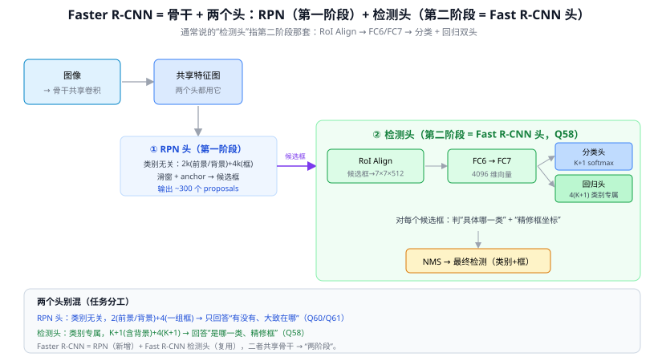

**别和 RPN 头混**：RPN 头（第一阶段）2 分类（前景/背景）+ 4 回归（类别无关），任务是"有没有 + 粗框"；检测头（第二阶段）K+1 分类 + 4(K+1) 回归（类别专属），任务是"是哪类 + 精修框"。粗→精两步走就是两阶段的定义。

> 对比 YOLOv8（本项目）：单阶段、无 RPN/RoI/FC，全卷积检测头直接在网格点上出"类别+框"（anchor-free+DFL）一步到位——更快，但对密集小目标更吃力。

---

## Q63. RPN 的约 300 个 proposals 是从所有 anchor 里 NMS 筛出来的吗？

是，但要先纠正"4k 个框"：4k 是**通道数**（每位置 k 个 anchor × 4 坐标），真正候选框数 = anchor 数 = H×W×k（如 60×40×9 ≈ 2 万）。测试时的筛选漏斗：

```
2 万 anchor → 应用偏移+裁边界+删过小框
   → 按 objectness 排序取 pre-NMS top-N(≈6000)
   → NMS(IoU 0.7)
   → post-NMS top-N(≈300) → 送第二阶段
```

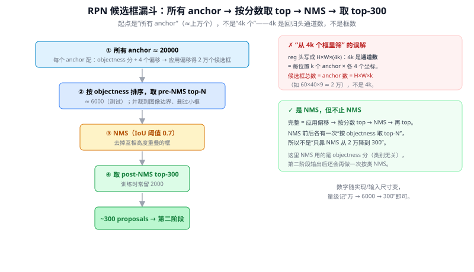

两个易忽略点：① 这里 NMS 用 **objectness 分（类别无关）**，RPN 不分类别；② 检测头输出后**还会再按类别 NMS 一次** → 全流程**两次 NMS**。量级记"万→6000→300"即可（具体数随实现/输入尺寸变）。

---

## Q64. RPN「按 objectness 取 top-N」具体是怎么取的？

就是**排序 + 截断**，不是复杂操作：把全图所有位置、所有 k 个 anchor 摊平成一个候选池（约 2 万行，每行 = 框 + 它的前景概率 s），按 s 从大到小排序，留前 N 个（如 6000），其余扔。代码就是 `topk`/`argsort`。

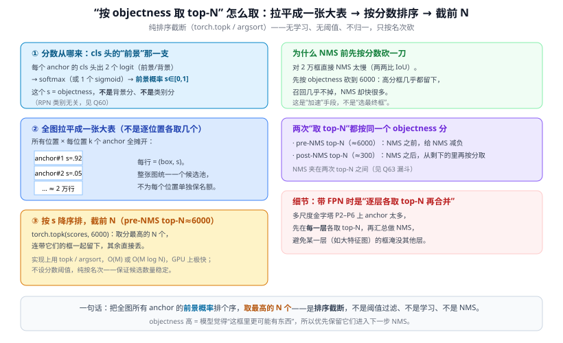

三个特点：**无阈值**（固定要 N 个，保证候选数稳定）、**无学习**（纯排名不更新权重）、**不是 NMS**（只看分数不看重叠）。它**先于 NMS**，目的是把要送进 NMS 的框数砍下来给 NMS 减负（NMS 要两两算 IoU，框越多越慢）。分数用的是 cls 头"前景"那一支的概率（类别无关）。

> 工程细节：带 FPN 时改成"每层各取 top-N"再合并，否则浅层高分辨率的海量 anchor 会淹没深层。YOLOv8 推理也有同源一步（按置信度排序+`max_nms`截断再 NMS）。

---

## Q65. 检测头的分类头和回归头，为什么设计成从同一个 FC 分叉出来？

经典**多任务学习**：分类"是什么"和回归"在哪"需要的中层特征大量重叠（都靠对物体形状/部件/边缘的理解），共用一份通用表征比各学一套更省更稳；而 FC6/FC7 参数量极大（FC6≈25088×4096≈1 亿），独立两座塔会让最贵的计算翻倍、还要对 ~300 个 RoI 逐个过。

但**不全程共享，末端才分叉**——因为两任务诉求相反：**分类要平移不变**（物体偏左偏右都判同一类），**回归要平移敏感**（边界差几像素就纠正）。所以共享主干学通用特征 + 各接一层轻线性头做特化。

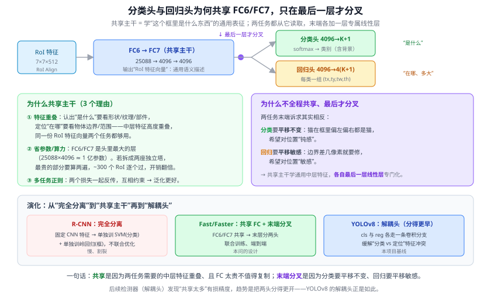

> 演化线：R-CNN 完全分离（SVM+岭回归各训）→ Fast/Faster 共享主干末端分叉 → **YOLOv8 解耦头**（分类/回归各走独立卷积分支，分得更早）。后续发现共享太多会让平移不变/敏感特征互相干扰，所以趋势是解耦更彻底——YOLOv8 解耦头就是在为这个冲突买单换精度。

---

## Q66. Faster R-CNN 能不能像 YOLOv1 那样在 FC7 后只用一个头直接预测类别和框？

先拆清"学 YOLOv1"指什么：
- **若指"把两个线性头合成一个"**：可以但**没意义**——Faster 的"两个头"本就不是两座塔，只是从同一个 FC7 并排接的两个 Linear。合成 `4096→(K+1+4(K+1))` 一层**数学上完全等价**（大权重矩阵不同行段互不影响），参数/计算/结果全不变。而且**一个头 ≠ 一个损失**：合成后仍要切片，前 K+1 维过 softmax+CE、后 4(K+1) 维过 Smooth L1，两套损失躲不掉（YOLOv1 也一样，7×7×30 照样切三部分各算损失）。
- **若指"不要 RoI/两阶段、在网格上一把出张量"**：那已不是改头，而是**换掉整个两阶段范式、变单阶段检测器**了。

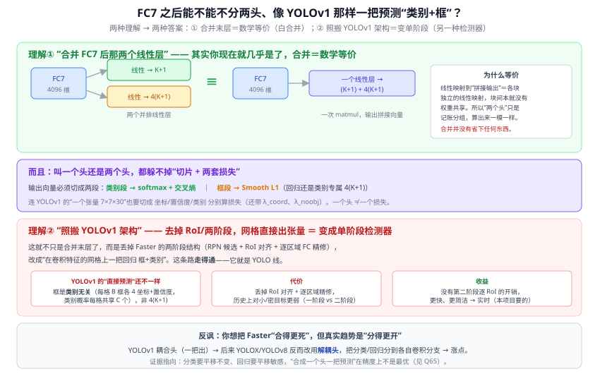

> 反讽：你的方向是"合得更死"，但历史趋势恰恰相反——YOLOv1 当年是耦合头，YOLOX/YOLOv8 反而改成**解耦头**并涨点（分类要平移不变、回归要平移敏感，挤一起互相干扰）。YOLOv8（本项目）= 范式上像 YOLOv1（单阶段直接预测）+ 头部比 YOLOv1 更解耦。

---

## Q68. Faster R-CNN 更精确，只是因为第二阶段逐区域 FC 精修吗？

抓到一个真实来源，但当成唯一就错了。两阶段更准 = **两根柱子**：
- **柱① 逐区域精修（你说的）**：检测头在 RPN 候选上做二次分类+二次框回归，且用 RoI Align 抠出对准目标的规整特征——比单阶段"一次到位+就地预测"更细。（框回归两次 coarse-to-fine，也是 Cascade R-CNN 做三次的动机。）
- **柱② 样本均衡（常被忽略，可能更大头）**：单阶段在所有网格/anchor 稠密预测→海量背景框→极端正负不平衡；两阶段靠 RPN 先筛掉绝大多数背景，第二阶段只对 ~300 候选（还 1:3 采样）精算，天然均衡。

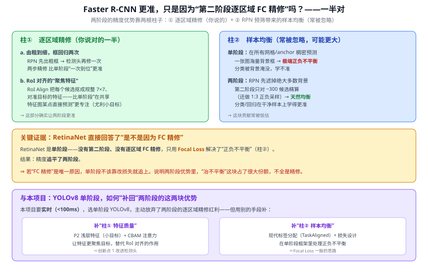

**关键证据**：RetinaNet 是单阶段（无 RPN/RoI/精修），只用 Focal Loss 补"不平衡"这一课就追平两阶段——说明两阶段的精度优势里很大一块来自柱②而非柱①。代价：两阶段要对 ~300 RoI 逐个过 FC，只有 5–17 fps，难实时。

> 本项目（YOLOv8）要实时、选单阶段，**补精度的两条路正对应两根柱子**：补柱①用 **P2 浅层特征 + CBAM** 让特征更聚焦（创新点 1）；补柱②用 **TaskAligned 标签分配 + VFL/DFL** 处理正负不平衡（Focal Loss 一脉）。理解 Faster 为什么准，就是理解本项目改进检测头要补什么。

---

## Q69. Faster R-CNN 里的 RPN 为什么要设计成现在这样？

一句话：**在骨干特征图上、用共享的轻量全卷积、靠 anchor 把"找框"变成"选参照+微调"、只判有没有物体而不判类别**。每个限定词对应一个动机（把设计和它拒绝的替代方案对看最清楚）：

- **接骨干共享特征图**（不接原图）：复用大感受野+现成语义，且与第二阶段共用一张图、候选生成几乎零额外卷积（"Faster"命名来源）。替代=SS 在像素上做，慢/不可学/割裂。
- **3×3 滑窗 + 全卷积、权重共享**（不用逐位置 FC）：参数少、平移不变、任意尺寸一次算完。替代=每位置一个 FC，参数爆炸/破坏平移不变/换尺寸失效。
- **预设 anchor**（不直接回归绝对框）：定长向量凭空回归绝对框难且不稳，anchor 把形状空间离散化、只需学小偏移、还能一位置同时测多个重叠目标。
- **只判前景/背景**（不直接出类别）：RPN 轻量、与类别数解耦可复用、形成"粗筛→精修"两阶段分工。替代=让 RPN 出类别就退化成单阶段检测器。

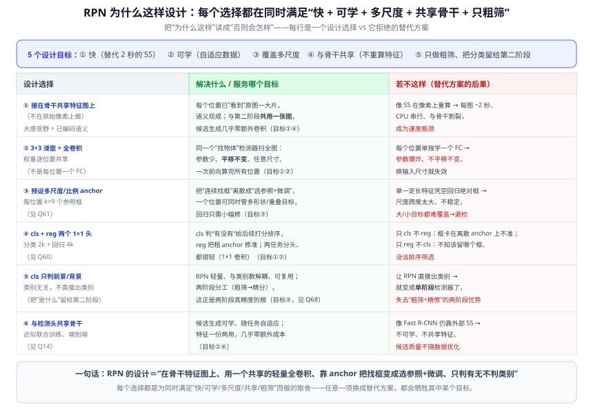

---

## Q70. RPN 在每个位置用 3×3 滑窗再接两个 1×1 头，具体怎么理解？

"滑窗"容易让人以为有 for 循环，其实**那层就是普通 3×3 卷积**（卷积核扫过特征图本身就是"滑动"）：

```
共享特征图 H×W×C
  │ Conv 3×3 (pad=1,stride=1) + ReLU     ← "3×3 滑窗"，聚 3×3 邻域上下文
  ▼ 中间特征图 H×W×256
  ├ Conv 1×1 → H×W×2k   cls 头（每位置 k anchor 各 2 前景/背景分）
  └ Conv 1×1 → H×W×4k   reg 头（每位置 k anchor 各 4 偏移）
```

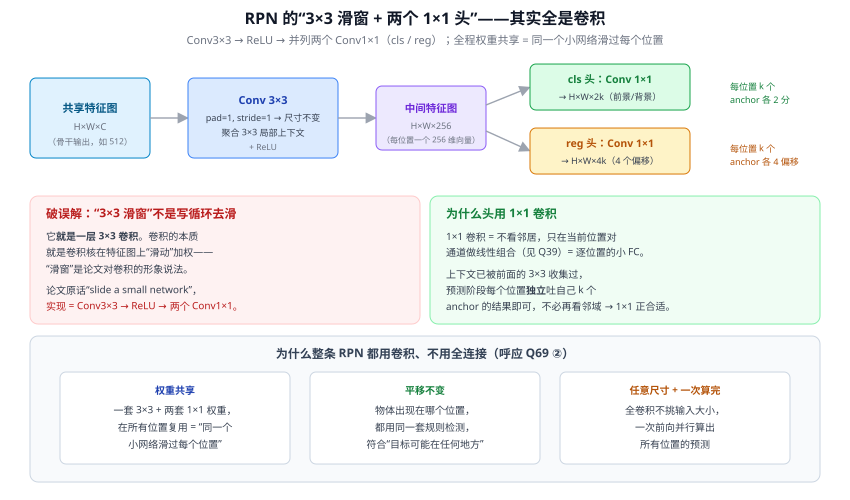

两个头用 **1×1 卷积 = 逐位置线性预测**（等价于所有位置共享的小 FC）：局部上下文已被前面 3×3 收集，预测时每位置只需独立输出自己 k 个 anchor 的结果。整条 RPN 全卷积的三个好处：权重共享、平移不变、任意尺寸一次算完。

**✏️ 数值例子（VGG16，输入 600×800）**：特征图 38×50×512 →（Conv3×3）中间 38×50×512 → cls 头 Conv1×1(512→18)、reg 头 Conv1×1(512→36)；全图 anchor = 38×50×9 = 17100。

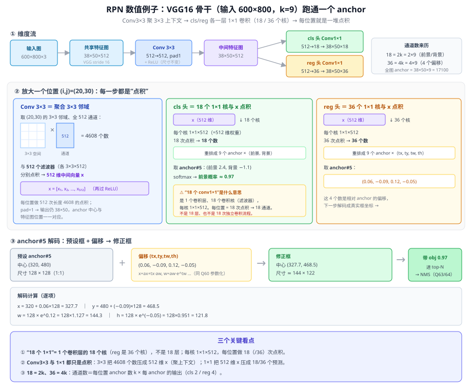

要点：① "18 个 1×1" = 1 个卷积层的 18 个核（reg 36 个核），不是 18 层；② Conv3×3 把 3×3×512=4608 个数压成 512 维 x（512 个核各一次点积，见下图），1×1 把 x 压成 18/36 个预测；③ 18=2k、36=4k = anchor 数 × 每 anchor 输出数。

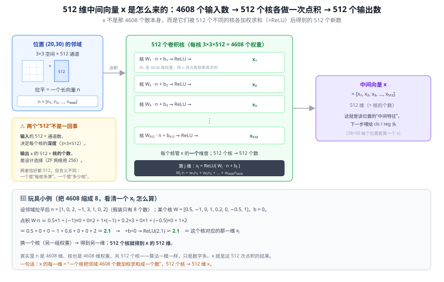

> 这套"3×3 聚合 + 1×1 出预测"的全卷积检测头被现代单阶段直接继承：YOLOv8 解耦头也是每分支堆几层 3×3、最后 1×1 输出。理解这个最小单元，就看懂了几乎所有检测头的搭法。
