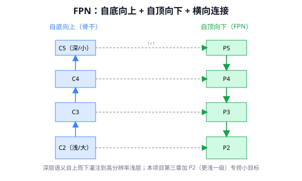
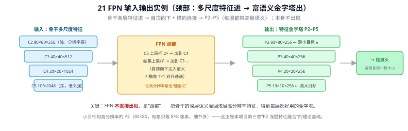
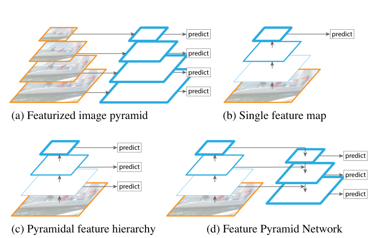
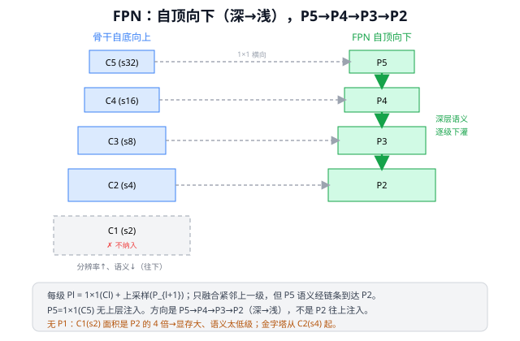

# 21 FPN（特征金字塔网络，Feature Pyramid Networks）⭐

> 定位：解决"多尺度目标检测"的奠基性工作，现代检测器的标配颈部（Neck）。
> 作者：Lin Tsung-Yi, He Kaiming 等，CVPR 2017。
> **本项目第三章改进（P2 浅层特征融合）的直接理论基础。**
> **输入 / 输出**：骨干多尺度特征 → 多尺度特征金字塔 P2–P5（供检测头，本身不出框）

---



> 📥📤 **输入/输出实例（看一组具体数值）**：输入是骨干的**多尺度特征** C2 80×80×256（浅、分辨率高）/ C3 40×40×512 / C4 20×20×1024 / C5 10×10×2048（深、语义强）→ FPN 自顶向下：C5 上采样 2× 加到 C4、再上采样加到 C3……（横向 1×1 对齐通道）→ 输出**特征金字塔** P2 80²/P3 40²/P4 20²/P5 10²（各 256 通道，每层都带上了高层语义）。**FPN 本身不出框**，是"颈部"给检测头供料。小目标用高分辨率 **P2**（每格只覆盖 8×8 像素、细节多）——这正是本项目第三章"P2 浅层特征融合"的直接理论基础。



> 📄 **论文原图对照**（图源：Lin et al., *Feature Pyramid Networks*, [arXiv:1612.03144](https://arxiv.org/abs/1612.03144) Figure 1，原文 [PDF](../papers/21_FPN_1612.03144.pdf)；仅笔记内学习引用，论文写作须自绘）：



> (a-d) 四种金字塔方案对比：(d) FPN = 自顶向下 + 横向连接，兼得高层语义与高分辨率（Q15）——本项目 P2 层的出处脉络。

## 一、提出背景：尺度问题

目标检测的核心难题之一是**目标尺寸差异巨大**：同一张图里可能既有占满画面的卡车，又有几个像素的远处小石块。CNN 的特征层有天然矛盾：

- **浅层特征**（高分辨率）：细节丰富、定位准，但语义弱（不知道"是什么"）→ 适合小目标
- **深层特征**（低分辨率）：语义强（知道"是什么"），但细节丢失、定位粗 → 适合大目标

FPN 之前的几种笨办法：
1. 只用最深层特征 → 小目标丢失（Faster R-CNN 原始做法）
2. 图像金字塔（多尺度缩放后分别检测）→ 计算量爆炸
3. 各层独立预测（SSD）→ 浅层缺语义，小目标仍差

FPN 的目标：**让每一层都同时具备高分辨率和强语义**，且几乎不增加计算。

---

## 二、核心结构：自顶向下 + 横向连接 ⭐

FPN 在骨干的"自底向上"路径外，增加一条"自顶向下"路径，并用横向连接融合。

### 2.1 FPN 结构图

```
┌─────────────────────────────────────────────────────────────────────────────┐
│                        FPN 完整结构（以 640×640 输入为例）                    │
├──────────────────────────────┬──────────────────────────────────────────────┤
│    骨干（自底向上，提特征）    │         FPN（自顶向下，注语义）                 │
├──────────────────────────────┼──────────────────────────────────────────────┤
│                              │                                              │
│  输入 640×640                 │                                              │
│     │                        │                                              │
│  C2 (160×160, 256ch)  ─1×1─► │ ──────────────────────────────► ⊕ ─3×3─► P2 │─► Head(小目标)
│     │   stride=4      →256ch │                                  ↑          │   160×160, 256ch
│     │                        │                              upsample×2     │
│  C3 ( 80×80,  512ch)  ─1×1─► │ ──────────────────────► ⊕ ─3×3─► P3 ───────┘
│     │   stride=8      →256ch │                           ↑                 │─► Head
│     │                        │                       upsample×2            │   80×80, 256ch
│  C4 ( 40×40, 1024ch)  ─1×1─► │ ──────────────► ⊕ ─3×3─► P4 ──────────────┘
│     │   stride=16     →256ch │                  ↑                          │─► Head
│     │                        │              upsample×2                     │   40×40, 256ch
│  C5 ( 20×20, 2048ch)  ─1×1─► │ ──────────────────────────────────► P5 ─────┘
│        stride=32      →256ch │                                              │─► Head(大目标)
│                              │                                              │   20×20, 256ch
└──────────────────────────────┴──────────────────────────────────────────────┘
```

箭头含义：`─1×1─►` = 1×1 卷积对齐通道数（各 Cl 通道数不同，统一压缩到 256ch）；`⊕` = 逐元素相加；`─3×3─►` = 3×3 卷积消除上采样的混叠效应。

### 2.2 每个融合节点的操作

以 P4 为例（其余 P2/P3 完全相同逻辑）：

```
C4(40×40, 1024ch)
       │
    1×1 conv           ← 把 1024ch 压缩到 256ch（对齐通道）
       │
       ▼
  [40×40, 256ch] ─────► ⊕(add)  ← 逐元素相加（两者尺寸已匹配）
                          ↑
  P5(20×20, 256ch)
       │
  upsample ×2          ← 最近邻插值，20×20 → 40×40
       │
  [40×40, 256ch] ──────┘
                         │
                      3×3 conv   ← 消除上采样的棋盘格混叠
                         │
                        P4 (40×40, 256ch)
```

通式：$P_l = \text{Conv}_{3\times3}\bigl(\text{upsample}(P_{l+1}) + \text{Conv}_{1\times1}(C_l)\bigr)$

**三个操作的缺一不可**：

| 操作 | 目的 | 去掉会怎样 |
|------|------|-----------|
| 1×1 conv | 统一通道数（不同 Cl 通道数不同，无法直接加） | 维度不匹配，无法相加 |
| upsample × 2 | 把深层低分辨率特征放大到与浅层对齐 | 尺寸不匹配，无法相加 |
| 3×3 conv | 消除最近邻插值的"棋盘格"混叠，同时融合相邻信息 | 特征图有插值伪影，影响精度 |

**直觉**：1×1 先"换语言"（统一通道），upsample 再"放大地图"（对齐尺寸），⊕ 把深层语义注入浅层，最后 3×3 "打磨"消除伪影。

---

## 三、关键贡献

1. **多尺度融合的范式**：自顶向下 + 横向连接，成为此后所有检测颈部的模板
2. **几乎零额外成本**：只加了少量 1×1/3×3 卷积，远比图像金字塔便宜
3. **小目标显著提升**：高分辨率层获得语义后，小目标召回率大幅改善

---

## 四、演进：PAN / PAN-FPN ⭐

### 4.1 FPN 的遗留问题

FPN 让每一层 Pₗ 都获得了深层语义，但还有一个短板：浅层的**精确定位信息**（边缘、像素细节）想到达最深层检测头，在 FPN 内部要经过约 100 层网络，途中逐渐衰减。

**PANet（Path Aggregation Network，CVPR 2018）** 的动机：补一条自底向上的短路，只需约 10 层就能让浅层定位直达深层检测头。

### 4.2 PANet 自底向上路径

以 FPN 的输出 P3/P4/P5 为起点，**从浅到深**再聚合一遍：

```
P3(80×80) ─────────────────────────────────────── N3(80×80) ──► Head(小目标)
    │
    │ stride-2 下采样 (80→40)
    ▼
[concat, 40×40]  ←─── P4(40×40)（来自 FPN，已有语义）
    │
    │ C2f 融合
    ▼
N4(40×40) ────────────────────────────────────── Head(中目标)
    │
    │ stride-2 下采样 (40→20)
    ▼
[concat, 20×20]  ←─── P5(20×20)（来自 FPN，已有语义）
    │
    │ C2f 融合
    ▼
N5(20×20) ────────────────────────────────────── Head(大目标)
```

每个节点做三件事：① 上一节点 stride-2 下采样（分辨率减半）；② 与同分辨率的 FPN 特征图 concat；③ C2f 融合两路信息。

**检测头挂在 N3/N4/N5，不是 P3/P4/P5**。N3/N4/N5 同时携带：
- FPN 下传的**语义**（"看得懂"是什么类别）
- PAN 短路带来的**定位**（"找得准"目标边缘，只走了约 10 层）

### 4.3 PAN-FPN 完整数据流

骨干 + FPN + PAN 三段串联：

```
阶段           方向          操作（YOLOv8 版）                          产出
─────────────────────────────────────────────────────────────────────────────
① 骨干         自底向上      Conv/C2f，stride 逐级 ×2                  C3/C4/C5
② FPN（颈上半） 自顶向下     upsample(C5) + concat(C4) → C2f → F4      F3 / F4
                              upsample(F4) + concat(C3) → C2f → F3
③ PAN（颈下半） 自底向上     N3 = F3                                   N3 → Head
                              conv↓(N3) + concat(F4) → C2f → N4        N4 → Head
                              conv↓(N4) + concat(C5) → C2f → N5        N5 → Head
─────────────────────────────────────────────────────────────────────────────
```

信息流示意图（从左往右是时间顺序，即先骨干、再 FPN、再 PAN）：

```
   骨干（自底向上）         FPN（自顶向下）          PAN（自底向上）        Head
   ────────────────         ──────────────           ──────────────         ────
input
  │
  ▼
C3(80×80) ─1×1─→ concat ←─upsample─┐
                                    │
C4(40×40) ─1×1─→ concat ←─upsample─┤→ F4(40×40)
                                    │         │
C5(20×20) ─1×1──────────────────── F5         │ conv↓(N3)
                                              │
              F3(80×80)=N3 ──────────────────────────────────► Head(小, stride 8)
                                       concat(N3↓)+C2f
                                              │
                                    N4(40×40) ─────────────── Head(中, stride 16)
                                       concat(N4↓)+C2f
                                              │
                                    N5(20×20) ─────────────── Head(大, stride 32)
```

三段分工对比：

| 路径 | 方向 | 作用 | 产出 |
|------|------|------|------|
| 骨干 Backbone | 自底向上 | 提取多尺度原始特征 | C3/C4/C5 |
| FPN（颈上半） | 自顶向下 | 深层语义注入浅层（"看得懂"） | F3/F4/F5 |
| PAN（颈下半） | 自底向上 | 浅层定位注入深层（"找得准"） | N3/N4/N5 |
| 检测头 Head | — | 分类 + 框回归 | 最终检测框 |

> **直觉**：FPN = 深层语义坐电梯下来，顺路给每层带上"语义礼包"；PAN = 浅层定位坐电梯上去，顺路给每层带上"定位礼包"。两路都走完，每个检测头都同时"看得懂 + 找得准"。

### 4.4 YOLOv8 具体实现与本项目改动

YOLOv8 默认 3 个检测尺度（格数 8400），本项目加 P2 后 4 个尺度（格数 ~33600）：

```
默认 YOLOv8（3 尺度）                      本项目 EXP-002（+P2，4 尺度）
─────────────────────────────────          ─────────────────────────────────────
FPN: C5→F5, F5+C4→F4, F4+C3→F3            FPN: 多一步 F3+C2→F2(160×160)
PAN: F3→N3, N3↓+F4→N4, N4↓+C5→N5         PAN: 多一步 F2→N2, N2↓+F3→N3, ...

Head: N3/N4/N5（三尺度）                   Head: N2/N3/N4/N5（四尺度）
格数: 80²+40²+20² = 8400                   格数: 160²+80²+40²+20² ≈ 33600
```

格数增至 4 倍，正负不平衡随之加剧（→ Q25），这是 EXP-002 未见提升的重要原因之一。

---

## 五、与本项目的关系 ⭐⭐（第三章核心）

这是本项目**创新点 1（改进小目标检测头）**最重要的理论依据：

- **YOLOv8 默认输出 3 个尺度**：P3（80×80，stride 8）、P4（40×40，stride 16）、P5（20×20，stride 32）。最小的检测尺度 P3 对应 stride 8，对路面上几个像素的抛洒物仍可能漏检。
- **本项目改进 = 增加 P2 层**（stride 4，160×160）：把 FPN 金字塔再往浅层延伸一级，得到分辨率更高的特征图，专门捕捉极小目标。这正是 FPN"自顶向下灌语义"思想的直接应用——给 P2 这个高分辨率层也注入深层语义。
- **配合 CBAM**（16 CBAM）：在融合后的特征上加注意力，进一步突出低对比度的小目标。

> 写第三章时，FPN 论文的 Figure 1（四种多尺度方案对比）和 Section 3（结构细节）是必引内容。精读重点见 `精读指南_YOLOv8与CLIP.md` 第 4 天。

---

## ✏️ 具体实例（动手算一遍）

**例 1：自顶向下逐级融合（每级怎么来）**
```
P5 = 1×1(C5)                ← 最深，无更高层可注入
P4 = 1×1(C4) + 上采样(P5)    ← 接收 P5 的语义
P3 = 1×1(C3) + 上采样(P4)    ← 接收 P4
P2 = 1×1(C2) + 上采样(P3)    ← 接收 P3
```
1×1 卷积统一通道数（如都变 256），上采样（2×）对齐空间尺寸后**逐元素相加**。深层语义就这样一级级灌到高分辨率浅层（方向别搞反，见 [Q15](#q15-fpn-的自顶向下注入方向是怎样的为什么没有-p1)）。

**例 2：一个目标该用哪一层检测（尺度分配公式）**
$$k=\left\lfloor k_0+\log_2\!\frac{\sqrt{wh}}{224}\right\rfloor,\quad k_0=4$$
- 224×224 大目标：$\log_2(224/224)=0$ → $k=4$ → **P4**
- 112×112 中目标：$\log_2(0.5)=-1$ → $k=3$ → **P3**
- 56×56 小目标：$\log_2(0.25)=-2$ → $k=2$ → **P2**（更高分辨率层）

大目标交给"看得宏观"的深层、小目标交给"分辨率高"的浅层——这正是本项目第三章**加 P2** 捞更小目标的依据。

---

## 六、参考文献

- Lin T Y, et al. *Feature Pyramid Networks for Object Detection.* CVPR 2017.
- Liu S, et al. *Path Aggregation Network for Instance Segmentation.* CVPR 2018.（PANet）

---

## 📋 模型答疑（来自模型详解问答）

> 以下问答原属"答疑记录"系列，因专属本模型已并入此处便于集中查阅；跨模型的通用问答仍留在答疑分册。

---

## Q15. FPN 的自顶向下注入方向是怎样的，为什么没有 P1？

**简答**：方向反了。FPN 是**自顶向下（深→浅）**：$P5\to P4\to P3\to P2$，深层语义往浅层灌，不是"P2 注入 P3/P4/P5"。每级 $P_l=\text{1×1}(C_l)+\text{上采样}(P_{l+1})$，只和**紧邻的上一级**融合，但 P5 的语义经链条逐级传到 P2。没有 P1 是因为 C1（stride 2，1/2 分辨率）特征图太大（显存/计算爆炸）且语义太低级，FPN 论文明确不纳入，金字塔从 C2（stride 4）起。



**展开**：

**① 各级怎么来（自顶向下）**
```
P5 = 1×1(C5)                ← 最深，无更高层可注入
P4 = 1×1(C4) + 上采样(P5)    ← 接收 P5
P3 = 1×1(C3) + 上采样(P4)    ← 接收 P4
P2 = 1×1(C2) + 上采样(P3)    ← 接收 P3
```

**② 校正三句话**

| 你的说法 | 校正 |
|---------|------|
| Pl 起点是 Cl | ✅ 大致对——每个 Pl 的**横向输入**来自对应 Cl（经 1×1） |
| P2 注入 P3、P4、P5 | ❌ 反了，是 **P5(深) 逐级注入 P4→P3→P2(浅)** |
| P3 只注入 P4、P5 | ❌ P3 是**接收** P4 的上采样、再向 P2 输出；不往更深层注入 |

每级只直接融合紧邻上一级（P4 只融 P5……），但链式使 P5 语义到达所有下层。

**③ 为什么是深→浅**
浅层 C2 分辨率高、定位准但语义弱；深层 C5 语义强但粗。把深层语义自上而下灌给高分辨率浅层 → 浅层既保留细节又"看得懂" → 改善小目标。（PANet/PAN-FPN 再加一条自底向上把定位往上灌，双向；YOLOv8 用 PAN-FPN。）

**④ 为什么没有 P1**
- **太大**：C1（conv1，stride 2）面积是 P2 的 4 倍 → 显存/计算爆炸（FPN 论文明确不纳入 conv1）。
- **语义太低级**：刚过第一层，只有边缘，对检测帮助小。
- 金字塔用 C2~C5（stride 4/8/16/32）。

**⑤ 命名差异（与本项目）**
FPN 论文用 P2~P5（stride 4~32）；**YOLO 用 P3~P5（stride 8~32）**。本项目"**加 P2 层**"= 在 YOLO 的 P3 上再加一级 stride 4 的更高分辨率层捞小目标——即把金字塔往更浅延一级；不加 P1/stride 2 同理（代价太大）。见 21 FPN、25 YOLO 演进。

