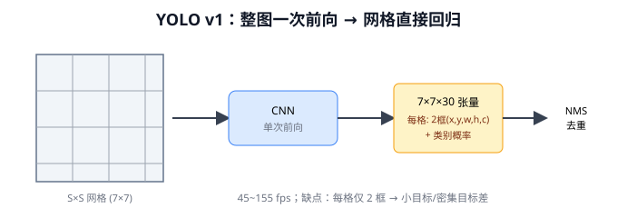
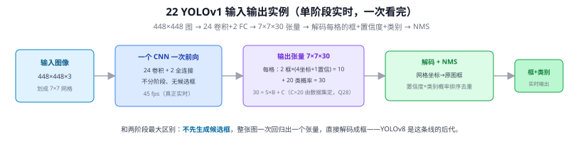
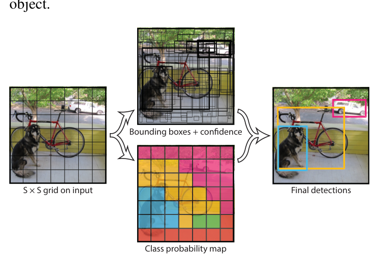
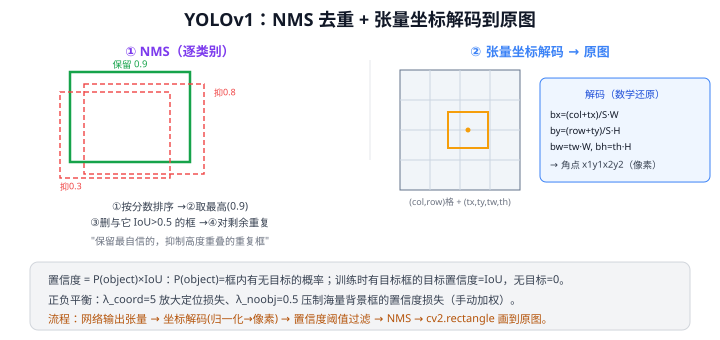
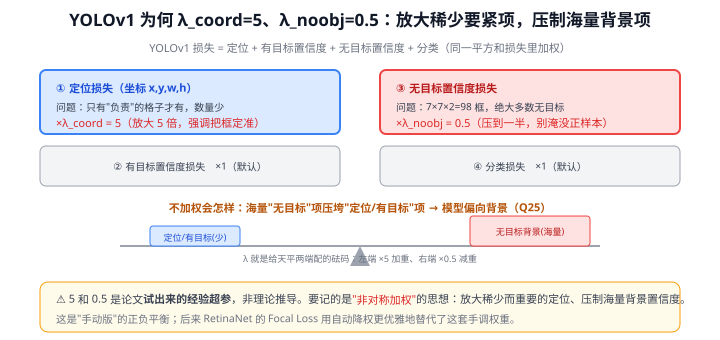
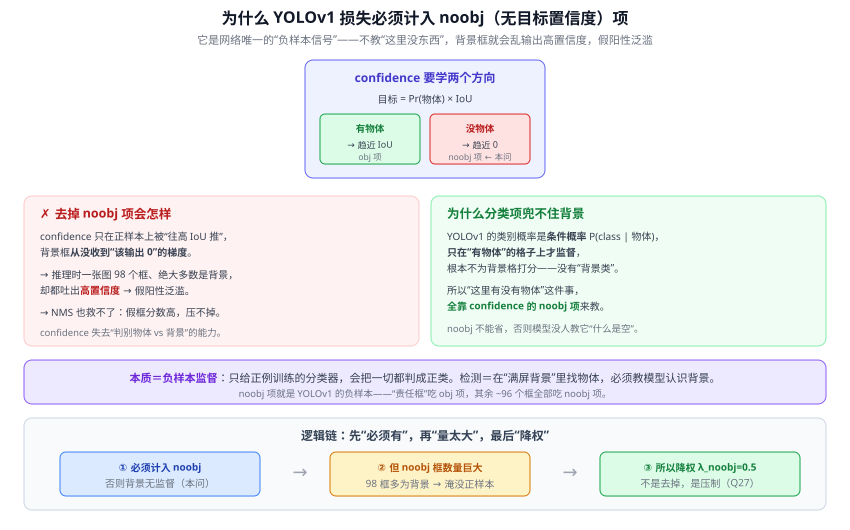
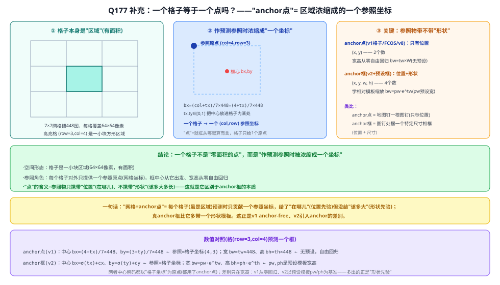
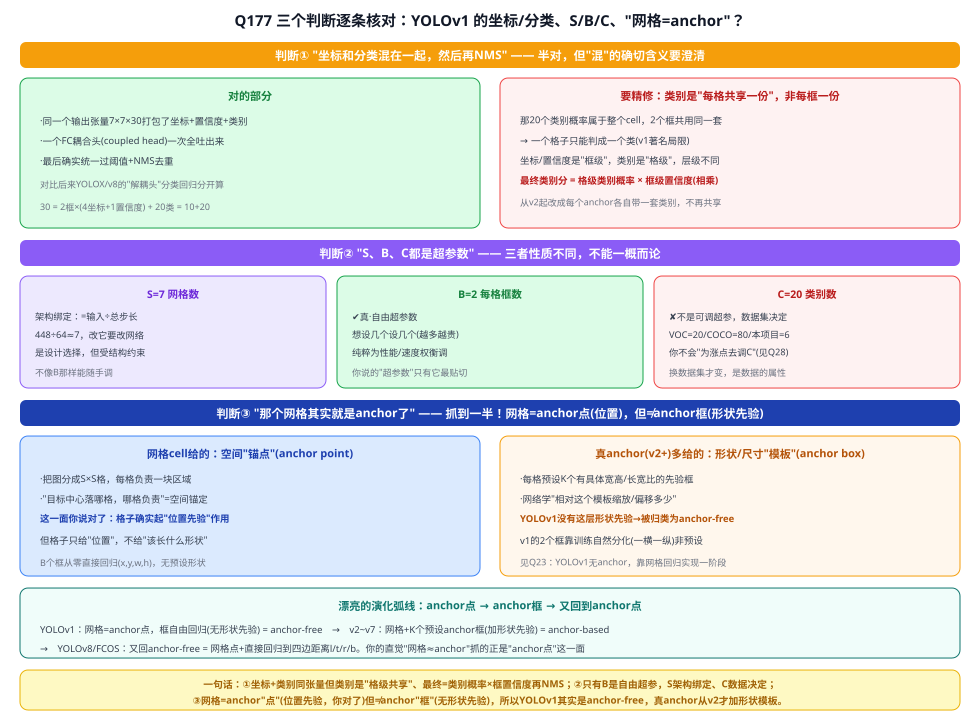
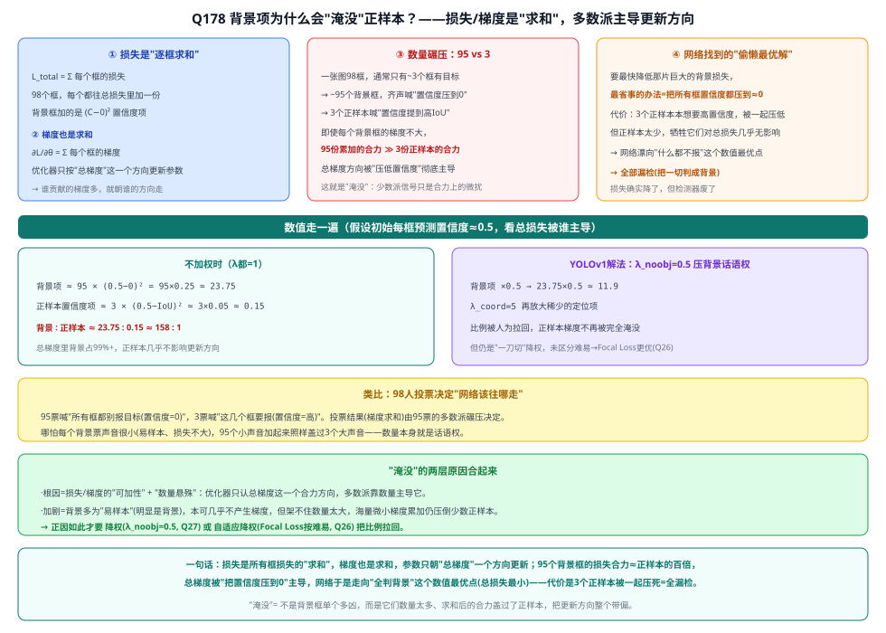
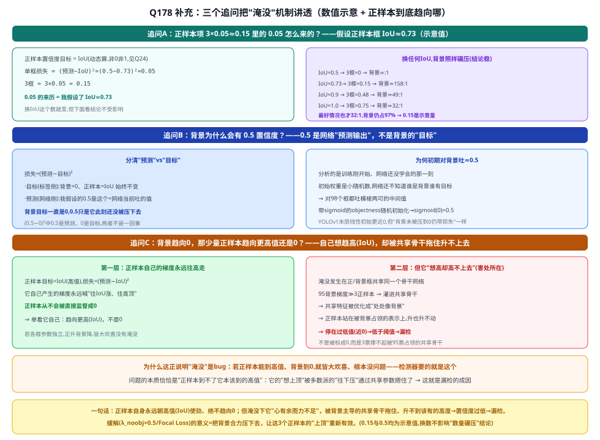

# 22 YOLO v1（You Only Look Once）

> 定位：单阶段实时检测的开山之作，把检测重新定义为一个回归问题。
> 作者：Joseph Redmon 等，CVPR 2016。
> 战绩：45 fps（快速版 155 fps），首次让检测真正"实时"。
> **输入 / 输出**：448×448 图像 → 7×7×30 张量 → 框 + 类别

---



> 📥📤 **输入/输出实例（看一组具体数值）**：输入 **448×448×3** 图（划成 7×7 网格）→ 一个 CNN 一次前向（24 卷积 + 2 FC，不分阶段、无候选框，45 fps）→ 输出张量 **7×7×30**（每格 = 2 框 ×(4 坐标+1 置信度) + 20 类概率 = 30，其中 C=20 由数据集定，Q28）→ 解码：网格坐标还原成原图框、置信度×类别概率排序 → NMS → 框+类别。和两阶段最大区别：**不先生成候选框**，整张图一次回归出张量直接解码——YOLOv8 是这条线的后代。



> 📄 **论文原图对照**（图源：Redmon et al., *You Only Look Once*, [arXiv:1506.02640](https://arxiv.org/abs/1506.02640) Figure 2，原文 [PDF](../papers/22_YOLOv1_1506.02640.pdf)；仅笔记内学习引用，论文写作须自绘）：



> 整图划 S×S 网格，每格直接回归 B 个框+置信度+类别概率，一次前向出全部检测（Q17）。

## 一、提出背景

两阶段检测器（R-CNN 系列）精度高但慢：先提候选框、再逐个分类，流程割裂。YOLO 的革命性想法：**为什么不让一个网络一次看完整张图，直接输出所有框和类别？** 即 "You Only Look Once"——整图只过一次网络，端到端回归出检测结果，从根本上甩开候选框生成的开销。

---

## 二、核心方法

### 2.1 网格划分

把图像划分为 $S \times S$ 网格（原文 7×7）。**目标中心落在哪个网格，就由那个网格负责预测它**。

### 2.2 每个网格的预测

每个网格预测：
- $B$ 个边框（原文 2 个），每个框含 5 个值：$(x, y, w, h, \text{confidence})$
  - confidence = $P(\text{object}) \times \text{IoU}$，表示"有目标且框准"的置信度
- $C$ 个类别的条件概率 $P(\text{class}_i | \text{object})$

输出张量维度：$S \times S \times (B \times 5 + C)$，原文 VOC 上为 $7\times7\times30$。

```
整图 224/448 ──► CNN（24 卷积 + 2 全连接）──► 7×7×30 张量
                                              直接解析出所有框 + 类别
```

### 2.3 损失函数 ⭐

YOLOv1 把所有误差塞进**一个平方和（MSE）损失**，共五项：

$$
\mathcal{L} =
\underbrace{\lambda_{coord} \sum_{i}\sum_{j} \mathbf{1}_{ij}^{obj}
  \bigl[(x_i-\hat x_i)^2+(y_i-\hat y_i)^2\bigr]}_{\text{① 中心坐标}}
$$

$$
+\; \underbrace{\lambda_{coord} \sum_{i}\sum_{j} \mathbf{1}_{ij}^{obj}
  \bigl[(\sqrt{w_i}-\sqrt{\hat w_i})^2+(\sqrt{h_i}-\sqrt{\hat h_i})^2\bigr]}_{\text{② 宽高（开平方）}}
$$

$$
+\; \underbrace{\sum_{i}\sum_{j} \mathbf{1}_{ij}^{obj}(C_i-\hat C_i)^2}_{\text{③ 正样本置信度}}
+\; \underbrace{\lambda_{noobj}\sum_{i}\sum_{j} \mathbf{1}_{ij}^{noobj}(C_i-\hat C_i)^2}_{\text{④ 负样本置信度（背景）}}
$$

$$
+\; \underbrace{\sum_{i} \mathbf{1}_{i}^{obj}\sum_{c}(p_i(c)-\hat p_i(c))^2}_{\text{⑤ 分类概率}}
$$

**符号说明**

| 符号 | 含义 |
|------|------|
| $i$ | cell 编号（共 S²=49 个） |
| $j$ | 同一 cell 内的框编号（共 B=2 个） |
| $\mathbf{1}_{ij}^{obj}$ | cell $i$ 的第 $j$ 框是"**负责框**"（该 cell 有 GT 且 $j$ 与 GT 的 IoU 最高） |
| $\mathbf{1}_{ij}^{noobj}$ | $1-\mathbf{1}_{ij}^{obj}$，其余所有框（背景框） |
| $\mathbf{1}_{i}^{obj}$ | cell $i$ 内有 GT（只要该 cell 有目标，不论哪个框负责） |
| $\hat C_i$ | 预测置信度，训练目标 = 预测框与 GT 的 IoU（动态计算，不是人工标注） |
| $\hat p_i(c)$ | 预测类别条件概率 |
| $\lambda_{coord}=5$ | 放大定位项（稀少但重要） |
| $\lambda_{noobj}=0.5$ | 压制背景置信度项（数量庞大） |

**"负责框"选取规则**

每个 cell 的 B=2 个框中，只选与 GT IoU 最高的那个为"负责框"，另一个视为背景（只参与 ④）。训练中两个框自然分化，一个偏纵向、一个偏横向，分工互补。

```
cell i 含 GT → 框 A (IoU=0.7) 负责框  → 参与 ①②③
               框 B (IoU=0.3) 背景框  → 只参与 ④（C 目标=0）
cell i 无 GT → 框 A、框 B 均背景框    → 各贡献一次 ④
```

**为什么宽高要开平方**

目标：让小框和大框的**相对偏差**受到同等惩罚，而非绝对偏差。

| 情形 | GT 宽 | 预测宽 | 相对误差 | 直接 MSE | √w 后 MSE |
|------|-------|-------|---------|---------|---------|
| 小框 | 10 | 20 | 100% | 100 | $({\sqrt{10}-\sqrt{20}})^2 \approx 1.72$ |
| 大框 | 100 | 110 | 10% | 100 | $({\sqrt{100}-\sqrt{110}})^2 \approx 0.24$ |

不开平方时两者损失相等（100），但小框的实际偏差严重得多。开平方后小框损失显著更大（1.72 vs 0.24），梯度自动向小框倾斜。

数学本质：$\dfrac{\partial}{\partial w}(\sqrt{w}-\sqrt{\hat w})^2 = \dfrac{\sqrt{w}-\sqrt{\hat w}}{\sqrt{w}}$，分母含 $\sqrt{w}$，w 越小梯度越大。

**为什么全用 MSE 不用交叉熵**

2016 年工程决策：统一用平方和，简单、梯度形式统一。代价是分类/置信度用 MSE 不如 BCE 合理——YOLOv2+ 改为 BCE；RetinaNet 引入 Focal Loss；YOLOv8 用 BCE+DFL，完全抛弃 MSE。

### 2.4 NMS

同一目标可能被多个框预测，用**非极大值抑制（NMS）**去重：保留置信度最高的框，抑制与它高度重叠的其他框。

---

## 三、优点与缺陷

**优点**：
- **快**：单次前向，45~155 fps，可实时
- **全局视野**：一次看整图，背景误检少（two-stage 容易把背景块误判）
- 端到端，结构简单

**缺陷**（催生后续改进）：
1. **小目标差、密集目标差**：每个网格只预测 2 个框、1 个类别，挨得近的小目标会被漏掉（→ v2 引入 anchor、v3 引入多尺度）
2. **定位精度不如两阶段**：粗网格回归不够精细
3. 对新长宽比泛化差

---

## 四、历史地位

YOLO v1 开创单阶段检测路线，"把检测当回归"的思想极具影响力。它与 SSD（23 SSD）一起代表"速度优先"路线，与 Faster R-CNN 的"精度优先"路线长期竞争。经过 v2—v11 的持续演进（25 YOLO 演进），YOLO 最终在速度和精度上都达到一流，成为工业界最受欢迎的检测框架。

---

## 五、与本项目的关系

- 本项目基线 **YOLOv8 是 YOLO v1 的直系后代**。理解 v1 的"网格 + 直接回归 + NMS"骨架，就抓住了整个 YOLO 家族的主干。
- v1 的两大缺陷——**小目标差、密集目标差**——正是本项目针对路面抛洒物（典型小目标）要解决的核心问题。v8 通过多尺度 + anchor-free 已大幅改善，本项目再用 P2 + CBAM 进一步增强。
- v1 的 NMS 一直沿用到 v8（v10 才尝试去掉，见 25）。

---

## ✏️ 具体实例（动手算一遍）

**例：7×7×30 输出张量是怎么来的（VOC 20 类）**
每个网格预测 2 个框、20 类：每框 5 个数 $(x,y,w,h,\text{conf})$ → $2\times5=10$，加 20 类 = **30**。共 7×7 个格 → 张量 **7×7×30**。

**例：把某格的预测解码回原图画框**
设第 (row=3, col=4) 格预测某框 $(t_x,t_y,t_w,t_h)=(0.5,0.5,0.3,0.2)$，图像 $W=H=448$，$S=7$：
$$b_x=\frac{col+t_x}{S}\,W=\frac{4+0.5}{7}\times448=288,\quad b_y=\frac{3+0.5}{7}\times448=224$$
$$b_w=t_w\,W=0.3\times448=134,\quad b_h=0.2\times448=90$$
→ 中心 (288,224)、宽134高90，转成角点后用 `cv2.rectangle` 画出（详见 [Q17](#q17-yolov1置信度正负样本平衡nms-与输出张量解码)）。

**例：置信度与类别分数**
某框 $\text{conf}=P(\text{object})\times\text{IoU}=0.9$，该格"车"的条件概率 $P(\text{car}|obj)=0.8$ → 该框是车的最终分数 $=0.8\times0.9=0.72$，再过阈值 + NMS。

---

## 六、参考文献

- Redmon J, et al. *You Only Look Once: Unified, Real-Time Object Detection.* CVPR 2016.

---

## 📋 模型答疑（来自模型详解问答）

> 以下问答原属"答疑记录"系列，因专属本模型已并入此处便于集中查阅；跨模型的通用问答仍留在答疑分册。

---

## Q17. YOLOv1：置信度、正负样本平衡、NMS 与输出张量解码

**简答**：① **P(object)** = 框内**有没有目标**的概率（不分类）；置信度 = P(object)×IoU = "有目标 × 框准"。② **置信度误差** = 预测置信度与目标置信度（有目标=IoU、无目标=0）的平方差。③ **正负平衡**靠两个权重：$\lambda_{coord}=5$ 放大定位损失、$\lambda_{noobj}=0.5$ 压制海量背景框的置信度损失。④ **NMS**：逐类按分数排序、取最高、删与它 IoU>阈值的框、重复。⑤ 输出张量是网格归一化坐标，需先**数学解码**成原图像素坐标，再用 **cv2** 画框。



**展开**：

**① P(object) 与置信度**
$\text{confidence}=P(\text{object})\times \text{IoU}$。P(object)=框内有无目标（不问类别）。类别单独：每格出 $P(\text{class}_i|\text{object})$，测试时类别分数 = $P(\text{class}_i|\text{object})\times P(\text{object})\times\text{IoU}$。训练目标置信度：有目标框=IoU，无目标=0。

**② 置信度误差**
$\sum_{\text{有目标}}(C-\hat C)^2 + \lambda_{noobj}\sum_{\text{无目标}}(C-0)^2$，$\hat C=$IoU。让有目标框置信度逼近 IoU、无目标框逼近 0。

**③ 怎么平衡正负样本**
7×7×2=98 框，绝大多数无目标 → 背景项会淹没正样本。解法（手动加权，非采样）：$\lambda_{coord}=5$ 放大定位、$\lambda_{noobj}=0.5$ 缩小无目标置信度损失；再加"每格 IoU 最高框才负责"。这就是 Q16 说的一阶段正负不平衡，后由 RetinaNet **Focal Loss** 更优雅地解决。

**④ NMS 原理**
逐类别：① 按类别置信度降序排 → ② 取最高加入保留 → ③ 删与它 IoU>阈值(如0.5)的框 → ④ 对剩余重复。即"保留最自信、抑制高度重叠的重复框"。通常先用置信度阈值滤一遍再 NMS。

**⑤ 张量解码到原图（你的理解对）**
张量里坐标是网格/归一化的，要先**解码**：对第 (row,col) 格，$b_x=\frac{col+t_x}{S}W,\ b_y=\frac{row+t_y}{S}H,\ b_w=t_wW,\ b_h=t_hH$ → 转角点 $x_1y_1x_2y_2$（像素）。然后置信度过滤 + NMS + `cv2.rectangle/putText` 画到原图。
> "通过 cv 还原"准确说：**坐标解码（归一化→像素）是数学步骤，cv2 只负责把框可视化画出来**。本项目用 YOLOv8（anchor-free，回归方式不同，见 25 YOLO 演进），但"输出→解码→NMS→画框"的推理后处理流程同理。

---

## Q24. YOLOv1 置信度目标值从哪里来：不是人工标注，是训练时动态算的 IoU

**简答**：标注文件里**没有 confidence 字段**，YOLO 标注只有 `(class, cx, cy, w, h)`。置信度的训练目标 $\hat{C}$ 是**损失函数在每次迭代中动态计算**的：有目标的框取当前预测框与 GT 框的 IoU，无目标的框取 0。目标值随训练推进而变化——框越练越准，IoU 越高，$\hat{C}$ 自然上升。这正是置信度语义上同时编码"有目标"和"框准不准"两层含义的原因。

**展开**：

**① 标注里真的没有 confidence**

YOLO 格式标注（本项目 `labels/val/*.txt`）每行只有：
```
class_id  cx  cy  w  h
```
没有置信度字段。人工标注只管"这里有什么、框在哪"，不管"框有多准"。

**② 目标置信度：loss 函数运行时算**

YOLOv1 置信度损失：
$$
\lambda_\text{obj}\sum_{\text{有目标框}}(C_{ij} - \hat{C}_{ij})^2 + \lambda_\text{noobj}\sum_{\text{无目标框}}(C_{ij} - 0)^2
$$

$\hat{C}_{ij}$ 的取值：
- **有目标框**（GT 中心落在格子 $i$，且 B=2 框里 IoU 最高那个）：$\hat{C} = \text{IoU}(\text{当前预测框},\,\text{GT框})$，每次 forward 后**实时算**
- **无目标框**：$\hat{C} = 0$

**③ 为什么用 IoU 而不是固定 1**

| 情况 | IoU | 目标=1 时 | 问题 |
|------|-----|----------|------|
| 框很准，IoU=0.9 | 高 | 损失小 ✅ | — |
| 框很歪，IoU=0.1 | 低 | 损失仍往 1 推 ❌ | 鼓励歪框高置信 |

用 IoU 作目标：框越准 → $\hat{C}$ 越高 → 损失鼓励"准的框高置信、歪的框低置信"。置信度定义自然成立：$\text{confidence} = P(\text{object}) \times \text{IoU}_\text{pred}^\text{truth}$。两层语义通过训练目标设计**自动融合**，无需人工标注。

**④ 动态目标的训练含义**

早期框歪 IoU=0.1，目标置信度只有 0.1，损失不鼓励高置信（合理）；随回归越来越准 IoU 升到 0.8，目标置信度同步升，网络才被允许输出高置信。这是**自适应训练信号**，损失函数替代了人工标注。

> 一句话：每次 forward 后**用预测框和 GT 框算 IoU** 当置信度目标；高置信度 = "有目标且框准"，两层语义融于一个数。

---

## Q27. YOLOv1 损失里的权重为什么是 λ_coord=5、λ_noobj=0.5？

> 接 [Q17](#q17-yolov1置信度正负样本平衡nms-与输出张量解码)、Q25：这两个权重就是 YOLOv1 "手动版"的正负平衡。

**简答**：这两个权重是为了对抗正负不平衡的"**非对称加权**"：① **λ_noobj=0.5**——7×7×2=98 个预测框里绝大多数是**无目标的背景框**，它们的置信度损失数量巨大，会淹没少数正样本，所以**压到一半**；② **λ_coord=5**——定位（坐标）损失只在少数"负责某目标"的格子上才有、数量少但**最要紧**（框要准），所以**放大 5 倍**强调它。一句话：**放大稀少而重要的定位项、压制海量而廉价的背景置信度项**。⚠️ 5 和 0.5 是论文**试出来的经验超参**，不是理论推导——要记的是"非对称加权"的思想，别纠结具体数字（同 Q4 对 LeNet 数字的态度）。



**展开**：

**① YOLOv1 损失的五个部分**
YOLOv1 把所有东西塞进一个平方和损失，含：定位损失（x,y,w,h）、有目标框的置信度损失、无目标框的置信度损失、分类损失。问题：这些项的**数量极不均衡**。

**② 为什么压 λ_noobj（=0.5）**
98 个预测框里，一张图通常只有几个目标 → **绝大多数框是"无目标"背景框**。每个背景框都贡献一份"置信度应趋 0"的损失，累加起来**压倒**了少数正样本框的损失（这正是 Q25 的不平衡）。若不压制，网络会学成"所有框都输出低置信度"以最小化这片损失 → 漏检。所以给无目标置信度损失乘 **0.5**，削弱背景的话语权。

**③ 为什么放大 λ_coord（=5）**
定位损失只在"负责某目标"的少数格子上才有（数量少），但它**直接决定框准不准**，是检测质量的关键。在和海量其它项一起优化时，若不强调，它的梯度会被淹没。所以乘 **5** 放大，让网络优先把框定准。此外定位是回归任务、置信度/分类偏分类任务，量纲也需平衡。

**④ 关键是"非对称"，不是具体数值**
$\lambda_{coord}=5 > 1 > \lambda_{noobj}=0.5$ 这个**一大一小的非对称**才是设计精髓：
- 把**稀少但重要**的（定位、正样本）→ 加重；
- 把**海量但廉价**的（背景置信度）→ 减重。

至于为什么恰是 5 和 0.5 而非 4 和 0.4——**是作者在 VOC 上调出来的经验值**，换数据集未必最优。不必过度解读。

**⑤ 这是"手动版"正负平衡，后被自动方法取代**
YOLOv1 用人工设的固定 λ 来硬抗不平衡，简单但粗糙（对所有背景框一视同仁地 ×0.5，没区分难易）。后来：
- 24 RetinaNet 的 **Focal Loss** 按样本难易**自动**动态降权，比固定权重精细得多；
- 现代 YOLO（25 YOLO 演进）用更好的标签分配 + VFL/DFL，不再依赖这种手调 λ。

**⑥ 与本项目**：YOLOv8 已无需手调这类权重，但理解 YOLOv1 的 λ 能让你明白"正负平衡"这件事的来龙去脉，以及为什么加 P2（更多背景框）时要关注损失是否仍然平衡（Q25）。

---

## Q28. YOLOv1 输出张量 7×7×30 中的 C=20 由什么决定，换数据集后会变吗？

> 接 [Q17](#q17-yolov1置信度正负样本平衡nms-与输出张量解码)：拆解输出张量 30 维的来源。

**简答**：C=20 来自训练数据集 **PASCAL VOC** 恰好有 20 个类别，不是 YOLOv1 架构的固定值。输出张量 **30 = 5×B + C = 5×2 + 20**，其中 B=2 是超参（每 cell 预测几个框），C 随数据集类别数而变——换数据集 C 就变，输出通道数跟着变。

**展开**：

**① 30 维的拆解**

```
输出张量：7 × 7 × 30
                  │
                  ├── 5 × B = 5 × 2 = 10   （2 个框，每框：cx, cy, w, h, confidence）
                  └── C     = 20            （20 个类别的条件概率 P(class | object)）
```

- **B=2**：每个 cell 预测 2 个候选框，是论文里设定的超参（越多越贵，原文选 2）。
- **C=20**：PASCAL VOC 2007/2012 共 20 个类别（人、自行车、鸟、船、瓶子、公共汽车……），C=20 是数据集决定的，不是架构硬编码的。

**② C 不是固定值，换数据集就变**

网络最后一层是全连接，输出节点数 = 7×7×(5×B + C)，C 直接改就行：

| 数据集 | 类别数 C | 输出维度 |
|--------|---------|---------|
| PASCAL VOC | 20 | 7×7×30 = 1470 |
| MS COCO | 80 | 7×7×90 = 4410 |
| 本项目（6 类训练） | 6 | 7×7×16 = 784 |

**③ 与本项目的关系**

本项目用 YOLOv8，训练 6 类（PL/ME/ST/VP/TD/OT，GL/RU 留给 CLIP 零样本），分类头输出 6 个通道。YOLOv8 anchor-free 解耦头的维度格式与 YOLOv1 不同，但"C 随数据集类别数变"这一点完全一样。

---

## Q67. YOLOv1 的损失函数为什么要计入 noobj（无目标置信度）项？

> 接 [Q24](#q24-yolov1-置信度目标值从哪里来不是人工标注是训练时动态算的-iou)（置信度目标 = Pr(物体)×IoU）、[Q27](#q27-yolov1-损失里的权重为什么是-λ_coord5λ_noobj05)（noobj 项的**权重**为何 0.5）。本问是 Q27 的**前一步**：为何要有它。

**简答**：因为 confidence 这个量要预测"**这框里有没有物体 + 框贴得多准**"(目标值 = Pr(物体)×IoU,[Q24](#q24-yolov1-置信度目标值从哪里来不是人工标注是训练时动态算的-iou))。它要学**两个方向**：有物体的框 → 置信度趋近 IoU(obj 项);没物体的框 → 置信度趋近 0(noobj 项)。如果损失里**只留 obj 项、不计 noobj**,网络就只被推着"把置信度往高调",从没有任何信号告诉海量背景框"你该输出 0"。结果推理时一张图 98 个预测框、绝大多数是背景,却统统吐高置信度 → 检测框满屏假阳性。所以 noobj 不是可有可无的修饰项,它是**教模型认识"背景/空"的唯一途径**。

**展开**：

**① confidence 的职责：既判"有无"、又判"准不准"**
YOLOv1 每个框的 confidence 监督目标 = **Pr(物体) × IoU**（[Q24](#q24-yolov1-置信度目标值从哪里来不是人工标注是训练时动态算的-iou)）：
- 框里**有**物体 → 目标 = 1×IoU = IoU（框越准、目标越高）；
- 框里**没**物体 → Pr(物体)=0 → 目标 = **0**。
推理时正是靠这个 confidence 去**排序、过阈值**,决定"这个框要不要保留"。要它能区分,就必须**两头都训**——高的样例和"该为 0"的样例都给它看。

**② 不计 noobj 会怎样：只有正梯度 → 背景全高分 → 假阳性泛滥**
若损失只算"有物体框"的置信度,confidence 头收到的梯度**永远是"往 IoU(较高值)走"**,从没有"往 0 走"的约束。于是：
- 训练完,背景框的置信度**没人管过**,推理时输出近乎随机甚至偏高;
- 一张图 7×7×2=98 个框,通常只有几个真目标 → **绝大多数是背景框**,它们一起吐高分;
- NMS **救不了**——NMS 只去重叠,不会删"孤立的高分假框";假框分数高,反而被保留。
最终：**漏检没改善,假阳性爆炸**。confidence 彻底失去"物体 vs 背景"的判别力。

**③ 为什么不能靠分类项替它兜底（最关键）**
有人会想:有分类损失啊,让分类去判背景不行吗?**不行**——YOLOv1 的类别输出是**条件概率** $P(\text{class}\mid\text{物体})$：
- 它**只在"有物体"的格子上监督**(算 20 类里哪类),
- **没有"背景类"**这一项,背景格的类别概率**根本不参与损失**。
也就是说,分类项**默认"已经有物体"**,压根不负责回答"有没有物体"。所以"判断有无物体"的担子**全压在 confidence 上**,而 confidence 学"无物体→0"**只能靠 noobj 项**。抽掉它,模型就**没有任何地方**学到"背景长什么样"。



**④ 本质：noobj 就是检测器的"负样本"**
换个角度看,这就是**负样本监督**的必要性:**只用正例训练的分类器,会把一切都判成正类**(只见过猫的模型,看见狗也喊猫)。目标检测的处境更极端——画面里**绝大部分是背景**,模型必须被明确教过"这是背景、不该报框"。noobj 项就是 YOLOv1 喂给网络的负样本：每个目标只有一个"责任框"(中心所在格、IoU 最高的那个框)吃 obj 项,**其余 ~96 个框全部吃 noobj 项**。

**⑤ 这也正是不平衡的来源 → 引出 Q27**
正因为 noobj 框**数量碾压**正样本框,它的损失会**淹没**少数正样本(详见 Q25)。但解决办法**不是去掉它**(去掉就回到②的灾难),而是**降权**——给它乘 $\lambda_{noobj}=0.5$ 压制话语权（[Q27](#q27-yolov1-损失里的权重为什么是-λ_coord5λ_noobj05)）。所以完整逻辑链是：
```
必须计入 noobj（否则背景无监督，本问）
      → 但 noobj 框数量巨大，会压垮正样本（Q25）
            → 所以保留但降权 λ_noobj=0.5（Q27）
```
Q67 解释"为何有",Q27 解释"为何只给 0.5"——**先有再压,缺一不可**。

**⑥ 与本项目（演进视角）**
"必须给背景/负样本监督"这件事**所有检测器都绕不开**,变的只是**怎么给得更聪明**：
- RetinaNet 的 **Focal Loss** 不再对所有背景一刀切降权,而是按难易**自动**动态降权——简单背景几乎不贡献梯度,难负样本才重点学(Q26);
- 现代 **YOLOv8**（本项目基线）用 TaskAligned 标签分配 + 分类用 BCE/VFL,对负样本仍有监督,只是不再手调 $\lambda_{noobj}$。
理解 YOLOv1 "为什么必须有 noobj",就懂了**为何检测器始终要显式建模背景**——本项目加 P2 后背景框更多(Q25),正负平衡这根弦更要盯紧。

---

## Q177. YOLOv1：坐标和分类"混在一起再 NMS"、S/B/C 都是超参数、"网格其实就是 anchor"——这几个判断对吗？

三条大方向都对，但每条差一点：

**① 坐标+分类混一起再 NMS——半对。** 确实打包在同一张量、由一个 FC"耦合头"一次吐出、最后统一 NMS。但那 20 个类别概率是**整个格子共享一套**（2 框共用），不是每框各一套 → 一个格子只能判一个类（v1 著名局限）。坐标/置信度是"框级"、类别是"格级"；最终得分 = 格级类别概率 × 框级置信度，相乘后才 NMS。v2 起改成每 anchor 各带一套类别。

**② S/B/C 不能一概叫超参数**——性质不同：

| | 是什么 | 性质 |
|---|---|---|
| S=7 | 网格数 | 架构绑定（=输入÷总步长） |
| B=2 | 每格框数 | ✔ 真·自由超参 |
| C=20 | 类别数 | 数据集决定（换数据集才变） |

**③ "网格就是 anchor"——抓到一半。** 网格给的是**空间"锚点"(anchor point)**——每格负责一块区域、起**位置**先验作用（这点对）。但它**没有形状先验**：v1 的 B 框从零直接回归 (x,y,w,h)、无预设宽高；真 anchor(v2+) 还预设宽高模板、网络只学"相对模板缩放"。所以网格 = anchor"点"、不是 anchor"框"——**v1 其实是 anchor-free**，anchor 是 v2 才引入。

> 演化弧线：v1(anchor 点/free) → v2~v7(加形状模板/anchor-based) → v8/FCOS(又回 anchor-free：网格点+直接回归四边距离)。你的直觉正好命中这个轮回。
> "点"不是零面积：格子是 64×64 的区域，但作预测参照时只贡献**一个原点坐标**（框中心从它出发回归）。点 vs 框的分水岭 = 参照物带不带**形状**（点只带位置 x,y；框带位置+形状 x,y,w,h）。类比：图钉(只标位置) vs 图钉处摆的相框(位置+尺寸)。





---

## Q178. "98 框绝大多数无目标 → 背景项淹没正样本"，为什么会被"淹没"？原因何在？

**根子在"损失/梯度是求和"**：总损失 = 98 个框损失相加、总梯度也是相加，优化器只沿**一个**合力方向更新。95 个背景框都喊"置信度压到 0"、3 个正样本喊"提到高 IoU"——合力被 95 这边碾压主导。

**数值**（初期每框预测≈0.5）：背景项 95×0.25≈**23.75** vs 正样本 3×(0.5−IoU)²≈**0.15**，约 **158:1**，背景占总梯度 99%+，正样本只是看不见的微扰。

**网络的偷懒解**：把所有框置信度压到≈0 能最快降那片背景损失；代价是 3 个正样本被一起压低，但太少、几乎不增总损失 → 网络漂向"全判背景、什么都不报" → 全漏检。类比：98 人投票，95 票盖过 3 票。

**解法**：人为拉回比例——λ_noobj=0.5 压背景、λ_coord=5 抬定位（Q27）；或 Focal Loss 按难易自适应降权（Q26）。但**只能压不能删**：noobj 删了背景就没监督（Q67）。



> 三个易混点：① 那个 0.05 是"假设正样本 IoU≈0.73"算的，换 IoU 就变，但背景碾压极稳（最好也才 32:1），0.15 是示意量。② 背景的 0.5 是网络"预测输出"（初期还没学会时的懵懂中间值），不是背景"目标"（目标始终 0）。③ 正样本自身梯度**永远往高走**（目标是 IoU），但正/背景**共享同一骨干**——背景合力把共享表示压成"处处像背景"，正样本想升也升不动、停在过低值 → 漏检。淹没的害处正是"正样本够不着它该有的高值"。



> 本项目加 P2 后框数成倍增、背景更多、正负更不平衡，这根弦更要盯紧；若小目标召回异常低，先查正负平衡。

---
