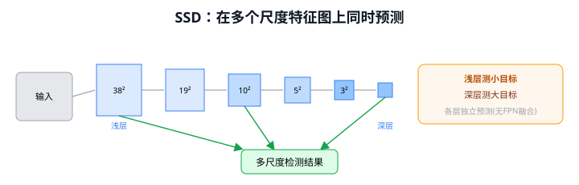
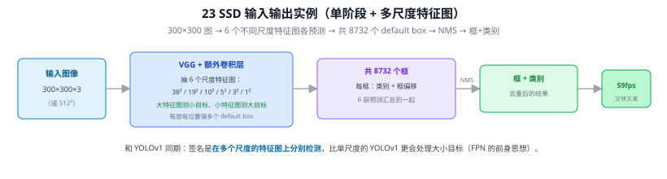
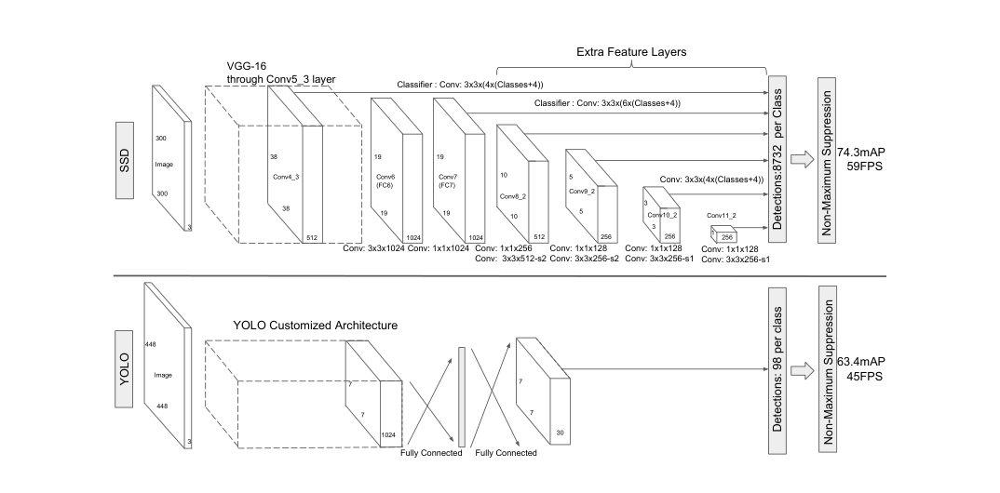
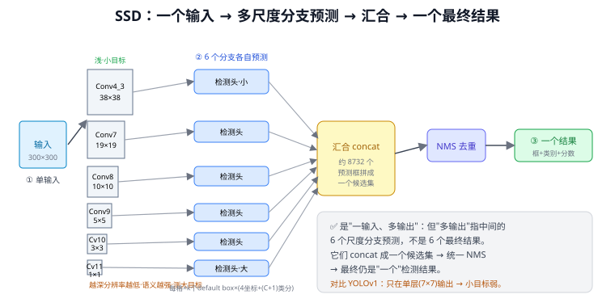
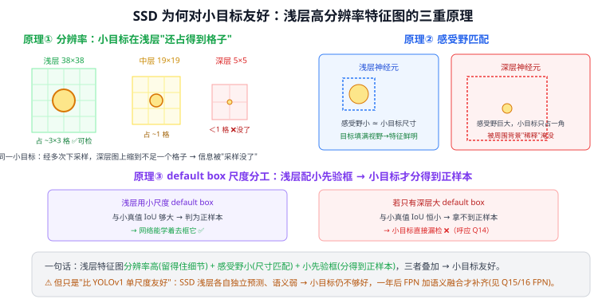

# 23 SSD（Single Shot MultiBox Detector）

> 定位：与 YOLO v1 同期的单阶段检测器，首次在多尺度特征图上做检测，兼顾速度与精度。
> 作者：Liu Wei 等，ECCV 2016。
> 战绩：59 fps，VOC mAP 74.3%，同时超过当时的 YOLO v1（速度与精度）。
> **输入 / 输出**：300²/512² 图像 → 多尺度 8732 个框 + 类别

---



> 📥📤 **输入/输出实例（看一组具体数值）**：输入 **300×300×3** 图 → VGG + 额外卷积层，抽 **6 个不同尺度的特征图**（38²/19²/10²/5²/3²/1²，大特征图测小目标、小特征图测大目标）→ 每层每位置铺多个 default box，共 **8732 个框** → 各出"类别 + 框偏移" → NMS → 框+类别（59 fps）。和 YOLOv1 同期，签名是**在多尺度特征图上分别检测**，比单尺度的 YOLOv1 更会处理大小目标——是 FPN 多尺度思想的前身。



> 📄 **论文原图对照**（图源：Liu et al., *SSD: Single Shot MultiBox Detector*, [arXiv:1512.02325](https://arxiv.org/abs/1512.02325) Figure 2，原文 [PDF](../papers/23_SSD_1512.02325.pdf)；仅笔记内学习引用，论文写作须自绘）：



> SSD vs YOLO 架构对比：SSD 在多个深度的特征图上都挂检测头 = 多尺度预测（Q18/Q19）。

## 一、提出背景

YOLO v1（22）够快但小目标差、定位粗；Faster R-CNN（20）准但慢。SSD 想取两者之长：**保持单阶段的速度，同时借鉴 anchor 和多尺度来提升精度**，尤其是小目标。

---

## 二、核心创新

### 2.1 多尺度特征图检测 ⭐

SSD 最关键的思想：**不只在最后一层预测，而是在骨干不同深度的多个特征图上同时预测**。

```
输入 ──► VGG 骨干 ──► Conv4_3 (38×38) ─┐
                  ──► Conv7   (19×19) ─┤
                  ──► Conv8   (10×10) ─┤ 每层都接检测头
                  ──► Conv9   (5×5)   ─┤ 浅层测小目标
                  ──► Conv10  (3×3)   ─┤ 深层测大目标
                  ──► Conv11  (1×1)   ─┘
```

- **浅层特征图（分辨率高）**负责小目标，**深层（分辨率低、语义强）**负责大目标
- 这比 YOLO v1 只用单层预测进步很大

> 注意：SSD 各层**独立**预测，没有 FPN 那样的"自顶向下语义融合"。所以 SSD 的浅层缺语义，小目标仍不够好——这正是一年后 21 FPN 要解决的问题。

### 2.2 Default Box（先验框）

类似 Faster R-CNN 的 anchor：每个特征图位置预设多个不同长宽比的默认框，网络预测相对默认框的偏移 + 各类得分。不同层用不同尺度的默认框。

### 2.3 难负样本挖掘（Hard Negative Mining）

检测中负样本（背景）远多于正样本。SSD 按置信度损失排序，只取损失最高的负样本，使正负比约 1:3，缓解类别失衡。

---

## 三、优点与局限

**优点**：
- 多尺度预测，比 YOLO v1 精度高、小目标好
- 单阶段，速度快
- 多尺度 + 先验框设计影响了后续大量检测器

**局限**：
- 浅层特征语义弱，**小目标仍不理想**（缺 FPN 式融合）
- 默认框尺度/比例需手工设计
- 对极小目标依然吃力

---

## 四、历史地位

SSD 与 YOLO 并列为早期单阶段双雄。它的"**多尺度特征图检测**"是迈向 FPN 的关键一步——FPN 在 SSD 多尺度的基础上加了"自顶向下语义融合"，补齐了 SSD 浅层语义弱的短板。可以说 SSD 提出了问题，FPN 给出了更优解。

---

## 五、与本项目的关系

- SSD 的"**浅层测小目标、深层测大目标**"正是 YOLOv8 多尺度检测头（P3/P4/P5）的雏形。本项目加 P2 层，就是沿着"再往浅层加一级测更小目标"的方向走。
- SSD 暴露的"浅层语义弱导致小目标差"问题，解释了本项目为何不能只靠加浅层分辨率，还要靠 FPN 融合 + CBAM 注意力补语义。
- 不直接使用，作相关工作对比。

---

## ✏️ 具体实例（动手算一遍）

**例：SSD300 的 8732 个预测框是怎么数出来的**
6 个尺度特征图，各位置配若干 default box，逐层相乘再相加：

| 特征图 | 尺寸 | 每格框数 | 预测框数 |
|--------|------|---------|---------|
| Conv4_3 | 38×38 | 4 | 5776 |
| Conv7   | 19×19 | 6 | 2166 |
| Conv8   | 10×10 | 6 | 600 |
| Conv9   | 5×5   | 6 | 150 |
| Conv10  | 3×3   | 4 | 36 |
| Conv11  | 1×1   | 4 | 4 |
| **合计** | | | **8732** |

这 8732 个框 concat 成一个候选集 → 置信度过滤 → NMS → 输出（"一输入、多尺度分支、汇成一个结果"，见 [Q18](#q18-ssd-是不是一个输入多个输出多尺度分支预测如何汇成一个结果)）。

**例：为什么浅层（38×38）测小目标**
38×38 分辨率高、格子密、感受野小、配的 default box 也小 → 小目标在这里"占得到格子、IoU 够大、分得到正样本"；到了 5×5 深层，小目标缩到不足一格就没了（原理见 [Q19](#q19-ssd-综合-6-个深度的特征图为何就对小目标友好原理是什么)）。

---

## 六、参考文献

- Liu W, et al. *SSD: Single Shot MultiBox Detector.* ECCV 2016.

---

## 📋 模型答疑

## Q18. SSD 是不是"一个输入多个输出"？多尺度分支预测如何汇成一个结果？

方向对，但"多输出"要厘清：SSD 是**一个输入**（整张图），经骨干在 **6 个不同深度的特征图**上各接一个检测头并行预测（这层意义上是"多输出"）。但这 6 组不是 6 个最终结果——它们 **concat 成一个候选集**（约 8732 框）、再统一 NMS，最终**仍是一组结果**。准确说：**一输入 → 多尺度分支预测 → concat+NMS 汇合 → 一输出**。



**为什么多尺度**：浅层（38×38，分辨率高、感受野小）测小目标、深层（1×1，语义强、感受野大）测大目标——相对 YOLOv1 只在单层 7×7 输出、大小目标挤一个尺度的进步。

**一个重要局限（区别于 FPN）**：SSD 的 6 个分支**各自独立预测、没有 FPN 的自顶向下语义融合**，浅层分辨率高但语义弱 → 小目标仍不够好。一年后 FPN 加了"深层语义灌给浅层"才补齐。SSD 提出"多尺度预测"，FPN 给了更优解。

> 本项目：YOLOv8 的 P3/P4/P5 多尺度头就是 SSD 这思想的延续；第三章加 P2 = 往更浅（stride 4）延伸测更小目标，但吸取 SSD 教训，还要靠 PAN 融合补语义 + CBAM 注意力。

---

## Q19. SSD 综合 6 个深度的特征图，为何就对小目标友好？原理是什么？

关键不在"6 个加起来"，而在多出来的**浅层高分辨率特征图**，靠三重原理叠加：
1. **分辨率高**：小目标经多次下采样，在深层图上缩到不足一格（信息被采样没了），浅层 38×38 还占好几个格、留得住；
2. **感受野匹配**：浅层感受野小 ≈ 小目标尺寸，目标填满视野、特征鲜明；深层感受野巨大，小目标只占一角被背景稀释；
3. **default box 尺度分工**：浅层配小先验框，与小真值 IoU 够大 → 分得到正样本能学；只有深层大先验框时小目标 IoU 恒小 → 拿不到正样本 → 漏检（同 Q14"anchor 必须覆盖数据尺寸分布"）。

三者缺一不可（只放大图 / 只加一层都不够）。



**边界**：SSD 只是"比 YOLOv1 单尺度友好"，6 分支各自独立预测、语义未融合，浅层语义弱（"看得见却看不懂"）→ 小目标仍不理想；FPN 把深层语义灌给浅层才真正补齐。

> 本项目第三章加 P2+CBAM 正是吸取这教训：P2 提供高分辨率（原理①②③），但不只靠加分辨率，还用 PAN 融合补语义 + CBAM 强化小目标响应。小目标方案 = SSD 浅层高分辨率 + FPN 语义融合 + 注意力，三代叠加。
