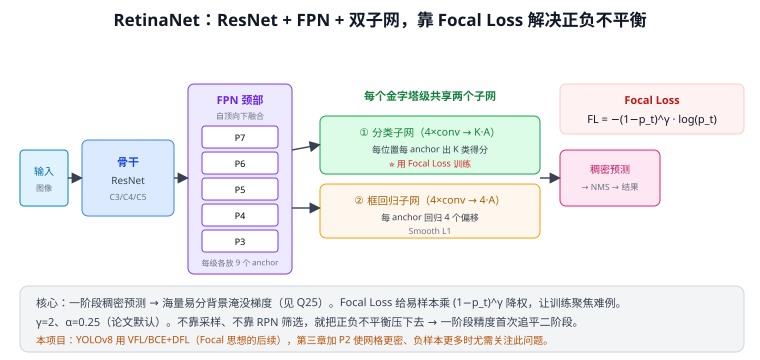
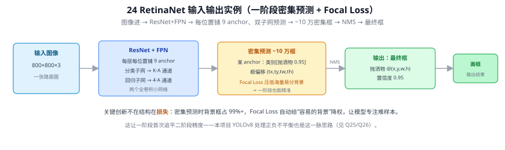
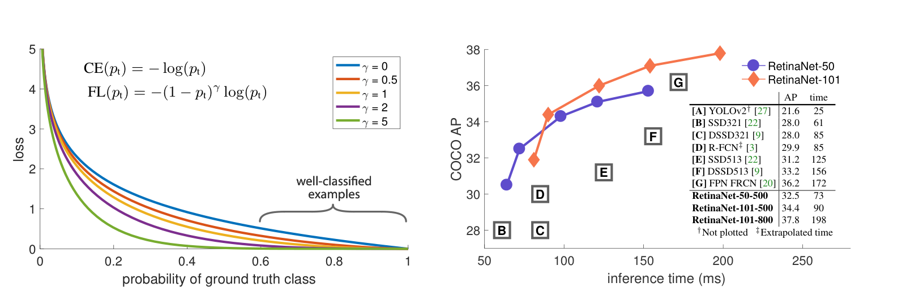
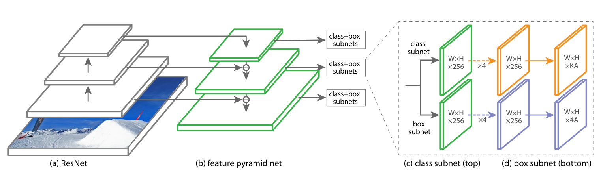

# 24 RetinaNet（Focal Loss）⭐

> 定位：第一个在精度上**追平二阶段**的一阶段检测器，靠的不是更复杂的结构，而是一个新损失函数 **Focal Loss**。
> 作者：Tsung-Yi Lin 等（FAIR，与 FPN 同一作者），ICCV 2017（Best Student Paper）。
> 战绩：COCO mAP 39.1（ResNeXt-101-FPN），首次让一阶段检测器精度超过当时所有二阶段方法，同时保持单阶段的简洁。
> **输入 / 输出**：图像 → 密集框 + 类别（Focal Loss 训练）

---

> 📥📤 **输入/输出实例（看一组具体数值）**：输入 **800×800×3** 图 → ResNet+FPN，每层每位置铺 **9 个 anchor**，两个全卷积子网：分类子网出 $K{\cdot}A$ 通道、回归子网出 $4{\cdot}A$ 通道 → 全图 **~10 万个密集预测**（某 anchor 类别 $[\text{抛洒物 }0.95]$、框偏移 $(t_x,t_y,t_w,t_h)$）→ **Focal Loss** 训练时自动压低占 99%+ 的"易分背景" → NMS → 最终框（抛洒物 @(x,y,w,h)、置信度 0.95）。关键创新不在结构、在**损失**：这让一阶段首次追平二阶段精度——本项目 YOLOv8 处理正负不平衡同属一脉（见 Q25/Q26）。

> 📄 **论文原图对照**（图源：Lin et al., *Focal Loss for Dense Object Detection*, [arXiv:1708.02002](https://arxiv.org/abs/1708.02002) Figure 1 / Figure 3，原文 [PDF](../papers/24_RetinaNet_FocalLoss_1708.02002.pdf)；仅笔记内学习引用，论文写作须自绘）：

> 上=Focal Loss 曲线：γ 越大对易分样本降权越狠（Q25/Q26 的解药）；下=RetinaNet 架构（FPN+分类/回归双子网）。

## 一、提出背景

到 2017 年，检测器分两派（见 Q16）：
- **二阶段**（20 Faster R-CNN）：准，但慢——先由 RPN 筛出稀疏候选，再逐个精修。
- **一阶段**（22 YOLOv1、23 SSD）：快，但精度始终差一截。

作者追问：**一阶段为什么精度上不去？** 结论不是结构问题，而是**训练时的极端正负不平衡**（见 Q25）：一阶段在所有位置稠密预测（Q21），一张图有上万~十万个 anchor，其中绝大多数是**易分背景**。这些易分负样本单个损失虽小，但数量巨大，**累加起来淹没了少数正样本的梯度**，模型被推向"全判背景"，精度上不去。

二阶段为什么没这问题？因为 RPN 先筛掉了大部分背景，第二阶段正负比可控（如 1:3）。一阶段没有这道筛选 → 不平衡最极端。

**RetinaNet 的主张**：不用采样、不用加二阶段，只要换一个能自动压制易样本的损失函数，一阶段就能追平二阶段。

---

## 二、核心创新

### 2.1 Focal Loss（焦点损失）⭐ 本文灵魂

从标准交叉熵出发（$p_t$ 是模型对**正确类**的预测概率）：

$$\text{CE}(p_t) = -\log(p_t)$$

问题：即便一个易分样本已经分得很好（$p_t=0.9$），它仍贡献一个不小的损失（$-\log 0.9≈0.1$），海量易样本累加就压倒了正样本。

Focal Loss 加一个**调制因子** $(1-p_t)^\gamma$：

$$\text{FL}(p_t) = -(1-p_t)^{\gamma}\log(p_t)$$

- **易样本**（$p_t→1$）：$(1-p_t)^\gamma→0$，损失被**大幅压低**（$p_t=0.9,\gamma=2$ 时因子=0.01，损失缩到 1/100）。
- **难样本**（$p_t→0$）：$(1-p_t)^\gamma→1$，损失几乎不变。

效果：训练**自动聚焦在难样本**上，海量易分背景不再主导梯度。再配一个类别权重 $\alpha$ 平衡正负：

$$\text{FL}(p_t) = -\alpha_t(1-p_t)^{\gamma}\log(p_t)$$

论文默认 **$\gamma=2$、$\alpha=0.25$**。$\gamma$ 越大对易样本压得越狠（$\gamma=0$ 退化回交叉熵）。

> 一句话：Focal Loss 不靠"扔掉"负样本（像 OHEM/难负挖掘那样硬采样），而是**动态地给易样本降权**，优雅地解决了"易负淹没梯度"——这是它比采样法更漂亮的地方。

### 2.2 结构：ResNet + FPN + 双子网

RetinaNet 结构本身很简洁、不是创新重点，但很标准：
- **骨干 ResNet** 提特征（C3/C4/C5）。
- **FPN 颈部**（21 FPN）构建 P3~P7 五级金字塔，自顶向下融合语义——解决 23 SSD 浅层语义弱的问题。
- **两个子网**（所有金字塔级**共享权重**）：
  - **分类子网**：4 层卷积 → 输出 $K\times A$（K 类 × 每位置 A=9 个 anchor），**用 Focal Loss 训练**。
  - **框回归子网**：4 层卷积 → 输出 $4\times A$（每 anchor 4 个偏移），Smooth L1。

每级每位置预设 **9 个 anchor**（3 尺度 × 3 长宽比）。

---

## 三、优点与局限

**优点**：
- Focal Loss 一招解决一阶段的核心痛点，**一阶段首次精度追平甚至超过二阶段**。
- 结构简洁、单阶段、速度快。
- Focal Loss 思想影响深远，被后续大量检测器/分割/长尾分类借用。

**局限**：
- 仍是 anchor-based，anchor 尺度/比例需设计（Q14）；后续 anchor-free（FCOS/YOLOv8）进一步简化。
- $\gamma,\alpha$ 是需调的超参（虽然作者给的默认值很鲁棒）。
- 速度比 YOLO 系略慢（FPN 五级 + 两子网开销）。

---

## 四、历史地位

RetinaNet 是检测发展的关键一环：它**证明了一阶段精度不足的根因是类别不平衡而非结构**，并用 Focal Loss 给出优雅解法。从此一阶段不再是"快但不准"的代名词。

放进脉络看：
- 22 YOLOv1/23 SSD 开创一阶段（快但精度差）
- **RetinaNet（本篇）用 Focal Loss 补上精度短板**
- 25 YOLO 演进 持续融合这些经验（多尺度、标签分配、损失改进）
- 28a DETR 换思路，用集合预测从根上绕开不平衡与 NMS

Focal Loss 与 FPN（同作者、同年）是 2017 年检测领域影响最大的两个贡献。

---

## 五、与本项目的关系

- **直接相关**：本项目基线 YOLOv8 是一阶段稠密检测器，同样面临正负不平衡。YOLOv8 用的 **VFL（Varifocal Loss）/ BCE + DFL** 正是 Focal Loss 思想的延续与改良。理解 Focal Loss 才懂 YOLOv8 为何不必手动做难负采样。
- **第三章改进的注意点**：加 **P2 层** 会让浅层网格更密、负样本进一步增多（Q21、Q25）→ 正负不平衡加剧，需关注训练收敛与召回，必要时调损失权重。
- **相关工作写作**：RetinaNet 是"一阶段精度演进"叙事里绕不开的一站，第二章相关工作应与 YOLO 系、二阶段一并对比。
- 不直接使用 RetinaNet 本体，作原理与相关工作引用。

---

## ✏️ 具体实例（动手算一遍）

**例：Focal Loss 如何把"易样本"的损失压下去（γ=2）**
标准交叉熵 $\text{CE}=-\log(p_t)$；Focal Loss 加调制因子 $(1-p_t)^\gamma$：

| 样本 | $p_t$（对正确类的预测概率） | CE = −log(p_t) | 调制因子 $(1-p_t)^2$ | Focal Loss | 缩小倍数 |
|------|------|------|------|------|------|
| 易分背景 | 0.9 | 0.105 | 0.01 | 0.00105 | **÷100** |
| 易分 | 0.7 | 0.357 | 0.09 | 0.032 | ÷11 |
| 难样本 | 0.3 | 1.204 | 0.49 | 0.590 | ÷2 |
| 极难 | 0.1 | 2.303 | 0.81 | 1.865 | ÷1.2 |

**易样本损失被狠狠压低（÷100），难样本几乎不变** → 训练自动聚焦难例。海量易分背景再多也淹没不了梯度（对比 YOLOv1 手调 λ、SSD 硬采样，见 Q25、Q26）。

**例：为什么能让一阶段追平二阶段**
一阶段稠密预测 → 正负 1:1000+ 的极端不平衡是精度短板。Focal Loss 不靠采样、不加二阶段，仅换损失就解决不平衡 → COCO mAP 39.1，首次超过当时所有二阶段。

---

## 六、参考文献

- Lin T Y, Goyal P, Girshick R, He K, Dollár P. *Focal Loss for Dense Object Detection.* ICCV 2017.
- （配套）Lin T Y, et al. *Feature Pyramid Networks for Object Detection.* CVPR 2017.（见 21 FPN）
