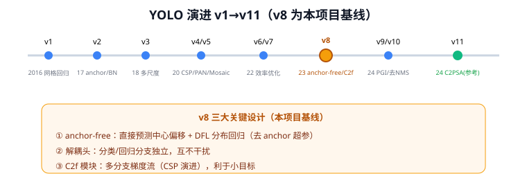
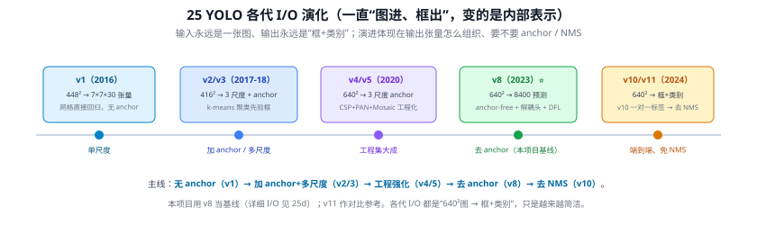

# 25 YOLO 演进总览：v1 → v11 ⭐

> 定位：本项目基线 **YOLOv8** 的完整来龙去脉。本文是**总览/索引**——逐代演进表 + 主线 + 选型决策；**每个时代的结构细节拆成了 5 篇分篇**（见下方导航），YOLOv8 单独深讲见 25d。
> 注：v8 源码层映射（C2f/解耦头/损失/配置）见 `learning/paper_notes_yolov8.md`。
> **输入 / 输出**：640×640 图像 → 框 + 类别（v8：8400 预测 → NMS，anchor-free）

---

> 📥📤 **输入/输出实例（各代 I/O 演化）**：所有 YOLO **输入永远是一张图、输出永远是"框+类别"**，演进只体现在**输出张量怎么组织、要不要 anchor / NMS**：v1（448²→7×7×30，无 anchor）→ v2/v3（416²，加 anchor + 三尺度）→ v4/v5（640²，三尺度 anchor + CSP/PAN/Mosaic）→ **v8（640²→8400 预测，anchor-free + 解耦头 + DFL，本项目基线）** → v10（一对一标签分配 → 去 NMS、端到端）。主线一句话：**无 anchor → 加 anchor → 去 anchor → 去 NMS**，越来越简洁。各代结构细节见分篇 25a–25e，v8 详细 I/O 见 25d。

## 一、为什么要看整个演进

YOLO 不是一个模型，而是一个迭代近 10 年的家族，每一代都在解决前一代的痛点。本项目选 v8 作基线、v11 作参考（CLAUDE.md 决策记录），就必须能说清 v8 继承了哪些设计、抛弃了哪些、为什么——这是开题答辩和第二章相关工作的必答题。

> **一条主线**：YOLO 的每次提升几乎都来自"**更好的多尺度融合 + 更顺的梯度流 + 更聪明的标签分配**"。本项目第三章（P2 多尺度 + CBAM）的改进思路与这条主线一致。

---

## 二、分篇导航（按时代拆分）

| 分篇 | 版本 | 一句话主题 |
|------|------|-----------|
| — | 22 YOLOv1 | 网格 + 直接回归，让检测实时（系列起点） |
| 25a | YOLOv2 / v3 | 锚框 + BatchNorm + **三尺度金字塔**（融入 FPN、残差骨干） |
| 25b | YOLOv4 / v5 | **CSP 骨干 + PAN 双向颈部 + Mosaic**；v5 全面工程化 |
| 25c | YOLOv6 / v7 | 高效骨干重构（RepVGG 重参数化 / E-ELAN），用结构换效率 |
| 25d ⭐ | **YOLOv8** | **anchor-free + 解耦头 + C2f + DFL**（本项目基线，含 C2f 详解 Q43） |
| 25e | YOLOv9 / v10 / v11 | 各打一补丁：PGI / 去 NMS 端到端 / C3k2+注意力（v11 参考） |

---

## 三、逐代演进表

| 版本 | 年份 | 作者/团队 | 核心改进 | 解决的痛点 | 分篇 |
|------|------|-----------|----------|-----------|------|
| v1 | 2016 | Redmon | 网格 + 直接回归 | 让检测实时 | 22 |
| **v2**(9000) | 2017 | Redmon | Anchor、BatchNorm、高分辨率微调、多尺度训练、Darknet-19 | v1 召回低、定位粗、小目标差 | 25a |
| **v3** | 2018 | Redmon | **多尺度预测（3 个 FPN 层）**、Darknet-53、独立逻辑分类 | 小目标 + 多标签 | 25a |
| v4 | 2020 | Bochkovskiy | **CSP 骨干、PANet 颈部、Mosaic**、CIoU、tricks 集大成 | 精度+速度综合 | 25b |
| **v5** | 2020 | Ultralytics | PyTorch 重构、工程化（AutoAnchor、超参进化） | 落地与易用 | 25b |
| v6 | 2022 | 美团 | RepVGG 重参数化骨干，面向工业部署 | 部署效率 | 25c |
| v7 | 2022 | Bochkovskiy | E-ELAN 高效聚合、辅助头训练 | 同精度提速 | 25c |
| **v8** ⭐ | 2023 | Ultralytics | **anchor-free、解耦头、C2f、DFL、任务统一** | 本项目基线 | 25d |
| v9 | 2024 | — | GELAN + PGI（可编程梯度信息） | 梯度/信息保留 | 25e |
| v10 | 2024 | 清华 | **去 NMS**（一致双分配），端到端 | 后处理开销 | 25e |
| **v11** | 2024 | Ultralytics | C3k2、C2PSA（注意力）、更轻量 | 本项目对比参考 | 25e |

> 三段式读图法（贯穿各分篇）：**输入 → 骨干 Backbone → 颈部 Neck → 检测头 Head → 输出**，红框=相对上一代的改动。v3 确立的"多尺度 + 残差骨干"骨架一路延续到 v8。

---

## 四、本项目为什么选 v8 而非 v11/v12（决策依据）

参见 CLAUDE.md 决策记录（2026-04-27）：
- **不用 v12**：太新、社区资料少、踩坑风险高。
- **用 v8 为主、v11 为参考**：v8 成熟稳定、生态完善；本项目数据上 v8（旧划分 mAP50=0.442）略优于 v11（0.429）。
- v8 的 anchor-free + C2f + PAN-FPN 给本项目改进（P2 + CBAM）留出清晰切入点。

---

## 五、与本项目的关系 ⭐

- **基线 = YOLOv8s**（EXP-001），所有改进都在它之上做（结构详见 25d）。
- **创新点 1（第三章）**在 v8 的 PAN-FPN 颈部加 **P2 层**（21 FPN）+ **CBAM**（16 CBAM），针对路面抛洒物的小目标、低对比度。
- **创新点 2（第四章）**在 v8 检测框之后接 **CLIP**（33 CLIP）做开放类识别。

---

## 六、参考文献

各代原始论文见对应分篇（25a–25e）的参考文献节。
