# 25a YOLOv2 / YOLOv3（Redmon：锚框 + 多尺度金字塔）

> 定位：YOLO 第二、三代（Redmon 团队），把 v1 的"实时但粗"补强为"有 anchor、能多尺度"。是 YOLO 演进总览的分篇。
> **输入 / 输出**：v2 416×416（支持多尺度训练）/ v3 416×416 → 框 + 类别（v3 在 3 个尺度上预测）

---

> 📥📤 **输入/输出实例**：输入 **416×416×3** 图 → Darknet → v3 在 **13²（大目标）/26²/52²（小目标）三个尺度**各预测，每尺度每格铺 3 个 **anchor**（k-means 在真值框上聚类得到）→ anchor 偏移解码 → NMS → 框+类别。这代签名：**引入 anchor + 三尺度金字塔**，补上 v1"定位粗、漏小目标"两个洞。

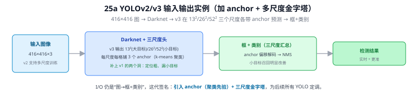

> 📄 **论文原图对照**（Redmon & Farhadi, *YOLO9000*, [arXiv:1612.08242](https://arxiv.org/abs/1612.08242) Figure 3；v3 原文 [PDF](../papers/25a_YOLOv3_1804.02767.pdf)；仅笔记内学习引用，论文写作须自绘）：

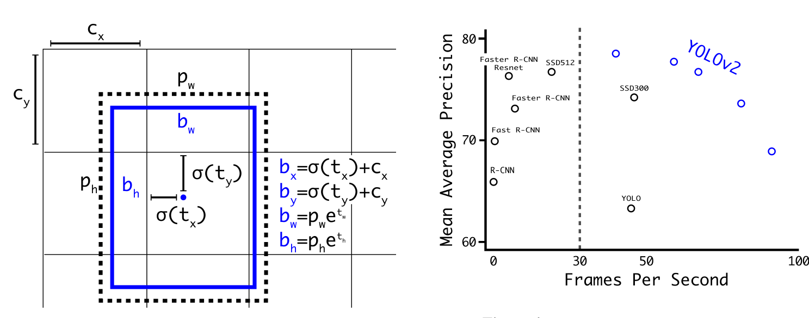

## 一、背景：v1 留下的三个洞

YOLOv1 用"网格 + 全连接直接回归"换来实时（45 fps），但留三大短板，v2/v3 就是来补的：① 单尺度 → 小目标差；② FC 回归 → 定位粗、召回低；③ 每格仅 2 框 → 密集漏检。

---

## 二、YOLOv2（YOLO9000，2017）：Anchor + BatchNorm + Darknet-19

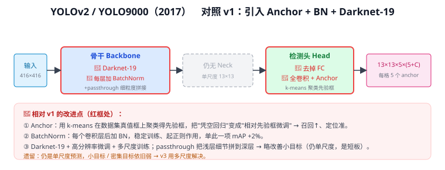

**核心改动**：
- **检测头去 FC、改全卷积 + Anchor**：用 k-means 在真值框上聚类得先验框，把"凭空回归绝对框"变成"相对先验框微调"→ 召回↑、定位准。
- **骨干换 Darknet-19，每个卷积加 BatchNorm**：仅 BN 一项就 mAP +2%。
- **高分辨率微调 + 多尺度训练**：训练时随机切换输入尺寸（320~608），适应多种分辨率。
- **passthrough**：把浅层细节拼到深层，缓解小目标信息丢失。

**遗留**：仍是**单尺度**预测，小目标依旧弱——v3 要解决的。

---

## 三、YOLOv3（2018）：单尺度 → 三尺度金字塔

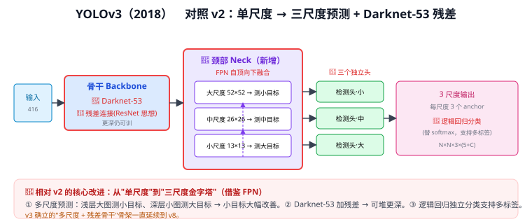

**核心改动**：
- **三尺度预测**：在 52×52 / 26×26 / 13×13 三个特征图上分别预测（借鉴 FPN 自顶向下融合）——浅层测小目标、深层测大目标，小目标大幅改善。
- **骨干升级 Darknet-53 + 残差**：引入 ResNet 残差，可堆更深仍训得动。
- **分类改独立逻辑回归**：每类一个独立 sigmoid（而非 softmax），支持多标签（见下方 Q182）。

> **v3 确立的"多尺度 + 残差骨干"骨架一路延续到 v8。**

---

## 四、与本项目

- 本项目基线 YOLOv8 的**多尺度三检测头**直接源自 v3；第三章加 **P2 层**就是在这套金字塔上再往浅层接一级捞极小目标。
- v2 的 **anchor + k-means 聚类**思路，到 v8 被 anchor-free 取代——理解 anchor 来历，才懂 anchor-free 省了什么。

---

## 五、参考文献

- Redmon J, Farhadi A. *YOLO9000: Better, Faster, Stronger.* CVPR 2017.（v2）
- Redmon J, Farhadi A. *YOLOv3: An Incremental Improvement.* arXiv 2018.

---

## 📋 模型答疑（来自模型详解问答）

---

## Q174. YOLOv3 最后的 3 个尺度，最终是如何形成检测框的？

四步（416 输入、COCO 为例）：

1. **三尺度各出一个张量**：13×13 / 26×26 / 52×52（步长 32/16/8），每格 3 个 anchor，通道 = 3×(5+C)=255。9 个 anchor 由 k-means 聚类、按大小分给三尺度（大目标给 13、小目标给 52），合计 (169+676+2704)×3 = **10647 个候选框**。
2. **每个 anchor 吐偏移量，不是坐标**：(tx,ty,tw,th) + objectness + C 个类别分。
3. **解码成真实框**：中心 `bx=σ(tx)+cx`（锁在本格内、训练稳）、宽高 `bw=pw·e^(tw)`（以 anchor 先验为基准），再 ×步长换回像素。
4. **打分 + NMS**：按 `objectness×类别概率` 过阈值，再按类 NMS 去重叠 → 最终框。

**核心**：网络从不直接"画框"，只在每个预设 anchor 上学一组偏移量，框由解码公式算出。

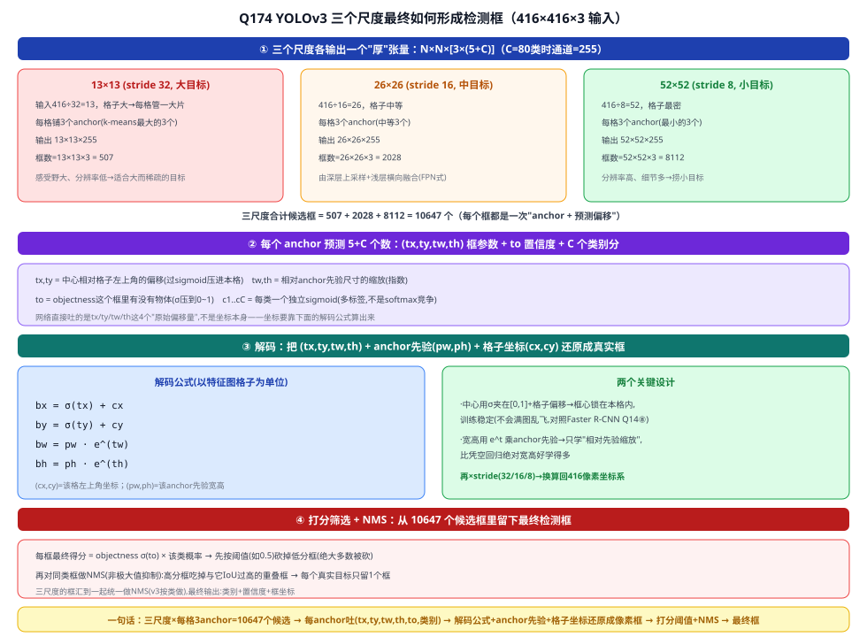

---

## Q175. 用 k-means 在真值框上聚类出的 9 个 anchor，可以作为 ground truth 吗？

**不能**。anchor 是**先验/参照模板**，不是 GT。混淆点是把"来源"当"角色"——anchor 确实"从真值框统计出来"，但**从 A 统计出来 ≠ 就是 A**。

- **GT**：每张图每个目标的真实标注框，逐图不同，进损失当"答案"；
- **9 个 anchor**：对全体真值框做一次 k-means 得到的 9 种典型形状，全局常量、训练前冻结、每图共用的"起点模板"。

类比服装尺码：量全国人身高定 S/M/L，尺码来自真人统计，但"M 码"不是任何一个具体的人。训练里两者分工：每个 GT 分给 IoU 最高的 anchor，损失学的是「anchor→GT」的偏移量。反证：真把 anchor 当答案，模型就只能输出这 9 种固定形状框。

> 聚类细节：用 `d=1−IoU` 而非欧氏距离（框像不像看重叠而非中心差）；聚完按面积从大到小分给三尺度。

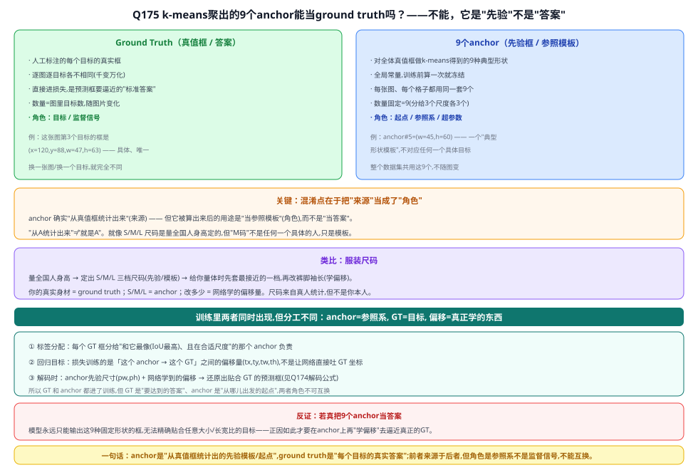

---

## Q176. YOLOv2 为什么可以支持多尺寸训练？

**能多尺寸训练，因为删了 FC、改全卷积**：FC 权重矩阵 = 输入维×输出维是焊死的（YOLOv1 末端 7×7×1024 拉平成 50176→FC，只能吃 448×448）；改全卷积后，卷积核权重**跨空间共享、不认 H×W**，只要输入是 **32 的倍数**就能随意换尺寸。训练时每 10 个 batch 随机换 {320…608}，一个模型适应多分辨率（相当于免费的数据增强）。

**但要分清两个"尺度"轴**（也是"v2 是不是单尺寸"的答案）：

| 轴 | 指什么 | YOLOv2 |
|---|---|---|
| 输入分辨率 | 喂进去的图多大 | **灵活**（320~608） |
| 预测尺度 | 在几个特征图上出框 | **单一**（只在 13×13 一层，无 FPN 金字塔） |

所以"v2 单尺寸"——指**预测尺度**=对（v3 才用三尺度补上）；指**输入分辨率**=不对。多尺度"训练"（一个模型适应多输入分辨率）≠ 多尺度"预测"（一次前向在多层各出一套框）。三代：v1 输入单一(FC焊死)+预测单尺度 → v2 输入多尺寸+预测单尺度 → v3 两者都多。本项目加 P2 改的是"预测尺度"轴。

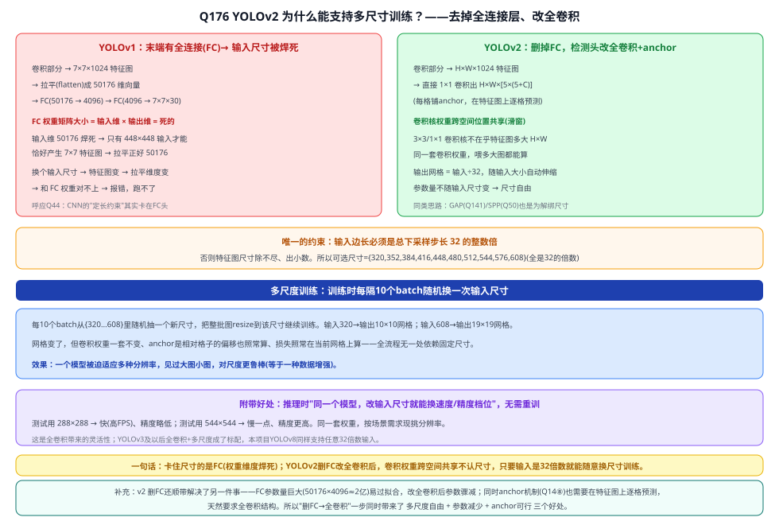

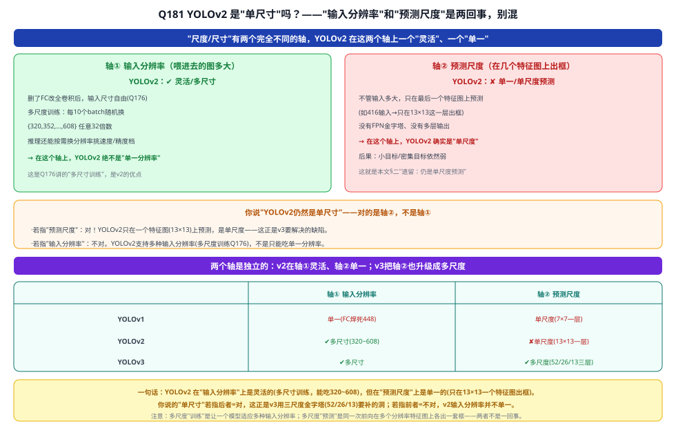

---

## Q179. "1×1 卷积把 H×W×1024 直接输出成 H×W×[5×(5+C)]"——具体是如何做到的？

1×1 卷积 = **逐像素、跨通道的线性变换**：一套 **[5×(5+C)]×1024** 的共享权重，在每个格子上把该格 1024 维特征线性映射成 125 维（VOC，5 anchor×25）预测，`out[k]=ΣW[k,c]·in[c]+b[k]`。同一套权重滑过全部 13×13 格 → 13×13×125，**参数与 H×W 无关**（这就是尺寸自由的来源）。

125 = 5×(5+20)，切成 5 组，每组 = 一个 anchor 的（4 坐标 + 1 置信度 + 20 类）。

**为什么能替代 FC**：每个输出只依赖**同一格**的特征（空间信息已被前面卷积的感受野编码进这 1024 维），不需要 FC 那种"把所有格子拉平混在一起"的全局操作。通道含义（第几个是 tx / 类别）不是天生的，是**损失的解码约定 + 训练**填对的。输出是原始偏移量，后接解码 + NMS（同 Q174）。

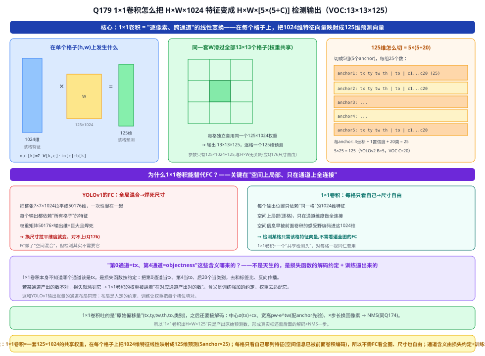

> YOLOv8 检测头同款"1×1 逐格出预测"（只是 anchor-free、分类回归解耦成两支 1×1）；加 P2 就是多接一套 1×1 头，几乎不增参数。

---

## Q180. YOLOv2 为什么要引入 Darknet-19？它又是什么？

Darknet-19 = YOLOv2 的**骨干**（19 卷积 + 5 maxpool），融合三家：VGG 的 3×3 堆叠、GoogLeNet 的 1×1 压通道 + GAP 代大 FC、每层 BatchNorm（仅 BN 就 +2% mAP）。

**为什么引入 = 精度/速度两难**：YOLOv1 旧骨干精度一般（无 BN），VGG-16 准但太重（~30.7 GFLOPs）跑不动实时。Darknet-19 用约 **1/5.5 于 VGG 的算力（~5.58 GFLOPs）**达到相近精度（ImageNet top-5≈91.2%）——更准又更快。

转检测：砍掉末端 GAP + softmax 分类头，保留卷积主体（出 H×W×1024）接 1×1 检测头（即"骨干 = 去掉分类层的分类网"）。名字：Darknet 是作者自研的 C/CUDA 框架，19 = 卷积层数；后续 Darknet-53、YOLOv8 的 CSPDarknet 同脉。

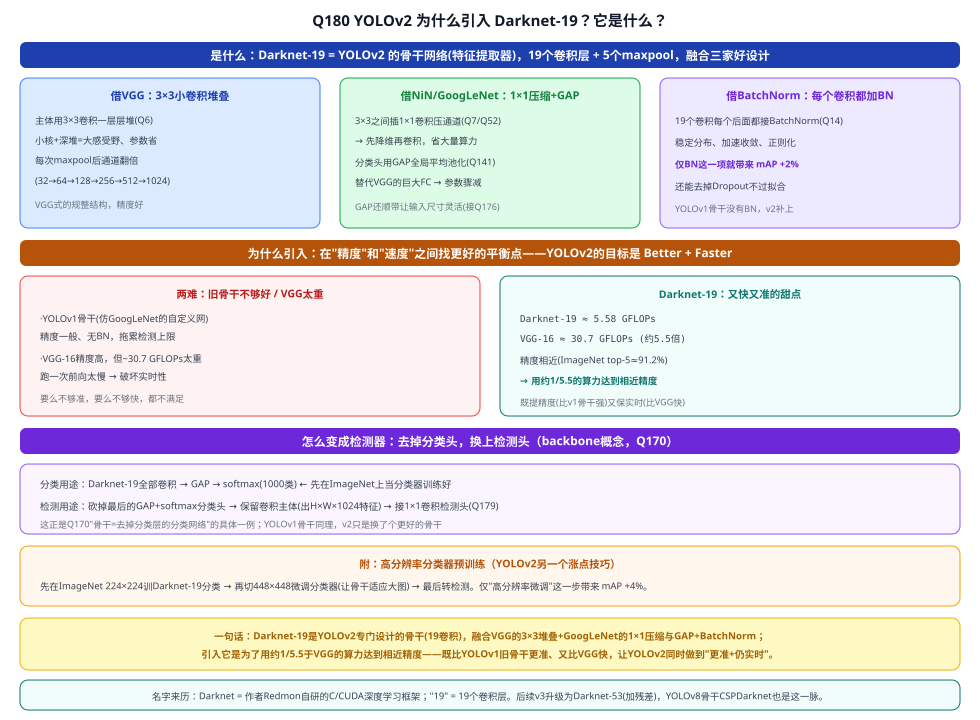

---

## Q182. YOLOv3"分类改独立逻辑回归"是什么过程？

把类别层的 **softmax（C 选 1、类间抢概率）换成每类一个独立 sigmoid**（各判"是/不是"、互不影响、不归一化）：

- **softmax**：$\sum p_i=1$，假设每框恰好属 1 类，遇多标签 / 标签重叠就冲突；
- **独立 sigmoid**：各类 $p_i=\sigma(z_i)$ 独立，"人=0.9"和"女人=0.85"可同时成立 → **支持多标签**。

过程：检测头出 C 个 logits → 各过 sigmoid → 标签 multi-hot、损失 = **每类一个 BCE 相加** → 推理每类各过阈值，可 0/1/多类命中。本质：**C 选 1 的单选题 → C 道独立的是非题**（sigmoid 门控 vs softmax 单选；BCE 见 Q183）。

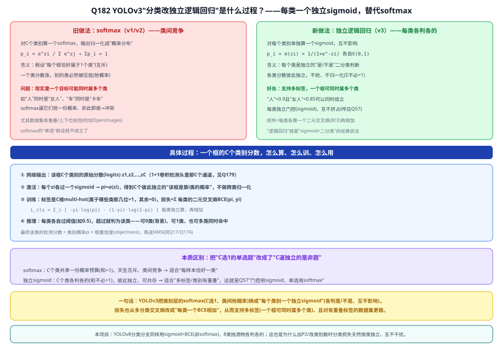

> YOLOv8 分类分支同样用 sigmoid + BCE，8 类各判各的。
