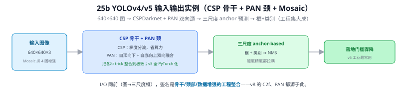
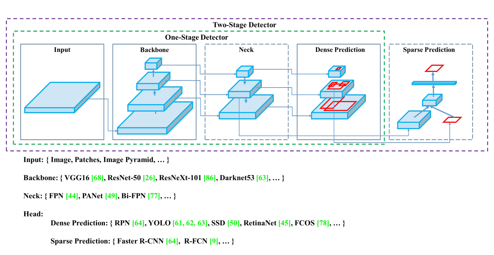
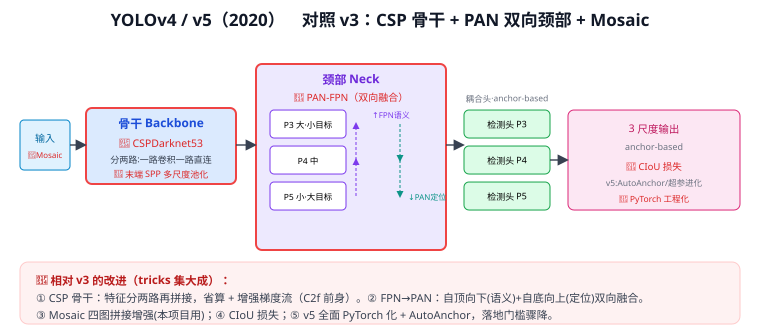

# 25b YOLOv4 / YOLOv5（CSP 骨干 + PAN 双向颈部 + Mosaic）

> 定位：YOLO 的"工程集大成"两代——v4 把各种 trick 整合到极致，v5 全面 PyTorch 化、落地门槛骤降。是 25 YOLO 演进总览 的分篇。
> **输入 / 输出**：608×608（v4）/ 640×640（v5）→ 框 + 类别（三尺度，anchor-based）

---

> 📥📤 **输入/输出实例（看一组具体数值）**：输入 **640×640×3** 图（训练用 Mosaic 拼 4 张图增强）→ CSPDarknet 骨干（梯度分流省算力）+ **PAN 双向颈**（自顶向下 + 自底向上融合）→ 三尺度 anchor-based 预测 → 框+类别 → NMS。I/O 同前（图→三尺度框），签名是**骨干/颈部/数据增强的工程整合**——v4 把各种 trick 整合到极致、v5 全 PyTorch 化落地门槛骤降；v8 的 C2f、PAN 都源于此。



> 📄 **论文原图对照**（图源：Bochkovskiy et al., *YOLOv4*, [arXiv:2004.10934](https://arxiv.org/abs/2004.10934) Figure 2，原文 [PDF](../papers/25b_YOLOv4_2004.10934.pdf)（v5 无正式论文）；仅笔记内学习引用，论文写作须自绘）：



> 检测器解剖图：Backbone / Neck / Head 三段组装范式——此后 YOLO 系列都按这三段讨论。

## 一、背景

v3 确立了"多尺度 + 残差骨干"骨架，但骨干算力、颈部融合、数据增强还有大量提升空间。v4/v5 不发明全新范式，而是把 2018–2020 年 CV 的有效 trick **系统整合**进 YOLO，并把代码工程化。

---

## 二、共同的三大改进



**改动（图中红框处）**：
- **骨干换 CSPDarknet53**：特征分两路——一路过卷积、一路直连，最后拼接（Cross Stage Partial）。省一半算力又增强梯度流——**这正是 v8 中 C2f 模块的前身**（Q43）。末端接 **SPP** 多尺度池化（Q50）。
- **颈部 FPN → PAN-FPN（双向融合）**：在自顶向下"灌语义"（21 FPN）基础上，再加自底向上"灌定位"——双向融合让大小目标都受益（方向细节见 Q15）。
- **Mosaic 数据增强**：四张图拼成一张训练，等效扩大 batch、丰富上下文、提升小目标——**本项目训练直接采用**。

**v4 其它**：CIoU 损失（更好的框回归度量）、各种 bag-of-freebies/specials 集成。

---

## 三、YOLOv5（Ultralytics，2020）：工程化的转折点

v5 最大的贡献不在某个新结构，而在**易用性与落地**：
- **全面 PyTorch 重构**（v1–v4 基于 Darknet/C），训练、导出、部署一条龙。
- **AutoAnchor**：自动在你的数据上聚类 anchor，免手调。
- **超参进化**（遗传算法搜超参）、丰富的模型尺寸（n/s/m/l/x）。

> v5 让 YOLO 从"研究代码"变成"开箱即用的工业工具"，是后来 v8/v11 生态的基础。本项目的训练/导出流程正建立在 Ultralytics 这套工程之上。

---

## 四、与本项目

- **Mosaic** 增强本项目直接用（呼应数据稀缺类）。
- **CSPDarknet → C2f** 的演化是理解 v8 骨干的关键（25d YOLOv8、Q43）。
- **PAN-FPN** 颈部被 v8 沿用，第三章加 P2/CBAM 就插在这套颈部上（21 FPN、16 CBAM）。

---

## 五、参考文献

- Bochkovskiy A, et al. *YOLOv4: Optimal Speed and Accuracy of Object Detection.* arXiv 2020.
- Jocher G, et al. *Ultralytics YOLOv5.*（docs.ultralytics.com）
- Wang C Y, et al. *CSPNet: A New Backbone that can Enhance Learning Capability of CNN.* CVPRW 2020.（CSP 原始论文）

---

## 📋 模型答疑（来自模型详解问答）

> 专属本模型的问答集中在此；跨模型的通用问答见答疑总目录。

---

## Q185. YOLOv4/v5 的 CSP 骨干是什么？

**简答**：CSP 骨干的核心动作就一句话——**把特征按通道劈两半，一半过卷积块、一半直接旁路，末尾拼回来**。为什么这么做：如果让整块特征全部过一大串卷积（普通做法），算力大、而且密集连接里梯度会重复（不同层反复学到相似的梯度信息，浪费）。CSP 只让一半通道去过重计算的块、另一半原样保留，最后拼接——算力砍掉一截、梯度路径也被拆开不再重复，精度却基本不掉。把这个改造套在 Darknet-53 上，就是 CSPDarknet53。

**展开**：

**① 名字拆解：Cross Stage Partial**
- **Partial（局部）**：只有"**一部分**"通道过卷积块，不是全部；
- **Cross Stage（跨阶段）**：直连的那一半**跨过整个块**，在阶段末尾才和"过块的那半"汇合（concat）。

CSPNet（Wang 等，2019）本身是个**通用设计**，可以套到 ResNet、DenseNet、Darknet 上（分别得到 CSPResNet、CSPDarknet 等）——它是"怎么组织一个 stage"的模式，不是一个具体网络。

**② 一个 CSP 块长什么样**
```
输入特征 (H×W×C)
   │
   ├─ 按通道劈两半 ─────────────┐
   ▼ part1 (C/2)                ▼ part2 (C/2)
 过一串卷积块(残差堆叠)         直连/旁路(几乎不算)
 只有半数通道参与→算力减半       原样保留特征
   │                            │
   └────── concat 拼接 ─────────┘
   ▼
 1×1 卷积融合 → 输出
```
对比普通残差（ResNet 是 F(x)+x **逐元素相加**）：CSP 是"按通道**劈开** → 部分处理 → **concat 拼接**"（concat 见 Q7），是另一种复用特征、优化梯度的思路。

**③ 为什么有效——两大好处**
1. **省算力**：只让一半通道过重计算的卷积块 → 计算量和参数**约省 20%**，速度更快。
2. **梯度不重复**：CSPNet 论文的核心动机是"**截断梯度流、防止不同层学到重复的梯度信息**"。整块全过时，密集/残差连接会让很多层收到高度相似（重复）的梯度，做了冗余计算；劈成两半后，过块的一半和旁路的一半**梯度路径不同**，避免了这种重复 → 学习更高效。

结果：**更快、更省参数，精度还不降甚至略升**——这正是 YOLOv4"在速度和精度间取最优"的关键一环。

**④ CSPDarknet53 = Darknet-53 + CSP**
YOLOv4/v5 的骨干 = 拿 YOLOv3 的 **Darknet-53**（Q180 提到的加了残差的骨干），把里面**每个 stage 的残差堆叠改造成 CSP 形式**（劈两半+一半过块+拼接）。末端再接 SPP 多尺度池化（Q50）。

**⑤ 谱系：CSP 一路演化到 YOLOv8 的 C2f**
```
CSPNet(2019, 通用设计)
  → CSPDarknet53 (YOLOv4/v5 骨干，劈两半)
    → C3 模块 (YOLOv5 后期，CSP 的模块化封装)
      → C2f 模块 (YOLOv8，更多梯度分支，本项目基线，见 Q43)
```
所以理解 CSP，就抓住了 YOLOv8 骨干模块（C2f）的来龙去脉。


> **与本项目**：本项目基线 YOLOv8 的骨干模块 **C2f 就是 CSP 思想的后代**（Q43）。理解 CSP"劈两半、部分处理、拼接"的套路，就懂了为什么 YOLOv8 骨干能在**轻量**（呼应实时 <100ms）和**精度**间取得好平衡——这对本项目选骨干、以及第三章在骨干/颈部上做改进都是基础认知。

---

