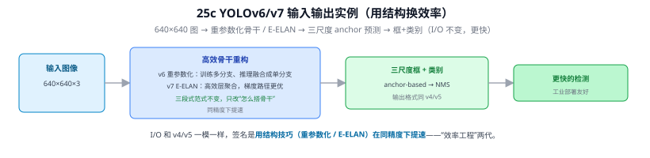
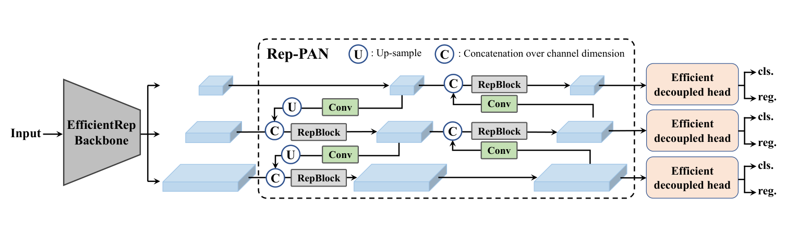
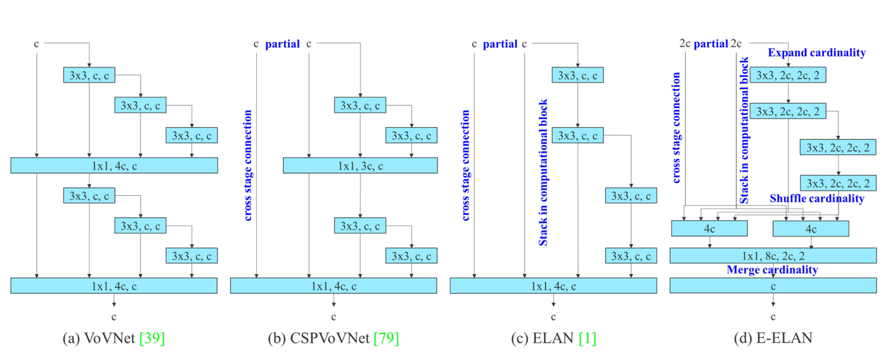
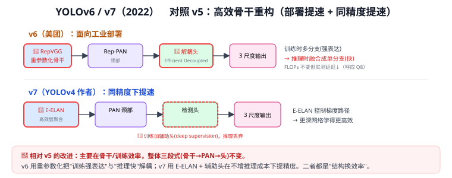

# 25c YOLOv6 / YOLOv7（高效骨干重构：用结构换效率）

> 定位：YOLO 的"效率工程"两代——三段式范式不变，改动集中在**骨干结构与训练效率**，用结构技巧在同精度下提速。是 25 YOLO 演进总览 的分篇。
> **输入 / 输出**：640×640 → 框 + 类别（三尺度，anchor-based）

---

> 📥📤 **输入/输出实例（看一组具体数值）**：输入 **640×640×3** 图 → 高效骨干重构（**v6 重参数化**：训练时多分支、推理时融合成单分支；**v7 E-ELAN**：高效层聚合、梯度路径更优）→ 三尺度 anchor-based 预测 → 框+类别 → NMS。**I/O 和 v4/v5 一模一样**，三段式范式不变，签名是**用结构技巧在同精度下提速**——"效率工程"两代，工业部署友好。

> 📄 **论文原图对照**（图源：Li et al., [arXiv:2209.02976](https://arxiv.org/abs/2209.02976) Figure 2（[PDF](../papers/25c_YOLOv6_2209.02976.pdf)）；Wang et al., [arXiv:2207.02696](https://arxiv.org/abs/2207.02696) Figure 2（[PDF](../papers/25c_YOLOv7_2207.02696.pdf)）；仅笔记内学习引用，论文写作须自绘）：

> 上=v6 的 RepVGG 风格骨干（训练多分支、推理重参数化合并）；下=v7 的 E-ELAN 高效层聚合。

## 一、背景

v5 把 YOLO 工程化后，工业界关心的是**实测延迟**而非纸面 FLOPs。v6/v7 不改三段式范式，而是在骨干/训练上做"结构换效率"的文章。

---

## 二、YOLOv6（美团，2022）：RepVGG 重参数化

- **训练时多分支**（多条卷积路径并行，表达力强、好训），**推理时把多分支数学融合成单分支**（等效但更快）。
- FLOPs 不变，但**实测延迟下降**——这正是 Q8 强调的"参数量/FLOPs ≠ 实际延迟"：规整的单分支对 GPU/部署更友好。
- 面向工业部署优化（量化友好、易上 TensorRT）。

> "重参数化"= 训练用复杂结构学得好、推理折叠成简单结构跑得快，是部署导向的典型手段（与 BN 折叠 思路同源：把训练期的额外结构在推理前合并掉）。

---

## 三、YOLOv7（Bochkovskiy，2022）：E-ELAN + 辅助头

- **E-ELAN（扩展高效层聚合网络）**：精心设计的梯度路径，控制特征在网络里如何聚合，让深层也能高效学习（又是"给梯度修高速路"母题，同 09 ResNet 残差、Q9）。
- **训练辅助头（深监督）**：训练时在中间层额外加检测头帮助学习，**推理时丢弃**——不增加部署成本却提升训练效果。
- 净效果：**同精度下提速**。

---

## 四、与本项目

- v6 的"FLOPs ≠ 延迟"教训直接指导本项目：第三章加 P2/CBAM 后**必须实测 FPS/延迟**（EXP-002），不能只看参数量（Q8）。
- v6/v7 的高效聚合思想，在 v8 的 C2f、v11 的 C3k2 上延续（25d YOLOv8、25e YOLOv9/v10/v11）。

---

## 五、参考文献

- Li C, et al. *YOLOv6: A Single-Stage Object Detection Framework for Industrial Applications.* 2022.
- Wang C Y, et al. *YOLOv7: Trainable bag-of-freebies sets new state-of-the-art.* 2022.

---

