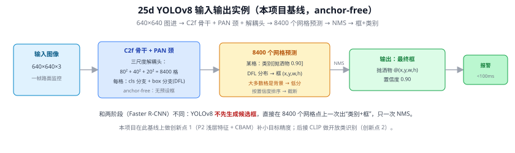
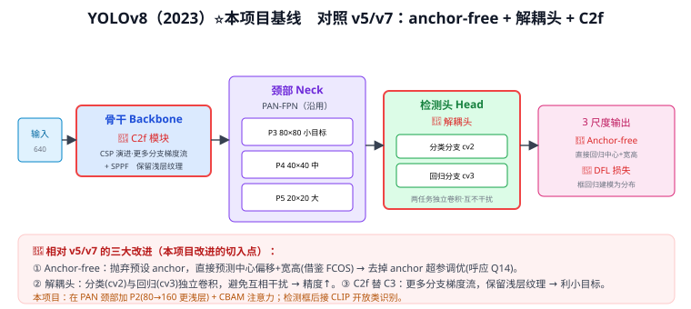
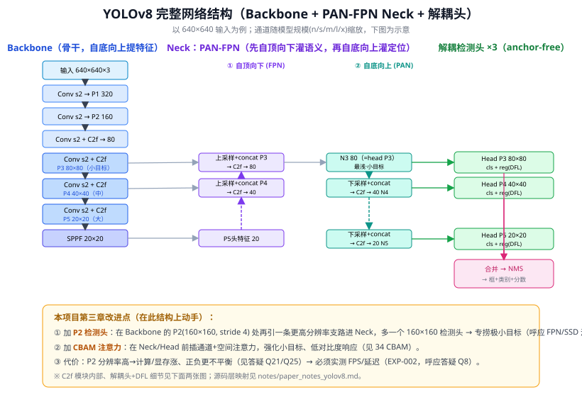
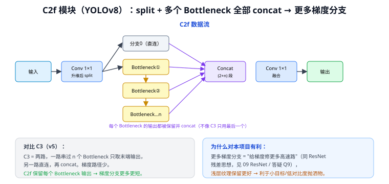
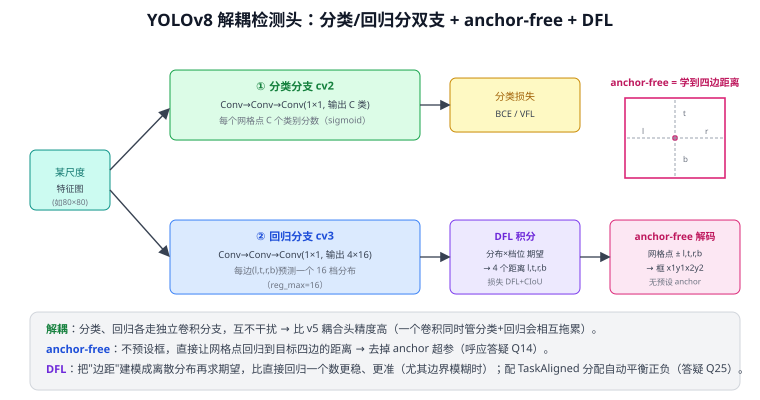
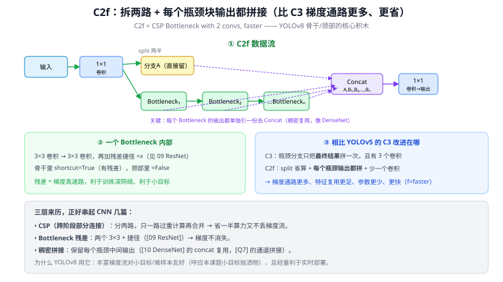

# 25d YOLOv8 ⭐（本项目基线：anchor-free + 解耦头 + C2f + DFL）

> 定位：**本项目检测基线（EXP-001），所有改进都在它之上做。** YOLO 演进集大成的一代，第三章的 P2/CBAM 改进就切入这里。是 25 YOLO 演进总览 的分篇。
> 注：源码层映射（C2f/解耦头/损失/配置）见 `learning/paper_notes_yolov8.md`，本文聚焦结构与原理。
> **输入 / 输出**：640×640 图像 → 框 + 类别（8400 预测 → NMS，**anchor-free**）

---

> 📥📤 **输入/输出实例（看一组具体数值）**：输入 **640×640×3** 一帧路面图 → C2f 骨干 + PAN 颈 → 三尺度解耦头 **80²+40²+20²=8400** 个网格预测，每格出 类别概率（如 $[\text{抛洒物 }0.90]$）+ DFL 分布解码出框 $(x,y,w,h)$ → 大多数格是背景给低分 → 按置信度排序 + **NMS** → 最终框（抛洒物 @(x,y,w,h)、置信度 0.90）。与两阶段（Faster R-CNN）不同：**不先生成候选框**，直接在 8400 个网格点一次出"类别+框"、只一次 NMS、**anchor-free**。本项目在此基线上做创新点 1（P2+CBAM 补小目标），再接 CLIP 做创新点 2（开放类识别）。



## 一、v8 相对 v5/v7 改了什么（三点）



**改动（图中红框处，也是本项目改进的切入点）**：
- **Anchor-free**：抛弃预设 anchor，直接预测中心偏移 + 宽高（借鉴 FCOS），配 **DFL** 把框回归建模为分布 → 去掉 anchor 超参调优的麻烦（呼应 Q14、Q14⑧）。
- **解耦头**：分类（cv2）与回归（cv3）独立卷积，两任务互不干扰 → 精度↑（v5 是耦合头）。
- **C2f 替 C3**：更多分支梯度流、保留浅层纹理 → 利小目标（详见下方 [Q43](#q43-yolov8-的-c2f-模块是什么相比-c3-改进在哪)）。

颈部 PAN-FPN 沿用 v4/v5（25b）。

---

## 二、YOLOv8 完整网络结构（三段式）⭐



**① Backbone（骨干，自底向上）**：`Conv` 逐级 stride-2 下采样（P1→P5），各阶段用 **C2f** 提特征，末端接 **SPPF**（空间金字塔池化快速版，多尺度感受野、便宜地扩大视野，Q50）。产出三尺度 **P3(80×80)/P4(40×40)/P5(20×20)** 送颈部——分别对应小/中/大目标（多尺度思想见 21 FPN、23 SSD）。

**② Neck（PAN-FPN，双向融合）**：先**自顶向下**把深层语义上采样、与浅层 concat（FPN，灌"语义"），再**自底向上**把浅层定位下采样、与深层 concat（PAN，灌"定位"）。双向融合后输出三尺度给检测头（方向细节见 Q15）。

**③ 解耦头 ×3（anchor-free）**：每尺度一个头，分类/回归**分双支**，anchor-free 直接回归四边距离 + **DFL**，最后合并三尺度做 **NMS** 出结果（推理后处理见 Q17、Q20）。

### 2.1 C2f 模块（v8 核心积木，替代 v5 的 C3）



C2f = 输入 1×1 卷积后 **split**，一路直连、其余串过 n 个 Bottleneck，**每个 Bottleneck 的输出都保留并 concat**（C3 只用最后一个）→ 梯度分支更多更短（"给梯度修高速路"，同 09 ResNet 残差、Q9），浅层纹理保留更好 → **利于小目标/低对比度抛洒物**。详细拆解见下方 [Q43](#q43-yolov8-的-c2f-模块是什么相比-c3-改进在哪)。

### 2.2 解耦头 + DFL



- **解耦**：分类（cv2，BCE/VFL）与回归（cv3）各走独立卷积，互不干扰 → 比 v5 耦合头准。
- **anchor-free**：网格点直接回归到目标**四边距离 (l,t,r,b)**，无需预设 anchor（去超参，呼应 Q14）。
- **DFL（Distribution Focal Loss）**：把每条边距建模成一个 16 档**离散分布**再求期望，比直接回归一个标量更稳、更准（边界模糊时尤甚）；配 **TaskAligned 标签分配**自动平衡正负（Q25），无需手调 λ（对比 YOLOv1 的 Q27）。

---

## 三、本项目第三章在此结构上动手 ⭐

- ① 在 Backbone 的 **P2(160×160, stride 4)** 处引一条更高分辨率支路进 Neck，多一个 P2 检测头捞极小目标（21 FPN）。
- ② 在 Neck/Head 前插 **CBAM**（16 CBAM）强化小目标与低对比度响应。
- ③ 代价是计算/显存↑、正负更不平衡（Q21、Q25）→ 必须实测 FPS/延迟（EXP-002，呼应 Q8）。

**为什么选 v8 而非 v11/v12**（CLAUDE.md 2026-04-27 决策）：v8 成熟稳定、生态完善；本项目数据上 v8（旧划分 mAP50=0.442）略优于 v11（0.429）；anchor-free + C2f + PAN-FPN 给 P2+CBAM 改进留出清晰切入点。**不用 v12**（太新、踩坑风险高）。

---

## 四、具体实例（动手算一遍）

**例 1：YOLOv8（640 输入）一共预测多少个位置**
三尺度检测头，anchor-free 每格 1 个预测：
$$80^2+40^2+20^2=6400+1600+400=\mathbf{8400}\ \text{个预测}$$
本项目**加 P2（160×160）**后：$160^2+8400=25600+8400=\mathbf{34000}$ → 浅层网格更密、利小目标，但负样本也更多（正负更不平衡，Q25）。

**例 2：DFL 怎么把"分布"积分成一个边距**
回归不直接输出一个数，而是输出 reg_max=16 档的概率分布再求期望。设某边距分布在档位 {6,7,8} 上概率 {0.2,0.5,0.3}（其余≈0）：
$$\hat d=\sum_i i\cdot p_i=6\times0.2+7\times0.5+8\times0.3=1.2+3.5+2.4=7.1$$
即预测该边距 = 7.1（个单位）。比直接回归一个标量更稳、边界模糊时更准。

**例 3：anchor-free 解码**
某网格点 $(c_x,c_y)$，预测四边距离 $(l,t,r,b)$ → 框角点 $=(c_x-l,\,c_y-t,\,c_x+r,\,c_y+b)$，无需预设 anchor（对比 Q14 的 anchor 偏移回归）。

---

## 五、参考文献

- Jocher G, et al. *Ultralytics YOLOv8.*（docs.ultralytics.com）
- Tian Z, et al. *FCOS: Fully Convolutional One-Stage Object Detection.* ICCV 2019.（anchor-free 思想）
- Li X, et al. *Generalized Focal Loss (DFL).* NeurIPS 2020.

---

## 📋 模型答疑（来自模型详解问答）

> 以下问答原属"答疑记录"系列，因专属本模型已并入此处便于集中查阅；跨模型的通用问答仍留在答疑分册。

---

## Q43. YOLOv8 的 C2f 模块是什么？相比 C3 改进在哪？

**简答**：C2f 把输入先 1×1 卷积后**按通道 split 成两半**：一半直接留着，另一半依次过 $n$ 个 Bottleneck（两层 3×3 + 残差，09 ResNet）；关键是**每个 Bottleneck 的中间输出都单独引一份**，最后把"留着的那半 + 各 Bottleneck 输出"全部 concat，再 1×1 卷积融合。相比 C3：① split 省算、② 少一个卷积、③ 保留每个瓶颈输出（稠密复用，类似 10 DenseNet）→ 梯度通路更多、特征复用更足、参数更少更快（"f"=faster）。

**展开**：

**① 名字拆解 C2f**
- **C**SP：跨阶段部分连接（Cross Stage Partial）——分两路，只一路过重计算再合并，省一半算力又不丢梯度流。
- **2**：模块里用 **2** 个 1×1 卷积（进、出各一个）来变换通道。
- **f**：faster——相比 C3 更省更快。

**② 数据流（对比 C3）**
```
C2f:
输入 ─►1×1卷积─► split 两半
                 ├─ 分支A：直接保留（不计算）
                 └─ 分支B：Bottleneck₁→Bottleneck₂→…→Bottleneckₙ
                           （每个块的输出都单独留一份）
   Concat[ A, B₁, B₂, …, Bₙ ] ─►1×1卷积─► 输出
```
- **C3（YOLOv5）**：瓶颈分支只把**最终结果**拼一次，且模块含 3 个卷积。
- **C2f（YOLOv8）**：split + **每个瓶颈输出都拼** + 少一个卷积。



**③ 一个 Bottleneck 内部**
两个 3×3 卷积串联，外加残差捷径 $+x$（09 ResNet、Q9）。在**骨干**里 `shortcut=True`（带残差，利于梯度流）；在**颈部**里 `shortcut=False`（只做特征变换）。

**④ 三层来历，串起 CNN 几篇**
| 来历 | 作用 | 关联 |
|------|------|------|
| CSP 跨阶段部分连接 | 分两路省算、不丢梯度 | YOLO 演进 |
| Bottleneck 残差 | 梯度高速路、训得动深层 | 09 ResNet、Q9 |
| 稠密拼接每个瓶颈输出 | 特征复用更充分 | 10 DenseNet、Q7 concat |

**⑤ 与本项目**
- **为什么 YOLOv8 用 C2f**：更丰富的梯度流对**小目标和难样本**更友好——正对本课题的小目标抛洒物；且结构相对轻量，利于实时部署（< 100ms 目标）。
- **第三章改进的落点**：加 P2（21 FPN）、加 CBAM（16 CBAM）都是在 C2f 搭起的骨干/颈部上动手，理解 C2f 的"split+稠密拼接+残差"才知道新模块插在哪、会不会破坏梯度流（呼应 Q9）。

---
