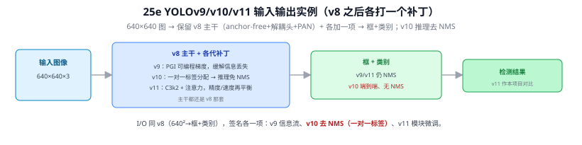
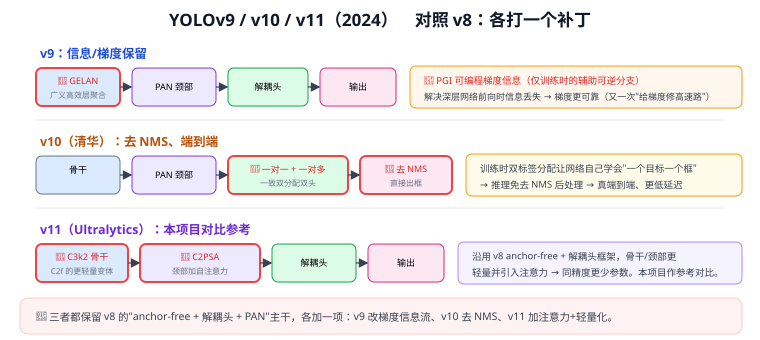
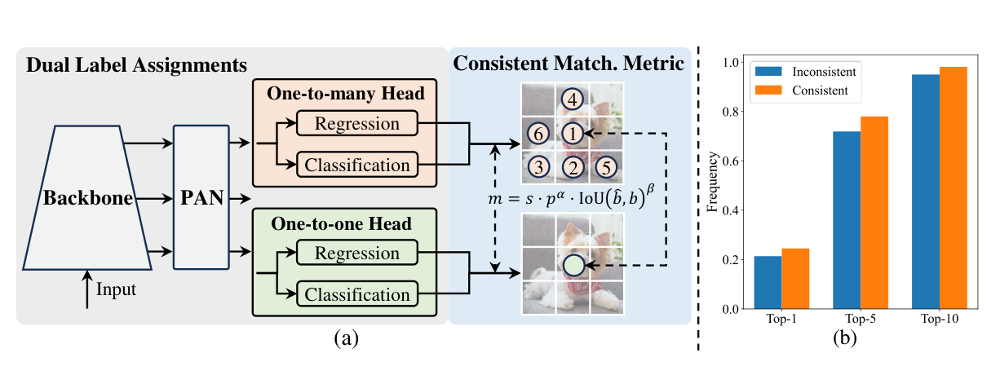
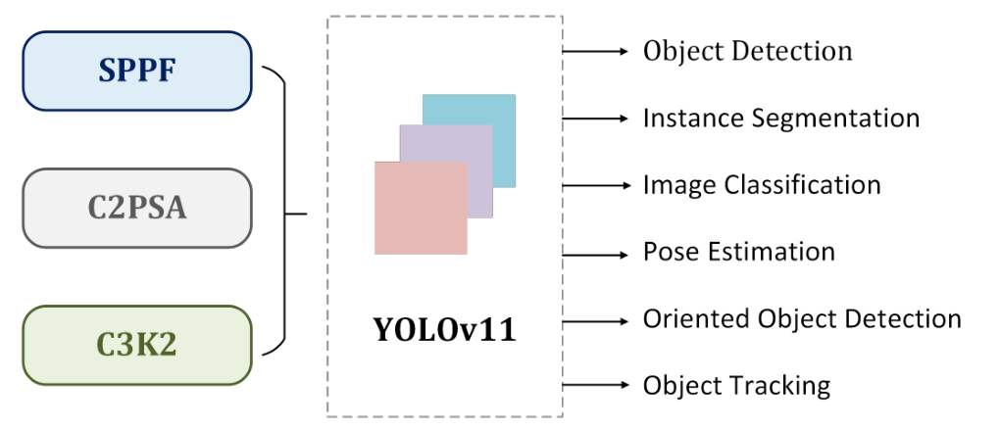

# 25e YOLOv9 / v10 / v11（v8 之后各打一个补丁）

> 定位：v8 之后的三代，**都保留 v8 的"anchor-free + 解耦头 + PAN"主干**，各加一项改动。v11 是本项目的对比参考。是 25 YOLO 演进总览 的分篇。
> **输入 / 输出**：640×640 → 框 + 类别（v10 推理**去 NMS**，端到端）

---

> 📥📤 **输入/输出实例（看一组具体数值）**：输入 **640×640×3** 图 → **都保留 v8 主干**（anchor-free + 解耦头 + PAN）+ 各加一项：**v9 PGI**（可编程梯度，缓解信息丢失）/ **v10 一对一标签分配**（推理免 NMS、端到端）/ **v11 C3k2 + 注意力**（精度/速度再平衡）→ 框+类别。I/O 同 v8，唯一 I/O 层面的变化是 **v10 推理去掉 NMS**。v11 是本项目的对比参考。

三者都在 v8 主干上各打一个补丁：

> 📄 **论文原图对照**（图源：Wang et al., [arXiv:2405.14458](https://arxiv.org/abs/2405.14458) Figure 2（[PDF](../papers/25e_YOLOv10_2405.14458.pdf)）；[arXiv:2410.17725](https://arxiv.org/abs/2410.17725) Figure 1（[PDF](../papers/25e_YOLOv11_2410.17725.pdf)；v9 原文 [PDF](../papers/25e_YOLOv9_2402.13616.pdf)）；仅笔记内学习引用，论文写作须自绘）：

> 上=v10 一致双重分配：训练一对多头+一对一头、推理只用一对一免 NMS（Q112 的正主）；下=v11 组件（SPPF/C2PSA/C3K2）与多任务头。

## 一、YOLOv9（2024）：GELAN + PGI

- **GELAN** 架构 + **PGI（可编程梯度信息）**：训练时加一条**可逆辅助分支**，缓解深层前向**信息丢失**——又是"给梯度/信息修高速路"母题（同 09 ResNet 残差、25c v7 的 E-ELAN、Q9）。
- 推理时辅助分支可去掉，不增部署成本。

## 二、YOLOv10（清华，2024）：去 NMS，端到端

- **一致双分配**（训练时一对一 + 一对多双头并存）：让模型学会"一个目标只出一个框"。
- 于是**推理时去掉 NMS**（Q20）→ 真端到端、更低延迟（去掉后处理开销，思想呼应 28a DETR 的集合预测无 NMS）。

## 三、YOLOv11（Ultralytics，2024）：更轻量高效

- **C3k2** 轻量骨干模块（C2f 的演化，Q43）+ **C2PSA** 颈部自注意力（把注意力引入 YOLO，呼应 27 注意力机制）。
- 同精度下更少参数、更快——**本项目对比参考**。

---

## 四、与本项目

- 本项目**用 v8 为主、v11 为参考**（CLAUDE.md 决策）：v11 在本项目数据上 mAP50=0.429，略低于 v8 的 0.442，故主线用 v8。
- v11 的 **C2PSA 注意力**与本项目第三章加 **CBAM**（16 CBAM）思路一致（都给特征加注意力），可在相关工作里对照。
- v10 的去 NMS 思想是"未来工作"可提的方向；本项目仍用标准 NMS（Q20）。

---

## 五、参考文献

- Wang C Y, et al. *YOLOv9: Learning What You Want to Learn Using PGI.* 2024.
- Wang A, et al. *YOLOv10: Real-Time End-to-End Object Detection.* 2024.
- Jocher G, et al. *Ultralytics YOLOv11.*（docs.ultralytics.com）

---

