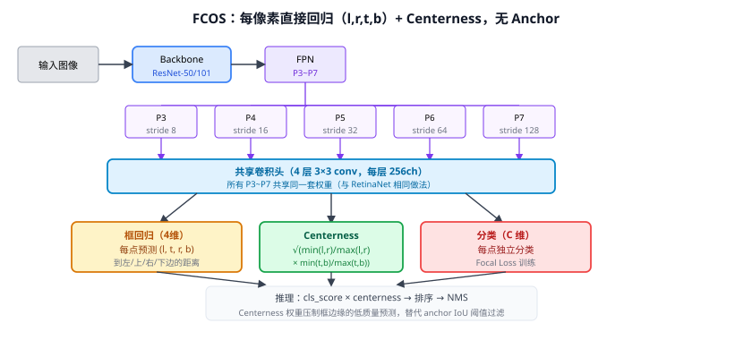

# 26 FCOS（全卷积单阶段目标检测）⭐

> 定位：第一个不用 anchor、直接在每个特征图位置预测框的高性能单阶段检测器；引入 **Centerness 分支**替代 anchor IoU 阈值的作用。
> 作者：Tian et al.，澳大利亚阿德莱德大学，ICCV 2019（Oral）。
> 战绩：COCO AP 44.7（ResNeXt-101），超过同骨干 RetinaNet；训练无需 anchor 超参设计。
> **输入 / 输出**：图像 → 每点 (l, t, r, b) + centerness + class → NMS → 检测框

---

## 一、提出背景

20 Faster R-CNN、24 RetinaNet 等都依赖 **anchor**：预先定义 9 个（3 尺度×3 比例）anchor，每个位置对 anchor 做 IoU 阈值匹配，再做偏移回归。这带来三个问题：
1. **超参多**：anchor 尺度、比例、正负阈值需手动设计，且对小目标/大宽高比敏感。
2. **正负不平衡**：anchor 中绝大多数是负样本（需 Focal Loss 或难负采样缓解）。
3. **迁移能力弱**：anchor 尺寸在不同数据集（遥感、医学、路面）需要重新设计。

FCOS 的想法：**直接预测每个特征图位置到目标框四条边的距离，彻底抛弃 anchor**。这被称为"每像素预测"（per-pixel prediction），与分割任务思路一脉相承。

---

## 二、核心创新

### 2.1 无 Anchor 框回归

对特征图上位置 $(x, y)$（图像坐标 $(c_x, c_y) = \text{stride} \times (x+0.5)$），若其落在某个目标框 $(x_1, y_1, x_2, y_2)$ 内，则回归目标为：

$$l^* = c_x - x_1,\quad t^* = c_y - y_1,\quad r^* = x_2 - c_x,\quad b^* = y_2 - c_y$$

所有在目标框内的位置都算正样本（无 anchor，无 IoU 阈值）。

### 2.2 多尺度分级分配（FPN Level Assignment）

为避免"歧义"（一个位置落在多个目标内），FCOS 给每个 FPN 层设**目标尺寸范围**：

| FPN 层 | 目标尺寸 $(max(l,r,t,b))$ |
|--------|------------------------|
| P3 (stride 8)   | 0 ~ 64 |
| P4 (stride 16)  | 64 ~ 128 |
| P5 (stride 32)  | 128 ~ 256 |
| P6 (stride 64)  | 256 ~ 512 |
| P7 (stride 128) | 512 ~ ∞ |

这样每个目标只在适合其大小的层预测，歧义大幅减少。

### 2.3 Centerness 分支（核心贡献）

直接预测框边缘的位置质量低（越远离中心，框越不准）。FCOS 新增一个 **centerness** 标量输出：

$$\text{centerness}^* = \sqrt{\frac{\min(l^*, r^*)}{\max(l^*, r^*)} \times \frac{\min(t^*, b^*)}{\max(t^*, b^*)}}$$

- 框中心处 centerness = 1（l=r, t=b）；
- 靠近边缘处 centerness → 0。

推理时：`最终得分 = cls_score × centerness`，自然压制低质预测，**不用设 IoU 阈值**，NMS 效果更好。

### 2.4 训练损失

$$\mathcal{L} = \frac{1}{N_{pos}}\sum_{x,y}\left[\mathcal{L}_{cls}(\hat{p}, c^*) + \mathbb{1}_{c^*>0}\left(\mathcal{L}_{reg}(\hat{t}, t^*) + \mathcal{L}_{cen}(\hat{cen}, cen^*)\right)\right]$$

- $\mathcal{L}_{cls}$：Focal Loss（24 RetinaNet）
- $\mathcal{L}_{reg}$：IoU Loss（比 L1 对尺度更鲁棒）
- $\mathcal{L}_{cen}$：Binary Cross Entropy

---

## 三、优点与局限

**优点**：
- **无 anchor 超参**：不需要设计 anchor 尺度比例，跨数据集迁移更简单。
- **正样本更多**：框内所有点都是正样本（anchor-based 每位置仅 1-2 个 anchor 为正），训练信号更密集。
- 精度媲美甚至超过同骨干的 anchor-based 方法（如 RetinaNet）。

**局限**：
- centerness 分支需要额外推理；层级分配边界是固定的，偶尔出现目标跨层被分割的问题。
- 歧义问题在目标密集场景仍存在（靠后处理 NMS 解决）。

---

## 四、历史地位

FCOS 是 **anchor-free 目标检测革命**的标志性工作，与 CenterNet（26a）同年，但路线不同（FCOS 用 FPN 多尺度，CenterNet 用单尺度热图）：

- **YOLOv8 解耦头直接继承 FCOS 范式**：anchor-free 框回归 (l,t,r,b) + 独立分类分支（25d YOLOv8）——这是本项目基线最直接的检测头来源。
- **FCOS 思想**在 GroundingDINO（35）等开放词汇检测中也有体现（每点对文本 query 匹配）。

放进脉络：RetinaNet（anchor, Focal Loss）→ **FCOS（anchor-free, centerness）** → CenterNet（热图）→ YOLOv8（anchor-free + 解耦头）。

---

## 五、与本项目的关系

- **直接来源**：YOLOv8 的检测头是 FCOS 风格的 anchor-free 解耦头，**第三章方法部分解释"为什么 YOLOv8 不用 anchor"需要引用 FCOS**。
- **P2 层扩展**：本项目在 P3~P5 之上加 P2 层（stride 4）检测更小目标，这正是 FCOS 多尺度分级思想的延伸——只需设 P2 的目标尺寸范围（0~32 像素）即可对应逻辑自洽。
- 不直接使用 FCOS 本体；作方法来源引用。

---

## 参考文献

- Tian Z, Shen C, Chen H, He T. *FCOS: Fully Convolutional One-Stage Object Detection.* ICCV 2019.
- （扩展）Tian Z, et al. *FCOS: A Simple and Strong Anchor-free Object Detector.* TPAMI 2022.
