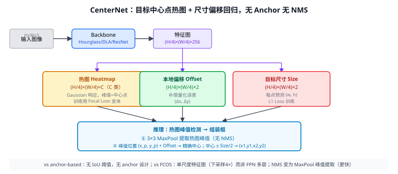

# 26a CenterNet（Objects as Points）

> 定位：把目标建模为**关键点（中心点）**，用热图预测中心位置，再从中心点回归框的尺寸和偏移，**无 anchor、无 NMS**（严格来说 MaxPool 峰值检测替代 NMS）。
> 作者：Zhou et al.，UT Austin，arXiv 2019（与 CornerNet、FCOS 同年，三篇构成 anchor-free 检测革命）。
> 战绩：COCO AP 45.1（Hourglass-104，测试时增强），实时版 DLA-34 COCO AP 37.4 @ 52 FPS。
> **输入 / 输出**：图像 → 中心点热图（C类）+ 本地偏移（2维）+ 尺寸（2维）→ 框

---



## 一、提出背景

CornerNet（2018）用两个角点（左上+右下）热图检测目标，再配对，准但复杂。CenterNet 更激进：**只用一个中心点**，绕过角点配对的后处理问题，让检测尽可能简单：

> "目标是一个点，其余一切（尺寸、类别）都由这个点决定。"

思路来自关键点检测（人体姿态估计），把每个目标"压缩"成一个二维坐标。

---

## 二、核心创新

### 2.1 Gaussian 热图（Heatmap）

对每个目标类别 $c$，在下采样 4× 的特征图上，以目标中心为圆心画高斯斑点：

$$Y_{xyc} = \exp\!\left(-\frac{(x-\tilde{p}_x)^2+(y-\tilde{p}_y)^2}{2\sigma^2}\right)$$

其中 $\sigma$ 由目标尺寸自适应决定（大目标高斯更宽）。热图值范围 [0,1]，峰值处为 1。

**训练**：Focal Loss 变体（与 CornerNet 相同）：

$$\mathcal{L}_{k} = -\frac{1}{N}\sum_{xyc}\begin{cases}(1-\hat{Y}_{xyc})^\alpha\log(\hat{Y}_{xyc}) & Y_{xyc}=1\\ (1-Y_{xyc})^\beta(\hat{Y}_{xyc})^\alpha\log(1-\hat{Y}_{xyc}) & \text{otherwise}\end{cases}$$

这里非中心点的负样本由 $(1-Y_{xyc})^\beta$ 降权，与 Gaussian 值成正比（高斯边缘算"软负样本"）。

### 2.2 本地偏移（Local Offset）

图像坐标 $(x, y)$ 下采样 4× 后量化为 $(\lfloor x/R \rfloor, \lfloor y/R \rfloor)$，丢失小数部分。偏移分支学这个误差：

$$\hat{O}_{\tilde{p}} = (p/R - \tilde{p}),\quad \text{L1 loss}$$

补偿后中心位置更精确，IoU 提升约 2 点。

### 2.3 尺寸回归（Size）

直接在中心点位置预测 $(w, h)$，不回归比例偏移（绝对值）：

$$\mathcal{L}_{size} = \frac{1}{N}\sum_{k=1}^{N}|\hat{S}_{p_k} - s_k|,\quad s_k=(w_k, h_k)$$

### 2.4 推理：MaxPool 峰值 ≈ NMS

热图上的局部极值（相邻 3×3 中最大值）即为检测到的中心点。Top-K 峰值 → 组装框：

```
中心 = (peak_x, peak_y) + offset
框   = (center_x - w/2, center_y - h/2, center_x + w/2, center_y + h/2)
```

**无需传统 NMS**（MaxPool 自然去除重叠峰值），速度更快。

### 2.5 统一框架：3D/姿态/深度

CenterNet 的优雅之处在于可扩展性：同样的骨干+热图框架，换几个回归头就能做：
- **人体姿态估计**：17 个关键点偏移
- **3D 目标检测**：深度 + 旋转角 + 3D 尺寸
- **图像字幕**：中心点作为锚

---

## 三、优点与局限

**优点**：
- **极简**：三个头，无 anchor，无 NMS（或极轻量 MaxPool NMS）。
- **速度快**：DLA-34 实时 52 FPS，适合路面视频流推理。
- **可扩展**：任意属性都可在中心点附加回归头。

**局限**：
- 下采样 4× 可能错过极小目标中心（两个极近目标中心重叠时预测困难）。
- 热图训练对 Gaussian $\sigma$ 的调参较敏感。
- 单尺度特征图（无 FPN）在多尺度场景（路面远近抛洒物差异大）精度弱于 FCOS + FPN。

---

## 四、历史地位

CenterNet 与 FCOS（26）并列为 anchor-free 检测的两条主要路线：

| | FCOS | CenterNet |
|-|------|-----------|
| 正样本 | 框内所有点 | 仅中心点 |
| 多尺度 | FPN P3~P7 | 单图 /4 |
| NMS | 传统 NMS | MaxPool 峰值 |
| 适合场景 | 大密集场景 | 快速实时 |

两者都是 **YOLOv8 anchor-free 解耦头**的思想来源。后续 DINO（检测，Transformer 版）、RTDETRv2 等在此基础上引入 Transformer query。

---

## 五、与本项目的关系

- **间接来源**：YOLOv8 采用 anchor-free + 解耦头设计，部分灵感来自 CenterNet；本项目第三章叙述检测头发展脉络时可与 FCOS 并列引用。
- **速度参考**：CenterNet 的实时推理设计（MaxPool NMS）与本项目"<100ms"目标相关，可作速度优化方向的参考文献。
- 不直接使用 CenterNet 本体；作方法来源引用。

---

## 参考文献

- Zhou X, Wang D, Krähenbühl P. *Objects as Points.* arXiv 2019.
- （相关）Law H, Deng J. *CornerNet: Detecting Objects as Paired Keypoints.* ECCV 2018.（26b）
