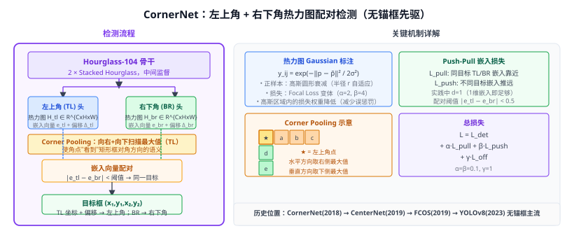

# 26b CornerNet（角点检测，无锚框先驱）

> 定位：**无锚框（Anchor-free）目标检测的早期开创性工作**，将目标框表示为一对关键点（左上角 + 右下角），通过热力图 + 嵌入向量配对，完全去掉锚框设计。
> 作者：Law & Deng，ECCV 2018，University of Michigan。
> 效果：MS COCO test-dev 42.1% AP（超越当时所有单阶段方法，与 Cascade R-CNN 相当）；后续 CenterNet 继承其 Heatmap 思想。
> **输入 / 输出**：图像 → 左上角热力图 + 右下角热力图 + 嵌入向量 + 偏移量

---



## 一、提出背景

在 CornerNet 之前，主流目标检测（Faster RCNN、SSD、YOLO）都依赖**锚框（Anchor Boxes）**：
- 需要人工设计尺寸和长宽比（超参数敏感）；
- 负样本远多于正样本（正负比例严重失衡，需要 focal loss / OHEM 弥补）；
- 不同尺度的目标需要匹配不同尺寸锚框（小目标尤其难）。

CornerNet 提出：**每个目标由两个角点（左上角 TL、右下角 BR）唯一确定**，检测问题转化为在热力图上找角点，再通过嵌入向量将属于同一目标的角点配对。

---

## 二、核心设计

### 2.1 角点热力图（Corner Heatmaps）

为每个类别 $c$ 生成两个热力图：
- $\mathbf{H}_{tl} \in \mathbb{R}^{C \times H \times W}$：左上角热力图
- $\mathbf{H}_{br} \in \mathbb{R}^{C \times H \times W}$：右下角热力图

正样本标注：在真实角点位置，以**半径 $r$ 为圆形区域**用二维 Gaussian 平滑标注（与 CenterNet 热力图类似，但 CornerNet 用自适应半径）：

$$y_{ij} = \exp\left(-\frac{(i - \tilde{p}_x)^2 + (j - \tilde{p}_y)^2}{2\sigma^2}\right)$$

损失函数（Focal Loss 变体）：
$$L_{det} = -\frac{1}{N}\sum_{cij}\begin{cases}(1-\hat{y}_{cij})^\alpha \log(\hat{y}_{cij}) & y_{cij}=1 \\ (1-y_{cij})^\beta\hat{y}_{cij}^\alpha\log(1-\hat{y}_{cij}) & \text{otherwise}\end{cases}$$

参数 $\alpha=2$, $\beta=4$（高斯中心区域权重降低，非角点区域惩罚减轻）。

### 2.2 嵌入向量（Embedding for Grouping）

每个角点预测一个**嵌入向量** $e \in \mathbb{R}^d$（实践中 $d=1$ 就够）。

配对损失（push-pull 思想）：
$$L_{pull} = \frac{1}{N}\sum_{k=1}^N\left[(e_{tl}^k - e_k)^2 + (e_{br}^k - e_k)^2\right]$$
$$L_{push} = \frac{1}{N(N-1)}\sum_{k=1}^N\sum_{j\neq k}\max(0, \Delta - |e_k - e_j|)$$

- **$L_{pull}$**：同一目标的 TL、BR 嵌入向量尽量靠近（拉力）；
- **$L_{push}$**：不同目标的角点嵌入向量尽量远离（推力）；
- 推理时：将 TL 和 BR 嵌入向量距离小于阈值的角点配对为目标框。

### 2.3 角点偏移（Offsets）

输入图像经下采样（stride=4）后，角点坐标有离散化误差。对每个角点额外预测一个 2D 偏移量 $(\delta_x, \delta_y)$，SmoothL1 损失：

$$L_{off} = \frac{1}{N}\sum_k\text{SmoothL1}\left(\hat{o}_k - o_k\right)$$

### 2.4 Corner Pooling

角点不在目标内部，而在目标**外边界**，普通卷积很难从角点感知对应的目标特征。CornerNet 提出 **Corner Pooling**：

- **Top-left corner pooling**：从角点位置向右和向下分别取最大值后相加；
- **Bottom-right corner pooling**：从角点位置向左和向上分别取最大值后相加。

```
左上角 Corner Pooling 伪代码：
  horizontal_max = max_pool(x, direction='right')   # 向右扫描
  vertical_max   = max_pool(x, direction='down')    # 向下扫描
  output = horizontal_max + vertical_max            # 两方向汇聚
```

这使得角点可以"看到"矩形框对角方向上的语义信息（如目标的整体轮廓）。

---

## 三、总体损失

$$L = L_{det} + \alpha L_{pull} + \beta L_{push} + \gamma L_{off}$$

论文中 $\alpha = \beta = 0.1$，$\gamma = 1$。

---

## 四、骨干网络：Hourglass-104

CornerNet 使用**叠沙漏网络（Stacked Hourglass Network）**作为骨干（2 个 Hourglass 模块），特点：
- 对称编码器-解码器，多尺度特征逐步压缩再恢复；
- 中间监督（intermediate supervision）：每个 Hourglass 末端都接检测头，所有头的损失求和；
- 参数量较大（~200M），推理速度偏慢（244ms per image）。

---

## 五、影响与后续

```
CornerNet (2018，ECCV)
  ↓ 角点 → 中心点（更直接）
CenterNet (2019，arXiv) — Objects as Points [26a]
  ↓ 中心点 + 回归 l/t/r/b
FCOS (2019，ICCV) — 每像素密集回归 [26]
  ↓ 无锚框已成主流
YOLOv8 (2023) — 完全无锚框，解耦头
```

CornerNet 是无锚框检测的**先驱实验**，虽然推理速度慢，但开创了用热力图检测关键点然后配对的思路，直接启发了 CenterNet / DLA / HRNet 等一系列工作。

---

## 六、与本项目的关系

- **背景叙述**：第二章目标检测综述中，CornerNet 是"锚框范式 → 无锚框范式"转变的里程碑，可用一段话介绍其 push-pull 嵌入思想；
- **对比基线**：本项目不复现 CornerNet（太慢），但可在"检测方法演进"中以对比说明 YOLOv8 无锚框的来源；
- **热力图借鉴**：第三章 CLIP 评估配套的 CAM/注意力可视化，与 CornerNet 热力图语义相通。

---

## 参考文献

- Law H, Deng J. *CornerNet: Detecting Objects as Paired Keypoints.* ECCV 2018.
- Newell A, Yang K, Deng J. *Stacked Hourglass Networks for Human Pose Estimation.* ECCV 2016.（骨干来源）
