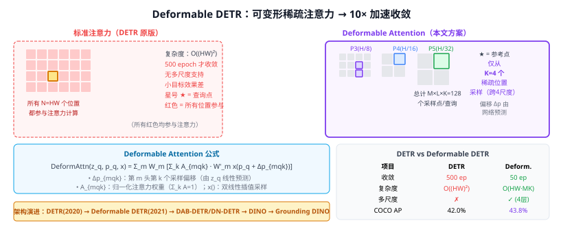

# 26c Deformable DETR（可变形注意力检测）

> 定位：在 **DETR**（Detection Transformer）基础上引入**可变形多尺度注意力（Deformable Attention）**，将 DETR 收敛速度从 500 epoch 提升到 50 epoch（10× 加速），同时支持多尺度特征，解决小目标问题。
> 作者：Zhu et al.，ICLR 2021，SenseTime + 中科大。
> 效果：MS COCO val 43.8% AP（50 epoch）；端到端无 NMS，多尺度版本接近 Cascade R-CNN 精度。
> **输入 / 输出**：图像 + 目标查询 → 目标框坐标 + 类别（无需 NMS）

---



## 一、背景：DETR 的问题

DETR（Carion et al., 2020，Facebook）首次将 Transformer 引入目标检测，将检测定义为**集合预测问题**（set prediction），用匈牙利匹配（Hungarian matching）去掉了锚框和 NMS。优点极大，但有两个致命缺点：

1. **收敛极慢**：需 500 epoch（vs Faster RCNN 12 epoch），原因在于全局自注意力在训练初期**均匀分散**注意力，难以聚焦目标区域；
2. **不支持多尺度**：Transformer encoder 对特征图中每个像素做全局注意力，计算复杂度 $O(HW)^2$，无法在高分辨率/多尺度上运行（小目标必需多尺度）。

---

## 二、可变形注意力（Deformable Attention）

### 2.1 核心思路

标准注意力：每个查询点 $q$ 与**所有** $HW$ 个键位置计算注意力权重。

**可变形注意力**：每个查询点 $q$ 只关注**稀疏的 $K$ 个采样点**（$K$ 远小于 $HW$），且采样点的位置由网络**动态预测**（可变形）：

$$\text{DeformAttn}(z_q, p_q, x) = \sum_{m=1}^{M} W_m \left[\sum_{k=1}^{K} A_{mqk} \cdot W'_m x(p_q + \Delta p_{mqk})\right]$$

- $z_q$：查询特征（query）
- $p_q$：查询的参考点（reference point），归一化坐标
- $\Delta p_{mqk}$：第 $m$ 头第 $k$ 个采样偏移（由 $z_q$ 线性投影得到）
- $A_{mqk}$：注意力权重（由 $z_q$ 线性投影后 softmax，$\sum_k A_{mqk}=1$）
- $M$：注意力头数，$K$：每头采样点数（典型 $M=8$，$K=4$）

**计算复杂度**：$O(HW \cdot MK)$（线性 vs 标准的 $O(HW)^2$），$MK \ll HW$。

### 2.2 采样点是如何工作的

```
查询点 q（位于特征图某位置）
    ↓ 线性投影
预测 K 个偏移 Δp₁, Δp₂, ..., Δpₖ  （相对于参考点的偏移）
    ↓ 双线性插值
从特征图 x 采样 K 个值
    ↓ 加权求和（权重 Aₖ）
输出该查询的注意力聚合特征
```

初始化时偏移为 0（均匀分布在参考点周围），训练中网络学会聚焦目标的语义重要区域（如角点、纹理边缘）。这解决了 DETR 收敛慢的问题：稀疏采样 = 更早收敛。

---

## 三、多尺度可变形注意力

为支持多尺度特征（解决小目标问题），从 FPN 的多个尺度特征图 $\{x^l\}_{l=1}^L$ 上联合采样：

$$\text{MSDeformAttn}(z_q, \hat{p}_q, \{x^l\}) = \sum_{m=1}^M W_m \left[\sum_{l=1}^L \sum_{k=1}^K A_{mlqk} \cdot W'_m x^l\left(\phi_l(\hat{p}_q) + \Delta p_{mlqk}\right)\right]$$

- $l$：特征层（P3/P4/P5/P6 四层）
- $\phi_l(\hat{p}_q)$：参考点归一化坐标映射到第 $l$ 层的绝对坐标
- 总计 $M \times L \times K = 8 \times 4 \times 4 = 128$ 个采样点

---

## 四、整体架构

```
图像
  → CNN 骨干（ResNet-50）
  → FPN（P3/P4/P5）+ P6（P5下采样）
  → 多尺度 Deformable Encoder（6层，MSDeformAttn）
  → Transformer Decoder（6层）
       - 每层：自注意力（目标查询间）+ 交叉注意力（MSDeformAttn，查询→特征图）
  → FFN → 分类头 + 回归头
  ↓
匈牙利匹配 + 损失函数（无 NMS）
```

**目标查询（Object Queries）**：300 个可学习的查询向量（参考点由查询预测），替代锚框。

---

## 五、与 DETR 对比

| 对比维度 | DETR（原版） | Deformable DETR |
|---------|------------|----------------|
| 收敛 epoch | 500 | **50** |
| 注意力复杂度 | $O((HW)^2)$ | $O(HW \cdot MK)$ |
| 多尺度支持 | ✗ | ✓（4 尺度） |
| 小目标 AP | 差 | 接近 Cascade RCNN |
| COCO AP（R50）| 42.0%（500ep）| **43.8%**（50ep）|

---

## 六、历史地位与后续

```
DETR (2020，Facebook)
    ↓ 收敛慢、不支持多尺度
Deformable DETR (2021，SenseTime)
    ↓ 10× 更快收敛 + 多尺度
DAB-DETR / DN-DETR / DINO (2022)
    ↓ 动态锚点/去噪训练/DINO预训练
Grounding DINO (2023，35a前续)
    ↓ 开放词汇检测，支持文本查询
```

Deformable DETR 是 **DETR 系列实用化的转折点**，后续几乎所有端到端检测 Transformer 都以它为基础改进。

---

## 七、与本项目的关系

- **相关工作**：第二章"目标检测方法"小节可以 DETR → Deformable DETR 为主线，介绍无 NMS 端到端检测的发展；
- **创新点对比**：本项目选择 YOLOv8 而非 DETR 系列，原因是实时推理（<100ms）和小数据集训练友好性；Deformable DETR 虽精度高，但参数量大、数据需求多；
- **第二章写作**：可提一句"本文参考 Deformable Attention 的稀疏采样思想，说明选择锚框替换方案的动机"。

---

## 参考文献

- Zhu X, et al. *Deformable DETR: Deformable Transformers for End-to-End Object Detection.* ICLR 2021.
- Carion N, et al. *End-to-End Object Detection with Transformers.* ECCV 2020.（DETR 原始论文）
