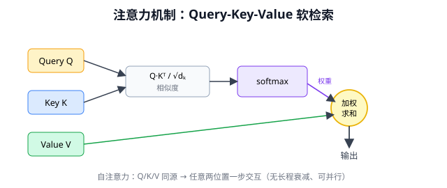
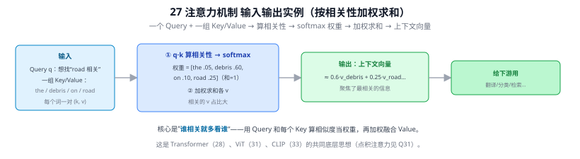
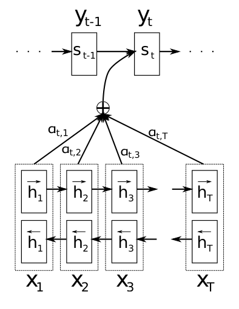

# 27 注意力机制（Attention Mechanism）

> 定位：让模型学会"聚焦"于相关信息的核心思想，是 Transformer、CLIP、ViT 的共同底层。
> 起源：Bahdanau 等，2015（神经机器翻译）。
> **输入 / 输出**：Query + 一组 Key/Value 向量 → 按相关性加权求和的上下文向量

---



> 📥📤 **输入/输出实例（看一组具体数值）**：输入一个 **Query**（想找"road 相关"的信息）+ 一组 **Key/Value**（一句话每个词 the/debris/on/road 各一对 $(k,v)$）→ ① 用 $q{\cdot}k$ 算相关性、softmax 成权重 $[\text{the }.05,\text{debris }.60,\text{on }.10,\text{road }.25]$（和=1）→ ② 加权求和各 $v$ → 输出**一个上下文向量**（≈ 0.6·v_debris + 0.25·v_road…，聚焦了最相关的信息）。核心是"**谁相关就多看谁**"——这是 Transformer（28）、ViT（31）、CLIP（33）的共同底层（点积注意力见 Q31）。



> 📄 **论文原图对照**（图源：Bahdanau et al., *Neural Machine Translation by Jointly Learning to Align and Translate*, [arXiv:1409.0473](https://arxiv.org/abs/1409.0473) Figure 1，原文 [PDF](../papers/27_Bahdanau注意力_1409.0473.pdf)；仅笔记内学习引用，论文写作须自绘）：



> 注意力机制的起点：解码第 t 步对双向编码器各 h_j 算权重 α_tj 加权求和——Transformer 点积注意力（Q31）的前身。

## 一、提出背景

早期 Seq2Seq 机器翻译用一个 LSTM 编码器把整句话压成一个**固定长度向量**，再用解码器生成译文。问题：长句的所有信息被硬塞进一个向量，**信息瓶颈**严重，长句翻译质量骤降。

Bahdanau 的洞见：人翻译时，生成每个目标词都会**回头看原句中最相关的几个词**，而不是只靠一个全局压缩向量。注意力机制把这个"回头看"数学化了。

---

## 二、核心思想：Query-Key-Value

注意力的本质是一次**"软检索"**：用一个查询去一堆键值对里加权取值。

```
Query（我想找什么） 
   │ 与每个 Key 算相似度
   ▼
相似度分数 ─► softmax ─► 注意力权重（和为1）
   │ 用权重对 Value 加权求和
   ▼
输出（聚焦后的信息）
```

### 标准公式（缩放点积注意力）

$$
\text{Attention}(Q, K, V) = \text{softmax}\!\left(\frac{QK^\top}{\sqrt{d_k}}\right)V
$$

- $Q$（Query）、$K$（Key）、$V$（Value）：都是输入经线性变换得到的向量
- $QK^\top$：每个 query 与每个 key 的相似度（点积越大越相似）
- $\sqrt{d_k}$：缩放因子，防止维度高时点积过大导致 softmax 梯度消失
- softmax：归一化成权重
- 乘 $V$：按权重聚合信息

**直觉**：输出是 Value 的加权平均，权重由"Query 和 Key 有多匹配"决定。模型学会了对每个位置"该关注哪些位置"。

---

## 三、注意力的种类

| 类型 | Q、K、V 来源 | 用途 |
|------|-------------|------|
| **交叉注意力** | Q 来自解码器，K/V 来自编码器 | 翻译时对齐源句与译文 |
| **自注意力（Self-Attention）** | Q、K、V 都来自同一序列 | 建模序列内部任意两位置关系（Transformer 核心） |
| **多头注意力** | 并行多组 Q/K/V | 从多个"子空间"同时关注不同模式 |

自注意力是关键飞跃：序列里每个位置都能直接"看到"所有其他位置，**一步建模长程依赖**（不像 LSTM 要逐步传递），且可完全并行。

---

## 四、为什么重要

注意力解决了两个根本问题：
1. **长程依赖**：任意两位置直接交互，距离不再衰减（胜过 LSTM）
2. **可并行**：矩阵运算，不需串行（胜过 RNN）

正是这两点，让 Transformer（28）能取代 LSTM，并扩展到超大规模。

---

## 五、与本项目的关系

- 注意力是本项目两个关键模型的共同底层：**CLIP 的文本/图像编码器（Transformer/ViT）**、以及 **CBAM 注意力模块**（虽然 CBAM 是卷积式注意力，但"学习权重以聚焦重要特征"的思想一致）。
- 理解 Q-K-V，才能理解 31 ViT 如何让图像 patch 互相关注、33 CLIP 如何编码文本。
- CBAM（16）在通道和空间维度做注意力，本质也是"算权重 → 加权特征"，与此同源。

---

## ✏️ 具体实例（动手算一遍）

**例：一次注意力加权（3 个 key，手算 softmax + 加权和）**
某 query $q$ 与 3 个 key 算出点积分数 $[2.0,\,1.0,\,0.1]$：
- softmax：$e^{2.0},e^{1.0},e^{0.1}=7.39,2.72,1.11$，和=11.22 → 权重 $[0.659,\,0.242,\,0.099]$
- 设三个 value 是 $v_1,v_2,v_3$，输出 $=0.659\,v_1+0.242\,v_2+0.099\,v_3$

即**最相关的 $v_1$ 贡献最大**（66%），其余按相关性递减——这就是"按相关性加权汇总"。分数差距越大，softmax 越"尖"（越聚焦单一来源）。

**例：注意力如何修 RNN 的定长瓶颈**
机器翻译解码"road"时，query（解码器当前状态）和源句各词的 key 算相关性，得到权重可能 $[0.05\text{我},0.05\text{爱},0.90\text{路}]$ → 主要从"路"的 value 取信息。**每生成一个词都重新看一遍全句**，不再受限于一个定长向量 C（对比 Q32）。

---

## 六、参考文献

- Bahdanau D, Cho K, Bengio Y. *Neural Machine Translation by Jointly Learning to Align and Translate.* ICLR 2015.
- Vaswani A, et al. *Attention Is All You Need.* NeurIPS 2017.（缩放点积/多头注意力的标准定义）
