# 28 Transformer ⭐

> 定位：现代深度学习的通用底座。完全基于注意力、抛弃循环结构的架构。NLP、CV、多模态全部建立其上。
> 作者：Vaswani 等（Google），NeurIPS 2017，论文名 *Attention Is All You Need*。
> **输入 / 输出**：token 向量序列（+位置编码）→ 同长上下文化 token 序列；翻译则输出译文序列（见 Q46）

---

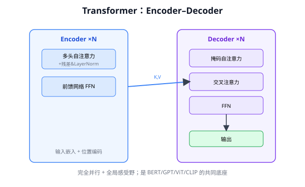

> 📥📤 **输入/输出实例（看一组具体数值）**：输入 **token 向量序列** "I love road"（3 个 token、各 512 维 + 位置编码标顺序）→ 多头自注意力 + FFN（×L 层，每个 token 看序列里所有 token、吸收上下文、并行计算，"road" 融入 "on the" 的语境）→ 输出**同长序列**（3 个上下文化 token，各 512 维，个数不变但含义更丰富）；翻译任务则用解码器自回归生成 "我 爱 路"（Q46）。关键：**序列进、同长序列出，每个 token 都"看过全局"后被重新表示**。

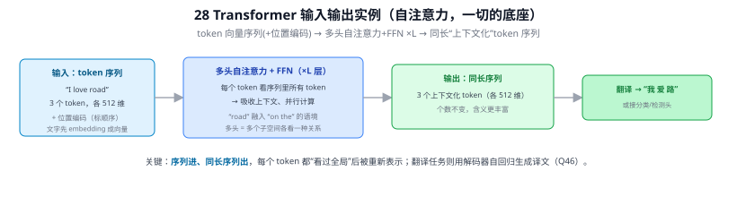

> 📄 **论文原图对照**（图源：Vaswani et al., *Attention Is All You Need*, [arXiv:1706.03762](https://arxiv.org/abs/1706.03762) Figure 1，原文 [PDF](../papers/28_Transformer_1706.03762.pdf)；仅笔记内学习引用，论文写作须自绘）：

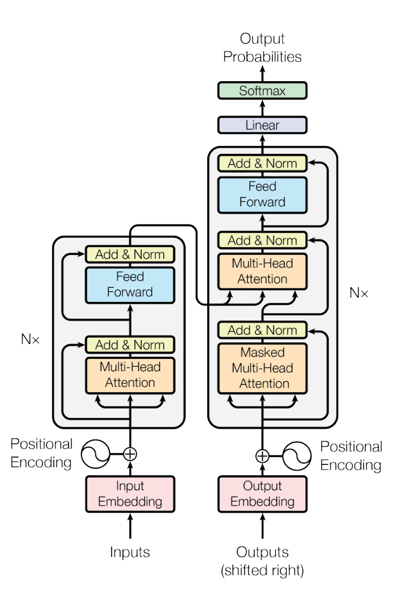

> 对照上面的输入/输出实例读原图：左列＝**编码器**（Inputs=源序列 → Input Embedding+位置编码 → N×[多头自注意力+FFN]，双向无掩码）；右列＝**解码器**（Outputs (shifted right)=右移的目标前缀，[Q125](#q125-训练时解码器并行预测下一个词推理时编码作-kvq-是已有翻译逐步自回归是这样吗) → Masked Multi-Head Attention=因果掩码自注意力（[Q121](#q121-原始-transformer-为什么需要掩码理论依据是什么是因为翻译任务才需要的吗)–[Q124](#q124-掩码就是人为把注意力权重设成--的下三角矩阵softmax-后权重为-0对吗)）→ 中间的 Multi-Head Attention=交叉注意力（Q=前缀、K/V=编码器输出）→ FFN（[Q120](#q120-ffn-具体是如何扩维再压回的)））；顶部 Linear+Softmax＝输出头，逐位置吐词表分布（Output Probabilities，[Q126](#q126-训练时解码器一次前向全预测到底如何体现)）。为何分左右两列见 [Q123](#q123-transformer-为什么要设计成编码器和解码器的形式)。

## 一、提出背景

在 Transformer 之前，序列建模靠 RNN/LSTM（03），但有两个硬伤：**串行不可并行**（训练慢）、**长程依赖仍衰减**。注意力机制（27）已证明能直接建模任意位置关系。Transformer 的大胆主张：**完全丢掉循环和卷积，只用注意力 + 全连接，就能做好序列建模**——而且天生可并行。

---

## 二、整体架构

经典 Transformer 是 **Encoder-Decoder** 结构（为翻译而生）。下图把"一层"内部完全展开，并标出三种注意力、维度流、残差+LayerNorm（原创绘制，等价呈现原论文 *Attention Is All You Need* 的架构，未直接复制其插图）：

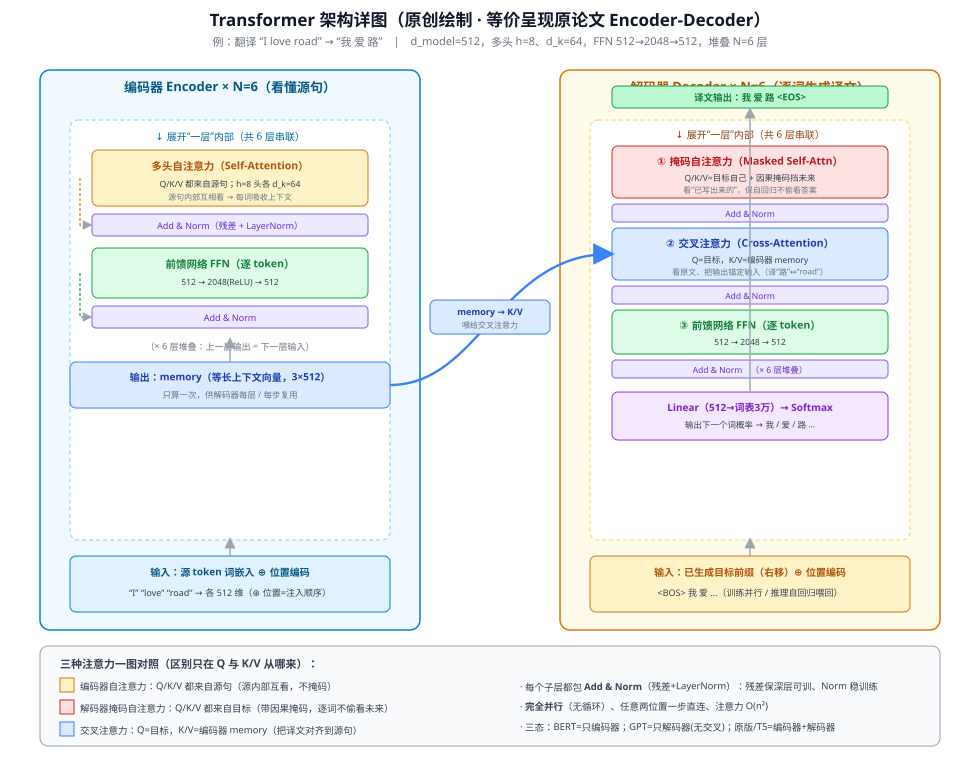

> 图怎么读（自下而上）：
> - **编码器（左，×6 层）**：源句"I love road"→词嵌入⊕位置编码→每层 = **多头自注意力**（源句内部互看）→ Add&Norm → **FFN**（512→2048→512）→ Add&Norm；顶部输出 **memory**（等长上下文向量，**只算一次**）。
> - **解码器（右，×6 层）**：已生成目标前缀"`<BOS>` 我 爱"→词嵌入⊕位置编码→每层 = **① 掩码自注意力**（看已写、挡未来）→ **② 交叉注意力**（Q=目标、K/V=编码器 memory，看原文）→ **③ FFN**，各子层都接 Add&Norm；顶部 **Linear→Softmax** 出下一个词概率 → 自回归拼出"我 爱 路 `<EOS>`"。
> - **三种注意力区别只在"Q 与 K/V 从哪来"**：编码器自注意力（源↔源、不掩码）、解码器掩码自注意力（目标↔目标、带因果掩码）、交叉注意力（目标→源 memory）。详见 [Q79](#q79-transformer-的输入和输出到底是什么decoder-的掩码自注意力与交叉注意力都必须有吗各起什么作用)。

精简版数据流（同一件事的文字速记）：

```
源句 ─► 词嵌入+位置编码 ─►┌ Encoder ×6 ┐─ memory(K,V) ─►┌ Decoder ×6 ┐─► Linear+Softmax ─► 译文
                         │ 自注意力    │                │ 掩码自注意力 │     (逐词自回归)
                         │ + FFN      │                │ + 交叉注意力 │
                         └────────────┘                │ + FFN       │
                                                       └─────────────┘
```

每层每个子层都是 **LayerNorm(x + Sublayer(x))**（残差 + LayerNorm）：残差（09 ResNet 思想）保证深层可训练，LayerNorm 稳定训练。

---

## 三、核心组件详解

### 3.1 多头自注意力（Multi-Head Self-Attention）⭐

把 Q/K/V 投影到 $h$ 个不同子空间，并行做 $h$ 次注意力（27 的缩放点积），再拼接：

$$
\text{MultiHead}(Q,K,V) = \text{Concat}(\text{head}_1,\dots,\text{head}_h)W^O
$$

**为什么多头**：不同头可关注不同关系（一个头看语法、一个头看指代……），类似 CNN 的多个卷积核。

> 深入：点积为何又对又并行见 [Q31](#q31-transformer-用点积注意力为何既能解决注意力又能并行运算)；Q/K/V 到底是什么见 [Q33](#q33-10-个-token-的情况下qkv-到底是什么)；多头的机制/缩维/投影混维/头分工见 [Q35](#q35-多头注意力总论机制缩维投影混维头分工)。

### 3.2 位置编码（Positional Encoding）

注意力本身**没有顺序概念**（打乱输入结果不变）。为注入位置信息，给每个位置加一个位置编码。原版用正余弦函数：

$$
PE_{(pos, 2i)} = \sin(pos / 10000^{2i/d}),\quad PE_{(pos, 2i+1)} = \cos(\cdot)
$$

后来的模型（BERT、ViT）多用可学习的位置嵌入。

> 深入：注意力为何"无序"、为什么必须显式补位置见 [Q34](#q34-既然-qkv-已经算出了注意力相关性为什么还需要位置信息)。

### 3.3 前馈网络（FFN）

每个位置独立过一个两层 MLP（含 ReLU/GELU，如 512→2048→512），增加非线性和表达力。详见 [Q78](#q78-ffn-是什么是通过-ffn-不断优化query-吗)（FFN 逐 token 加工、与注意力的分工）。

### 3.4 残差 + LayerNorm

每个子层输出 = LayerNorm(x + Sublayer(x))。残差（09 ResNet 思想）保证深层可训练，LayerNorm 稳定训练。

### 3.5 掩码自注意力 + 交叉注意力（Decoder）

解码器每层有两次注意力：**掩码自注意力**（生成时不能"偷看"未来词，用掩码把未来位置的注意力权重置 0，保证自回归因果性）+ **交叉注意力**（Q=目标、K/V=编码器 memory，回看源句）。两者的作用、是否都必须、以及输入/输出到底是什么，详见 [Q79](#q79-transformer-的输入和输出到底是什么decoder-的掩码自注意力与交叉注意力都必须有吗各起什么作用)。

---

## 四、优点与影响

**优点**：
- **完全并行**：整个序列一次性处理，训练效率远超 RNN
- **全局感受野**：任意两位置一步交互，无长程衰减
- **可扩展**：堆叠层数 + 加大宽度即可扩到千亿参数，是大模型时代的前提

**影响**（无与伦比）：
- NLP：29 BERT（Encoder）、30 GPT（Decoder）
- CV：31 ViT（图像切块当序列）、28a DETR（检测）
- 多模态：33 CLIP、34 BLIP、37 LLaVA

可以说，过去 8 年几乎所有突破性模型都是 Transformer 的变体。

**局限**：注意力是 $O(n^2)$ 复杂度（序列长度的平方），长序列/高分辨率图像开销大——催生了各种高效注意力（Swin 的窗口注意力、稀疏注意力等）。

---

## 五、与本项目的关系 ⭐

- Transformer 是本项目核心模型 **CLIP** 的骨架：CLIP 的文本编码器是标准 Transformer，图像编码器（ViT 版）是 31 ViT（也是 Transformer）。不懂 Transformer 就无法真正理解 CLIP 的工作原理。
- YOLOv11 引入的 **C2PSA 注意力模块**、本项目用的 **CBAM**，都受注意力思想启发（虽实现是卷积式）。
- 理解自注意力的"全局建模"能力，有助于理解为什么 VLM 能做开放词汇识别——文本和图像在同一注意力空间里对齐。

---

## ✏️ 具体实例（动手算一遍）

**例：10 个 token 的自注意力，张量尺寸一路走**（d_model=512，单头 d_k=64）
```
输入 10 个 token → 嵌入+位置编码 → X: 10×512
Q = X·W_Q : 10×64    K = X·W_K : 10×64    V = X·W_V : 10×64
分数 S = Q·Kᵀ        : 10×10     （所有 token 两两相关性，一次矩阵乘）
缩放+softmax(按行)   : 10×10     （每行是一个 token 对全句的注意力权重）
输出 = softmax(S)·V  : 10×64     （每个 token 融合了全句信息）
```
Q/K/V 来源与三重身份见 [Q33](#q33-10-个-token-的情况下qkv-到底是什么)；点积为何又对又并行见 [Q31](#q31-transformer-用点积注意力为何既能解决注意力又能并行运算)。

**例：多头（8 头）怎么拼**
把 512 维切成 8 头 × 64 维，每头独立做上面一遍 → 8 个 10×64 输出 → 拼接回 10×512 → 再过一个线性层。不同头可关注不同关系（语法/指代/位置…）。

**例：为什么要除以 √d_k**
d_k=64 时点积是 64 项之和，数值偏大；不缩放 softmax 易饱和（一个权重≈1 其余≈0）梯度趋零。÷√64=÷8 把方差拉回 ~1（缩放点积注意力）。

---

## 六、参考文献

- Vaswani A, et al. *Attention Is All You Need.* NeurIPS 2017.

---

## 📋 模型答疑（来自模型详解问答）

> 以下问答原属"答疑记录"系列，因专属本模型已并入此处便于集中查阅；跨模型的通用问答仍留在答疑分册。

---

## Q31. Transformer 用点积注意力，为何既能"解决注意力"又能并行运算？

注意力核心 = 先算 query 与各 key 的**相关性**得权重、再对 value 加权求和。**点积**同时解决"算得对"和"能并行"：
- **算得对**：$q\cdot k=|q||k|\cos\theta$，方向越一致（语义越对得上）点积越大，天然是相关性度量，且**无额外参数**（学习都在生成 Q/K 的投影里）；
- **能并行**：所有位置的相关性一次矩阵乘 $QK^\top$ 算完（n×n 分数矩阵），整个注意力 = softmax(QKᵀ/√d_k)V = 两次矩阵乘 + 一次 softmax，**无时间依赖**（不像 RNN 的 h_t 要等 h_{t-1}），而矩阵乘正是 GPU 最擅长的并行运算。顺带让任意两位置一步直连（路径 O(1)、无长程衰减）。

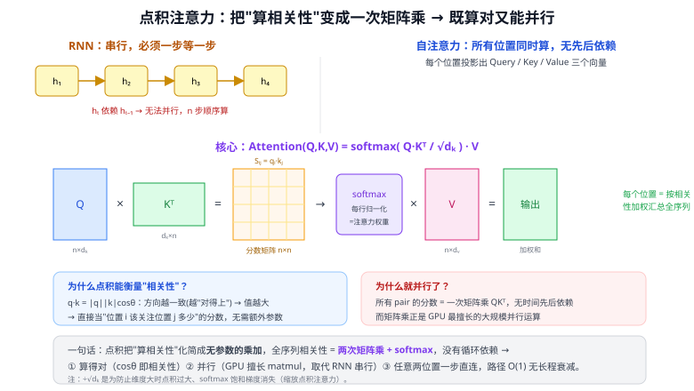

**Q/K/V 三向量**：Query（我想找什么）、Key（我能提供什么的标签）、Value（实际携带的内容）；注意力 = 用 Query 和所有 Key 算权重 → 对所有 Value 加权求和。

**vs 加性注意力（Bahdanau）**：加性用小 MLP 算分数、带参数且难写成矩阵乘；点积直接 $q\cdot k$、无参数、整批就是 $QK^\top$、GPU 友好——这就是 Transformer 选点积的原因。**÷√d_k**：d_k 大时 q·k 数值大、softmax 饱和梯度趋零，除以 √d_k 把方差拉回 ~1（"缩放点积注意力"）。**代价**：要算 n×n 分数矩阵 → O(n²d)，序列极长时贵（这也是高效注意力、ViT 切有限 patch 的原因）。

> 本项目：CLIP 文本编码器就是 Transformer、图像侧 ViT 也把 patch 当 token 做同样自注意力。懂"点积=可并行的相关性度量"才懂 CLIP 为何能高效把图文编到同一空间做匹配。

---

## Q33. 10 个 token 的情况下，Q、K、V 到底是什么？

Q/K/V **不是三份不同输入，而是同一批 token 向量分别乘三个可学习投影矩阵 W_Q/W_K/W_V 得到的三种"视角"**：文本分词成 10 个 token → 查嵌入表+加位置编码 → 堆成矩阵 X(10×d) → Q=XW_Q、K=XW_K、V=XW_V（各 10×d_k）。第 i 行 = 第 i 个 token 的 query/key/value。每个 token 同时扮三角色：q_i"我想找什么"、k_i"我能提供什么"、v_i"若被关注传出什么"。这就是"**自**注意力"（自己生成 Q/K/V 看自己）。

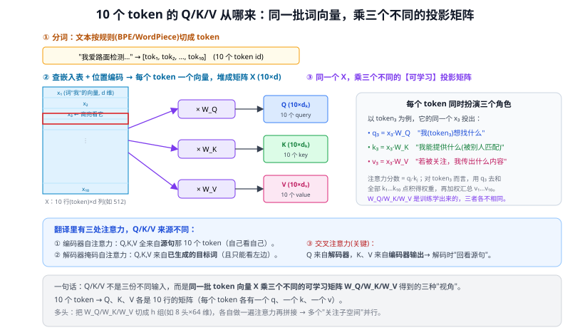

token₃ 的新表示 = 用 q₃ 对 k₁..k₁₀ 算相关性 → softmax → 对 v₁..v₁₀ 加权求和 → 融合了全句相关信息（上下文感知）；10 个 token 各做一遍，但一次 QKᵀ 全算完。

**翻译里有三处注意力，Q/K/V 来源不同**（重要）：

| 位置 | Q 来自 | K/V 来自 | 作用 |
|---|---|---|---|
| 编码器自注意力 | 源句 | 源句同一批 | 源句内部理解 |
| 解码器掩码自注意力 | 已生成目标词 | 已生成目标词 | 目标端内部（只看左边） |
| **交叉注意力** ⭐ | 解码器 | 编码器输出 | 解码时"回看源句"=翻译关键 |

"10 个源 token"最直接对应编码器自注意力；真正完成翻译对齐的是交叉注意力（Q 来自解码器、K/V 来自编码器输出，不再经定长 C 瓶颈）。

> 本项目：ViT 把 patch 当 token、CLIP 文本塔对 token 做同样流程。懂"Q/K/V=同一批 token 的三种投影"是看懂 CLIP/ViT 的基础。

## Q34. 既然 Q/K/V 已经算出了注意力（相关性），为什么还需要位置信息？

> 接 [Q31](#q31-transformer-用点积注意力为何既能解决注意力又能并行运算)、[Q33](#q33-10-个-token-的情况下qkv-到底是什么)：点积算的是"内容相关性"，但它对"词序"一无所知。

**简答**：因为**点积注意力只看内容、不看顺序**——$q_i\cdot k_j$ 的大小只取决于第 i、j 个 token 的**内容**，跟它们排在第几位无关。结果：把输入词序打乱，注意力算出的每个 token 表示**完全不变**（这叫"置换等变"，相当于把句子当成一**袋**无序的词）。可是"我爱你"和"你爱我"用的是同一批词、只是顺序不同，含义却相反——纯注意力分不清。所以必须在 token 进入 Q/K/V 投影**之前**，给每个 token **加上位置编码**，让 $q_i,k_i$ 同时携带"内容 + 位置"，点积才能既比内容又比位置。本质上：**这是并行的代价**——RNN 顺序处理，顺序天然藏在递推里；Transformer 为并行（[Q31](#q31-transformer-用点积注意力为何既能解决注意力又能并行运算)）抛弃了递推，也就丢了顺序，必须显式加回。


**展开**：

**① 注意力为什么"无序"——置换等变**
回顾 [Q33](#q33-10-个-token-的情况下qkv-到底是什么)：$q_i,k_i,v_i$ 都是 token i 的向量乘投影矩阵得到的，**只跟 token 内容有关**。注意力分数 $S_{ij}=q_i\cdot k_j$ 也就只反映"i 和 j 内容有多相关"，**没有任何一项编码"i 在 j 前面还是后面、隔多远"**。

数学上：若把输入 token 顺序做一个置换（permutation），$Q,K,V$ 的行跟着同样置换，输出 $\text{softmax}(QK^\top)V$ 的行也只是**跟着置换**，每个 token 自身算出的结果不变。这个性质叫**置换等变**——模型把输入当成一个**集合（袋）**，不是**序列**。

**② 一个反例：词一样、序不同、义相反**
- "我爱你" vs "你爱我"
- "狗 咬 人" vs "人 咬 狗"

两句用**完全相同的 token**，只是顺序不同。纯注意力对这两句算出的相关性、每个词的输出表示**一模一样** → 翻译/分类都分不出区别。但它们意思完全不同！语言强烈依赖顺序，所以必须把顺序信息喂进去。

**③ 怎么补——位置编码加在 Q/K/V 之前**
做法很直接：每个位置准备一个"位置向量"，**加到词嵌入上**，再去投影 Q/K/V：
$$x_i = \underbrace{\text{词嵌入}(token_i)}_{\text{内容}} + \underbrace{PE(i)}_{\text{第 i 位}}\quad\Rightarrow\quad q_i=x_iW_Q,\ k_i=x_iW_K,\ \dots$$
这样"我"在第 1 位和"我"在第 3 位的 $x$ 就不同了 → $q_i\cdot k_j$ 既含内容又含位置 → "我爱你"和"你爱我"可区分 ✓。

**④ 三种常见实现**
| 方式 | 代表 | 特点 |
|------|------|------|
| 正弦位置编码 | 原始 Transformer | 用不同频率的 sin/cos，固定不学；能外推到更长序列，三角恒等式隐含**相对位置** |
| 可学习绝对位置 | BERT / 31 ViT | 每个位置一个可训练向量，简单有效，但长度受限 |
| 相对位置 / RoPE | 现代 LLM | 直接编码"两 token 相对距离"，长文本表现更好 |

**⑤ 顺带澄清一个常见误解**
位置编码不是"额外再算一遍注意力"，而是**在输入端就把位置混进 token 向量**，让同一套点积注意力自动同时考虑内容和位置。注意力机制本身没变，只是喂给它的输入带上了位置标记。

**⑥ 与本项目**：31 ViT 把图像切成 patch 当 token，同样**必须加位置编码**——否则模型分不清某个 patch 在图的左上还是右下，空间结构就乱了。CLIP（33 CLIP）的图像塔(ViT)和文本塔(Transformer)都依赖位置编码。理解"注意力无序、需显式补位置"，是看懂 ViT/CLIP 输入处理的基础。

---

## Q35. 多头注意力总论：机制、缩维、投影混维、头分工

**一、机制（纠"拼成大 Q/K/V"的误解）**

多头用 **h 组不同的 W_Q/W_K/W_V** 各投一套 Q/K/V（维度 d_k=d/h，比单头小）；每个头**各自独立算完注意力** head_i=softmax(Q_iK_iᵀ/√d_k)V_i；**拼接的是各头的注意力输出、不是 Q/K/V**，拼完再过输出矩阵 W_O 融合：

$$\text{MultiHead}=\text{Concat}(\text{head}_1,…,\text{head}_h)\,W_O$$

顺序：各头分头算 → 拼输出 → 过 W_O（不是"拼大 Q/K/V 再算一次"——那退化成单头）。多头精髓 = 每头在各自低维子空间独立关注不同的东西。（实现上常用一个大矩阵一次投影出完整 Q 再 reshape 成 h 段，与"h 组小矩阵"数学等价。）

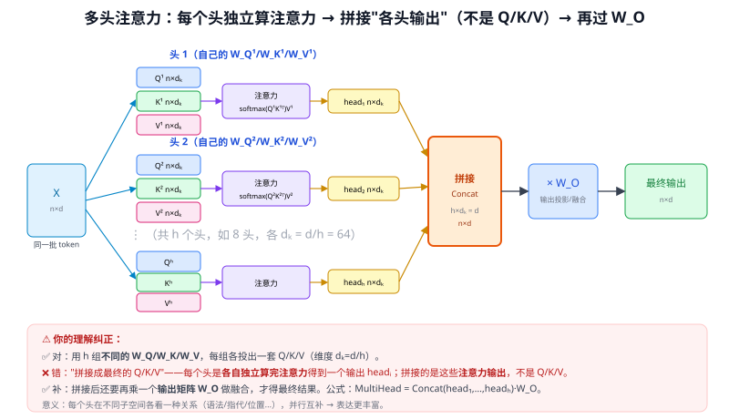

**二、为什么缩到 d_k=d/h？不缩、最后调维行不行？**

**行**（W_O 形状任意、维度总能对上），但缩维是刻意的成本设计：它让多头总参数/算力 ≈ **单头**；不缩（每头全 d 维）会变约 **h 倍**开销、收益却很小——多头价值在"**有多个不同子空间**"而非"每头维度多高"（64 维足够表达一种关系）。同预算下"多个小头">"少数大头"（覆盖更多关系、还鼓励特化）。所以原论文选 8 头×64 维而非 8 头×512 维。


**三、头分工是涌现还是设计？**

**既非拍脑袋、也无"第 i 头必学某语义"的定理**：① 机制上只保证"**有能力 + 倾向分化**"（各头参数独立、随机初始化打破对称、梯度下降的反冗余压力推它们各管一摊——同 Q5 卷积核自动学成不同特征）；② 实证确实观测到功能头（位置型/句法型/指代型/`[SEP]`型，Clark 2019、Voita 2019）；③ 但很多头**冗余**、剪掉也不掉点（Michel 2019）——"每头=一个干净语义"是理想化，真实是"多样但杂乱、部分可解释、不少冗余"。**具体学什么是训练涌现，被允许被鼓励，但不预先指派、无定理担保。**

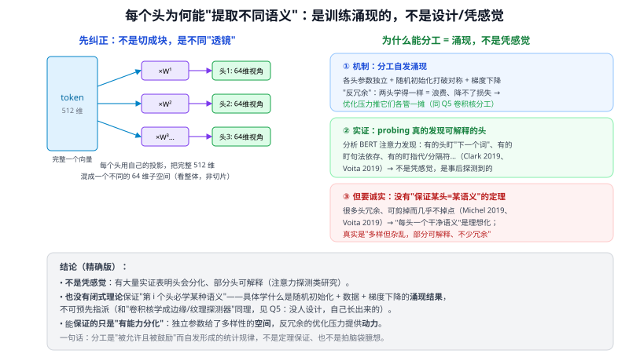

> 写论文提示：别把"每个头/通道精确对应某语义"当事实写，应表述为"通过可学习多子空间自适应强化判别性特征"（涌现、数据驱动），更经得起盲审。

**四、投影 = 把完整 d 维"混"成不同的 d_k 维子空间（线性组合，不是切段）**

"混"= 矩阵乘法 = 对所有输入维度加权求和：token 是 512 维 x，W 是 512×64，输出每个数 $q_j=\sum_i W_{ij}x_i$ 都用到**全部 512 维**。所以不是"从 512 挑一段 64"，而是"用 64 套不同配方把整桶 512 维原料各调一杯"。换一个 W = 换一个投影方向/滤镜 = 从同一 token 提炼侧重点不同的 64 维摘要——每头都看完整 512 维、只是各用不同权重。（和 1×1 卷积"混通道"、全连接同源，都是线性变换 = 加权混合。）

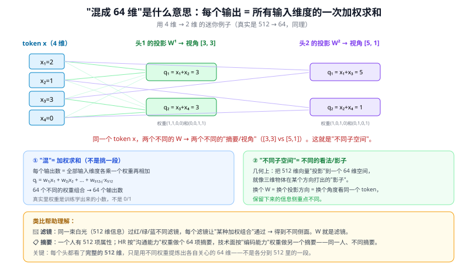

> 本项目：ViT/CLIP 大量这种投影（Q/K/V、patch 嵌入）。懂"投影 = 学出来的加权混合、把高维提炼到有侧重的低维视角"，就懂 CLIP 怎么把图文投到同一空间做相似度匹配。

## Q78. FFN 是什么？是通过 FFN 不断"优化"query 吗？

**一、FFN 是什么**
Transformer 每层里**紧跟注意力之后的一个小型两层 MLP**：

$$\text{FFN}(x) = W_2\,\cdot\,\text{ReLU}(W_1 x + b_1) + b_2$$

- **先扩维再压回**：如 256 → 2048 → 256（中间放大约 4 倍、夹一个 ReLU/GELU）；
- **逐 token 独立（position-wise）**：**同一个 FFN** 分别作用在每个 token / 每个 query 上，**不混不同 token**；
- 作用：**加非线性 + 给每个 token 自己的特征做加工变换**（提供表达力）。

**二、它在解码器一层里的分工**
一层 = **自注意力 → 交叉注意力 → FFN**，三步各司其职：

| 子层 | 干什么 | 跨 token 吗 |
|---|---|---|
| 自注意力 | query 之间协商、分工避让 | 跨（query↔query） |
| 交叉注意力 | query **看图、取回**目标区域证据 | 跨（query↔图像） |
| **FFN** | 把取回的证据在**每个 query 内部加工/消化**成更好的向量 | **不跨**，逐 query 独立 |

**注意力负责"跨 token 搬运信息"（看图、协商），FFN 负责"在单个 query 内部把信息加工成更好的表示"——它不看图、也不看别的 query。**

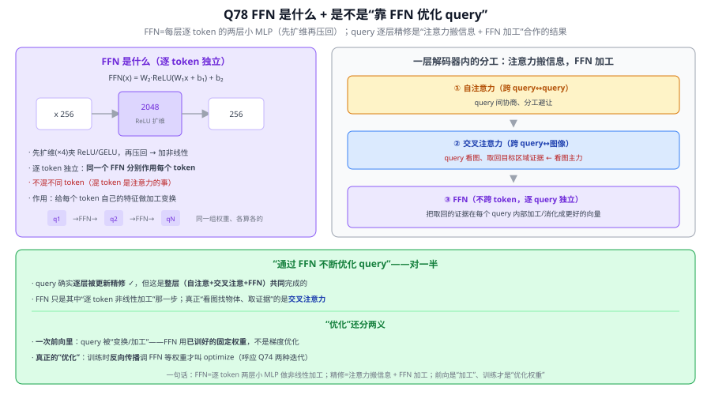

**三、"通过 FFN 不断优化 query"对吗？——对一半**
- **query 确实逐层被更新精修** ✓，但这是**整层（自注意+交叉注意+FFN）共同**完成的；FFN 只是其中"**逐 token 非线性加工**"那一步，真正"看图找物体、取证据"的是**交叉注意力**。说"靠 FFN 优化 query"会漏掉注意力这个主力。
- **"优化"分两义**（Q74）：
  - **一次前向里**：query 被**变换/加工**（前向计算，不是梯度优化）；
  - **真正的"优化"**：训练时**反向传播**把 FFN（及所有）**权重**调好——那才是 optimize。前向里 FFN 用的是**已训好的固定权重**去加工 query。

**一句话**：FFN = 每层里逐 token 的两层小 MLP，给 query 做非线性加工；query 的逐层精修是"**注意力搬信息 + FFN 加工**"合作的结果，FFN 不是独自优化 query，且前向是"加工"、训练才是"优化权重"。

---

## Q79. Transformer 的输入和输出到底是什么？Decoder 的掩码自注意力与交叉注意力都必须有吗、各起什么作用？

**一、输入输出**
原始 Transformer 是 encoder-decoder seq2seq（为翻译而生）。以 "I love road"→"我 爱 路"：
- **编码器**：输入 = 源 token 词嵌入+位置编码；输出 = 等长 **memory**（每 token 看过全句的上下文向量），只算一次、供解码器复用。
- **解码器**：输入两份 = ①目标侧 token（训练=整条目标右移；推理=已生成的词）+ ②memory；输出 = 每位置在目标词表上的概率分布 → 取下一个 token。
- 三态：encoder-only(BERT) / decoder-only(GPT) / encoder-decoder(原版/T5)。

**训练 vs 推理（解码器吃的不同）**：编码器侧一样（源→memory）；差别在解码器——

| | 训练（目标句已知） | 推理（未知） |
|---|---|---|
| 解码器输入 | 整条目标右移、一次喂入 | 从 `<BOS>` 逐步把上一步输出接回 |
| 计算 | 因果掩码下各位置**并行**出分布 | **逐词自回归** |
| 喂的前缀 | 真值前缀（teacher forcing） | 自己刚生成的词 |
| 损失 | 各分布 vs 标签逐位置交叉熵→反传 | 无标签、取 argmax |

> 训练"答案已知"→整句右移一次并行算完（teacher forcing）；推理"答案未知"→逐词生成、把自己输出喂回。这也是掩码必须存在的原因：训练并行喂整句时保证位置 i 不偷看未来真值。

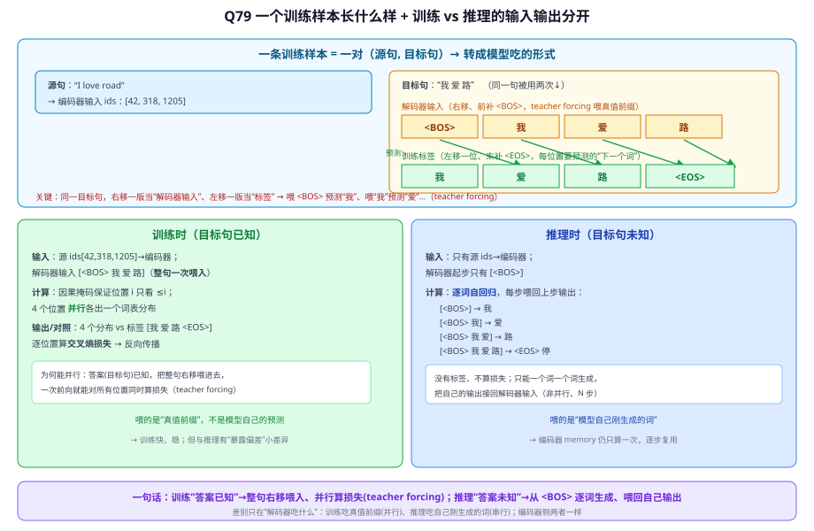

**二、Decoder 两种注意力（都必须有吗）**
每层：掩码自注意力 → 交叉注意力 → FFN。
- **掩码自注意力**：Q/K/V 全来自目标 token 自己 + 因果掩码（位置 i 只看 ≤i、挡未来）。作用 = 参考**已生成的目标上下文**（管输出连贯）。为何掩码：训练整句并行喂入但预测第 i 词只准用前面，否则看到答案就学不到、也和推理对不上。
- **交叉注意力**：Q 来自目标、K/V 来自 memory(源)。作用 = 让每个目标词**看原文**（译"路"时对齐"road"，把输出锚定输入）。

**都必须吗**：encoder-decoder 里缺一不可（去交叉→不看输入自说自话、去掩码→偷看未来破坏自回归）；但取决于架构——**decoder-only(GPT) 无交叉注意力**（输入提示直接拼进同一序列、全靠掩码自注意力），encoder-only(BERT) 连 Decoder 都没有。**交叉注意力之所以存在，正因为有独立编码器要查阅。**

一句话：**掩码自注意力 = "看我已写出来的"（输出自洽）；交叉注意力 = "看原文"（锚定输入）。**

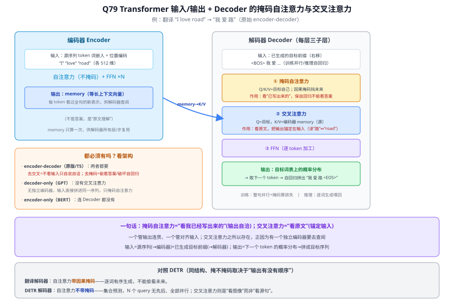

> 对照 DETR：也是"自注意力(query 间)+交叉注意力(看图像)"，但它自注意力**不带掩码**——DETR 是集合预测、N 个 query 无先后全并行；翻译解码器带因果掩码因为逐词有序生成。掩不掩码取决于"输出有没有顺序"。

**三、数值走一遍**（d=512、目标词表 3 万）：

| 阶段 | 值 |
|---|---|
| 编码器 | 源 ids[42,318,1205]→查嵌入+位置→6 层→**memory 3×512**（只算一次作交叉 K/V） |
| 掩码自注意力 | 解码器输入右移，因果掩码 3×3 下三角、softmax 后未来位=0（看不到"路"防作弊） |
| 交叉注意力 | 生成"路"位置：Q·三源 K→softmax→I 0.05/love 0.15/**road 0.80**→主吸 m_road→FFN→输出投影 512→3万→softmax→**路 0.90** |
| 推理自回归 | `<BOS>`→我→爱→路→`<EOS>` 停，每步重算但 memory 复用 |

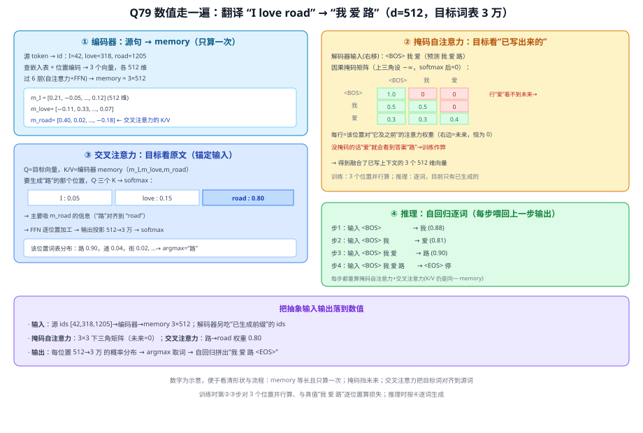

**road 0.80 怎么算的**（套 softmax(QKᵀ/√d)V，只看"路"对 3 源词）：① Q="路"位置向量×W_Q、K=memory×W_K（W_Q/W_K 训练学出让该对齐的词点积大）；② 点积 Q·K_I≈0、Q·K_love≈25、Q·K_road≈63；③ ÷√512≈22.6 → [0, 1.11, 2.79]；④ softmax（e^x 放大差距）→ 0.05/0.15/**0.80**；⑤ 加权求和 V 以 road 为主 → FFN → 输出"路 0.90"。**关键**：softmax 的 e^x 把"缩放后差 1.68"指数放大成"概率约 5 倍"，让最对齐者拿大头。

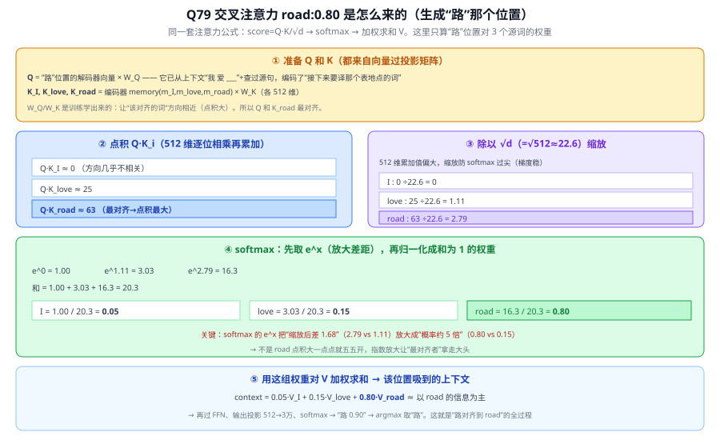

## Q80. Transformer 训练的结果是什么？是不是参数固定后、推理就按训练好的参数自回归输出？

**一、"训练的结果"具体是什么——一大袋固定的数（权重）**
梯度下降把所有"待定参数"调到合适值后**冻结**。Transformer 里这些参数是：
- **词嵌入表**（token→向量）、(可学习的)**位置嵌入**；
- 每层的 **$W_Q/W_K/W_V/W_O$**（注意力投影）；
- 每层 **FFN** 的 $W_1,b_1,W_2,b_2$；
- 每层 **LayerNorm** 的 $\gamma,\beta$；
- **输出投影**（512→词表）。

原版 base 约 **6500 万个数**；一个"训练好的模型"就是这一大袋数（**checkpoint**）。它们编码了"怎么看上下文、怎么把'路'对齐到'road'、怎么选下一个词"的**全部知识**。

**二、推理：权重冻结，只做前向**
- 权重**不再更新**、**不算损失、不反向传播**；
- **编码器**：源句一次**并行**过完出 memory（**不是**自回归）；
- **解码器（生成）**：从 `<BOS>` 开始，用这套固定权重**逐词自回归**，把上一步输出喂回（[Q79](#q79-transformer-的输入和输出到底是什么decoder-的掩码自注意力与交叉注意力都必须有吗各起什么作用)）。

所以"按训练好的参数自回归输出"——对，**但"自回归"只在生成端**，编码器侧是一次并行。

**三、两个小补充（让说法更准）**
- **解码策略是额外一层选择**：每步拿到词表分布后，可贪心 **argmax**、**beam search**、或带温度的 **top-k/top-p 采样**。"自回归"是框架，"怎么从分布里挑词"是另一层选择（翻译常用 beam、聊天常用采样）——同一套冻结权重换策略输出可不同。
- **KV 缓存只是加速**：逐词推理时缓存已算过的 K/V 避免重算，是工程优化，**不改变"权重冻结、数学不变"**。

> 呼应 Q74：**训练 = 调权重（优化）、推理 = 用固定权重做前向（加工）**，正是那两种"迭代"的分野。一句话：**训练产出"一套定格的数"，推理就是拿这套数把输入算成输出，权重全程不变。**

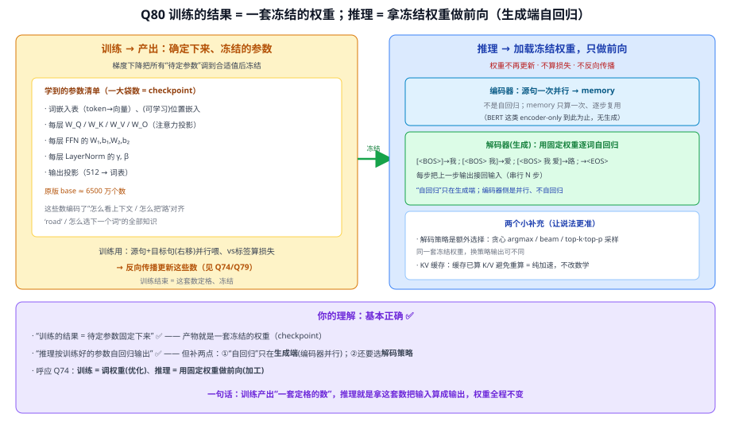

---

## Q81. 生成是怎么逐词进行的（推理与训练、每步两种注意力、焦点转移）

**一、推理首步：`<BOS>` 凭什么产生"我"**
`<BOS>` 不含内容、只是"起跑信号"。它的 query 经**交叉注意力读编码器 memory**（"I love road" 的编码）+ 固定权重 → softmax 出"我"。真正定"我"的是**源 memory + 权重**，不是 `<BOS>`。证据：换源 "You love road"、同样的 `<BOS>`，首词变"你"——说明定首词的是源句（经交叉注意力），不是 `<BOS>`。


**二、对应训练时**
同条样本（源 "I love road"→memory；解码器输入右移 `[<BOS> 我 爱 路]`、标签 `[我 爱 路 <EOS>]`）。`<BOS>` 位置的前向**与推理一模一样**（嵌入→掩码自注意力→交叉注意力读 memory→FFN→输出投影），差别只在：① 喂的是**真值前缀**（teacher forcing）；② 每位置**有标签**、算交叉熵、**反传更新权重**；③ **4 位置并行**算。早期 `<BOS>` 未必出"我"（损失大），正是损失把权重推到"源=I love road、句首→我"；收敛冻结后即推理所用。**所以 Q81 的推理是结果，训练是产生那套权重的过程。**

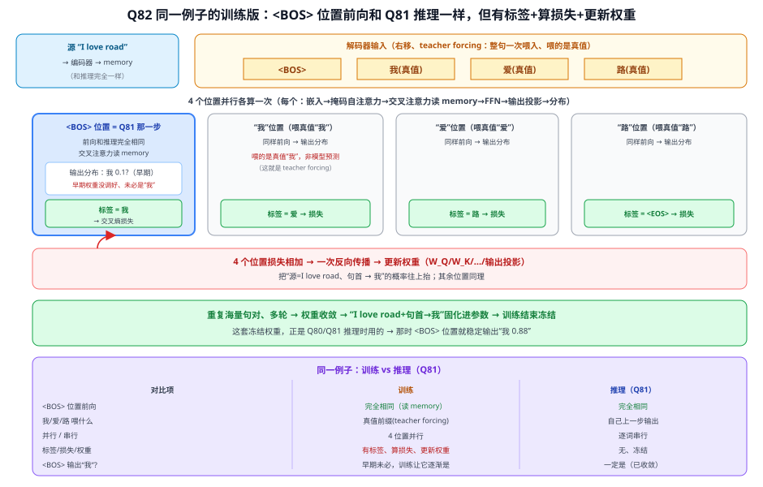

**三、推理每步的两种注意力**

| 步 | 解码器输入（目标前缀） | 掩码自注意力（最后位看谁） | 交叉注意力（读**同一** memory，焦点） | 输出 |
|---|---|---|---|---|
| 1 | `[<BOS>]` | 只看 `<BOS>`→透传 | 焦点 **I** | 我 |
| 2 | `[<BOS> 我]` | "我"看 `{<BOS>,我}` | 焦点移到 **love** | 爱 |
| 3 | `[<BOS> 我 爱]` | "爱"看 `{<BOS>,我,爱}` | 焦点移到 **road** | 路 |
| 4 | `[<BOS> 我 爱 路]` | "路"看全部 | 源词译完 | `<EOS>` |

**掩码自注意力** K/V=**已生成的目标前缀**（每步长一词，管"我已写了什么"）；**交叉注意力** K/V=**同一份固定 memory**（编码器只算一次、每步复用），变的只是**焦点**随前缀滑动。补：推理时没有未来可看，掩码形同自动满足；它真正"挡未来"的作用在训练并行喂整句时。

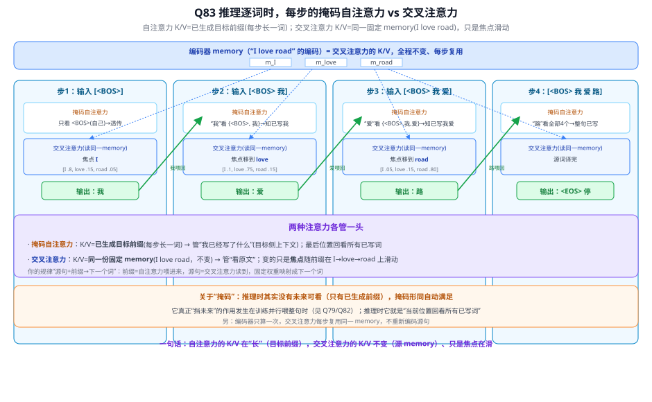

**四、焦点为何"自动"转移**
焦点 = $\text{softmax}(\text{query}\cdot\text{各源词 key})$；源词 key **固定不变**，变的是 **query**——每步前缀长一词（经自注意力）+ 位置变，使 query 的"诉求"从"在句首、要主语"→"已写主语、要动词"→"已写我爱、要宾语"；"诉求↔源词"对齐是 $W_Q/W_K$ **训练学出来**的（要主语↔I、要动词↔love、要宾语↔road）→ 最匹配的 key 一换、焦点就滑。所以"自动" = 喂进新前缀后全是固定权重的点积+softmax，无额外指令。（"要主语/动词"是直观说法，真实是涌现的统计对齐、无干净句法标签，同 [Q35④](#q35-多头注意力总论机制缩维投影混维头分工)。）

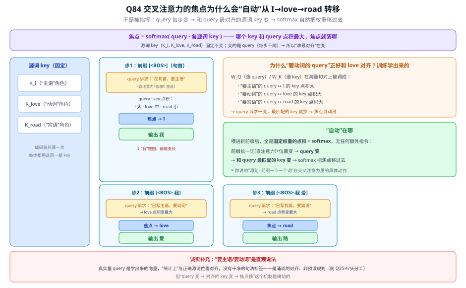

---

## Q115. Transformer 为什么不按照输入长度缩减输出？为什么输出和输入一样长？

**简答**：自注意力是"每个 query 位置对所有 V 做加权平均"，出的是**一个向量**；FFN 是"每位置各算各的、不跨 token"。两者都不合并/减少位置数，也不会新增。所以每层都是 **N→N** 的等长映射，L 层堆起来仍是 N→N。要让它"N→1（分类）"或"N→N+1（生成下一词）"，必须在 Transformer 外面接聚合或解码器自回归。

**展开**：

**① 核心：自注意力 + FFN 每层都是 N→N 的等长映射**
- **自注意力**：每个位置用它的 query 对**所有位置的 V 做加权平均** → 每个位置输出**一个向量**。位置数不变，只是每个位置的"内容"变了（凝聚了全局信息）。
- **FFN**：两层 MLP，**逐 token 独立**算（position-wise），不同 token 间不混——也是 N→N。
- 一层 = N 进 N 出；L 层堆起来，始终 N 进 N 出。

**② 为什么不能变少 / 变多**
- **变少（N→1）**：自注意力不会"合并"多个 token。要做到 N→1，必须在 Transformer 后面加**外部聚合**——如 BERT 取 **[CLS] token**（Q97）、ViT 接 **GAP**（Q99）或全连接——这已经不属于 Transformer 本身。
- **变多（N→N+M）**：Transformer 不会"凭空造出新 token"。要生成新内容，用**解码器自回归**：每步把已生成的 token 当新输入再过一遍，逐步扩展——每一步仍是等长，但序列在外部被拉长。

**③ Token 数量 ≠ 输出维度**
- 长度（token 数 N）由**上游分词器/patch 切分**决定：切出几个就是几个；
- 输出**维度**（d_model）是固定的设计参数，和 token 数无关；
- 最后一步通常过一层 FC 把 d_model 映射到词表大小(vocab_size)做 softmax 出概率，这只是维度变换，**不改长度**。

**④ 和 RNN 对比**

| | RNN | Transformer |
|---|---|---|
| 输入→输出 | 可 N→1（取最后 h_T）或序列 | 并行、每位置出一向量（等长） |
| "收束"概念 | 有（h_T = 吞完整句的摘要向量） | **没有天然收束**（无最后的隐藏态） |
| 变长输出 | 逐步循环（吐一个词、用输出当下一步输入） | 靠解码器自回归逐步扩展 |

**⑤ 三类场景**
- ① BERT/ViT 编码器：N 个 token → N 个编码后 token；
- ② 编码器-解码器：[编码器 N→N memory] + [解码器 M→M]；
- ③ 解码器自回归生成：每步输入前缀长度 N→输出 N 个向量，只用最后一个做 next token 预测，再把它拼回前缀变 N+1→再跑一轮。每一步仍是等长。

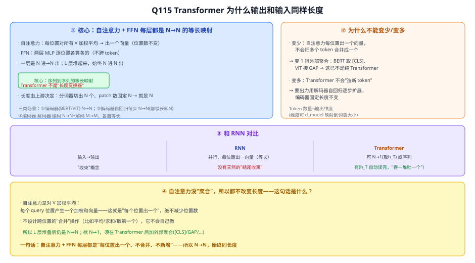

---

## Q85. 为什么解码器非要掩码自注意力不可？（几种绕过设想都不行）

**一、自注意力 vs 交叉注意力：分工不同，且交叉的 query 正是自注意力产出的**
掩码自注意力读**目标前缀**（"已写什么"，目标侧）、交叉注意力读**源 memory**（"原文什么"，源侧）；交叉看不到目标前缀、自注意力看不到源，互不替代。而且解码器一层顺序是 **自注意力 → 交叉注意力**，**交叉用的 query = 自注意力的输出**。旁证：GPT（decoder-only）砍掉交叉注意力、却**必留掩码自注意力** → 自注意力是更根本的"看上下文"，能砍 cross、不能砍 self。

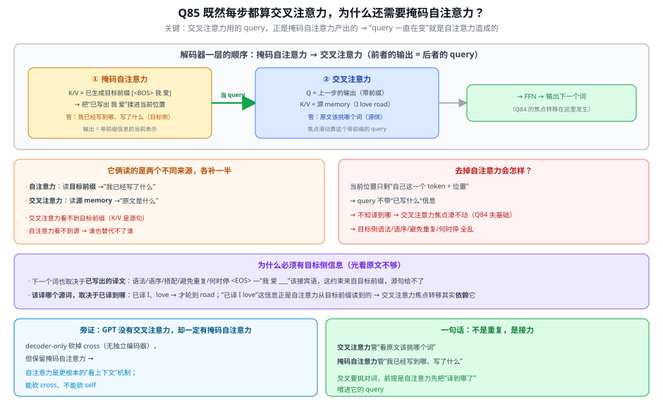

**二、为什么必须把内容"汇总到当前位置"**
因为下一个词是从**当前位置那一个向量**经输出头（512→词表+softmax）算出来的 → 所需信息（自己的词+前缀+原文）必须**浓缩进它**，否则看不到。（自注意力其实是每个位置**并行**地把它需要的上下文汇总进自己，预测时读最后那个。）

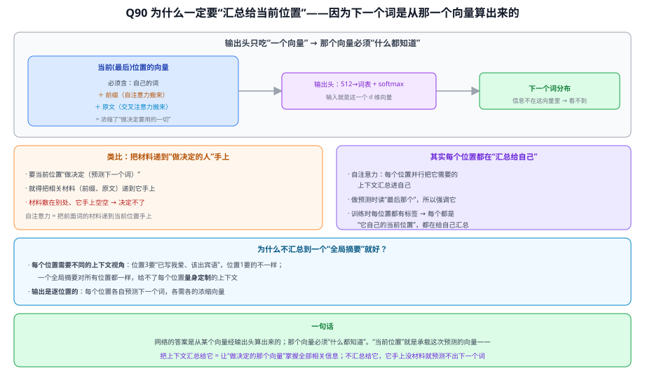

**三、几种"绕过"设想为何都不行**
- **只靠位置编码？** 位置 = 序号 ≠ 内容：PE(2) 只说"排第 3"，不告诉前面写了什么。杀手例 `[<BOS> 我 爱]` vs `[<BOS> 你 爱]`——最后位 token 都"爱"、位都 2，**没自注意力表示一样**、分不出"我/你"（位置编码仍必要，但只补次序、不补内容，[Q34](#q34-既然-qkv-已经算出了注意力相关性为什么还需要位置信息)）。

  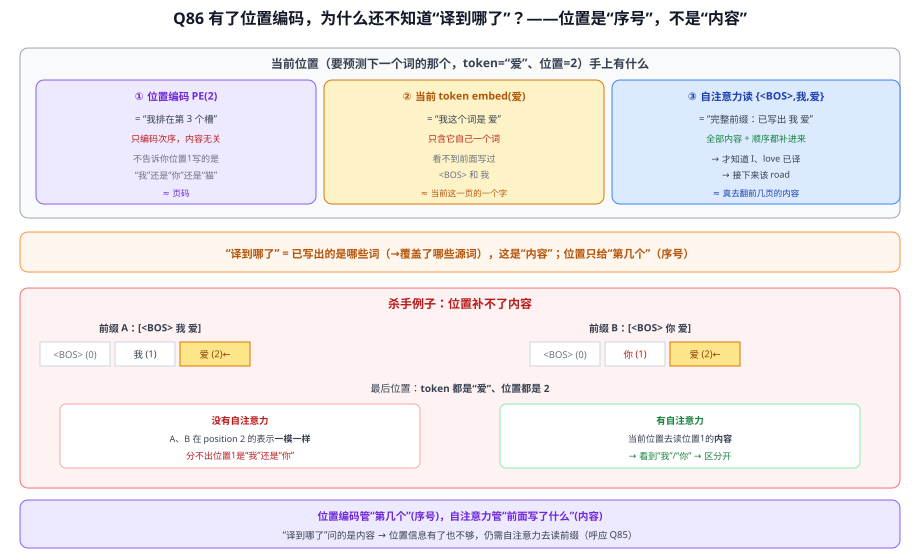

- **直接喂内容？** "喂内容"（把词放进序列，训练本就 teacher forcing 在做）≠ "读内容"（当前位置去读）；喂进去仍需一个机制把它**聚合**进当前位置。

  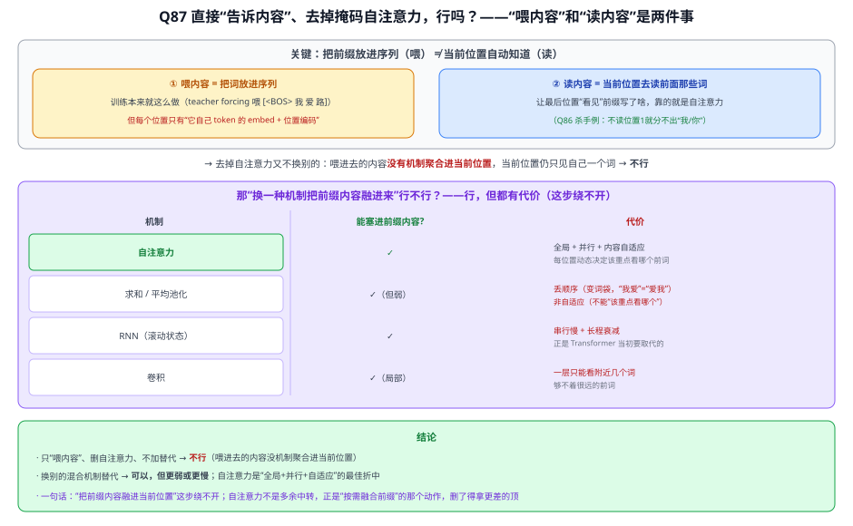

- **内容+位置（+当前位置标记）都告诉？** 内容/位置/聚合是**三件分开的事**：① 词嵌入给含义、② 位置编码给序号、③ 聚合（自注意力）把"带标签的一串词"融进当前位置。前两个只是"贴标签/备料"，③ 仍空——**位置/序号/指针都只标"在哪"，永远不把别词的内容搬进当前向量**（当前向量 = embed(自己)+PE(自己)[+标记]，无一分量来自前缀内容）。

  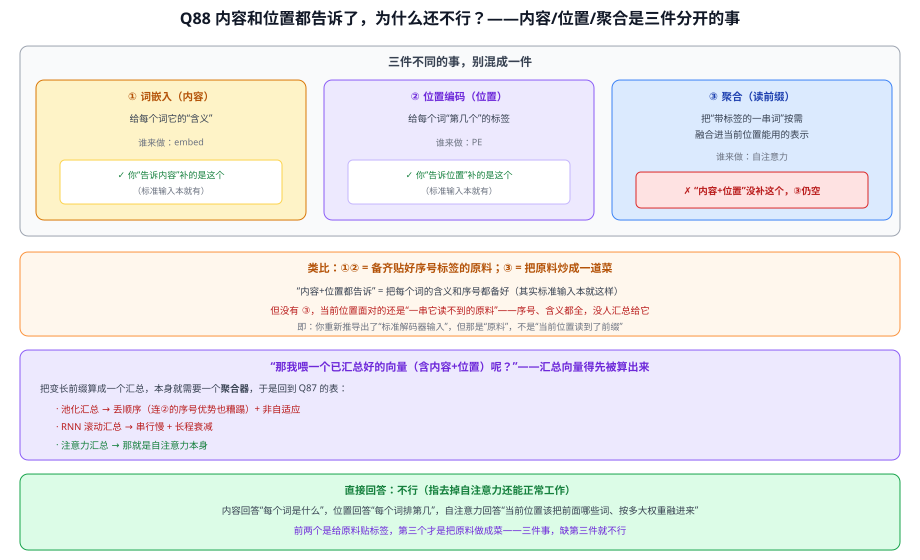

- **把已有内容当 query 不就行了？** 那**正是掩码自注意力本身**：已有内容是前缀一串词（多向量），query 要一个向量 → **必须先合成一个向量，合成那步就是自注意力**，产物正是交叉注意力的 query。若"只拿最后一个词（爱）当 query"，则只含"爱"、不含"我已写" → 焦点滑不动、目标侧乱，那才是真去掉自注意力、会坏。

  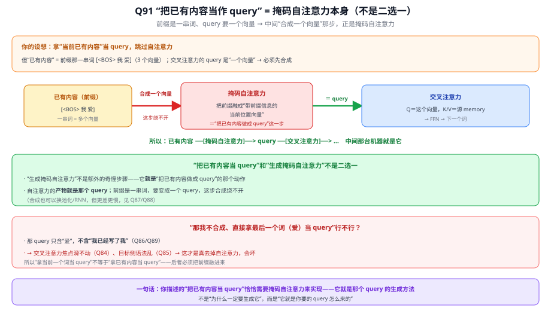

**四、能不能换个聚合器**
"把变长前缀聚合进当前位置"这步绕不开，但机制可换、代价不同：**求和/平均池化**丢顺序+非自适应、**RNN** 串行慢+长程衰减（正是 Transformer 当初要取代的，02 RNN）、**卷积**只看局部。**自注意力**恰好同时拿到"全局 + 并行 + 内容自适应"，是最佳折中（*Attention is All You Need* 的取舍）。

**五、直击"为什么必须是自注意力"：那个"已翻译的编码"不是现成的，算它的操作就是自注意力**
常见的理解是"query = **已翻译内容的编码** + 位置、且不看未来"——两点都对，但漏了一层：**"已翻译的编码"不是天上掉的，得被算出来**。已翻译的是一串词 `[我, 爱]`，它们的**原始词嵌入只是孤立词义**（"我"的意思、"爱"的意思），**还不等于**"一个捕捉了'我爱'这个已译上下文的编码"。要把这串词**混合成一个能用的编码**（让当前位置带上"已写我爱、该出宾语"），必须有一步聚合——**这一步就是自注意力**。所以"query = 已翻译的编码 + 位置"里，"编码"那一步做它的**就是自注意力**；你不是"先有编码、再决定要不要自注意力"，**自注意力就是产生那个编码的方法**。
- **"不看未来"和"自注意力"是两件事、不矛盾**："不看未来"是**属性**（因果约束）= 加在自注意力上的**掩码**；"自注意力"是**机制**（把一串词编码成表示）。合起来 = **掩码自注意力** = 带因果约束地编码前缀。你说的"不看未来"恰恰是给它**戴掩码**，不是替代它。
- **为什么这台"编码机"选自注意力**：见上文「四」——不是"非它不可"，而是在候选（RNN/卷积/池化/注意力）里它最合适。
- **那"原始编码+位置、不编码"行不行？——"变"≠"完整"**。有人想：每步 query 的原始编码都不一样，直接用不就行？但 query 每步变只是**必要、不充分**——它还得**装下整条已写前缀**。两种理解都不行：**①只取最后一个词的原始编码**（embed(爱)+PE）确实每步变，但**只含最后词、丢了前面**——`[我 爱]` 与 `[你 爱]` 最后词都"爱"位都 2 → query 一样、分不出（"变"但**不完整**）；**②取整串原始编码** `[embed(我)+PE₁, embed(爱)+PE₂]` 是**一堆向量、不是一个 query**，要变成一个能用的 query 必须**合并**——合并就是编码=自注意力。你要的是"**同时满足每步变 + 装下整条有序前缀的一个向量**"，原始最后词给"变"不给"完整"、原始整串给"完整"却非一个向量；**唯一两全的单个向量就是把前缀合并起来 = 编码（自注意力）**。
- **更一般的判据："要不要跨 token 的信息"**。反过来说：**若当前位置只需要它自己那个词**（不需要别的词的信息），那"原始词编码+位置"（再过逐 token 的 [FFN](#q78-ffn-是什么是通过-ffn-不断优化query-吗)）就够了、**自注意力可省**——这正是 FFN 逐 token、不带注意力的原因。触发"必须自注意力（或替代）"的，是"**需要别的 token 的信息**"（哪怕只要一个）；"整条前缀"只是它的**强情形**。一句话看整个 Transformer：**逐 token 的操作**（词嵌入/位置/FFN/输出头）处理"每个词自己"，**注意力**（自/交叉）是唯一"跨 token 搬信息"的操作 → **要不要注意力 = 要不要别的 token 的信息**。

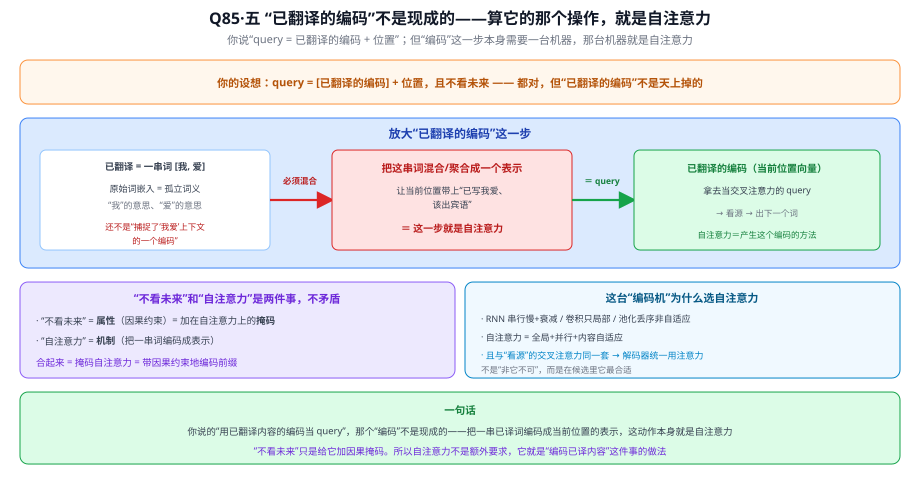

> **一句话**：当前位置要预测下一词，就得把"前缀写了什么"融进它那一个向量；位置/标签只回答"在哪"、不搬"内容"。而**"把一串已译词编码成当前位置的表示"这个动作本身就是（掩码）自注意力**——你说的"用已翻译内容的编码当 query"里，那个"编码"就是它算的，"不看未来"只是给它加因果掩码。所以自注意力不是额外要求，它就是"编码已译内容"这件事的做法；几种绕过设想要么没做这步、要么其实就是它。

## Q116. 为什么 Q、K、V 是投影矩阵得到的，而不是直接用原先的序列？

**简答**：直接拿 $x$ 当 Q=K=V，同一个向量要扮演"提问""被查的标签""被汇总的内容"三个不同角色，冲突了；而且 Q=K 导致相似度矩阵对称，丢失"I 要查 run"和"I 被 run 查"这种非对称信息。用三个投影，每个 token 一次变成三个独立方向，彼此不冲突。

**展开**：

**① 若不用投影：同一向量 $x$ 同时充当 Q、K、V**
$$\text{Attention}(x) = \text{softmax}\left(\frac{x \cdot x^\top}{\sqrt{d}}\right) \cdot x$$
同一向量需同时：
- **Q**（提问）："我想找谁？" → 问出一个方向；
- **K**（被查）："我被谁找到？" → 被匹配的标签；
- **V**（取值）："如被注意，我贡献什么内容？" → 被汇总的东西。
→ 这三个功能可能完全不同方向，用一个向量无法表达。

**② Q=K 导致相似度矩阵对称——丢失"提问方向 ≠ 被查方向"**
Q 和 K 用了同一向量 → 自注意力计算出的相似度矩阵**对称**：$x_i\cdot x_j = x_j\cdot x_i$。但语言中**"I 要查 run"和"I 被 run 查"是两回事**——Q 的"我想找动词"和 K 的"我是主语被动词找"方向不该相同。对称矩阵**只能表达"这两个词笼统多像"，丢掉了非对称依赖**。

**③ 投影给了三种"人格"**
$$Q = xW_Q,\quad K = xW_K,\quad V = xW_V$$
同一个 token 在一次前向中通过三套参数投影成**三个独立向量**——同一个 $x$ 可出现非常不同的 Q 和 K → 能表达非对称关系：$x_{I}W_Q$（"I 要找什么"）和 $x_{I}W_K$（"I 被谁找"）不必相近。且 V 可以给出有别于 Q/K 的**另一层语义**（Q/K 做对齐，V 输出搬运到下一层的上下文信息，不受"相似度"约束）。

**④ 附带好处：投影顺手解决多头降维**（呼应 Q35）
想要多头注意力，就得把向量拆成 h 个子空间——投影恰好同时完成了**线性变换 → 降低维度($d_k = d/h$) → 拆分给各头**。不用投影就要为这个目的再额外设计模块，现在全由 $W_Q/W_K/W_V$ 一行代码完成。

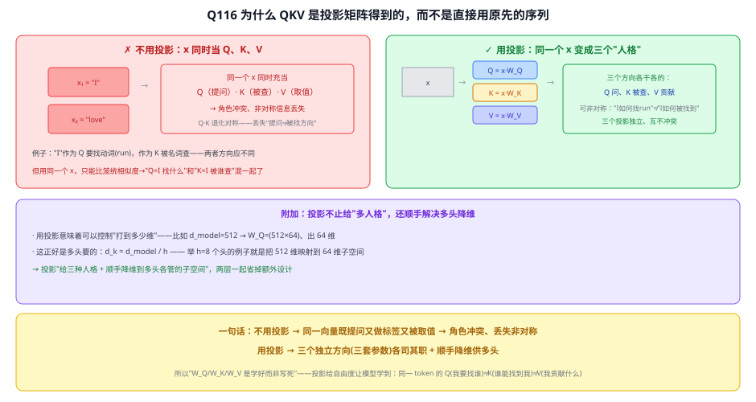

**⑤ 一句话**
不用投影 → 同一向量既提问、又被查、还被取值，Q=K 导致信息丢失（非对称消失）；用三个独立投影 = "给 token 三副眼镜（三套 W）"，同一 token 分别看出 Q(我要找谁)、K(谁能找到我)、V(我贡献什么)，各不冲突，且同时做到多头降维。

---

## Q117. 为什么是 Q、K、V 三个，而不是四个？当初是怎么想出来的，有什么理论根据？

**简答**：Q、K、V 直接取自计算机科学最基础的操作——**数据库/字典查询**。你查一本字典、做一次搜索、查一次数据表，天然就是三步：①你要找什么（Query）→ ②和每条记录的"被检索标签（Key）"做匹配 → ③匹配上后返回那条记录的内容（Value）。三步各不相干、三者缺一不可——这便是 Q、K、V 三件套的直接来源。Vaswani 等人把这场"检索操作"放进网络，并对所有位置**同时做**（并行），就得到了**缩放点积注意力**。

**展开**：

### 一、QKV 不是"想出来的"，是"检索/记忆/注意力"长期演化的结果

QKV 三件套的根可以追溯到更早的工作——**开信记忆网络（Memory Networks, Westin 2015）**先把 Q 和记忆条目做匹配、再取匹配条目的值；以及 **Bahdanau 的加性注意力（2015）** 已经隐含 Q 和 K 的角色。Transformer 的创新不在"发明 QKV 三角"，而是把已有想法归化成**一个纯点积式、可批量矩阵乘的版本**。

> 本质就是"查字典/查数据库"：**Query** 是你要问的问题，**Key** 是每笔数据的标签索引，**Value** 是每笔数据被命中后返回的内容。所以只需要 3 样——少了角色混了，多了无独立功能。

### 二、为什么要三个各自独立：Q、K、V 分属不同角色

- **Q ≠ K**（不对称）：Q 提问、K 做被检索的标签；检索语言里"I 要找 run"和"I 作为 K 被 run 匹配到"是两回事（呼应 [Q116](#q116-为什么-qkv-是投影矩阵得到的而不是直接用原先的序列) "角色冲突"）。
- **K ≠ V**（标签 ≠ 内容）：搜索视频时，被索引的是**标题（K）**，但点击后你想要的是**视频内容（V）**——标签轻量、内容丰富，两者不同。匹配用 K（容易对齐），搬运用 V（包含原 token 的完整语义）。正因为 K≠V，模型可以把"易于比对"和"被搬走的内容"拆到两个投影里各做各的。

### 三、为什么不是 4 个

2 个不够（Q=K 丢非对称 / K=V 丢"标签≠内容"自由度）。3 个刚好覆盖"发起→检索比对→返回内容"。没有第 4 个独立角色——再多一个项目既无理论支撑也无额外收益。后来的研究（如一些高效注意力变体）有时共享投影、甚至放弃 K vs V 显式分离，都是在 3 个角色的框架内做权衡，证明的是"3 是保底的上限"。

### 四、两个例子——不用术语也能看三个角色

**① 查字典**：Q=要查哪个字(部首/拼音)，K=部首索引(标签，不是正文)，V=该字的解释(被命中的内容)。  
**② 视频搜索**：Q=要搜的关键词，K=每个视频的标题标签(不是视频文件)，V=搜索结果中展示的视频(匹配上后要给用户的)。  

凡是 Q 不直接等于要检索的内容、检索时靠轻量标签而不是完整内容、被返回的东西和标签不一样——就自然出现 Q、K、V 三者。

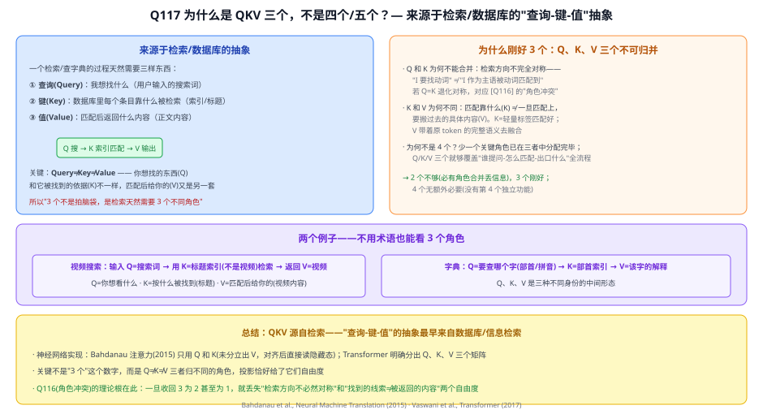

**⑤ 一句话**
QKV 三件套的本质就是**数据库/字典检索**——查询(Q) × 键索引(K) = 相似度，去加权取出值(V)。需要 3 个是因为"找的依据(Key)"和"返回的内容(Value)"和"搜索意图(Query)"三者是不同的东西，少了任何一个就丢了信息。

---

## Q118. 是不是 Transformer 的输入一定得是"序列"？

**简答**：对，数学上必须是"序列"（有同构 token 排成一排）；但序列 ≠ "自然语言的句子"。只要把不管什么模态的数据变成一组 N×d 维的向量，就能喂进去。位置编码是可选附属品——有顺序信息的任务必须加，没有的可以不加。

**展开**：

**① 数学层面：Transformer 就是要一组同构向量**
自注意力做的是 $N\times d$ 矩阵的三个投影和相互之间的加权平均——输入必须被表达为 "N 个 token，每个都是一个 $d$ 维向量"。这个 $N$ 可以是：
- 文本：词被 tokenizer 切成 $N$ 个 subword 后嵌入；
- 图像：切 patch 拉平成 $N$ 个 token（见 31 ViT）；
- 视频：时空 patch = 更多的 token；
- 音频：波形分帧/频谱可序列化；
- 集合/检测：DETR 的 object query —— 就是 N 个可学习 query 向量，图像 token 作 K/V，两边一起交互。

**③ 位置编码：是任务需要，不是 Transformer 硬性要求**
位置编码不是因为"Transformer 规定必须有"，而是因为**自注意力本身不对 token 的位置敏感**——N 个 token 如果完全不加位置信息，无论是"我爱你"还是"你爱我"，计算结果是一样的。如果任务不需要区分位置（如 DETR 的 object query 做检测、或某些集合推理任务），甚至可以**不加位置编码**。所以它是"需要顺序语义时才加"，不是 Transformer 的数学前提。

**④ N=1 的特殊情况**
如果只有一个 token 输入（N=1），自注意力退化——一个 token 对所有 V 加权平均时只有一个值，注意力无效，等价于逐 token 的 FFN。所以 Transformer 只有在 N≥2 时，注意力机制才真正发挥"跨 token 聚合信息"的作用。

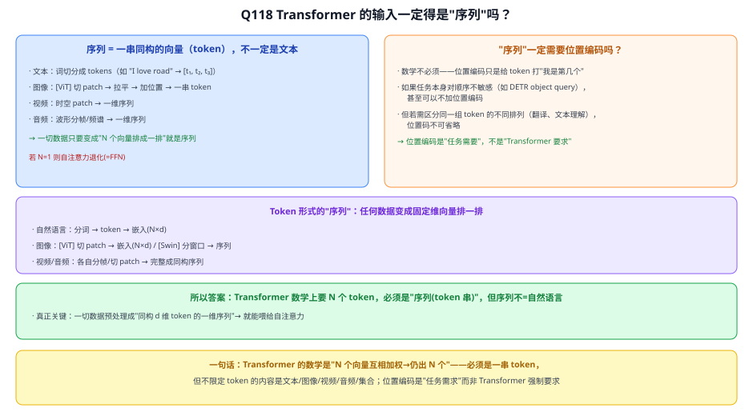

**⑤ 一句话**
Transformer 数学上必须有 N 个同构的向量才能做自注意力——这当然是"序列"，但这个序列不限于自然语言；只要能变换成向量的一维排列，任何模态都可喂给它。位置编码是**为任务需要**而非 Transformer 要求。

---

## Q119. 多头投影—拆头—拼接—W_O，全程维度到底怎么变化？QKV 是否都这样？

**简答**：对。QKV 三条并行的路径全都 512→512（整维度投投影分各头），每头独立在 64 维子空间算注意力出 64 维，最后 8×64 concat 回 512，再过 W_O 融合。每层的输入输出维度保持不变。

**展开**：

**① 你的数字走一遍（d=512，h=8）**
```
输入 x: [N, 512]

① 投影 + 拆头：每 token 512 分给 8 个头 → 每头 64
   Q = x·W_Q [512→512] → reshape → [N, 8, 64]
   K = x·W_K [512→512] → reshape → [N, 8, 64]
   V = x·W_V [512→512] → reshape → [N, 8, 64]

② 每头独立算缩放点积 (64 维内):
   head_i = softmax(Q_i·K_i^⊤ / √64) · V_i    → [N, 64]

③ 头结果串回:
   concat(head1,...,head8) = [N, 8×64] = [N, 512]

④ W_O 混合 8 头 → 输出:
   concat · W_O [512→512]   → [N, 512]
```

**② 两个常见误解**
- "每个头 512 维" ✗ → 投影后按头分 d/h = 64 维，各头只在这 64 维子空间工作；
- 8 个视角是随机初始化经训练涌现的，不可预设分工（见 Q35 ④）。

**③ W_O 的作用**： 8 个头独立算完→拼接，各头信息可能来自不同的子空间表达；W_O 是一次全连接（512→512）来把 8 个头的输出混合、对齐回同一空间，保证下一层接收的是"混过的全局结果"而非松散的多头拼接。

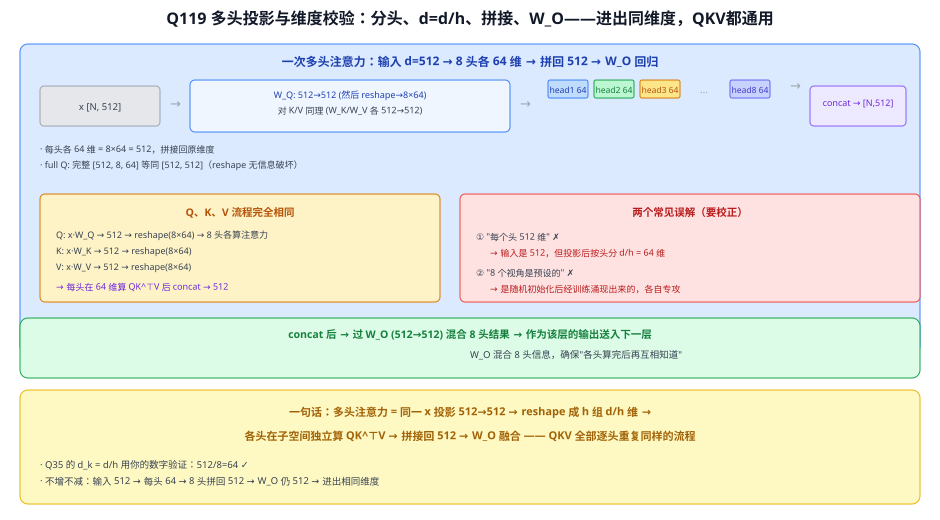

**④ 一句话**
d=512、h=8 = 每头 64 维独立算 QK^⊤V，8 头拼接 512，W_O 混合——Q、K、V 全部重复同一套分头-算-拼回的流程；进出维度始终相等。

---

## Q120. FFN 具体是如何"扩维再压回"的？

**简答**：$\text{FFN}(x) = W_2\,\text{ReLU}(W_1 x + b_1) + b_2$。对每个 token 的 512 维向量：乘 W₁ 变 2048 维（扩 4 倍）→ ReLU 归零负值（只留被激活的少数维）→ 乘 W₂ 回到 512 维。就是"一次扩、一次筛、一次压"三步，两块权重矩阵中间夹一个非线性。

**展开**：

**① 用具体数字走一遍（d=512，扩到 2048）**
```
x: [512]                        ← 一个 token 的向量
① 扩维: h = W₁·x + b₁           W₁ 形状 [2048×512]
   → h: [2048]                  ← 512 → 2048，放大 4 倍
② 非线性: a = ReLU(h)
   → 负的全部置 0，只留被"激活"的少数维（稀疏激活）
③ 压回: y = W₂·a + b₂           W₂ 形状 [512×2048]
   → y: [512]                   ← 2048 → 512，回到原维度
```
对**每个 token 单独**做（position-wise），不跨 token（[Q78](#q78-ffn-是什么是通过-ffn-不断优化query-吗)）。

**② 直觉：2048 个"特征探测器 + 记忆槽"**
把 W₁ 的**每一行**（512 维）看成一个**探测器**、W₂ 的**每一列**（512 维）看成该探测器对应的**输出内容**：
- **扩维 = 2048 次匹配检测**：h 的第 i 个分量 = W₁ 第 i 行 · x = "这个 token 像不像我负责的模式？"；
- **ReLU = 挑中被激活的少数**：不像的（负分）直接归零 → 稀疏激活，通常只点亮一小部分探测器；
- **压回 = 把点亮探测器各自的"输出向量"加权求和**：y = Σ aᵢ·(W₂ 第 i 列)，即"命中了哪些模式，就把这些模式对应的知识写回 token"。

> 所以 FFN 常被解读为 Transformer 的 **key-value 记忆库**：W₁ 是 2048 把"钥匙"（检测什么），W₂ 是 2048 个"值"（检测到后写入什么）。这也是"知识主要存在 FFN 里"这一说法的来源——和注意力的 QKV 检索（[Q117](#q117-为什么是-qkv-三个而不是四个当初是怎么想出来的有什么理论根据)）结构同构，差别在：FFN 的"键值"是**静态学好的参数**，注意力的 K/V 是**当前输入动态算出来的**。

**③ 为什么非要"先扩再压"，不直接 512→512**
1. **给非线性腾空间**：ReLU 的表达力取决于"能切多少刀"——512 维里只有 512 个切分方向，扩到 2048 就有 2048 个特征检测方向；**高维里做非线性、低维里传结果**。
2. **稀疏特征分工清晰**：维度冗余 + ReLU → 每个 token 只激活少数探测器，互不打架。
3. **必须压回 512**：残差连接 `x + FFN(x)` 要求**同维**（[Q115](#q115-transformer-为什么不按照输入长度缩减输出为什么输出和输入一样长) 的等维接口），下一层才能无缝接上。

**④ 量级感**
FFN 参数 = 512×2048×2 ≈ **210 万/层**，比同层注意力的 4×512×512 ≈ 105 万还多——**FFN 是 Transformer 参数的大头**。"4 倍扩维"是原论文的经验默认值，后来的大模型也基本沿用（约 2.7~4 倍）。

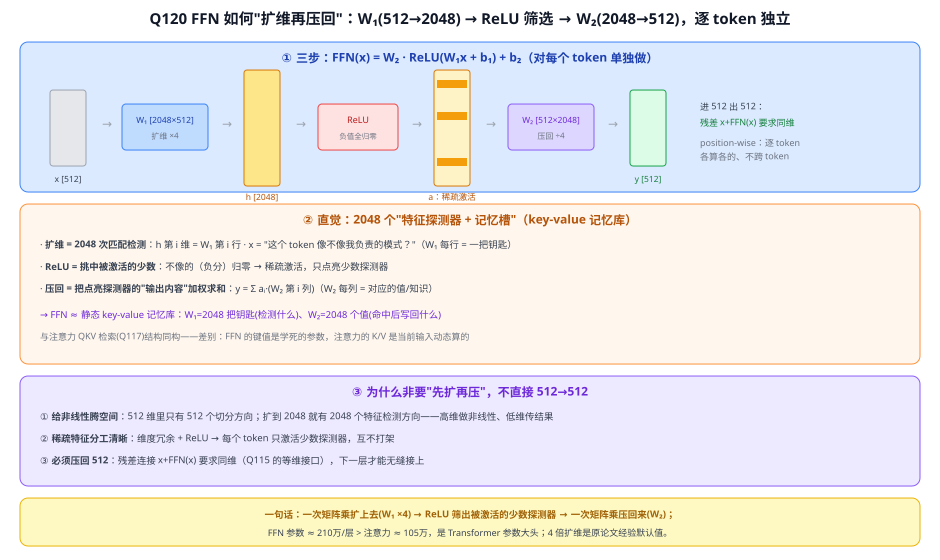

**⑤ 一句话**
FFN 的"扩维再压回"= 一次矩阵乘扩上去（W₁，×4）→ ReLU 筛出被激活的少数探测器 → 一次矩阵乘压回来（W₂）；高维里做非线性检测、低维里保持残差接口，且这套"钥匙-值"结构正是 Transformer 存知识的地方。

---

## Q121. 原始 Transformer 为什么需要掩码？理论依据是什么？是因为翻译任务才需要的吗？

**简答**：掩码不是为"翻译"设的，是为"**自回归生成**"设的。理论依据一句话：生成按链式法则分解成 ∏ P(y_t | y_<t)，每个词的条件里**只有过去没有未来**；而 Transformer 训练时为了并行把整句真值一次喂进去，未来词就在输入里——不加下三角掩码，模型直接看到自己要预测的答案，训练作弊、推理翻车。原始 Transformer 恰好是翻译模型所以带了个生成的 decoder；它的 encoder 从第一天起就**没有**因果掩码。

**展开**：

**① 理论依据：链式法则 + 防泄漏 + 训推一致，三层递进**
1. **数学定义**：生成任务的目标是建模 P(y|x)，唯一通用的分解就是链式法则 P(y|x) = P(y₁|x)·P(y₂|y₁,x)·…·P(y_t|y_<t,x)…。注意每一项的条件**只有 y_<t（已生成的过去）和 x（原文）**——未来 y_>t 根本不在条件里。模型要学的就是这些条件分布，所以每个位置**按定义**就不许看未来。
2. **训练防泄漏**：训练用 teacher forcing——把整句真值右移一位一次性喂给 decoder，让 N 个位置**并行**各自预测下一个词。此时位置 t 的标签 y_{t+1} 就在同一句输入里；若自注意力不加掩码，位置 t 一眼看到 y_{t+1}，任务退化成"复制输入里的下一个词"，损失轻松趋 0，但学到的是抄写不是条件分布。
3. **训练-推理一致**：推理时逐词生成，走到第 t 步时未来**根本还不存在**。若训练时依赖了未来信息，推理时这个信息源凭空消失，分布错配、输出崩坏。掩码保证训练时每个位置的"视野"和推理时一模一样——这也是为什么**并行训练能等价于逐步推理**：一次带掩码的前向 = N 个"只看过去"的预测同时做。

> 和 RNN 对照最能看清动机：RNN 天然按时间步串行，物理上就看不到未来，所以不需要掩码；Transformer 为了**并行训练**把整句同时摊开算，"时间箭头"没了，掩码就是**人工把时间箭头加回来**的手段。掩码是并行化的代价，不是注意力机制天生的需求。

**② 实现：下三角矩阵，未来打 −∞**
在 softmax 之前把注意力分数矩阵的上三角（j > i 的位置）全部加 −∞ → softmax 后这些位置权重恰好为 0。位置 1 只能看 y₁，位置 2 能看 y₁y₂……每行视野递增。原始 Transformer 里**只有 decoder 的自注意力**用它：encoder 自注意力不带（双向），decoder 的交叉注意力也不带（源句 x 是完整已知的输入，看全句天经地义）。

**③ 你的判断校正：分界线是"生成 vs 理解"，不是"翻译 vs 其他"**
- **需要因果掩码**（凡是逐 token 自回归产出的）：原始 Transformer 的 decoder（翻译只是当年的示例任务）、GPT/LLaMA 全系（聊天生成）、图像描述模型、LLaVA 里生成回答的 LLM 部分（Q110）。
- **不需要因果掩码**（只做理解/编码，输入全部已知）：BERT（Q93）、ViT/Swin、CLIP 双塔、SegFormer、SAM——"偷看两边"对编码器是**特性不是作弊**，因为它不预测序列里的下一个元素，输入本来就整体给定。
- 一个反直觉的例子：**DETR 的 decoder 也不带因果掩码**——它虽然叫 decoder，但 100 个 query 是**集合预测**、一次性并行出框、框与框之间没有先后顺序，自然没有"未来"可偷看（[Q79](#q79-transformer-的输入和输出到底是什么decoder-的掩码自注意力与交叉注意力都必须有吗各起什么作用) 提过）。所以更准的判据是：**输出有没有"顺序依赖的逐步生成"**。

**④ 三种"掩码"别混为一谈**
| 掩码 | 作用层面 | 目的 | 谁在用 |
|------|---------|------|--------|
| **因果掩码**（本题） | 注意力分数 | 防偷看未来，保自回归 | 生成端 decoder / GPT |
| **Padding 掩码** | 注意力分数 | 批处理时把补零占位打 −∞ | 几乎所有 Transformer（纯工程） |
| **BERT 的 [MASK]** | 输入 token | 完形填空训练目标（MLM） | BERT 预训练（是任务设计，不是注意力掩码） |

所以"BERT 也有 mask"和"decoder 的 mask"是两码事：前者遮**输入的词**逼模型猜，后者遮**注意力的视野**防作弊。

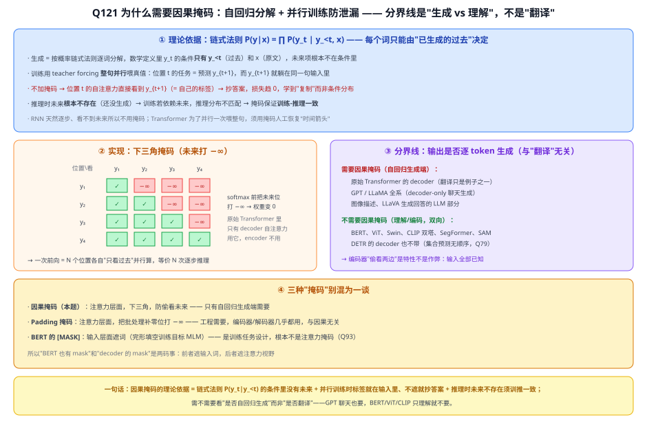

**⑤ 一句话**
因果掩码的理论依据 = 链式法则里 y_t 的条件**只有过去**＋并行训练时标签就在输入里**不遮就抄答案**＋推理时未来不存在须**训推一致**；需不需要它看"输出是否自回归生成"而非"是否翻译"——GPT 聊天也要、BERT/ViT/CLIP 只理解就不要，原始 Transformer 自己的 encoder 也从来没有过。

---

## Q122. 掩码怎么就实现了"不看未来"的？

**简答**：注意力里根本没有"看一眼"这种模糊操作——位置 i 的输出就是把所有位置的 v 按权重 α 加权求和，α 是信息进来的唯一闸门。掩码把未来位置的注意力分数加上 −∞，softmax 一算 e^{−∞}=0，未来的权重**精确等于 0**，对应的 v 乘 0 后彻底消失。未来的内容不是"被劝退了"，是**在数学上被乘成了零**。

**展开**：

**① 核心：先看清"看"是什么**
自注意力的输出公式：outputᵢ = Σⱼ αᵢⱼ·vⱼ（α 来自 softmax(QK^⊤/√d)）。位置 i "看到"位置 j 的**唯一渠道**是 αᵢⱼ·vⱼ 这一项——没有旁路、没有隐藏通道。所以"让 i 看不到 j"有一个干净的充要条件：**αᵢⱼ = 0**。掩码做的全部事情就是把未来位置的 α 逼成精确的 0。

**② 用位置 2 那一行走一遍（4 个 token）**
```
① 打分:   S = QK^⊤/√d    位置2行 = [1.2, 0.5, 0.9, 2.1]  ← 未来的分也算了
② 加掩码: S + M          = [1.2, 0.5, −∞, −∞]            ← 上三角(j>i)加 −∞
③ softmax: e^{−∞}=0     → [0.67, 0.33, 0, 0]            ← 过去两位自动归一=1
④ 加权和: 0.67·v₁ + 0.33·v₂ + 0·v₃ + 0·v₄               ← v₃、v₄ 被乘 0，消失
```
每一行做同样的事，行号越大能看的越多——整个注意力矩阵成为下三角（[Q121](#q121-原始-transformer-为什么需要掩码理论依据是什么是因为翻译任务才需要的吗) 的掩码矩阵图）。

**③ 为什么非得 −∞，两个"更直观"的替代都不行**
- ✗ **把分数改成 0**：softmax 是 e^x 再归一化，e⁰ = 1 不是 0——未来反而分到一份不小的权重；
- ✗ **softmax 之后把权重置 0**：剩下的权重加起来不到 1，还得手动重新归一化；
- ✓ **softmax 之前加 −∞**：e^{−∞} 严格为 0，且 softmax **自动**只在过去的位置上归一（0.67+0.33=1），一步到位。工程实现里用 −10⁹ 这类大负数代替 −∞，效果一样。

**④ 分数照算、算完作废——掩码不是"跳过计算"**
QK^⊤ 是一次整块矩阵乘，上三角（未来对）的分数**照算不误**，掩码是在算完之后作废它们。这正是并行的代价：宁可白算一半，也要用一次矩阵乘同时搞定全部位置（对照 [Q121](#q121-原始-transformer-为什么需要掩码理论依据是什么是因为翻译任务才需要的吗)：掩码是并行化的代价，这里看到代价的另一半——冗余计算）。

**⑤ 必须每一层都加，泄漏才封得死**
若只第 1 层加、第 2 层不加（或反过来）：第 1 层不加时 y₁ 的表示里**已经混进了未来的信息**，第 2 层哪怕规规矩矩戴着掩码，位置 3 去看 y₁ 也会**间接**读到未来——泄漏顺着层传播。反之，只要每层都是下三角，可见性经过任意多层复合仍是下三角：位置 3 看位置 2，而位置 2 只融合过 ≤2 的内容，链条上每一环都干净。"不看未来"由此在**整个网络**意义上成立——信息只能沿"过去→现在"单向流动。

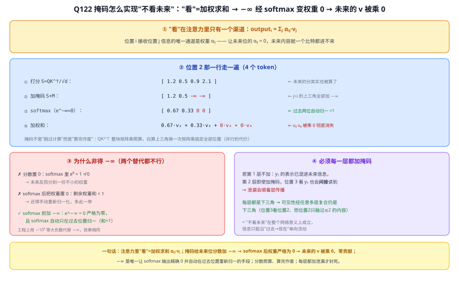

**⑥ 一句话**
掩码实现"不看未来"= 给未来位置的注意力分数加 −∞ → softmax 后权重**严格为 0** → 加权求和时未来的 v 被乘 0、零贡献；−∞ 是唯一能让 softmax 输出精确 0 且自动在过去位置重新归一的手段；分数其实照算、算完作废（并行的代价），并且每层都得加，可见性才能全网保持下三角。

---

## Q123. Transformer 为什么要设计成编码器和解码器的形式？

**简答**：不是"Transformer 必须长这样"，而是"翻译任务长这样"。翻译 = 读懂一句 + 写出另一句：读的那句整句摆在那，看得越全越好（双向、无掩码）；写的那句只有已生成的前缀，看未来就是作弊（因果掩码）。视野规则相反，一个模块伺候不了两件事，于是拆成编码器＋解码器，中间用交叉注意力通信。后来 BERT 只留编码器、GPT 只留解码器，恰恰证明这是任务结构的产物。

**展开**：

**① 两件事，视野规则相反**

| | 读懂源句（编码器） | 生成目标句（解码器） |
|---|---|---|
| 输入状态 | 整句**完全已知** | 只有已生成前缀，未来**不存在** |
| 最优视野 | **双向**看全句，注意力矩阵是满的 | **因果掩码**，下三角只看过去（[Q121](#q121-原始-transformer-为什么需要掩码理论依据是什么是因为翻译任务才需要的吗)） |
| 计算方式 | 一次并行编码 → 输出 memory | 逐步自回归 |

源句"偷看两边"是特性（信息全在），目标句偷看未来是作弊（标签泄漏）——**同一套注意力不可能同时满视野和下三角**。分开后各用各的视野规则，互不妥协。

**② 桥 = 交叉注意力，且分工带来效率红利**
解码器每层用交叉注意力（Q=目标 query，K/V=编码器输出 memory）去"查"源句（[Q79](#q79-transformer-的输入和输出到底是什么decoder-的掩码自注意力与交叉注意力都必须有吗各起什么作用)、[Q81](#q81-生成是怎么逐词进行的推理与训练每步两种注意力焦点转移)）——这是理解与生成之间唯一的信息通道。效率上：**编码器只跑一次**，memory 缓存后被生成的每一步反复读；若混在一个模块里，源句理解就得跟着每步生成重算。

**③ 更深一层：形式跟着任务走——继承自 seq2seq 范式**
"编码器-解码器"不是 Transformer 论文的发明：2014 年 seq2seq（RNN 版）确立"先把输入压成理解、再展开成输出"的两段式，2015 年 Bahdanau 注意力补上"生成时回看原文"的桥。任务结构是"一条序列 → **另一条异构序列**"（不同语言、不同长度），两段式是这个结构的自然形态。Transformer（2017）的任务恰好是机器翻译，于是照着这个范式**把算子从 RNN 换成自注意力**——架构形式是任务给的，创新在算子。

**④ 反证：任务结构一变，这个形式就被拆了**
- **只理解、不生成**（分类/检索/编码）→ 砍掉解码器 = **BERT / ViT / CLIP 双塔**（encoder-only，Q93）；
- **输入输出是同一条流的续写**（prompt 和回答同在一个文本空间，不是两条异构序列）→ 不需要单独的编码器、也不需要交叉注意力，一套因果堆叠既读 prompt（prefill）又生成 = **GPT**（decoder-only，Q92）——结构更简单、更好规模化，成为 LLM 主流；
- **输入输出仍是两条异构序列/模态** → encoder-decoder 至今活着：T5、翻译系统、Whisper（语音→文字）、DETR（图像 memory + query 解码，Q72）。

> 判据一句话：**输入输出是不是两条异构序列？是 → 编码器-解码器；只理解 → 仅编码器；同流续写 → 仅解码器。**

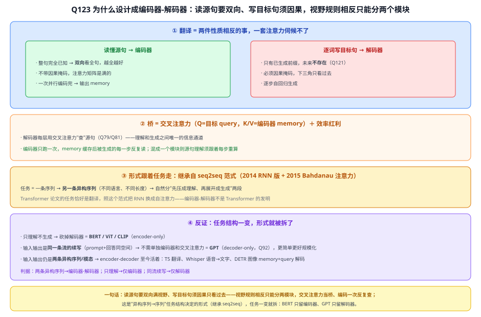

**⑤ 一句话**
设计成编码器-解码器，是因为翻译分成视野规则相反的两件事：读源句要**双向满视野**、写目标句须**因果只看过去**，只能分两个模块再用交叉注意力当桥（编码一次、生成每步反复查）；这是"异构序列→序列"任务结构决定的形式（继承 seq2seq），任务一变就拆——BERT 只留编码器、GPT 只留解码器、T5/Whisper/DETR 保留双段。

---

## Q124. 掩码就是人为把注意力权重设成 −∞ 的下三角矩阵、softmax 后权重为 0，对吗？

**简答**：对，骨架完全正确——人为固定的 −∞ 矩阵，经 softmax 把对应权重逼成 0。要校准的是三个用词：−∞ 打的是**上三角**（未来），"下三角"是被保留的可见区形状；加的位置是 softmax **前的分数**而非权重；屏蔽的是**未来**不是过去。

**展开**：

**① 校准一：−∞ 打上三角，活下来的是下三角**
掩码矩阵 M：j ≤ i（过去+自己）的位置加 0 保留，**j > i（未来）的上三角**加 −∞：
```
M = [  0  −∞  −∞  −∞ ]     红区 = 上三角 j>i（未来）→ 打 −∞
    [  0   0  −∞  −∞ ]     绿区 = 下三角 j≤i（过去+自己）→ 加 0 保留
    [  0   0   0  −∞ ]
    [  0   0   0   0 ]
```
你说的"下三角矩阵"描述的是**结果**：softmax 之后权重矩阵的非零区（= 每个位置的可见区域）呈下三角形状。说"掩码是下三角"日常交流没问题，但写论文/代码时要分清：**加 −∞ 的动作发生在上三角**。

**② 校准二：−∞ 加在"分数"上，不是"权重"上**
完整顺序（[Q122](#q122-掩码怎么就实现了不看未来的) 的四步）：分数 S = QK^⊤/√d → **S + M（此处加 −∞）** → softmax → 权重 α。"权重"专指 softmax 之后和为 1 的 α——它的 0 是被 −∞ **间接逼出来的**。不能直接动权重：softmax 后把权重置 0，剩余权重和 < 1，破坏归一化还得手动补救；在分数上加 −∞ 则 softmax 自动只在过去的位置归一，一步到位。

**③ 校准三：看不到的是"未来"**
"看不到过去"是笔误——下三角保留的恰恰是过去，**被屏蔽的是未来**。

**④ "人为设置"这个洞察是对的，且值得强调**
掩码矩阵是**固定常数**：不参与训练、没有梯度、不随输入内容变，只由序列长度决定形状。它是把任务规则（自回归不许偷看，[Q121](#q121-原始-transformer-为什么需要掩码理论依据是什么是因为翻译任务才需要的吗)）**硬编码进结构**的约束——与 W_Q/W_K/W_V 这些学出来的参数完全两回事。这也呼应 Q42 的"固定 vs 动态"之辨：注意力权重 α 是动态算的，而掩码是写死的规则。

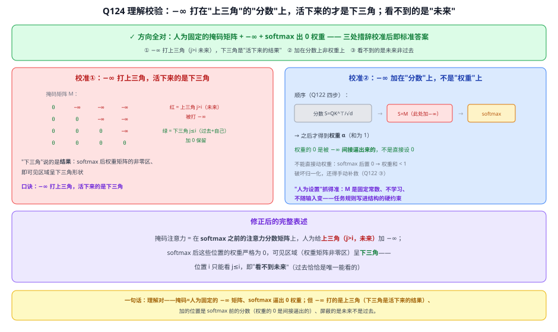

**⑤ 一句话（修正后的标准表述）**
掩码注意力 = 在 softmax **之前的注意力分数矩阵**上，人为给**上三角（j>i，未来）**加 −∞；softmax 后这些位置的权重严格为 0，可见区域（权重矩阵非零区）呈**下三角**——位置 i 只能看 j≤i，即"**看不到未来**"；掩码本身是固定常数、不学习，是任务规则写进结构的硬约束。

---

## Q125. 训练时解码器并行预测下一个词，推理时编码作 KV、Q 是已有翻译、逐步自回归——是这样吗？

**简答**：骨架对：训练并行、推理逐步自回归 ✓。修两点：一，"Q=已翻译、KV=编码"只是解码器每层**第二步交叉注意力**的分工，在它之前还有一步**掩码自注意力，Q/K/V 三者全是已生成前缀**；二，这套分工**训练时也一模一样**，训推的真正差别只有"前缀是真值还是自己的输出"——真值整句已知所以能并行，自己的输出得一步步生所以只能串行。

**展开**：

**① 训练并行 ✓：真值右移 + 因果掩码，一次前向预测全部位置**
源句 "I love road" → 目标 "我爱路"：解码器输入 `[<BOS>, 我, 爱, 路]`（真值右移），4 个位置在因果掩码（[Q121](#q121-原始-transformer-为什么需要掩码理论依据是什么是因为翻译任务才需要的吗)/[Q122](#q122-掩码怎么就实现了不看未来的)）下各看各的过去，**同时**预测 `[我, 爱, 路, <EOS>]`，4 份损失一起反传。能并行的前提恰恰是**前缀是真值、整句已知**。

**② 解码器每层两次注意力，Q/KV 来源不同（[Q79](#q79-transformer-的输入和输出到底是什么decoder-的掩码自注意力与交叉注意力都必须有吗各起什么作用)）**

| | Q | K | V | 干什么 |
|---|---|---|---|---|
| 第一步 **掩码自注意力** | 目标前缀 | **目标前缀** | **目标前缀** | 自己查自己，把前缀内容融进当前位置（[Q85](#q85-为什么解码器非要掩码自注意力不可几种绕过设想都不行)） |
| 第二步 **交叉注意力** | 前缀（经上一步融合） | **编码器 memory** | **编码器 memory** | 回看原文取证据（[Q81](#q81-生成是怎么逐词进行的推理与训练每步两种注意力焦点转移)） |

你的"编码作 KV、Q 是已有翻译"对第二步是准确的；漏的是第一步——那里 **Q、K、V 全部来自已有的翻译**。

**③ 关键修正：Q/KV 分工训推一致，差别只在"前缀由谁提供"**
训练时解码器**同样**有交叉注意力、同样拿编码器 memory 当 K/V——不然它学不会"看原文"。训推对照：
- **训练**：前缀 = **真值**（teacher forcing）→ 整句已知 → N 个位置**并行**；
- **推理**：前缀 = **自己上一步的输出** → 第 t 步的输入依赖第 t−1 步的结果，**依赖链断不开** → 只能一步步来 = **自回归**。

所以推理串行的原因不是"KV 换了来源"（没换），而是**下一步的输入还没生出来**。

**④ 两个补充细节**
- 编码器推理时也**只跑一次**：memory 缓存后被每一步的交叉注意力反复读（[Q123](#q123-transformer-为什么要设计成编码器和解码器的形式) 的效率红利、Q77 同理）；
- 工程上推理还给自注意力配 **KV 缓存**，免得每步重算整个前缀的 K/V（[Q80](#q80-transformer-训练的结果是什么是不是参数固定后推理就按训练好的参数自回归输出)）——只是加速，不改机制。

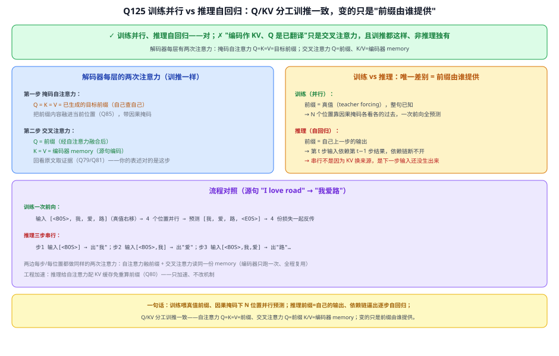

**⑤ 一句话（修正后的标准表述）**
训练：喂**真值前缀**，因果掩码下 N 个位置**并行**预测各自的下一词；推理：前缀是**自己的输出**，依赖链逼出**逐步自回归**。解码器每层两次注意力——掩码自注意力 **Q=K=V=前缀**、交叉注意力 **Q=前缀、K/V=编码器 memory**——这套分工**训推完全一致**，变的只是前缀由谁提供。

---

## Q126. 训练时解码器"一次前向全预测"到底如何体现？

**简答**：体现于三处：**输出形状**——顶层不是一个向量而是 N×d 矩阵，输出头逐行套用得 N 个词表分布，谁也不等谁；**语义等价**——掩码使位置 t 只看 ≤t 的前缀，等价于推理跑 N 遍各取一个预测，即一条句子拆成 N 条训练样本一次做完；**损失**——N 份交叉熵一起算、一次反传。

**展开**：

**① 一次前向里，每个位置都带着自己的"作业"（源句 "I love road" → "我爱路"）**
输入真值右移 `[<BOS>, 我, 爱, 路]`，过 L 层解码器（每层 N→N 等长映射，[Q115](#q115-transformer-为什么不按照输入长度缩减输出为什么输出和输入一样长)），顶层输出 4×d 矩阵，**同一个输出头逐行**套用：
```
位置   输入     视野(因果掩码)        顶层向量 → 输出头 → 预测    标签
 1    <BOS>    [<BOS>]              h₁ → 词表分布₁ → "我"      我
 2    我       [<BOS>,我]           h₂ → 词表分布₂ → "爱"      爱
 3    爱       [<BOS>,我,爱]        h₃ → 词表分布₃ → "路"      路
 4    路       [<BOS>,我,爱,路]     h₄ → 词表分布₄ → "<EOS>"   <EOS>
```
计算上没有任何一步是"先算位置 1 再算位置 2"：注意力是整块矩阵乘 QK^⊤（掩码管好各行视野，[Q122](#q122-掩码怎么就实现了不看未来的)），FFN 逐 token 本就独立（[Q78](#q78-ffn-是什么是通过-ffn-不断优化query-吗)），输出头是一次 [4,d]×[d,词表] 矩阵乘——**4 个分布同时出**。

**② 等价性是掩码给的：一条句子 = N 条训练样本**
因果掩码让**位置 t 的视野 = 推理走到第 t 步时的视野**（都只看 ≤t 的前缀）。所以这一次前向**严格等价于**把推理跑 4 遍——第 1 遍只喂 `<BOS>` 取预测、第 2 遍喂 `<BOS>我` 取预测……——只是 4 遍的计算被压进一次矩阵运算。换个说法：**一条句子被掩码拆成 4 条"给定长 t 前缀 → 预测第 t+1 词"的训练样本**，一次前向全做。这正是 [Q121](#q121-原始-transformer-为什么需要掩码理论依据是什么是因为翻译任务才需要的吗) "一次带掩码的前向 = N 个'只看过去'的预测同时做"的具体形态。

**③ 损失端同样是"全"的**
4 个分布对 4 个标签各算一份交叉熵（Q102），相加/平均成一个标量，**一次反传**同时用上全部位置的监督信号。对比 RNN：同一句话要按时间步串行滚 4 步才凑齐这 4 份损失——Transformer 的训练效率优势正在这里。

**④ 常见误解澄清：推理时其实也"全预测"了**
不要以为解码器一次前向只出"最后一个位置"的预测——那是**推理时的用法**：推理时每个位置照样都算出了分布（"全预测"照样发生），只是前面位置的词早就生成过了，**只取最后一行**、其余丢弃（KV 缓存就是为了别白算这些，[Q80](#q80-transformer-训练的结果是什么是不是参数固定后推理就按训练好的参数自回归输出)）。真实区别：**训练 N 个预测全用来算损失，推理 N 个预测只用最后一个**——"全预测"一直都在，变的是用几个。

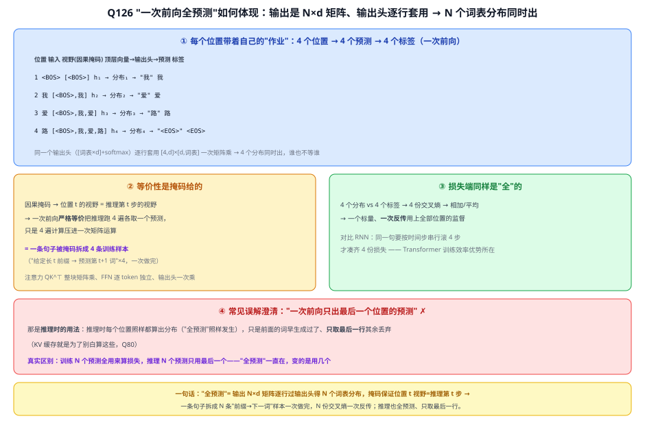

**⑤ 一句话**
"全预测"体现在：解码器顶层输出 **N×d 矩阵**、输出头**逐行**套用 → **N 个词表分布同时出**；掩码保证位置 t 视野=推理第 t 步 → 一条句子拆成 N 条"前缀→下一词"样本一次做完；N 份交叉熵一次反传。推理时同样全预测、只取最后一行——变的不是"算几个"，是"用几个"。

---
