# 28a DETR（DEtection TRansformer）

> 定位：把 Transformer 引入目标检测，将检测重新表述为"集合预测"问题，去掉 anchor 和 NMS。
> 作者：Carion 等（Facebook AI），ECCV 2020。
> 意义：开创检测 Transformer（DETR 系）范式。
> **输入 / 输出**：图像 → 固定 N 个 (框 + 类别) 集合（无 NMS）
> 🔑 **前置**：本篇虽属目标检测，但本质是 Transformer 的检测应用——请先读 27 注意力机制 + 28 Transformer 再来。编号定为 **28a**（紧随 28 Transformer，沿用 25a–25e 的后缀法），即"目标检测主线 25e 之后、但需 28 作前置"。

---

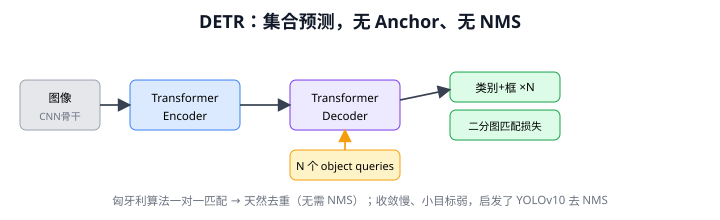

> 📥📤 **输入/输出实例（看一组具体数值）**：输入一张图（无 anchor）→ CNN 特征 + Transformer 编码器/解码器 + **N=100 个 object query**（每个 query 各"认领"一个物体，query 之间互相看自动去重）→ 输出 **100 个预测的集合**，每个 = 类别（含"无物体"∅）+ 框（如 #7→车@(..)、#23→∅、#41→人@(..)，训练用二分图匹配让一物体配一 query）→ 去掉 ∅ → 最终框，**无需 NMS**（query 天然不重复）。范式革新：把检测变成"**预测一个固定大小的集合**"，去 anchor、去 NMS，开创检测 Transformer 路线。

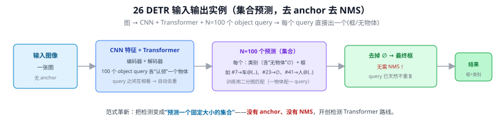

> 📄 **论文原图对照**（图源：Carion et al., *End-to-End Object Detection with Transformers*, [arXiv:2005.12872](https://arxiv.org/abs/2005.12872) Figure 2，原文 [PDF](../papers/28a_DETR_2005.12872.pdf)；仅笔记内学习引用，论文写作须自绘）：

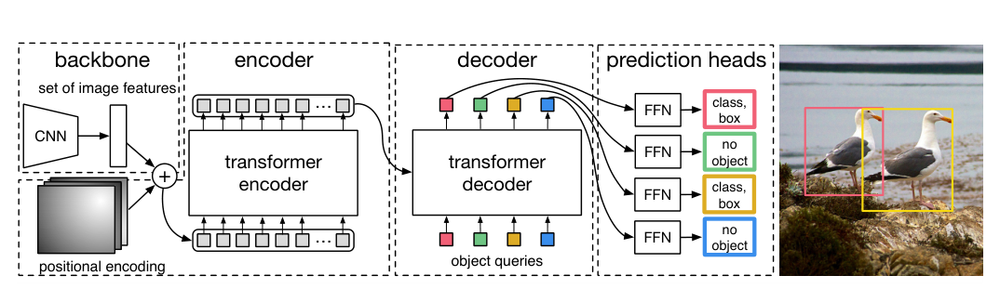

> DETR 流水线：CNN 骨干→Transformer 编解码→N 个 object query 并行出框，集合预测+匈牙利一对一免 NMS（Q72/Q111）。

## 一、提出背景

无论两阶段（Faster R-CNN）还是单阶段（YOLO/SSD），都依赖两个手工组件：**anchor**（预设框）和 **NMS**（后处理去重）。这些组件含大量超参、不可微、且割裂了端到端。DETR 的核心野心：**用一个纯端到端、无 anchor、无 NMS 的网络直接输出一组检测结果**。

它的关键洞见：检测本质是**集合预测**——给定一张图，输出一个无序的 {(类别, 框)} 集合。

---

## 二、核心方法

### 2.1 整体结构

```
图像 ──► CNN骨干(ResNet) ──► 特征图 ──► 加位置编码
                                          │
                              Transformer Encoder（自注意力，建模全局关系）
                                          │
              N 个可学习的 object queries ──► Transformer Decoder
                                          │
                              每个 query ──► FFN ──► (类别, 边框)
                                          │
                                     直接输出 N 个预测（N 固定，如 100）
```

- **Object Queries**：N 个可学习向量，每个负责"问"图中一个潜在目标。Decoder 通过交叉注意力让每个 query 去图像特征里找它该负责的目标。
- 输出固定 N 个预测（多余的预测"无目标"类）。

### 2.2 二分图匹配损失（Hungarian Matching）⭐

DETR 去掉 NMS 的关键：训练时用**匈牙利算法**在 N 个预测和真值之间做**一对一最优匹配**，每个真值只匹配一个预测。这从根本上避免了"多个框预测同一目标"，因此推理时不需要 NMS。

$$
\hat{\sigma} = \arg\min_{\sigma} \sum_i \mathcal{L}_{match}(y_i, \hat{y}_{\sigma(i)})
$$

匹配后再算分类损失 + 框损失（L1 + GIoU）。

---

## 三、优点与局限

**优点**：
- 真正端到端，无 anchor、无 NMS，框架极简优雅
- 全局自注意力，对大目标和遮挡场景表现好
- 开创性，启发了一大批后续工作

**局限**：
1. **收敛极慢**：原版需训练 500 epoch（Faster R-CNN 约 30），因为二分匹配早期不稳定
2. **小目标差**：Transformer 在高分辨率特征上计算量爆炸，原版只用单尺度低分辨率特征
3. 计算开销大

→ **Deformable DETR**（用稀疏可变形注意力，见 17 Deformable Conv 思想）大幅加速收敛并支持多尺度；后续 DINO、DN-DETR 进一步把 DETR 系做到 SOTA。

---

## 四、历史地位

DETR 是检测领域的范式转变之一：证明了不靠 anchor/NMS 也能做好检测，把 Transformer 的"集合预测 + 注意力"带入检测。它的"一对一匹配去 NMS"思想，甚至反过来影响了 CNN 检测器——**YOLOv10 的去 NMS 设计**（见 25 YOLO 演进）就借鉴了这一思路。

---

## 五、与本项目的关系

- 本项目用 YOLOv8（CNN 单阶段，仍用 NMS），不用 DETR——DETR 收敛慢、小目标弱、对小数据集不友好，不适合本项目的小数据量和实时需求。
- **相关工作价值**：DETR 是"检测 Transformer"路线的代表，写第二章时与 YOLO 的"CNN 单阶段"路线对比，能体现对检测技术全景的把握。
- **概念关联**：DETR 的 object query + 交叉注意力机制，与本项目用到的 35 Grounding DINO（基于 DETR 架构的开放词汇检测）一脉相承。理解 DETR 有助于理解 Grounding DINO。

---

## ✏️ 具体实例（走一张图）

**例：DETR 怎么"集合预测"，为什么不需要 NMS**
```
图 → CNN 骨干 → 特征 → Transformer 编码器（自注意力）
  → 解码器：100 个可学习 object query 并行问"我负责哪个目标"
  → 输出固定 100 个预测：每个 = (类别 或 ∅"无物体", 框)
```
设图里真有 3 个目标：训练时用**匈牙利算法（二分匹配）**把 100 个预测和 3 个真值一一最优配对——3 个预测被指派去对上真值，其余 97 个学成 ∅（背景）。

**为什么没有重复框、不用 NMS**：每个真值只被**一个** query 认领（一对一匹配），网络从训练起就学会"一个目标只出一个框"，所以推理时天生不重复 → **省掉 NMS**（对比稠密检测器靠 NMS 去重，见 Q20）。也因为是一对一，DETR 不产生海量负样本 → 没有极端正负不平衡（见 Q25）。代价：训练收敛慢、小目标早期偏弱。

---

## 六、参考文献

- Carion N, et al. *End-to-End Object Detection with Transformers.* ECCV 2020.
- Zhu X, et al. *Deformable DETR: Deformable Transformers for End-to-End Object Detection.* ICLR 2021.
- Zhang H, et al. *DINO: DETR with Improved DeNoising Anchor Boxes.* ICLR 2023.

---

## 📄 论文主线走一遍（Carion et al., ECCV 2020）

> 论文：*End-to-End Object Detection with Transformers*，arXiv:**2005.12872**。
> 本节按**原论文章节顺序**复述一遍（与上文"我帮你消化过的讲法"互补，这里贴着论文骨架走）。
> ⚠️ 配图为**原创重绘**（结构等价于官方图，但为自绘），不复制论文原图；**官方原图请到 arXiv:2005.12872 看**。下文图号按 arXiv 版标注，阅读时以论文为准。

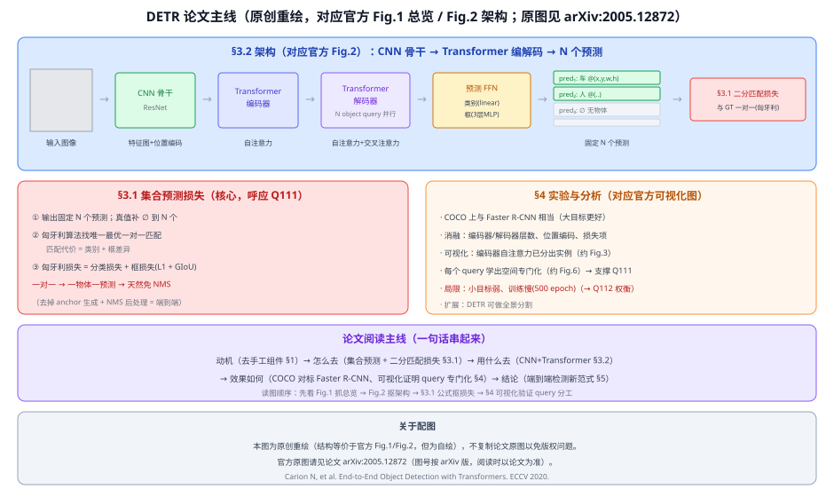

**一句话主旨**：把目标检测重新表述为**直接集合预测（direct set prediction）**，用"二分匹配损失 + Transformer"端到端出框，**去掉 anchor 生成与 NMS 等手工组件**。

**§1 引言（动机）** —— 对应官方 **Fig.1**（pipeline 总览）
现代检测器（Faster R-CNN、YOLO）都依赖手工设计的组件：anchor 先验、NMS 后处理、标签分配规则。DETR 的主张：这些都可以用"**预测一个集合 + 一对一匹配**"替代，让检测真正端到端。Fig.1 就是这条总览：CNN + Transformer → 一组预测 → 与真值二分匹配算损失。

**§3.1 集合预测损失（全文最核心）**
1. 模型输出**固定 N 个**预测（N 远大于图中物体数，如 100）；
2. 把真值补 ∅（"无物体"）到 N 个，用**匈牙利算法**在"N 个预测"与"N 个真值"间找**唯一最优的一对一匹配**（匹配代价 = 类别 + 框差异）；
3. 按匹配对算**匈牙利损失** = 分类损失 + 框损失（**L1 + GIoU**，见 Q75）。
> 一对一 → 一物体只由一个预测负责 → **天然免 NMS**（这正是 [Q111](#q111-detr-凭什么说一个-query-认领一块理论根据是什么)/[Q112](#q112-匈牙利一对一匹配能免-nms那-yolo-也用它不就不用-nms-了) 的理论根）。

**§3.2 架构** —— 对应官方 **Fig.2**（详细结构）
- **CNN 骨干**（ResNet）：图 → 特征图 → 1×1 降维 → **展平成序列** + 加**位置编码**；
- **Transformer 编码器**：对图像序列做自注意力（论文可视化显示编码器已能把不同实例"分开"）；
- **Transformer 解码器**：**N 个 object query**（可学习位置嵌入）**并行**解码，每层做 query 自注意力 + 对编码器输出的交叉注意力；
- **预测 FFN**：每个 query 输出 → 类别（一层 linear）+ 框（3 层 MLP）；
- **辅助损失**：每层解码器后都接预测头 + 匈牙利损失（帮助收敛）。

**§4 实验与分析** —— 对应官方若干可视化图（约 **Fig.3 / Fig.6**）
- **COCO** 上与 Faster R-CNN **相当**（大目标更好、小目标偏弱）；
- **消融**：编码器/解码器层数、位置编码、损失项的作用；
- **可视化**：编码器自注意力已把实例分开（约 Fig.3）；**每个 query 学出空间专门化**——不同 query 负责不同区域/尺寸（约 Fig.6）→ 这就是 [Q111](#q111-detr-凭什么说一个-query-认领一块理论根据是什么) "领地分工"的**论文实证**；
- **局限**：训练慢（**500 epoch**）、小目标弱（→ 后续 Deformable DETR / DINO 改进，也呼应 [Q112](#q112-匈牙利一对一匹配能免-nms那-yolo-也用它不就不用-nms-了) 的收敛权衡）；
- **扩展**：同一套框架可做**全景分割**。

**§5 结论**：DETR 用集合预测 + Transformer 把检测做成端到端，开启"无 anchor、无 NMS"的新范式。

**📖 读这篇论文的建议顺序**：先看 **Fig.1** 抓总览 → **Fig.2** 抠架构 → 回 **§3.1** 抠匹配损失公式（最关键）→ **§4 可视化**验证"query 分工"→ 附录看架构细节。带着一个问题读："为什么一对一匹配就能免 NMS？"（答案在 [Q111](#q111-detr-凭什么说一个-query-认领一块理论根据是什么)）。

---

## 📋 模型答疑（来自模型详解问答）

> 专属本模型的问答集中在此；跨模型的通用问答见答疑总目录。

---

### 🧭 DETR 答疑导航（精修脉络一页纸）

DETR 的问答有 6 条，围绕"query 怎么工作、L 层怎么精修"层层递进。按此顺序读最顺：

| 主题 | 问题 | 一句话 |
|------|------|--------|
| **地基** | [Q72](#q72-detr-的-n-个-object-query-到底是什么又是如何通过交叉注意力去-query-目标的) | object query 是什么、交叉注意力如何 query 目标（含数值走一遍） |
| **纵深六问** | [Q73](#q73-解码器为何重复-l-次query-像-n-个卷积核吗随机-query-怎么靠损失精确匹配又如何互相通气自交叉注意力是不是同主体不同主体) | 为何 L 次 / 像卷积核吗 / 随机 query 怎么匹配 / 互相通气 / 自-交叉判据 |
| **两种迭代 + 精修机制** | [Q74](#q74-query-类比-n-个-anchor-吗既然训练会越来越准能不能不要-l-次精修l-次精修是在一次前向里完成的吗) | query 像 anchor 吗 / 能不能省 L / L 次在一次前向内 ＋ **④ L 层凭什么精修（原 Q76 并入）** |
| **数据流** | [Q77](#q77-第一层-q-是初始化的kv-来自图像编码那第二层的-q-是什么kv-又是什么) | 各层 Q/K/V 从哪来：Q 逐层更新、图像 K/V 全程不变 |
| **理论根据** | [Q111](#q111-detr-凭什么说一个-query-认领一块理论根据是什么) | "一个 query 认领一块" = 匈牙利一对一匹配逼出的涌现分工 |
| **匹配范式** | [Q112](#q112-匈牙利一对一匹配能免-nms那-yolo-也用它不就不用-nms-了) | 一对一能否用于 YOLO 去 NMS（YOLOv10 已做到） |

**主线：自注意力 & 交叉注意力逐层如何精修（一层内部 → L 层串联）**

前提：**图像编码器只跑一次，memory 作 K/V 被全部 L 层共享、永不变；逐层在变的只有 query**——精修不是反复看不同的图，而是**带着越来越准的问题反复问同一张图**（[Q77](#q77-第一层-q-是初始化的kv-来自图像编码那第二层的-q-是什么kv-又是什么)）。一层解码器三步顺序执行：

1. **自注意力（query↔query，同主体）＝分工去重**：N 个 query 互相通气"你盯那辆车、我换一个"，不直接定位、只做协商避让（免 NMS 的根）。
2. **交叉注意力（query↔图像，不同主体）＝看得更准、吸得更准**：Q=分完工的 query、K/V=图像 memory，算相似度让物体那片"亮"，按权重把区域特征加权吸进 query（真正灌入视觉信息）。
3. **FFN+残差＝更新成"更懂自己物体在哪"的新 query**，传给下一层。

L 层串联：L1 query 懵→注意力散→框粗；L2 用更准的 query 重新问图→注意力更聚焦→框收紧；…；L6 注意力压在物体上→框贴合。**关键正反馈**：交叉注意力吸特征 → FFN 更新 query → 更准的 query 让下层交叉注意力落更准 → 再吸更相关特征（Deformable/DINO 显式化成 框_{l+1}=框_l+Δ_l）。**自注意力保证"不重复"、交叉注意力保证"越看越准"，缺一不可**。为什么会发生：不是推理时跑梯度，而是**训练**用匈牙利一对一匹配 + **每层辅助损失（深监督）**把每层的"精修函数"学好了 → 推理前向一遍就逐层收紧（"训练调权重"与"L 层前向精修"正交，[Q74](#q74-query-类比-n-个-anchor-吗既然训练会越来越准能不能不要-l-次精修l-次精修是在一次前向里完成的吗)）。

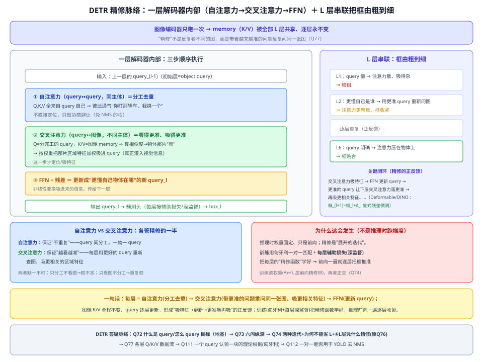

---

## Q72. DETR 的 N 个 object query 到底是什么？又是如何通过交叉注意力去 query 目标的？

- **N 个 object query 是什么**：N 个**可学习向量**（网络参数、非图像算出、非预设框），随机初始化、训练后固定。每个 query = 一个"**检测名额**"：负责去图里找出至多一个物体、填出 (类别, 框)。N（原版 100）是预算上限，图里物体须 <N，多出的学成 ∅（无物体）。
- **怎么交叉注意力 query 目标**：解码器里 query 当查询 Q、编码器输出的图像特征当 K/V；query 和图像每个位置算相似度→注意力权重→加权求和把目标区域特征"吸"回来。喊话式：query 朝整张图问"我的物体在哪？"，权重高的位置就是答案。

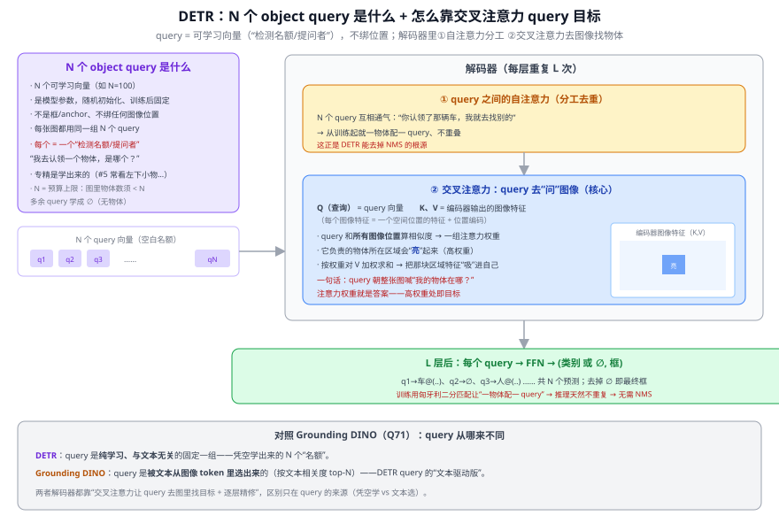

**破误解**：query 不是 anchor（无先验几何、初始随机数）、不是从图像来（固定参数、每张图同一组）、不绑位置（靠交叉注意力吸到某区域才有位置）。训练后每个 query 会**自发专精**（统计上 #5 偏爱左下小物等，是学到的分工倾向、非写死）。

**解码器每层两种注意力**：① **query 自注意力**（query 间互相通气、分工不撞车，是一对一去 NMS 的根）；② **交叉注意力**（query↔图像，真正找目标：Q=query、K/V=图像特征+位置编码，算相似度 softmax→目标区域权重高→加权吸进自身）。逐层 L 次由粗到细精修。

**类别怎么知道（两个输出头）**：query 精修完的向量（256 维，已吸进目标外观）分两路——**分类头**=线性层 256→(K+1) softmax（K=类别数、+1=∅），**框回归头**=3 层 FFN 256→4 出 (cx,cy,w,h)。关键：这是**闭集**分类，类别表训练时焊死（COCO 80+∅），靠匈牙利匹配指派真值+交叉熵教"这种外观判成 car"。这正是与开放词汇的分界——**Grounding DINO 无固定分类器**，靠 query 与文本算相似度、换文本即换类。

**去 NMS**：query 自注意力+训练时一对一匈牙利匹配→一物一框、推理免 NMS。**收敛慢**（原版 500 epoch）：query 随机、与图无关，要靠交叉注意力慢慢学"该看哪"；Deformable DETR 让 query 只看参考点附近少数位置加速。

**数值走一遍**（COCO 80 类、N=100、d=256、图 800×1066，见下图）：图→ResNet→25×34×256→850 个图像 token 作 K/V；盯 q7 当 Q→与 850 个位置算分数 softmax（车所在区权重高合计~0.85）→吸进车外观→×6 层得 z7→分类头 256→81 softmax **car 0.92**、框回归 256→4 出框；100 个 query 里约 97 个学成 ∅ 丢弃→去 ∅ 即最终框、不跑 NMS。

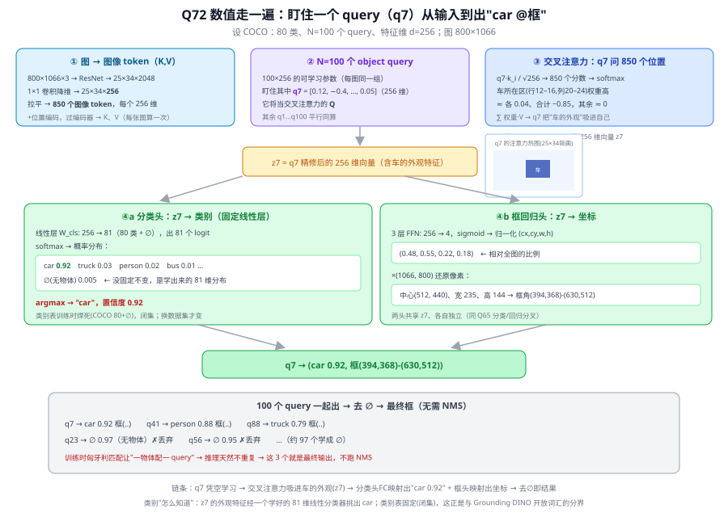

---

## Q73. 解码器为何重复 L 次？query 像 N 个卷积核吗？随机 query 怎么靠损失精确匹配、又如何"互相通气"？自/交叉注意力是不是"同主体/不同主体"？

按你提的六问逐条答。

**1. 解码器为什么重复 L 次（原版 L=6）？**
因为**一次看不准，要迭代对焦**。query 第一次问"我的物体在哪"，注意力还散、框还粗；它据此更新自己，**带着更准的"我是谁/在哪"再问第二次** → 注意力更聚焦 → 框更准……逐层由粗到细。DINO/Deformable 系更是显式迭代：第 $l$ 层预测一个参考框，第 $l{+}1$ 层**从这个框出发**继续修。训练时**每层都接一个预测头算辅助损失**，逼每层都往对的方向走、收敛更稳。所以 L 次 = L 轮"渐进对焦 + query 反复协商分工"。

**2. 像"N 个卷积核提取 N 个特征"吗？——对一半，差别关键**
"N 个各提一份、各自专精"这层**像**；但机制是两码事（04 CNN）：

| | N 个卷积核 | N 个 object query |
|---|---|---|
| 权重 | **固定**，推理不变 | 注意力权重**随图动态**（输入相关） |
| 作用方式 | **每个位置**滑动、权重共享 | 不滑动，靠**注意力**定位 |
| 产出 | 每核出一张**特征图**（H×W 个值） | 每 query 出**一个物体**（一个框） |
| 语义 | 一种**模式**，哪儿出现哪儿激活（**多处**） | 一个**具体实例**，只认领**一个** |

一句话：卷积核是"**一种特征、到处响应**"的静态匹配器；query 是"**一个名额、动态寻址 + 互斥竞争**"的实例槽位。类比别走太远。

**3. "query 和 K/V 越匹配 = 和图像某区域匹配"——对 ✓**
交叉注意力里 query 和每个图像位置算相似度，**它负责的物体那片区域权重高（亮）**、其余 ≈0；"匹配"就是注意力集中到那片区域、把那片特征加权吸进来。补一句：不是死磕一个像素，而是一个**集中在物体上的软分布**。

**4. 随机的 query 怎么靠损失最后精确匹配？（训练机制核心）**
1. **前向**：100 个 query → 100 个预测（类别+框）。
2. **匈牙利二分匹配**：每步训练在"100 预测"与"图里 M 个真值"间算**代价矩阵**（代价 = 分类代价 + 框 L1 + GIoU），求**一对一最优指派**——每个真值**只配一个** query，其余配 ∅。
3. **算损失**：**只有被配中的 query** 被梯度推去预测该真值的类别+框（分类交叉熵 + 框 L1+GIoU）；没配中的推向 ∅。
4. **反复多张图 → 自组织**：按最低代价配对，一个**本就倾向左下出框**的 query 反复被左下真值配中 → 梯度强化该倾向 → 学成稳定"专精槽位"（偏好某区域/尺寸）。随机初始就这样被**梯度逐步捏成**分工明确的 N 个名额。
- 框为何**精确**：L1+GIoU 直接惩罚坐标误差，回归头 + 逐层精修把框压到物体上；
- 为何**免 NMS**：一物体只奖励一个 query → 一物一框；
- 注意：query 不是被**焊死**到某区域，而是学到**先验/倾向**，推理时靠交叉注意力**随实际图像**落到真实物体上。训练 = ①query 学先验 + ②解码器学会读图精修。

**5. N 个 query 如何"互相通气"？**
靠解码器里的 **query 自注意力子层**：这 100 个 query **彼此之间**做注意力（Q、K、V 全来自这组 query），于是每个 query 能"看到"别人当前倾向哪个物体，从而**避让**。两个都飘向同一辆车 → 自注意力让它们察觉重叠、一个退去找别的。这种协商在 L 层里反复进行，配合一对一匹配损失 → 分工不撞车 → 免 NMS 的来源。

**6. "不同主体=交叉注意力、同一主体=自注意力"——对 ✓，这就是判据本身**
判据是"**Q 和 K/V 从哪来**"：
- **自注意力**：Q、K、V 来自**同一组**向量（自己看自己）。例：解码器里 query↔query（第 5 问）、编码器里图像 token↔图像 token。
- **交叉注意力**：Q 来自一方（query）、K/V 来自**另一方**（图像特征）——一问一答、**不同主体**。

DETR 解码器每层**两种都有**：先自注意力（query↔query，分工）→ 再交叉注意力（query↔图像，找物体）；编码器则是自注意力（图像↔图像）。

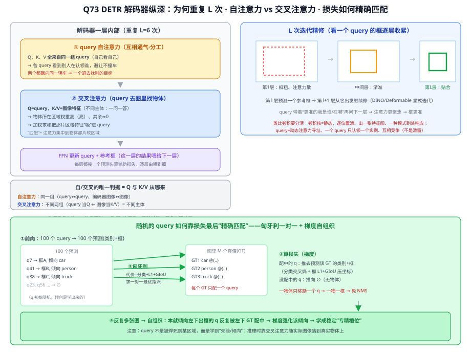

---

## Q74. query 类比 N 个 anchor 吗？既然训练会越来越准，能不能不要 L 次精修？L 次精修是在一次前向里完成的吗？

**先分清两种"迭代"**（易混）：

| | A. 训练迭代 | B. L 层解码器精修 |
|---|---|---|
| 在哪 | 跨很多图/epoch 的前向+反向 | 一次前向内 |
| 做什么 | 梯度下降调权重 | query 依次过 L=6 层、每层精修框 |
| 何时 | 只训练 | 训练+推理都有 |
| 效果 | 模型越来越准 | 单图内框由粗到细 |

"越来越准"指 A、"L 次精修"指 B，两者**正交**。

**1. query 类比 anchor 吗？——挺准**：都是 N 个预测槽位各出类别+框；差别 = anchor 稠密(上万)、固定几何、一 GT 配多 anchor、要 NMS；query 稀疏(100)、可学习、不绑位置、匈牙利一对一、免 NMS。妙的是 DAB-DETR/DINO 直接把 query 重写成"可学习 anchor 框"(4 维)，"query≈动态 anchor"在后续变体字面成立。

**2. L 次精修在一次前向里完成吗？——是**：L=6 是物理堆叠的 6 层解码器，一次前向 query 依次过 L1→L6、每层框收紧；训练推理都走这 L 层（推理只是没损失、读最后一层）。

**能不能不要 L 次？——不能**：训练调的是权重，但推理面对新图仍要靠前向把框定位到这张图的物体上；一层表达力不够，L 层给"每次前向内的深度/容量"逐层由粗到细。类比：ResNet 训好了也不能砍成 1 层——深度是每次前向的表达力，和"训练收敛"两码事。DETR 消融减层数→AP 明显降。

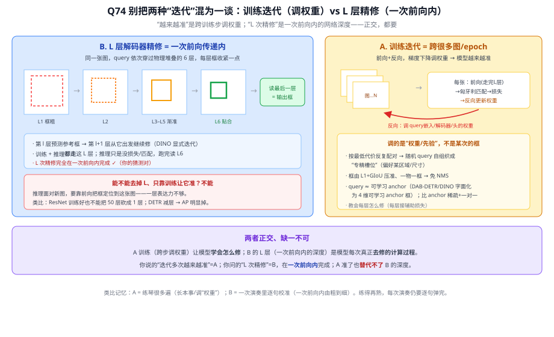

**L 层凭什么能"精修"？三个机制**（不只加深/加非线性、也不只损失）：
- **① 迭代结构**：6 层是同一种操作（自注意力+交叉注意力+FFN）重复 = 把一个迭代更新 unroll 成 6 步，"重复同操作"本身就是精修的结构含义；
- **② 每层再注意 +（变体）参考框残差**：第 1 层注意力散、框粗→更新 query→第 2 层用更好的 query 重查图→落更准→框更准；Deformable/DAB/DINO 更直接 **框(l+1)=框(l)+Δ(l)**（字面精修）；
- **③ 深监督（每层接损失）**：每层解码器后都接预测头+匈牙利损失，逼每个中间层都输出像样的框、形成由粗到细的阶梯（这就是你问的"是不是因为损失"——是一环、非全部）。

**只有损失没结构→有目标没机制；只有结构没深监督→中间层学不到渐准的框；非线性/深度只是表达力底座**（必要不充分）。原版 DETR 精修是隐式（堆叠再注意+辅助损失），Deformable/DAB/DINO 才把参考框残差更新做成显式。

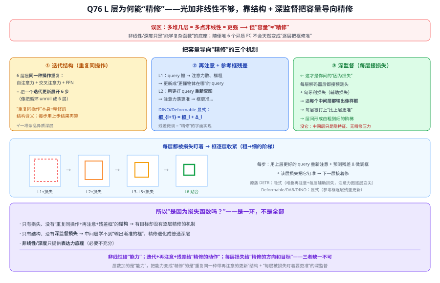

---

## Q77. 第一层 Q 是初始化的、K/V 来自图像编码；那第二层的 Q 是什么、K/V 又是什么？

**第二层的 Q 是什么？**
是**第一层的输出 query**，**不再是初始 query**。第一层的初始 query 经过（自注意力 → 交叉注意力 → FFN）后，**已吸收图像信息、被更新成"更懂自己物体在哪"的新向量**；它就是第二层的输入 Q。此外那组**固定的 object query 位置编码**每层都**重新加一遍**，给每个槽位稳定的"身份"信号——**内容在变、身份标签不变**。

**第二层交叉注意力的 K/V 是什么？**
**和第一层一模一样的图像编码器输出 memory**。图像编码器**只跑一次**，其输出（memory）被**全部 6 层解码器共享复用**、逐层完全不变。所以第 2、3、…层交叉注意力的 K/V 都是同一份图像特征。

**关键洞察（精修的数据流本质）**

| | 逐层变不变 | 来自哪 |
|---|---|---|
| **Q（query）** | **逐层更新** | 上一层输出的 query（+ 每层重加的固定位置编码） |
| **交叉注意力 K/V（图像）** | **全程不变、共享同一份** | 编码器输出 memory（只算一次） |

**证据（图像 K/V）没变，变的只是 query 每层问得更好** → 注意力一层比一层落得准 → 框一层比一层贴合。这就是 [Q74 ④（原 Q76）](#q74-query-类比-n-个-anchor-吗既然训练会越来越准能不能不要-l-次精修l-次精修是在一次前向里完成的吗) 说的"精修"在数据流上的样子。

**补：自注意力那一次**
每层**先**有一次**自注意力**，其 **Q、K、V 全来自 query 自己**（这层的 query 彼此看、分工避让，见 [Q73](#q73-解码器为何重复-l-次query-像-n-个卷积核吗随机-query-怎么靠损失精确匹配又如何互相通气自交叉注意力是不是同主体不同主体)）；**之后**才是交叉注意力（Q=query、K/V=图像 memory）。

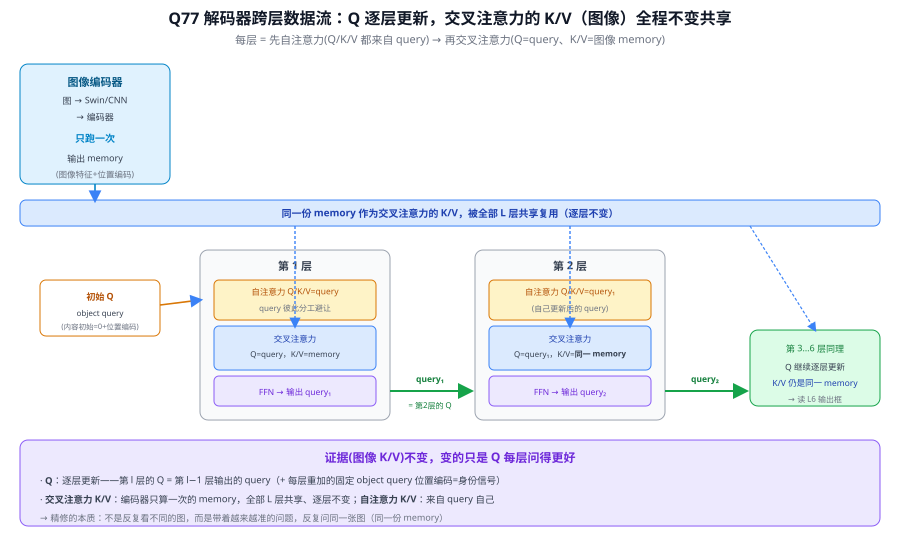

> 精确补注：原版 DETR 里 query 的**内容部分**初始化为 **0**，靠 object query 位置编码注入，经第一层交叉注意力才把图像信息吸进来；严格说"第一层 Q = 0 + object query 位置编码"，第二层起 Q 才带上吸进来的图像内容。日常理解记成"object query 是第一层输入"即可。

---

## Q111. DETR 凭什么说"一个 query 认领一块"？理论根据是什么？

**简答**：初始化时 N 个 object query 只是随机可学习向量，架构里没有任何规则规定"哪个 query 负责哪块"。真正逼出分工的是**匈牙利一对一匹配损失**：DETR 固定输出 N 个预测，算损失前用匈牙利算法在"N 个预测"和"真值补 ∅ 到 N 个"之间找唯一最优的一对一匹配，每个真值只配一个预测、其余被迫预测 ∅。因为一个物体只有一个预测被记功，两个 query 抢同一物体必有一个落空吃高损失 → 梯度把它们推开 → 跨数据集训练后每个 query 漂向自己的专长领地（DETR 原论文 Fig.7 实证了这种空间专门化）。

**展开**：

**① 先破误区：不是架构强制，是"学出来"的**
初始化时 N 个 query 是**随机的可学习向量**，架构里**没有任何一行**规定"query #3 永远负责左上角"。所以"一个 query 领一块"是**训练收敛后涌现（emergent）的分工**，不是硬编码。

**② 理论根据：二分图一对一匹配损失（匈牙利）**
1. **集合预测**：DETR 一次固定吐出 **N 个预测**（N=100），不管图里有几个物体。
2. **匈牙利一对一匹配**：算损失前先把真值补 ∅（"无物体"）到 N 个，用**匈牙利算法**在"N 个预测"和"N 个真值(含∅)"间找**唯一最优的一对一匹配**（匹配代价 = 类别 + 框差异）。每个真值 ↔ 恰好一个预测，其余预测 ↔ ∅。
3. **集合损失（permutation-invariant）**：只看"配对后每对准不准"，不在乎预测的顺序/位置。

**③ 为什么"一对一"就逼出分工（核心推理）**
- 每个真值**只有一个预测被记功**（匹配上 → 低损失）；
- 两个 query 都抢同一物体 → 只有一个能匹配上，另一个必然落空 → 被迫预测 ∅ → 若还固执报物体就吃**高损失**；
- 梯度于是**把两个 query 推开**：别重复覆盖同一块；
- 跨整个数据集反复训练，每个 query 为让"匹配稳定、总损失最小"，会**漂向自己的一块专长领地**（某空间区域 / 某尺寸 / 某类物体）。
- **DETR 原论文 Fig.7 实证**：训练后每个 query 各自学出空间专门化——不同 query 关注画面不同区域、不同框尺寸。

**④ query 自注意力是"通信手段"，匈牙利损失才是"驱动力"**
- 解码器里 query 之间的**自注意力**让它们互相看到、"通气"（你领这个我领那个）= **避免撞车的机制**；
- 但真正**逼**它们分工的**理论根据是匈牙利一对一损失**。自注意力是**使能（enabling）**，匈牙利匹配是**目标（objective）**，两者缺一不可，根在损失。

**⑤ 同时就是 DETR "去 NMS" 的理论根**
对照 anchor 检测器：一个真值被**很多** anchor 匹配（**一对多**）→ 冒出一堆重复框 → 靠 NMS 去重（Q107）。DETR 的**一对一匹配**从损失层面保证"一个物体只由一个预测负责"→ 天然无重复框 → **不需要 NMS**。所以"一个 query 领一块"和"端到端去 NMS"是**同一理论根据（一对一匹配）的两面**。

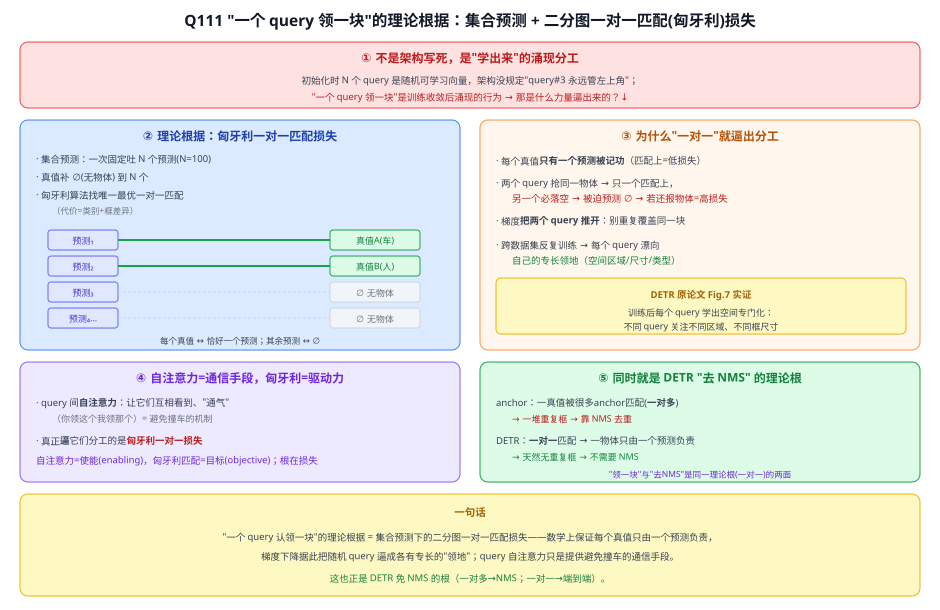

**⑥ 与本项目**：本项目主线是 YOLOv8+CLIP 两阶段（仍用 NMS，见 Q105/Q106），不采用 DETR。但理解"一对一匹配 = 领地分工 + 免 NMS"这条理论线，有助于在相关工作里对比"稠密 anchor+NMS"与"集合预测"两种范式（呼应 Q71 Grounding DINO 也是 query 式）。

---

---

## Q112. 匈牙利一对一匹配能免 NMS，那 YOLO 也用它不就不用 NMS 了？

**简答**：你的想法对。一对一匹配从损失层面保证"一物体一预测"，确实能去掉 NMS，而且 YOLOv10 已把它做进 YOLO。但一对一带来"监督稀疏 → 收敛慢/掉精度"和"稠密头难挑唯一赢家"两个真实困难——这正是经典 YOLO(v1~v8) 长期用"一对多 + NMS"（训得快又准）、直到 YOLOv10 才用双分配去 NMS 的原因。

**展开**：

**① 你的想法已经实现（真实研究方向）**
- **YOLOv10（2024）**：一致的双重分配（consistent dual assignments）→ 用一对一匹配做到推理时 NMS-free，跟你说的一样；
- 更早 **OneNet / DeFCN（2021）** 证明稠密 CNN 检测器用一对一标签分配也能去 NMS；**RT-DETR（2023）** 把 DETR 做到实时。
- 所以答案是"**能，且做到了**"。真正的问题是——为什么经典 YOLO 一直留着 NMS、直到 v10 才这么干？

**② 三个代价**

**代价①：一对一监督太"稀疏" → 收敛慢、精度易掉（最关键）**
- 一对一：每个真值**只监督一个预测** → 正样本极少 → 梯度稀薄 → **收敛极慢**（DETR 要 500 epoch，YOLO 通常 100~300）。
- 一对多：每个真值配**很多** anchor/网格点当正样本 → 监督丰富 → **收敛快、对小目标友好**。
- **核心权衡**：一对一 = 干净免 NMS 但监督稀疏；一对多 = 监督丰富但产生重复框 → 靠 NMS 收尾。长期后者又快又准，所以 YOLO 一直用它。

**代价②：稠密 CNN 头难"选出唯一赢家"**
- DETR 一对一能成，很大程度靠 **query 之间的自注意力**——预测互相通气、抑制去重（[Q111](#q111-detr-凭什么说一个-query-认领一块理论根据是什么)）；
- 纯稠密 CNN 头：相邻网格点**特征几乎一样、彼此又不通信** → 两个挨着的格子都对同一物体开火 → **没 NMS 就重复**。
- 所以稠密检测器要去 NMS，得额外补机制：要么加"预测间交互"，要么设计精细匹配规则强行只让一个格子中标。

**代价③（其实是解法）：YOLOv10 两者都要、再调一致**
- **训练时**同时挂一个**一对多头**（给丰富监督、保收敛与精度）+ 一个**一对一头**（为免 NMS）；
- 用"**一致匹配度量**"让两个头对同一物体挑中同一正样本、不打架；
- **推理时只用一对一头** → 无重复框 → **不用 NMS**，还保住精度。把"一对多的监督"和"一对一的干净"调和到一致，就是它的核心贡献。

**③ 两种匹配范式对比**

| | 一对多 + NMS（经典 YOLO） | 一对一（DETR / YOLOv10） |
|---|---|---|
| 监督信号 | 丰富（每 GT 多正样本） | 稀疏（每 GT 一个） |
| 收敛 | 快 | 慢（DETR 500 epoch） |
| 需要 NMS | 要 | **不要** |
| 去重靠什么 | 后处理 NMS | 损失层面一对一 + 预测间交互/一致匹配 |

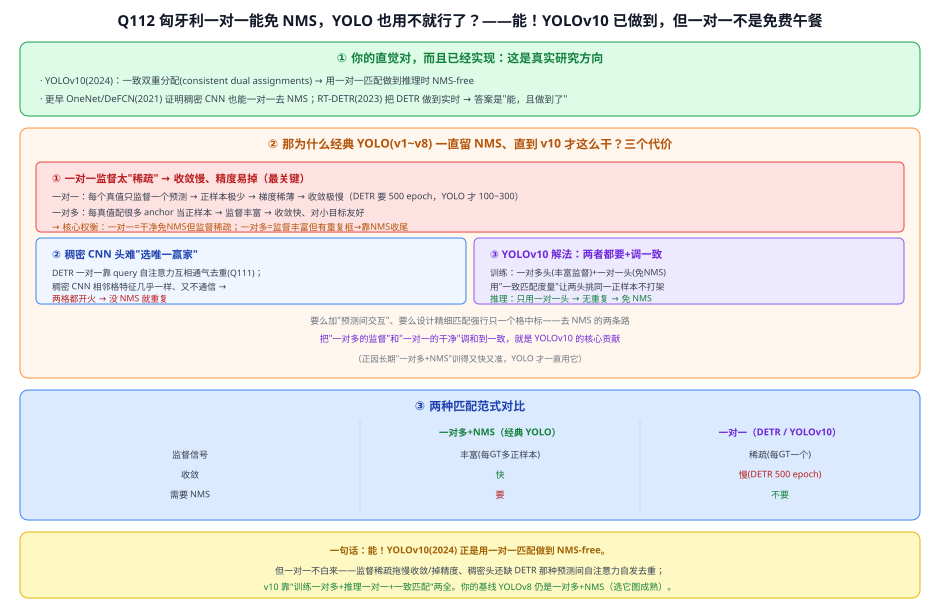

**④ 与本项目**：本项目基线 **YOLOv8 仍是一对多（TaskAligned Assigner）+ NMS**（Q106），选它是图**社区成熟、稳定**（CLAUDE.md 决策）；YOLOv10 虽 NMS-free 但更新、生态尚浅，作"演进参考"而非主线（25e）。理解这条"一对多→一对一"的匹配范式演进，能在相关工作里把 DETR 与 YOLO 演进串成一条线。

---
