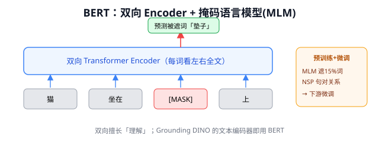
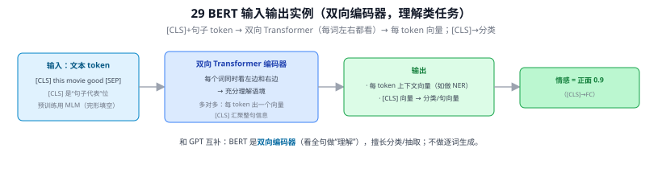
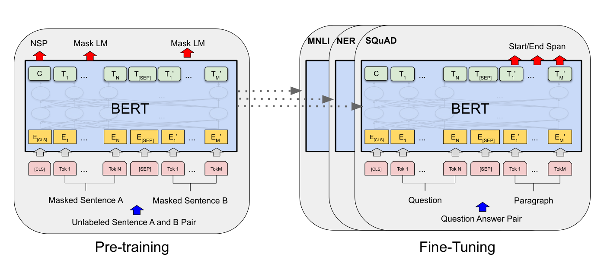
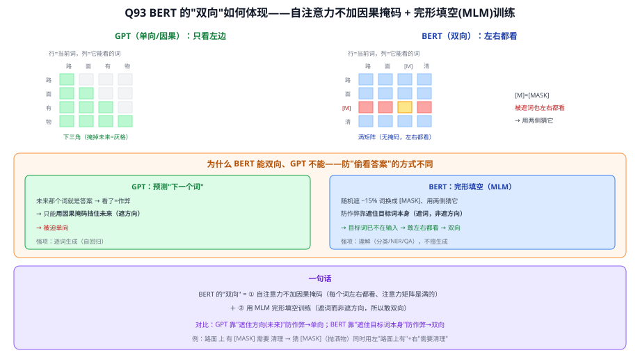
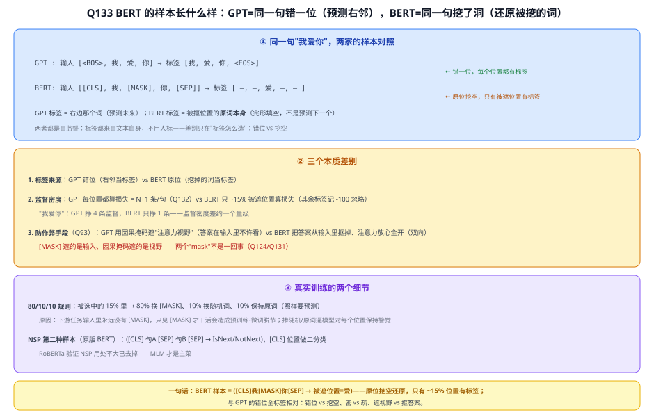
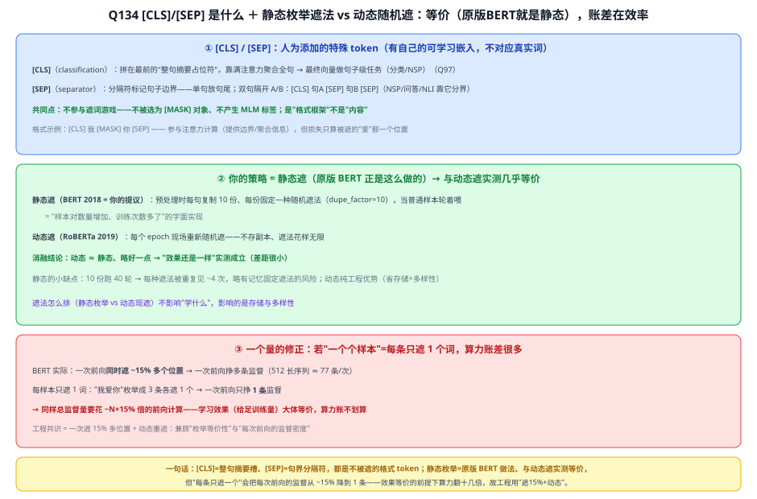

# 29 BERT（Bidirectional Encoder Representations from Transformers）

> 定位：把"预训练 + 微调"范式带入 NLP 的里程碑，双向 Transformer 编码器。
> 作者：Devlin 等（Google），NAACL 2019（2018 公布）。
> **输入 / 输出**：文本 token 序列（[CLS]+句子）→ 每 token 上下文向量；[CLS] → 分类 / 句向量

---



> 📥📤 **输入/输出实例（看一组具体数值）**：输入文本 token `[CLS] this movie good [SEP]`（`[CLS]` 是"句子代表"位）→ **双向 Transformer 编码器**（每个词同时看左边和右边、充分理解语境，预训练用 MLM 完形填空）→ 输出：① 每个 token 的上下文向量（如做 NER 命名实体识别）；② **`[CLS]` 向量 → 分类**（情感"正面" 0.9）或当句向量。和 GPT 互补：BERT 是**双向编码器**（看全句做"理解"），擅长分类/抽取，不做逐词生成。



> 📄 **论文原图对照**（图源：Devlin et al., *BERT: Pre-training of Deep Bidirectional Transformers*, [arXiv:1810.04805](https://arxiv.org/abs/1810.04805) Figure 1，原文 [PDF](../papers/29_BERT_1810.04805.pdf)；仅笔记内学习引用，论文写作须自绘）：



> 两阶段范式：左=MLM+NSP 预训练（Q93/Q133 的样本形式）→ 右=换小头微调各任务（Q95）；[CLS]/[SEP] 见 Q97/Q134。

## 一、提出背景

Transformer（28）提供了强大架构，但如何利用海量无标注文本？此前的语言模型（如 GPT-1）是**单向**的（只能从左往右看），理解任务（如问答、情感分析）其实需要**同时看左右上下文**。BERT 提出：用双向 Transformer 编码器，在大规模无标注语料上预训练，再在下游任务上微调。

---

## 二、核心方法

### 2.1 双向编码

BERT 只用 Transformer 的 **Encoder**（自注意力是双向的，每个词能看到左右所有词）。这与 GPT 的单向 Decoder 形成对比：

```
BERT:  [双向]  "猫坐在 ___ 上"   ← 能同时利用左右文预测
GPT:   [单向]  "猫坐在垫子"→ "上"  ← 只能从左往右
```

### 2.2 两个预训练任务

**① 掩码语言模型（MLM, Masked Language Model）⭐**
随机遮住 15% 的词，让模型根据上下文预测被遮的词。这迫使模型学习双向上下文表示。这是 BERT 区别于 GPT 的关键——MLM 天然需要双向信息。

**② 下一句预测（NSP, Next Sentence Prediction）**
判断两句话是否前后相邻，学习句子间关系（后续研究 RoBERTa 发现 NSP 可去掉）。

### 2.3 预训练 + 微调范式 ⭐

```
预训练：海量无标注文本 ──MLM+NSP──► 通用语言表示（一次，昂贵）
微调：  加一个任务头 ──少量标注数据──► 适配具体任务（多次，便宜）
```

一个预训练好的 BERT，换个输出头 + 少量数据，就能在问答、分类、NER 等任务上达到 SOTA。这套"预训练大模型 + 下游微调"范式，定义了之后整个领域的玩法。

---

## 三、历史地位

- BERT 在 11 项 NLP 任务上刷新 SOTA，引爆"预训练语言模型"热潮。
- 确立"自监督预训练 + 微调"范式——这一思想同样是 33 CLIP（图文预训练）、视觉自监督（MAE）的精神内核。
- 变体众多：RoBERTa（更大数据/去 NSP）、ALBERT（参数共享）、DistilBERT（蒸馏）、ELECTRA（替换检测）。

**局限**：BERT 是编码器，擅长**理解**任务，不擅长**生成**（不能自回归生成文本）——生成由 GPT 系（30）主导。

---

## ✏️ 具体实例（动手走一遍）

**例：掩码语言模型（MLM）预训练任务**
输入一句话，随机遮住 15% 的词，让模型根据**双向上下文**填空：
```
输入：  路面 上 有 一块 [MASK] 需要 清理
目标：  [MASK] = "抛洒物"
```
BERT 同时看左边（"路面上有一块"）和右边（"需要清理"）来预测——这正是"双向"的含义（GPT 只能看左边）。还有 NSP 任务判断两句是否相邻。

**例：下游怎么用（迁移）**
预训练完，接一个小输出头微调即可：
- 句子分类：取 `[CLS]` 位置的向量 → 接一层 → 类别；
- 序列标注（如 NER）：每个 token 的输出向量 → 接一层 → 标签。

"大语料预训练 + 小数据微调"这套范式，与本项目用**预训练 YOLOv8/CLIP 再微调**同源（见 Q13）。

---

## 五、参考文献

- Devlin J, et al. *BERT: Pre-training of Deep Bidirectional Transformers for Language Understanding.* NAACL 2019.
- Liu Y, et al. *RoBERTa: A Robustly Optimized BERT Pretraining Approach.* 2019.

---

## 📋 模型答疑（来自模型详解问答）

> 专属本模型的问答集中在此；跨模型的通用问答见答疑总目录。

---

## Q93. BERT 的"双向编码器"，这个"双向"是如何体现的？

**一、机制：自注意力不加因果掩码**

| | 注意力能看的范围 | 注意力矩阵形状 |
|---|---|---|
| GPT（单向/因果） | 只看左边（≤ i） | 下三角（掩掉未来） |
| **BERT（双向）** | **左右都看（全句）** | **满矩阵（无掩码）** |

"双向"就体现在**注意力矩阵是满的、不是下三角**——每个词都能把左右两边的信息都吸进自己的表示。

**二、为什么 BERT 能双向、GPT 不能（防作弊方式不同）**
- **GPT 预测"下一个词"**：未来那个词**就是答案**，看了=作弊 → 只能**用因果掩码挡住未来（遮方向）** → 被迫**单向**。
- **BERT 玩"完形填空"（MLM）**：随机遮住 ~15% 的词换成 `[MASK]`，用**两边上下文**猜被遮的词。防作弊靠**"把目标词本身遮掉"**（换 `[MASK]`），而**不是**"限制看的方向"——目标词已不在输入里，所以**可以放心左右都看** → **双向**。

一句话对比：**GPT 靠"遮住方向(未来)"防作弊 → 单向；BERT 靠"遮住目标词本身"防作弊 → 能双向。**

**三、举例 + 意义**
完形填空式：`路面 上 有 [MASK] 需要 清理` —— 猜 `[MASK]`（如"抛洒物"）时，BERT **同时用左边"路面上有"和右边"需要清理"** 两侧线索。
- **好处**：每个词的最终表示都融合**全句（左右）上下文** → 特别适合**理解类任务**（文本分类、命名实体识别、问答）；
- **代价**：BERT **不能像 GPT 那样逐词生成**——它不是自回归的，强项是"读懂"、不是"写出"。

> **一句话**：BERT 的"双向" = **自注意力不加因果掩码（每个词左右都看）** + **用 MLM 完形填空训练（遮词而非遮方向，所以敢双向）**。它换来"深度理解全句"，但放弃了"逐词生成"。



---

## Q95. BERT 训练玩完形填空，怎么就"适合文本分类"了？

**逻辑链：预训练（学通用理解）→ 微调（适配具体任务）**
1. **预训练（MLM，海量无标注）**：填空只是"练习"，逼模型学会**理解语言**、产出**通用文本编码器**——留下来的是"会理解文本的编码器"，不是"会填空"这件事本身。
2. **微调（少量有标注）**：取 `[CLS]` 向量（整句摘要）→ 接一层线性分类头 → 少量标注数据微调到位。同理可做 NER、问答（都是"理解类"）。

**类比**：MLM 像"做填空题练语文"；练好后你能做的不只填空——阅读理解、判断、分类都行，因为真正学到的是"**理解**"，填空只是练习方式。

> **一句话**：**填空是训练的"游戏"，留下来的是"会理解文本的编码器"；分类复用的是这份理解，不是填空本身。** 这就是"**预训练（无标注学通用表示）→ 微调（有标注适配任务）**"的迁移学习经典范式——和本项目直接**拿 CLIP 预训练权重**做零样本识别是同一思路（大规模预训练 → 下游少改甚至不改就能用）。

![Q95 BERT 预训练(MLM学理解)→微调([CLS]+小头适配分类)；填空是手段、理解才是目的](../figures/Q95_pretrain_finetune.svg)

---

## Q97. `[CLS]` token 就是为了分类？它是怎么实现的？

**实现四步**
1. **拼 `[CLS]` 到最前**：`[CLS] 路面 上 有 抛洒物`；`[CLS]` 的嵌入是一个**可学习向量**（无真实词义）。
2. **一起过 Transformer 层**：自注意力是满的 → `[CLS]` attend 到所有词 → 把全句信息**聚合进自己**。
3. **取 `[CLS]` 最终向量 → 分类头**（小线性/MLP）→ 类别。
4. **训练**（预训练 + 微调）逼 `[CLS]` 学成好用的"整句摘要"。

**为什么用专门 token 而非"平均所有 token"**：`[CLS]` **内容中立、可学习**，不偏向任何词，靠注意力学"该汇总什么"；平均（mean pooling）也可行——`[CLS]` 只是经典设计、不是唯一选择。

**它是怎么"学成"摘要的（有明确标签 + 损失，逐渐molded）**：`[CLS]` **不是天生会分类**，它是个内容中立的空槽——是**标签 + 分类损失**把它训成"类别摘要"（同卷积核自长成边缘探测器的涌现道理，Q5）。分类训练时每个样本有**真实类别标签**：`[CLS]`→分类头→softmax→预测→与标签算**交叉熵**→反向传播，梯度**逐渐**把 `[CLS]` 初始向量、它的注意力权重（怎么加权聚合 patch）、整个编码器一起捏好。**学成什么取决于训练目标**：ViT 预训练即有监督分类（ImageNet 标签）→ `[CLS]` 直接学成类别摘要；BERT 的 MLM 预训练给 `[CLS]` 的是 NSP 自监督二分类信号（先学粗粒度句表示），到具体分类任务再靠**微调时的明确标签**把 `[CLS]`+新分类头训到位。

> **一句话**：`[CLS]` = 一个可学习、内容中立的"**整句摘要**"槽；靠满注意力把全序列聚合进自己，取它的最终向量接分类头做**序列级任务**（分类为主）；token 级任务用各 token 自己的向量。**ViT 也照搬这套**（图切 patch 当 token + 一个 `[CLS]`，用 `[CLS]` 输出做图像分类，见 Q98）。

![Q97 [CLS]：拼到最前的可学习摘要槽→满注意力聚合全句→取最终向量接分类头；主要供序列级任务](../figures/Q97_cls_token.svg)

**⑤ 补充：句向量到底是什么，裸的 [CLS] 向量直接拿去用好不好用（2026-07-21 追问）**

"句向量"不是某个固定算法，而是一种**接口约定**——不管输入句子多长、切出多少个 token，都压缩成**一个固定长度的向量**（维度=隐藏层维度，如 BERT-base 768 维）去代表整句话，供"需要一个向量比较/分类/检索"的任务使用。BERT 默认就是用 `[CLS]` 最终向量充当句向量（本 Q 讲的机制）。**但有个容易忽略的坑**：只做完 MLM+NSP 预训练、没有针对具体任务再微调的 `[CLS]` 向量，直接拿去做"计算两句话余弦相似度"这类任务，效果其实并不好（有研究发现甚至不如简单的词向量平均）——原因是 MLM/NSP 这两个预训练任务，从来没有教过 `[CLS]` "语义越像的两句话，向量夹角要越小"这件事，`[CLS]` 只是被这两个任务捏成对它们**自己**有用的样子，不代表天然适合做向量空间的相似度比较。这正是后来出现 **Sentence-BERT（SBERT）** 的原因——用孪生网络结构 + 专门的相似度/对比学习目标去微调，逼迫句向量真正满足"语义越像、余弦相似度越高"；SBERT 论文实测发现效果最好的是对**所有 token 向量取平均（mean pooling）**而非只用 `[CLS]`，呼应上面"`[CLS]` 非唯一、mean pooling 也可行"这句话的另一面。**一句话**：`[CLS]` 好不好用取决于有没有针对性训练过——分类任务里有监督标签+分类头微调过，`[CLS]` 就好用（本 Q 讲的场景）；但没专门为"相似度"训练过的裸 `[CLS]`，不能直接假设它适合语义相似度/检索，这类需求要用 Sentence-BERT/SimCSE 这类专门微调过的句向量模型。

---

## Q133. 类比 GPT 的 (BOS我爱你 → 我爱你EOS)，BERT 的样本对长什么样？

**简答**：
```
原句:      我 爱 你
GPT  样本:  输入 [<BOS>, 我, 爱, 你]           → 标签 [我, 爱, 你, <EOS>]   ← 错一位，每位置有标签
BERT 样本:  输入 [[CLS], 我, [MASK], 你, [SEP]] → 标签 [—, —, 爱, —, —]      ← 原位挖空，只遮的位置有标签
```
GPT 预测右邻（未来），BERT 还原被挖的词（原位）；都是自监督、标签免费。

**展开**：

**① 三个本质差别**
1. **标签来源方式**：GPT 是**错位**——标签=右边那个词（预测未来）；BERT 是**原位挖空**——随机选 ~15% 的词抠掉换 `[MASK]`，标签=被抠位置的原词本身。完形填空不是预测下一个。
2. **监督密度差一个量级**：GPT 一条 N token 序列产生 **N+1 条**信号（Q132，每位置都算损失）；BERT 只有被遮的 **~15%** 位置算损失，其余位置标签留空（工程上记 -100，交叉熵忽略）。同一句"我爱你"：GPT 挣 4 条监督、BERT 只挣 1 条——这是 MLM 训练效率低于自回归的原因之一。
3. **防作弊手段不同**（[Q93](#q93-bert-的双向编码器这个双向是如何体现的)）：GPT 靠**因果掩码**遮"注意力的视野"（答案就在输入里、不许看）；BERT 把**答案本身从输入里抠掉了**，注意力可以放心全开（双向满视野）。注意 `[MASK]` 遮的是**输入**、因果掩码遮的是**视野**——两个"mask"不是一回事（Q124/Q131 的老话题第三次出现）。

**② 真实训练的两个细节**
- **80/10/10 规则**：被选中的 15% 里，80% 换 `[MASK]`、10% 换**随机词**、10% **保持原词**（但照样要预测）。原因：下游任务的输入里**永远不会出现 `[MASK]`**——若模型只在见到 `[MASK]` 时才认真提特征，预训练和微调就脱节；掺随机词和原词逼它对**每个**位置都保持警觉。
- **NSP（原版 BERT 的第二种样本）**：`([CLS] 句A [SEP] 句B [SEP] → IsNext/NotNext)`——一半样本 B 是 A 的真实下一句、一半随机抽，用 `[CLS]` 位置（[Q97](#q97-cls-token-就是为了分类它是怎么实现的)）做二分类。后来 RoBERTa 验证 NSP 用处不大、去掉了——**MLM 才是主菜**。

**③ 把样本逐条列出来（2026-07-08 追问补充）**

GPT：一句"我爱你"产出 **4 条**样本，且**在同一次前向里同时完成**（Q126）：

| # | 输入（前缀） | 标签（预测下一个） |
|---|-------------|------------------|
| 1 | `<BOS>` | 我 |
| 2 | `<BOS>` 我 | 爱 |
| 3 | `<BOS>` 我 爱 | 你 |
| 4 | `<BOS>` 我 爱 你 | `<EOS>` |

BERT：一次训练遍历只产出**被遮位置那几条**（假设这次遮中"爱"）：

| # | 输入 | 标签 |
|---|------|------|
| 1 | `[CLS]` 我 `[MASK]` 你 `[SEP]` | 位置3 = 爱 |

就这 1 条——没被遮的位置不产生任何监督。但 BERT 的账要**跨轮次**算：每个 epoch 重新随机遮，同一句话在不同轮次变成不同样本：

| 轮次（示意） | 输入 | 标签 |
|---|------|------|
| 第 1 轮遮"爱" | `[CLS]` 我 `[MASK]` 你 `[SEP]` | 位置3 = 爱 |
| 第 2 轮遮"我" | `[CLS]` `[MASK]` 爱 你 `[SEP]` | 位置2 = 我 |
| 第 3 轮遮"你" | `[CLS]` 我 爱 `[MASK]` `[SEP]` | 位置4 = 你 |
| 某轮命中 10% 随机替换 | `[CLS]` 我 **狗** 你 `[SEP]` | 位置3 = 爱（要求纠错） |
| 某轮命中 10% 保原词 | `[CLS]` 我 爱 你 `[SEP]` | 位置3 = 爱（照样预测） |

> 最准确的对比：**GPT 的 4 条是"一次前向内并行摊开"，BERT 的多条是"跨轮次靠随机重遮攒出来"**——单次密度 4:1，BERT 多跑几轮也能把每个词遮一遍（MLM 更费轮数的原因之一）。



**④ 一句话**
BERT 样本 = **([CLS] 我 [MASK] 你 [SEP] → 被遮位置=爱)**：同一句话和"自己挖了洞的版本"配对、还原被挖的词，只有 ~15% 位置有标签；对照 GPT 的"同一句话和自己错一位"——**错位 vs 挖空、密 vs 疏、遮视野 vs 抠答案**，但同为自监督、标签都免费。

---

## Q134. Q133 样本里的 [CLS]/[SEP] 是什么？如果不按轮次随机遮、而是预先枚举成一个个固定样本，效果是不是一样？

**简答**：[CLS] 是句首的"摘要槽"、[SEP] 是句子边界分隔符，都是人为特殊 token、不参与遮词也不产生标签。静态枚举遮法与每轮随机遮效果几乎一样——原版 BERT 就是静态预生成（每句 10 份固定遮法），RoBERTa 换动态遮只略好一点；但注意别把"枚举"做成"每条只遮一个词"——那会把每次前向的监督密度从 ~15% 降到 1 条，效果等价的前提下算力翻十几倍。

**展开**：

**① [CLS] / [SEP]：格式框架，不是内容**
- **[CLS]**（classification）：拼在**最前**，内容中立、嵌入可学习；靠双向满注意力把全句信息聚进自己，最终向量供句子级任务（分类、NSP 二分类）使用（[Q97](#q97-cls-token-就是为了分类它是怎么实现的)）。在 MLM 样本里只是"在场"。
- **[SEP]**（separator）：标记句子边界——单句 `[CLS] 句A [SEP]`；双句 `[CLS] 句A [SEP] 句B [SEP]`，NSP 和下游问答/NLI 靠它知道 A 在哪结束、B 从哪开始。
- 共同点：**不参与遮词游戏**——不会被选为 [MASK] 对象、不产生 MLM 标签；参与注意力计算（提供边界信息/聚合），但损失只算被遮的内容词位置。

**② 你的"预先枚举成固定样本" = 静态遮 = 原版 BERT 的做法**
原版 BERT（2018）在**预处理阶段**就把每句复制 **10 份**、每份固定一种随机遮法（`dupe_factor=10`），训练时当普通样本轮着喂——正是"样本对数量增加、训练次数多了"的字面实现。RoBERTa（2019）改成**动态遮**（每个 epoch 现场重新随机遮），消融实验结论：**动态 ≈ 静态、略好一点**。所以"效果还是一样"在实测上成立；动态的真正优势是工程性的——不存 10 份副本、遮法花样无限（静态 10 份跑 40 轮，每种遮法被重复见 ~4 次，略有记忆固定遮法的风险）。**遮法怎么排（静态枚举 vs 动态现遮）不影响"学什么"，影响的是存储与多样性。**

**③ 一个量的修正：别把"枚举"做成"每条只遮一个词"**
BERT 实际是**一次前向同时遮 ~15% 的多个位置**——512 长的序列一次挣约 77 条监督。若枚举成"每条样本只遮 1 个词"（"我爱你"拆 3 条各遮 1 个），一次前向只挣 **1 条**监督：同样的总监督量要花约 N×15% 倍的前向计算。学习效果（给足训练量）大体等价，**算力账差十几倍**。工程共识 = **一次遮 15% 多位置 + 动态重遮**：兼顾你说的"枚举等价性"与每次前向的监督密度。



**④ 一句话**
[CLS] = 整句摘要槽、[SEP] = 句界分隔符——都是不被遮的格式 token；你的"预先枚举固定遮法"就是原版 BERT 的静态遮，与动态遮实测等价（动态略好、纯工程优势）；唯一要补的量是"每次遮多个（15%）"——遮法怎么排不影响学什么，影响每次前向挣几条监督。

---
