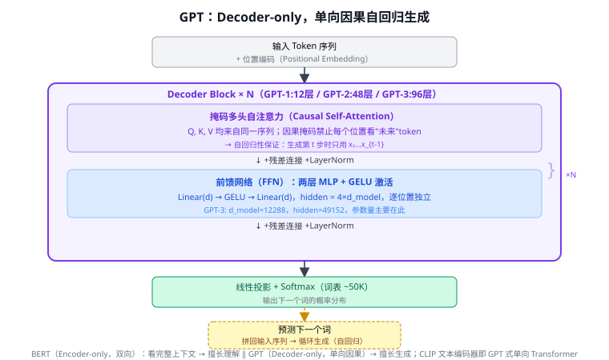
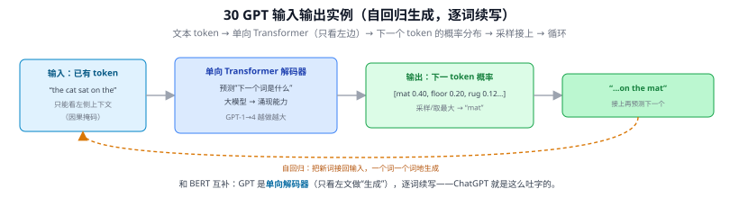
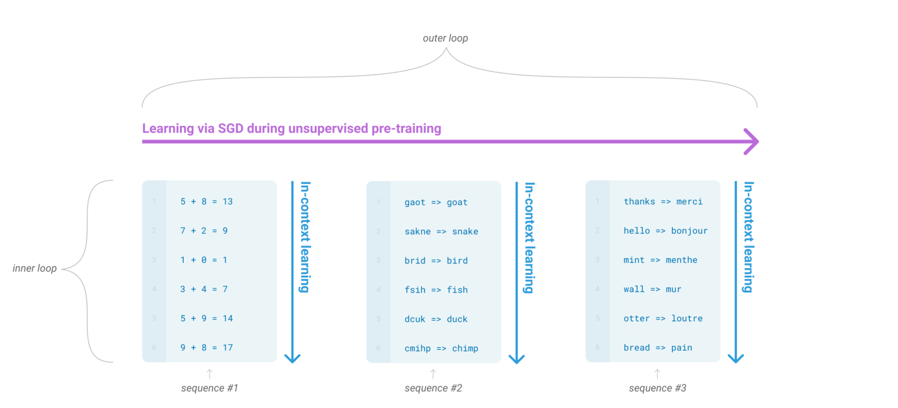
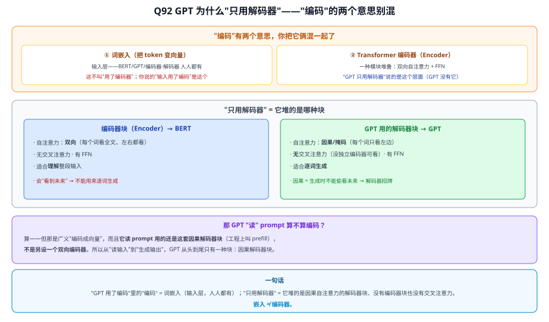
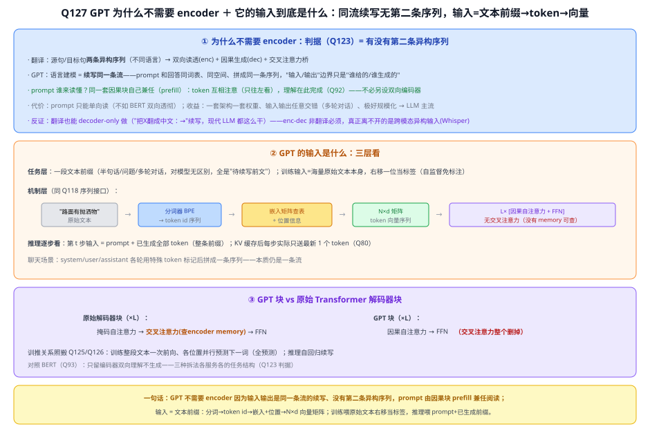
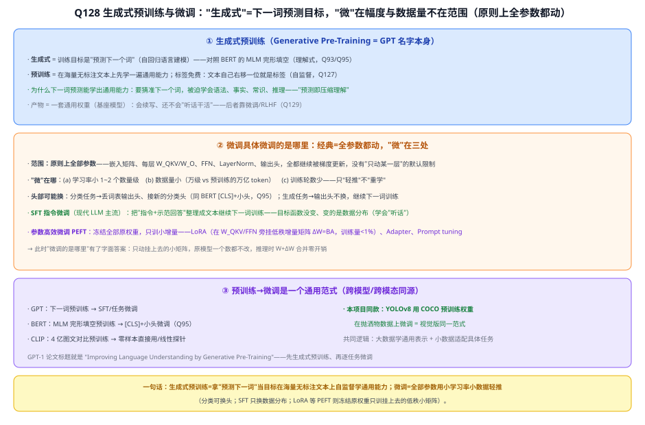
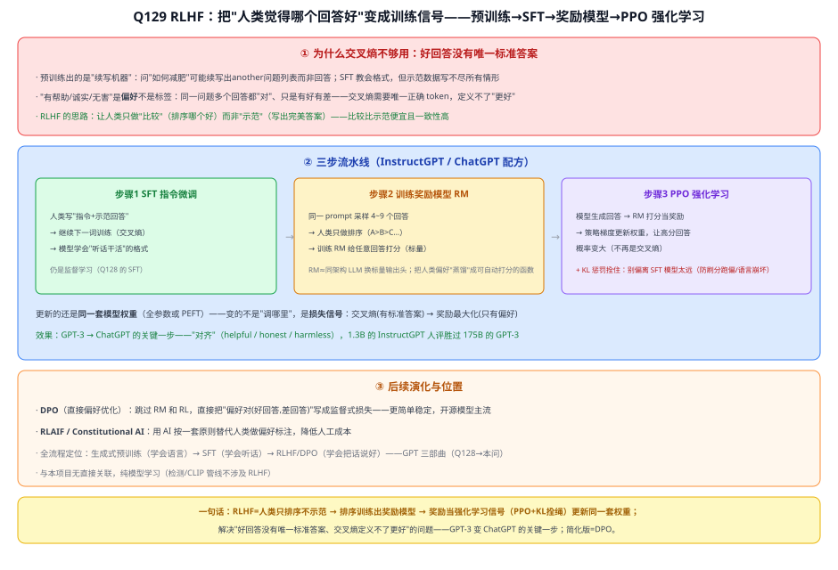
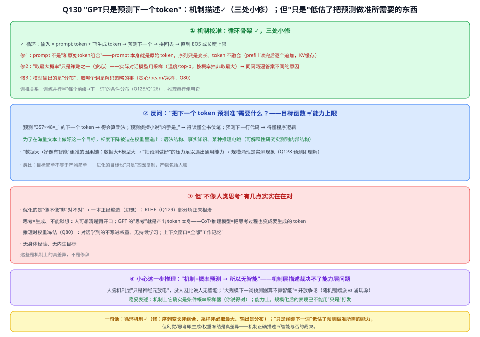
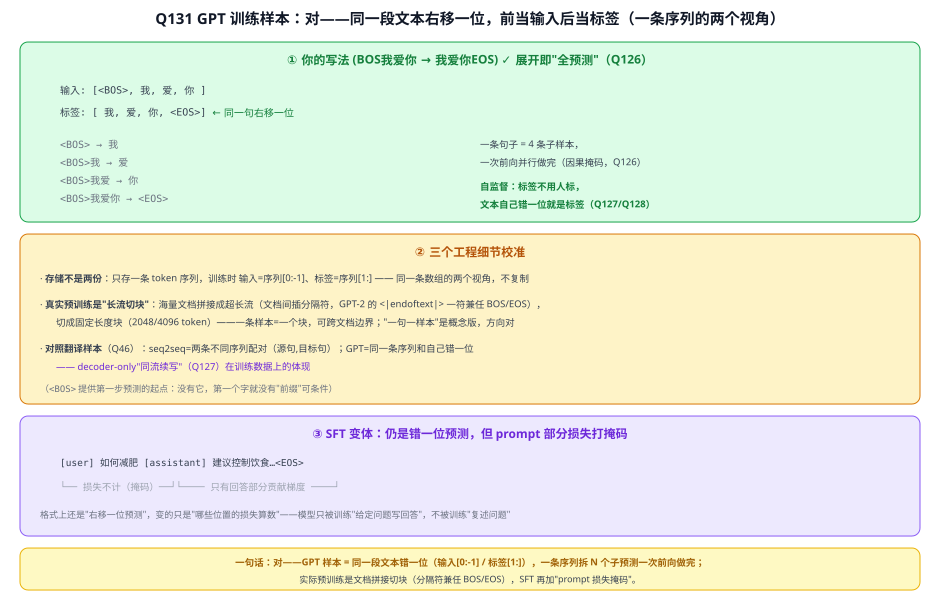
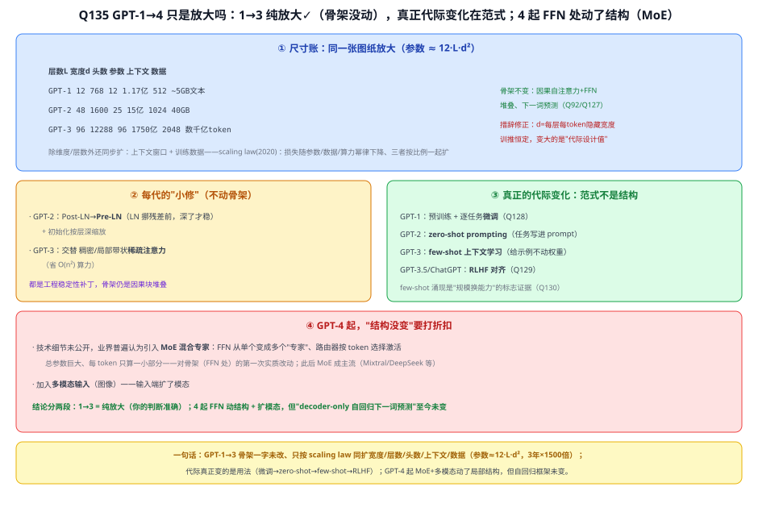

# 30 GPT 系列（Generative Pre-trained Transformer）

> 定位：自回归生成式语言模型的代表，"大模型 + 涌现能力"的旗帜。
> 作者：OpenAI，GPT-1（2018）→ GPT-2（2019）→ GPT-3（2020）→ GPT-4（2023）。
> **输入 / 输出**：文本 token 序列 → 下一个 token 的概率分布（自回归生成）

---



> 📥📤 **输入/输出实例（看一组具体数值）**：输入已有 token "the cat sat on the"（只能看左侧上下文，因果掩码）→ **单向 Transformer 解码器**（预测"下一个词是什么"，大模型涌现能力）→ 输出**下一个 token 的概率分布** $[\text{mat }0.40,\text{floor }0.20,\text{rug }0.12,\dots]$ → 采样/取最大 → "mat" → 接成 "…on the mat" → **把新词接回输入，循环逐词生成**（自回归）。和 BERT 互补：GPT 是**单向解码器**（只看左文做"生成"）——ChatGPT 就是这么吐字的。



> 📄 **论文原图对照**（图源：Brown et al., *Language Models are Few-Shot Learners*, [arXiv:2005.14165](https://arxiv.org/abs/2005.14165) Figure 1.1，原文 [PDF](../papers/30_GPT3_2005.14165.pdf)（GPT-4 报告 [PDF](../papers/30_GPT4_2303.08774.pdf)；GPT-1/2 未挂 arXiv）；仅笔记内学习引用，论文写作须自绘）：



> GPT-3 的"上下文学习"：外循环=SGD 预训练学通用能力，内循环=推理时从 prompt 里的示例现学现用、权重一个不动（Q135③ 的范式变化）。

## 一、提出背景

与 BERT（29）的"双向理解"路线不同，GPT 走"**单向生成**"路线：用 Transformer 的 **Decoder**，通过预测下一个词来训练。核心信念：**只要把"预测下一个词"这个任务做到极致、模型做到足够大，就能涌现出通用智能能力。**

---

## 二、核心方法：自回归语言建模

### 2.1 训练目标

给定前文，预测下一个词，最大化序列的联合概率：

$$
P(x) = \prod_{t=1}^{T} P(x_t \mid x_1, \dots, x_{t-1})
$$

用 Transformer Decoder 的**掩码自注意力**（28）保证每个位置只能看到它之前的词（因果性）。

### 2.2 各代演进

| 版本 | 年份 | 参数量 | 关键进展 |
|------|------|--------|----------|
| GPT-1 | 2018 | 1.17亿 | 证明"生成式预训练 + 微调"可行 |
| GPT-2 | 2019 | 15亿 | 零样本能力初现，无需微调就能做多任务 |
| **GPT-3** | 2020 | **1750亿** | **In-Context Learning（上下文学习）**：给几个示例就会做新任务，涌现能力 |
| GPT-4 | 2023 | 未公开(估万亿级) | 多模态（看图）、推理能力大幅提升 |

### 2.3 关键概念

- **涌现能力（Emergent Abilities）**：模型规模超过某阈值后，突然具备小模型没有的能力（如多步推理、算术）。
- **In-Context Learning**：不更新权重，仅在输入里给几个示例（few-shot prompt），模型就能照做。这改变了"用模型"的方式——从微调变成写 prompt。
- **指令微调 + RLHF**（ChatGPT）：用人类反馈强化学习对齐，使模型听从指令、安全有用。

---

## 三、历史地位

- GPT 系把语言模型推向"基础模型（Foundation Model）"时代，催生了 ChatGPT 引领的生成式 AI 浪潮。
- 证明了**规模本身就是能力来源**（Scaling Law），重塑了整个 AI 研发范式。
- GPT-4 的多模态能力（看图说话）与本项目所属的视觉语言模型方向直接相关。

---

## ✏️ 具体实例（动手走一遍）

**例：自回归生成（一次预测一个词）**
GPT 用**掩码自注意力**（只能看左边，防偷看未来），逐词生成：
```
输入: 路面 上 有        → 预测下一个词: "抛洒物"(概率最高)
输入: 路面 上 有 抛洒物  → 预测: "，"
输入: 路面 上 有 抛洒物 ，→ 预测: "需要"
... 把刚生成的词接回输入，循环，直到 <EOS>
```
这与 Q32 里解码器的"自回归"一致，只是底座换成了并行训练的 Transformer。

**例：与 BERT 的根本差别**
| | BERT | GPT |
|---|---|---|
| 注意力 | 双向（看全句） | 单向掩码（只看左边） |
| 任务 | 完形填空（理解） | 预测下一个词（生成） |
| 擅长 | 分类/抽取 | 对话/写作/续写 |

**例：涌现（emergence）**
模型规模从 GPT-2（1.5B）到 GPT-3（175B），"少样本/零样本按提示完成新任务"的能力突然显现——只靠"预测下一个词"这一个目标，规模够大就涌现出推理/翻译等能力。这是本项目用 CLIP **零样本**识别的同源思想（大规模预训练 → 不专门训练也能干新任务）。

---

## 五、参考文献

- Radford A, et al. *Improving Language Understanding by Generative Pre-Training.* 2018.（GPT-1）
- Brown T, et al. *Language Models are Few-Shot Learners.* NeurIPS 2020.（GPT-3）
- OpenAI. *GPT-4 Technical Report.* 2023.

---

## 📋 模型答疑（来自模型详解问答）

> 专属本模型的问答集中在此；跨模型的通用问答见答疑总目录。

---

## Q92. GPT 输入不是"用了编码"吗？为什么说它"只用了 Transformer 的解码器"？

**一、"编码"有两个意思，别混**
- **① 词嵌入（把 token 变向量）**：输入层，BERT/GPT/编码器-解码器谁都得先做，**不叫"用了编码器"**；
- **② Transformer 编码器（Encoder）**：原版架构里一种**特定模块堆叠**（双向自注意力+FFN），专门"理解"整段输入。

你说的"GPT 输入用了编码"是 ①；"GPT 只用解码器"说的是 ②。

**二、"只用解码器" = 它堆的是哪种块**

| | 编码器块（Encoder）→ BERT | GPT 用的解码器块 |
|---|---|---|
| 自注意力 | **双向**（每词看全文、左右都看） | **因果/掩码**（每词只看左边） |
| 交叉注意力 | 无 | 原版有（看 Encoder）；**GPT 没有**（无独立编码器可看） |
| FFN | 有 | 有 |
| 适合 | **理解**整段输入 | **逐词生成** |

GPT 堆的是"**因果自注意力 + FFN**"的解码器式块，**不用**编码器那种双向块、也**没有交叉注意力**。为什么必须因果：GPT 要**从左到右生成**，预测下一个词时**不能偷看未来** → 天生用**因果（掩码）**块（编码器是双向的、会看到未来，不能拿来生成）。

**三、那 GPT "读"prompt 算不算编码？**
算——但那是广义的"编码成向量"，而且**它读 prompt 用的还是这套因果解码器块**（工程上叫 **prefill**），**不是另设一个双向编码器**。所以从"读输入"到"生成输出"，GPT 从头到尾只有一种块：**因果解码器块**。

> **一句话**：**"GPT 用了编码"里的"编码" = 词嵌入（输入层，人人都有）；"只用解码器" = 它堆的是因果自注意力的解码器块、没有编码器块也没有交叉注意力。嵌入 ≠ 编码器。**



---

## Q127. GPT 为什么不需要 encoder？它的输入到底是什么？

**简答**：①不需要 encoder 不是因为"不是翻译"本身，而是因为**没有第二条异构序列**：GPT 的输入输出是同一条文本流的前后段，prompt 由因果解码器块自己在 prefill 阶段读懂，无需双向编码器、也无处使用交叉注意力。②输入=**一段文本前缀**：文本 → BPE 分词 → token id → 查嵌入矩阵变向量 + 位置信息 → N×d 矩阵进第一个 GPT 块；训练时输入就是原始文本自己（右移一位当标签），推理时输入是 prompt+已生成的全部 token。

**展开**：

**① 把"因为不是翻译"精确化：判据是"有没有第二条异构序列"（Q123）**
翻译需要 encoder，是因为存在**两条异构序列**：源句要双向读透（encoder）、目标句要因果生成（decoder）、交叉注意力搭桥。GPT 的任务是**语言建模——续写同一条流**：prompt 和回答在同一个文本空间、同一个词表、拼成同一条序列；"输入/输出"的边界只是"哪部分是你给的、哪部分是我生成的"。没有第二条序列，encoder 和交叉注意力就都没有存在的对象。

**② prompt 谁来"读懂"？因果块自己兼任（prefill）**
prefill 阶段把 prompt 整段送入因果堆叠，token 之间照样互相注意（只往左看），理解就在这个过程中完成（[Q92](#q92-gpt-输入不是用了编码吗为什么说它只用了-transformer-的解码器)）。**代价**：prompt 只能单向读，不如 BERT 双向透彻；**收益**：一套架构、一套权重、输入输出可任意交错（多轮对话=不断续写同一条流）、结构简单极好规模化——decoder-only 因此成为 LLM 主流。

**③ 反证：翻译也能 decoder-only 做**
把任务写成 `"把下面这句英文翻成中文：I love road →"` 让模型续写——现代 LLM 全是这么做翻译的。说明 **enc-dec 对翻译也不是必须**，只是当年针对"两条异构序列"的合理设计；真正离不开双段式的是**跨模态异构输入**（如 Whisper 的音频→文字）。

**④ GPT 的输入：三层看**
- **任务层**：一段**文本前缀**——半句话、一个问题、一整段多轮对话，对模型没有区别，全是"待续写的前文"。**训练输入 = 海量原始文本本身**：每条文本既当输入又当标签（右移一位），自监督、无需人工标注——GPT 能吃下整个互联网文本的原因。
- **机制层**（Q118 的序列接口）：文本 → **分词器**（BPE）切 token → 查**嵌入矩阵**变向量 → 加位置信息 → N×d 矩阵送入第一个 GPT 块。GPT 块与原始解码器块的差别：**没有交叉注意力**（没有 encoder memory 可查），每层只剩"因果自注意力 + FFN"。
- **推理逐步看**：第 t 步输入 = **prompt + 已生成的全部 token**；配 KV 缓存后每步实际只送最新 1 个 token（Q80）。聊天场景里 system/user/assistant 各轮用特殊 token 标记后拼成一条序列——本质仍是一条流。

训练与推理的关系照搬 Q125/Q126：训练整段文本一次前向、各位置并行预测下一词（全预测）；推理自回归续写。



**⑤ 一句话**
GPT 不需要 encoder，因为它的输入输出是**同一条流的续写**、没有第二条异构序列——prompt 由因果块 prefill 兼任阅读，交叉注意力无处可用被整个删掉；输入 = **文本前缀**（分词→token id→嵌入+位置→N×d 向量矩阵），训练喂原始文本右移当标签，推理喂 prompt+已生成前缀逐步续写。

---

## Q128. 何为"生成式预训练"？微调具体微调的是哪里？

**简答**：生成式预训练就是 GPT 名字本身（Generative Pre-Training）：在海量无标注文本上用"预测下一个词"目标自监督训练，得到一套通用基座权重。微调：经典做法是**全部参数**用小学习率、小数据、少轮数"轻推"一遍（分类任务另换个头）；现代 LLM 的 SFT 同样是全参数、只是换成指令数据；想省资源就用 LoRA——原权重全冻结，只训旁挂的小增量矩阵。

**展开**：

**① "生成式预训练"拆词**
- **生成式** = 训练目标是**预测下一个词**（自回归语言建模，[Q127](#q127-gpt-为什么不需要-encoder它的输入到底是什么)）。对照 BERT：MLM 完形填空是"理解式"借口任务（Q95）——两家都是自监督，差在目标设计（也因此 GPT 单向、BERT 双向，Q93）。
- **预训练** = 在海量**无标注**文本上先学通用能力。标签免费：每条文本右移一位就是标签——这是能吃下整个互联网文本的前提。
- **为什么下一词预测能学出通用能力**：要把"下一个词"猜准，就被迫学会语法（接什么词性）、事实（"江苏大学位于_"）、常识与推理（故事的合理走向）——"预测即理解"。
- 产物 = **基座模型**：会续写，但还不会"听话干活"——那要靠微调和 RLHF（[Q129](#q129-rlhf-是什么)）。

**② 微调具体微调的是哪里：经典答案=全都动，"微"在幅度**
- **范围：原则上全部参数**——嵌入矩阵、每层 W_Q/W_K/W_V/W_O、FFN 的 W₁/W₂、LayerNorm 的缩放平移、输出头，全部继续被梯度更新。没有"默认只调最后几层"这回事（那是一种可选策略）。
- **"微"体现在三处**：(a) 学习率比预训练小 1~2 个数量级；(b) 数据量小得多（几千~几万条 vs 万亿 token）；(c) 训练轮数少。合起来 = 在预训练找到的好起点附近**轻推**，不是重学（与 Q13 讲的 CNN 微调同一逻辑）。
- **头部可能换**：判别任务（分类/匹配）把词表输出头换成新的任务头（同 BERT [CLS]+小头）；生成任务不换头，继续下一词训练。
- **SFT（指令微调，现代 LLM 主流）**：把"指令+示范回答"整理成文本继续下一词训练——**目标函数没变，变的是数据分布**，模型由此学会"听话"。
- **PEFT（参数高效微调）**：**冻结全部原权重**，只训小增量——LoRA 在 W_QKV/FFN 旁挂低秩增量 ΔW=BA（训练量 <1%，推理时 W+ΔW 合并零开销）、Adapter、Prompt tuning。此时"微调的是哪里"有了字面答案：**只动挂上去的小矩阵，原模型一个数都不改**。

**③ 预训练→微调是通用范式（跨模态同源）**
GPT（下一词→SFT）、BERT（完形填空→换头微调）、CLIP（图文对比→零样本/线性探针）——共同逻辑都是**大数据学通用表示 + 小数据适配具体任务**。本项目同款：**YOLOv8 用 COCO 预训练权重在抛洒物数据上微调**，就是视觉版的同一范式。



**④ 一句话**
生成式预训练 = 拿"预测下一词"当目标、在海量无标注文本上自监督学出通用基座；微调 = **全部参数**用小学习率小数据**轻推**（"微"在幅度不在范围；分类可换头、SFT 只换数据分布），而 LoRA 等 PEFT 冻结原权重只训旁挂的低秩小矩阵——预训练→微调与 BERT/CLIP/YOLOv8-COCO 是同一个范式。

---

## Q129. RLHF 是什么？

**简答**：RLHF = 人类反馈强化学习，GPT 训练三部曲的第三步（预训练学语言 → SFT 学听话 → RLHF 学把话说好）。做法：让人类对模型的多个回答**排序**（不用写标准答案），用排序训出一个**奖励模型**替人打分，再用**强化学习（PPO）**朝着高分方向更新模型权重，同时用 KL 惩罚拴住别跑偏。GPT-3 到 ChatGPT 的质变主要就来自这一步。

**展开**：

**① 为什么交叉熵不够用：好回答没有唯一标准答案**
预训练出的是"续写机器"：问"如何减肥"，它可能续写出另一堆问题（因为网上这类文本常这样接）。SFT 教会了格式，但示范数据写不尽所有情形，而且"有帮助/诚实/无害"是**偏好**不是标签——同一问题多个回答都"对"，只是有好有差。交叉熵（Q102）需要唯一正确 token 才能算损失，**定义不了"哪个更好"**。RLHF 的思路：人类只做**比较**（排序哪个好）而非**示范**（写完美答案）——比较便宜得多、标注一致性也高。

**② 三步流水线（InstructGPT/ChatGPT 配方）**
1. **SFT 指令微调**：人写"指令+示范回答"，继续下一词训练（仍是交叉熵监督，= [Q128](#q128-何为生成式预训练微调具体微调的是哪里) 的 SFT）——学会"听话干活"的格式；
2. **训练奖励模型（RM）**：同一 prompt 让模型采样 4~9 个回答，人类**只排序**（A>B>C…）；用排序数据训练 RM——通常是同架构 LLM 换一个**标量输出头**，学会给"prompt+回答"打分。本质是把人类偏好**蒸馏成一个可自动打分的函数**；
3. **PPO 强化学习**：模型生成回答 → RM 打分当**奖励** → 策略梯度更新权重，让高分回答的概率变大（不再是交叉熵）；同时加 **KL 惩罚**：新模型的输出分布不许偏离 SFT 模型太远——防止模型找到 RM 的漏洞刷高分（reward hacking）导致语言崩坏。

注意：**更新的还是同一套模型权重**（全参数或 PEFT），变的不是"调哪里"，是**损失信号**——从"有标准答案的交叉熵"换成"只有偏好的奖励最大化"。

**③ 效果与演化**
- **效果 = 对齐（alignment）**：helpful/honest/harmless。InstructGPT 论文的著名结果：1.3B 参数的 RLHF 模型在人评中胜过 175B 的 GPT-3——**对齐比堆参数更能提升"好用"**。这就是 GPT-3（会续写）到 ChatGPT（会对话）的关键一步。
- **DPO（直接偏好优化）**：跳过 RM 和 RL，把"偏好对（好回答, 差回答）"直接写成一个监督式损失——更简单稳定，开源模型主流。
- **RLAIF / Constitutional AI**：用 AI 按一套原则替代人类做偏好标注，降人工成本。
- 全流程定位：**生成式预训练（学会语言）→ SFT（学会听话）→ RLHF/DPO（学会把话说好）**。

> 与本项目无直接关联（检测/CLIP 管线不涉及 RLHF），纯当模型学习。



**④ 一句话**
RLHF = 人类只**排序**不示范 → 排序训练出**奖励模型** → 奖励当强化学习信号（**PPO+KL 拴绳**）更新同一套权重，解决"好回答没有唯一标准答案、交叉熵定义不了更好"的问题——GPT-3 变 ChatGPT 的关键一步；简化版是 DPO。

---

## Q130. GPT 就是不断"前缀+已生成 token→预测下一个"直到 EOS，它不像人类思考、只是概率预测，训练文本大才好像有智能——对吗？

**简答**：循环机制你说对了：输入=prompt+已生成 token → 预测下一个 → 拼回去 → 直到 EOS/长度上限。修三处：序列是"变长"不是"组合"；不一定取最大概率（采样才是对话模型主流）；输出是分布、选词归解码策略。哲学那半句：机制上它**确实**只是条件概率采样器；但"把下一词预测准"这件事本身逼出了远超"鹦鹉学舌"的内部能力——"只是"二字下得太快，而"不像人类思考"的部分（幻觉、不能默想、权重冻结）又实实在在成立。

**展开**：

**① 机制校准（骨架 ✓，三处小修）**
- **循环 ✓**：prompt token + 已生成 token → 预测下一个 → 追加 → 循环，直到 EOS 或长度上限。
- **修 1**：prompt 不是"和原始 token 组合成新 token"——**prompt 本身就是初始序列**，token 之间不融合，序列只是逐步变长；工程上 prefill 一次读完 prompt，之后每步只算最新 token（KV 缓存，Q80/[Q127](#q127-gpt-为什么不需要-encoder它的输入到底是什么)）。
- **修 2**："查找最大概率的 token"只是**贪心**策略；实际对话模型用**采样**——温度、top-p 等，按概率抽而非取最大。这是同一个问题问两遍答案不同的原因。
- **修 3**：模型每步输出的是**整个词表上的分布**（Q126），取哪个词是解码策略（贪心/beam/采样）的事——分布是模型的，选择是策略的。

**② "只是预测下一个 token"：反问一句——预测准需要什么？**
预测 `"357×48=_"` 的下一个 token 得会乘法；预测侦探小说最后一章"凶手是_"得读懂全书伏笔；预测下一行代码得懂程序逻辑。**"下一词预测"是目标函数，不是能力上限**：为了在海量文本上把这一个目标做好，梯度下降被迫在权重里造出语法结构、事实知识、某种推理电路——可解释性研究确实在模型内部找到了这类结构（归纳头、内部世界表征等）。这就是 [Q128](#q128-何为生成式预训练微调具体微调的是哪里) 的"预测即理解"。所以"训练文本大→好像有智能"的因果链，更准确说是：**数据大＋模型大，使"把预测做好"的压力足以逼出通用能力**——规模涌现是实测现象。类比：进化的目标也"只是"基因复制，产物包括人脑——**目标简单不等于产物简单**。

**③ 但"不像人类思考"，有几点实实在在对**
- **优化"像不像"，不是"对不对"**：预训练只奖励续写得像语料 → 一本正经编造（**幻觉**根源）；RLHF（[Q129](#q129-rlhf-是什么)）部分矫正未根治；
- **思考 = 生成，不能默想**：人可以想清楚再开口；GPT 的"思考"就是产出 token 本身——思维链（CoT）和推理模型 = **把思考过程也变成要生成的 token**，用更多 token 换更多计算；
- **推理时权重冻结**（Q80）：对话中学到的不写进权重，无人类式持续学习；上下文窗口 = 全部"工作记忆"；
- 无身体经验、无内生目标。

**④ 结论：机制层描述裁决不了能力层问题**
"机制只是概率预测 → 所以没有真智能"这步推理要小心：人脑机制层面"只是神经元放电和化学信号"，没人因此说人没有智能。"大规模下一词预测器算不算智能"是认知科学与哲学的**开放争论**（随机鹦鹉派 vs 涌现能力派各有证据）。稳妥表述：**机制上它确实是条件概率采样器（你说得对）；能力上，这个采样器规模化后的表现，已经不能用"只是"轻易打发**。



**⑤ 一句话**
循环机制对：前缀+已生成 → 出分布 → 解码策略选词（不一定取最大）→ 追加 → 到 EOS；"只是预测下一词"低估了"预测准"所需的能力（目标函数≠能力上限，规模涌现实测存在），但幻觉、思考即生成、权重冻结是与人类思考的真差异——机制描述正确，智能与否的裁决则是开放问题。

---

## Q131. GPT 训练时的样本是不是类似 (BOS我爱你 → 我爱你EOS)？

**简答**：对。GPT 的样本就是同一段文本的"错一位"自配对：`<BOS>我爱你` 作输入、`我爱你<EOS>` 作标签，每个位置预测下一个 token，一条句子拆成 N 条子样本一次前向全做。实际工程里不复制两份（序列切片两视角），预训练用"文档拼接+切块"而非一句一条，SFT 时再给 prompt 部分的损失打掩码。

**展开**：

**① 配对展开看（✓）**
```
输入:  [<BOS>,  我,   爱,   你 ]
标签:  [ 我,    爱,   你,  <EOS>]     ← 同一句右移一位

<BOS>         → 我
<BOS>我       → 爱
<BOS>我爱     → 你
<BOS>我爱你   → <EOS>
```
一条句子 = 4 条子样本，一次前向借因果掩码并行做完（Q126），4 份交叉熵一起反传。这正是**自监督**：标签不用人标，文本自己错一位就是标签（[Q128](#q128-何为生成式预训练微调具体微调的是哪里)）。`<BOS>` 的作用是给第一步预测提供起点——没有它，第一个字就没有"前缀"可条件。

**② 三个工程细节校准**
- **存储不是两份**：数据集里只存一条 token 序列；训练时"输入=序列[0:-1]、标签=序列[1:]"是**同一条数组的两个切片视角**，不真复制。
- **真实预训练是"长流切块"**：海量文档**拼接**成超长流（文档之间插分隔符，如 GPT-2 用 `<|endoftext|>` 一符兼任 BOS/EOS），再**切成固定长度块**（2048/4096 token）——一条训练样本 = 一个块，可能跨越文档边界。"一句话一条样本"是概念版，方向对，工程版更糙但高效。
- **对照翻译样本**（Q46）：seq2seq 的样本是**两条不同序列**的配对（源句, 目标句）；GPT 的"配对"是**同一条序列和它自己错一位**——decoder-only"同流续写"（[Q127](#q127-gpt-为什么不需要-encoder它的输入到底是什么)）在训练数据上的体现。

**③ SFT 变体：错位不变，加"损失掩码"**
指令微调样本形如 `[user] 如何减肥 [assistant] 建议控制饮食…<EOS>`——仍拼成一条序列右移训练，但通常给 prompt 部分的损失**打掩码（不计损失）**，只让回答部分的 token 贡献梯度：模型只被训练"给定问题写回答"，不被训练"复述问题"。注意这个"损失掩码"和注意力的因果掩码（Q121）是两回事：前者管哪些位置的损失算数，后者管注意力能看哪里。



**④ 一句话**
对——GPT 样本 = **同一段文本错一位**（输入[0:-1] / 标签[1:]），`<BOS>` 给第一步当起点、`<EOS>` 教会何时停；一条序列拆 N 个子预测一次前向做完；工程上是文档拼接切块（分隔符兼任 BOS/EOS），SFT 再加 prompt 损失掩码。

---

## Q132. "我爱你"3 个 token 错成 4 个样本对，那 N 个 token 训练时就错成 N+1 个样本，是吗？

**简答**：对。公式：预测对数 = 序列长度 − 1。"我爱你"含 BOS/EOS 序列长 5 → 4 对；N 个正文 token → (N+2)−1 = N+1 对。规模化时直接记"信号数 ≈ token 总数"（每个 token 被预测一次）；这些"样本"不拆成独立数据，是同一次前向里的 N+1 份损失项。

**展开**：

**① 通用公式：预测对数 = 序列长 − 1**
每对相邻 token 就是一条"前缀→下一词"的监督信号（前一个位置负责预测后一个）：
```
序列(含特殊符):  <BOS>  我   爱   你  <EOS>     ← 长度 L = N+2 = 5
预测对:            └→我  └→爱  └→你  └→<EOS>     ← L−1 = N+1 = 4 对
```
是 L−1 不是 L，因为最后一个 token（`<EOS>`）只当标签、自己不再预测别人。你的"N 个 token → N+1 个样本"就是这个公式在"N 正文 + BOS + EOS"配置下的特例。

**② 规模化账本：训练信号数 ≈ token 总数**
真实预训练是"长流切块"（[Q131](#q131-gpt-训练时的样本是不是类似-bos我爱你--我爱你eos)）：每个定长块内照样是"长度−1"条预测对，块边界差的一两个常数在万亿量级下可忽略。所以工程口径直接说：**语料有多少 token，就有多少次"下一词预测"的监督信号——每个 token 都恰好被当作一次预测标签**。一份 2 万亿 token 的语料 ≈ 2 万亿条监督信号，且全部免费（自监督）。"海量样本"的真正来源不是标注了海量数据，而是**海量文本自己错一位生出海量监督**。

**③ 措辞校准："N+1 个样本"是逻辑计数，不是物理拆分**
这些样本不会被拆成 N+1 条独立数据——还是那一条序列，一次前向借因果掩码**同时**算出 N+1 个位置的预测和 N+1 份交叉熵（Q126 的全预测）。"N+1 个样本" = 损失项的逻辑计数；数据条数 = 1 条序列（或 1 个块）。


**④ 一句话**
对——公式 = **序列长 − 1**：N 正文 + BOS/EOS → (N+2)−1 = **N+1 对**；规模化直接记"**信号数 ≈ token 总数**"（每个 token 被预测一次、监督全部免费）；且 N+1 是同一次前向里的损失项计数，不是拆出 N+1 条数据。

---

## Q135. GPT-1→2→3→4 只是维度越来越大、层数越来越多、参数越来越多，大结构没变吗？

**简答**：GPT-1→3 就是"同一张图纸放大"：骨架没动，宽度/层数/头数/上下文/数据按 scaling law 一起扩。每代有些工程小修（Pre-LN、稀疏注意力）但不动骨架；真正的代际差异在"用法"（微调→prompt→few-shot→RLHF）。GPT-4 起引入 MoE 和多模态，FFN 处动了结构——不过自回归下一词预测的大框架至今未变。

**展开**：

**① 尺寸账**

| | 层数 L | 宽度 d | 头数 | 参数 | 上下文 | 数据 |
|---|---|---|---|---|---|---|
| GPT-1 (2018) | 12 | 768 | 12 | 1.17 亿 | 512 | ~5GB 文本 |
| GPT-2 (2019) | 48 | 1600 | 25 | 15 亿 | 1024 | 40GB |
| GPT-3 (2020) | 96 | 12288 | 96 | **1750 亿** | 2048 | 数千亿 token |

参数 ≈ 12·L·d²（每层 W_QKVO + FFN 的账，Q119/Q120）：宽度翻倍参数 ×4、层数翻倍再 ×2。除你说的维度/层数，**上下文窗口和训练数据也同步扩**——scaling law（Kaplan 2020）：损失随参数/数据/算力幂律下降，三者要按比例一起扩，只堆参数不堆数据会浪费。措辞修正：**d 是每一层、每个 token 的隐藏向量宽度**，单次前向里恒定（Q115 等维接口），"越来越大"指代际设计值。

**② 每代的小修（不动骨架）**
- **GPT-2**：LayerNorm 从残差后挪到残差前（Post-LN→**Pre-LN**，网络深了才训得稳）、初始化按层深缩放；
- **GPT-3**：交替使用稠密/局部带状**稀疏注意力**（省 O(n²) 算力）。
这些是工程稳定性补丁，骨架仍是 [Q92](#q92-gpt-输入不是用了编码吗为什么说它只用了-transformer-的解码器)/[Q127](#q127-gpt-为什么不需要-encoder它的输入到底是什么) 那套因果块堆叠。

**③ 真正的代际变化：范式，不是结构**
- GPT-1：预训练 + **逐任务微调**（[Q128](#q128-何为生成式预训练微调具体微调的是哪里)）；
- GPT-2：**zero-shot prompting**——不微调，把任务写进 prompt；
- GPT-3：**few-shot 上下文学习**——规模够大后给几个示例放 prompt 就能干活、权重一个不动（规模涌现的标志性证据，[Q130](#q130-gpt-就是不断前缀已生成-token预测下一个直到-eos它不像人类思考只是概率预测训练文本大才好像有智能对吗)）；
- GPT-3.5/ChatGPT：**RLHF 对齐**（[Q129](#q129-rlhf-是什么)）——结构没变，训练信号变了。

**④ GPT-4 起，"结构没变"要打折扣**
GPT-4（2023）细节未公开，业界普遍认为引入 **MoE（混合专家）**：FFN 从单个变成多个"专家"，路由器按 token 选择激活——总参数巨大、每 token 只算一小部分。这是对骨架（FFN 处）的**第一次实质改动**，此后 MoE 成主流（Mixtral、DeepSeek 等）；同时加入**多模态输入**（图像）。结论分两段：**1→3 纯放大（你的判断准确）；4 起 FFN 动结构 + 扩模态，但 decoder-only 自回归下一词预测这个最大框架至今未变**。



**⑤ 一句话**
GPT-1→3 骨架一字未改，按 scaling law 同步放大宽度/层数/头数/上下文/数据（3 年 ×1500 倍）；代际真正变的是**用法**（微调→prompt→few-shot→RLHF）；GPT-4 起 MoE + 多模态动了局部结构，但"decoder-only 自回归下一词预测"的大框架至今没变——你的判断对 1→3 完全成立。

---
