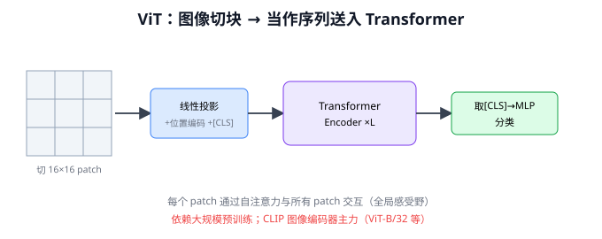
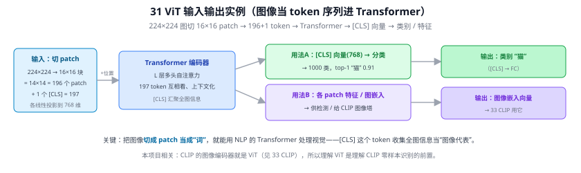
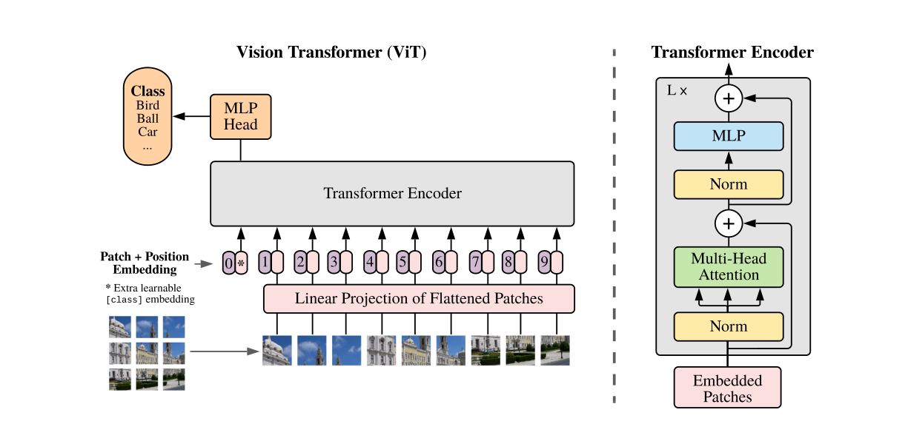
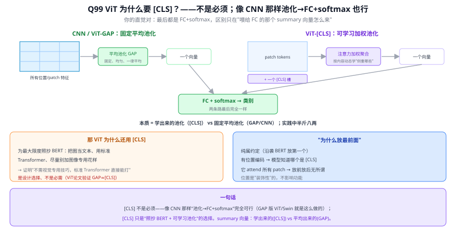
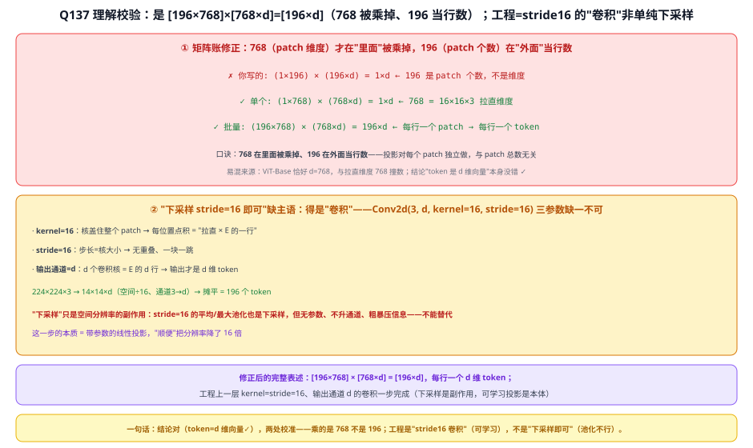
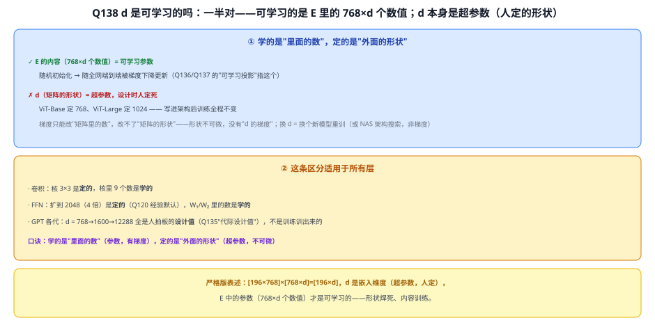

# 31 ViT（Vision Transformer）⭐

> 定位：把 Transformer 直接用到图像上，证明"不要卷积也能做好视觉"。CLIP 图像编码器的主力。
> 作者：Dosovitskiy 等（Google），ICLR 2021，论文名 *An Image is Worth 16×16 Words*。
> **输入 / 输出**：图像切成 patch 序列（+[CLS]）→ [CLS] 向量 → 类别；或各 patch 特征

---



> 📥📤 **输入/输出实例（看一组具体数值）**：输入 **224×224** 图切成 **16×16** 的 patch → 14×14 = **196 个 patch** + 1 个 `[CLS]` = **197 个 token**，各线性投影到 **768 维** + 位置编码 → Transformer 编码器（L 层多头自注意力，token 互相看）→ **两种输出**：① `[CLS]` 向量（768 维）→ 分类头 → top-1 "猫" 0.91；② 各 patch 特征 / 图像嵌入 → 供检测或给 CLIP 图像塔。关键：把图像**切 patch 当"词"**，就能用 NLP 的 Transformer 处理视觉。本项目相关：33 CLIP 的图像编码器就是 ViT，理解它是理解 CLIP 零样本识别的前置。



> 📄 **论文原图对照**（图源：Dosovitskiy et al., *An Image is Worth 16x16 Words*, [arXiv:2010.11929](https://arxiv.org/abs/2010.11929) Figure 1，原文 [PDF](../papers/31_ViT_2010.11929.pdf)；仅笔记内学习引用，论文写作须自绘）：



> 图切 patch→线性投影成 token（Q136/Q137 的拉直×E）+[CLS]+位置嵌入→标准 Transformer 编码器→[CLS] 接分类头（Q99）。

## 一、提出背景

Transformer（28）在 NLP 大获成功，但视觉长期被 CNN 统治。难点：自注意力是 $O(n^2)$，若把每个像素当一个 token，224×224 图就有 5 万个 token，计算量爆炸。ViT 的巧妙解法：**把图像切成一个个 patch（图块），每个 patch 当作一个"词"**，于是图像变成了一个短序列，可以直接喂给标准 Transformer。

---

## 二、核心方法

```
图像 224×224×3
   │ 切成 16×16 的 patch（共 14×14 = 196 个）
   ▼
每个 patch 展平 → 线性投影 → patch embedding（如 768 维）
   │ + 位置编码（可学习）
   │ + 前置一个 [CLS] token（用于分类）
   ▼
标准 Transformer Encoder ×L（多头自注意力 + FFN）
   ▼
取 [CLS] token 输出 → MLP 分类头 → 类别
```

### 关键点

1. **Patch Embedding**：把图像切块当序列，是 ViT 的灵魂。"一张图 = 16×16 个词"即由此而来。
2. **位置编码**：patch 本身无位置信息，需加可学习位置嵌入。
3. **[CLS] token**：借鉴 BERT，用一个特殊 token 聚合全图信息做分类。
4. **纯注意力**：每个 patch 通过自注意力与所有其他 patch 交互——**全局感受野从第一层就有**（CNN 要堆很多层才能获得全局视野）。

---

## 三、关键结论与局限

**核心发现**：
- **数据量是关键**：在中等数据集（ImageNet-1k）上，ViT 不如同等 CNN（因为 ViT 缺少 CNN 的归纳偏置——局部性、平移不变性，需要更多数据自己学）。
- **大数据下反超**：在超大数据集（JFT-300M、ImageNet-21k）预训练后，ViT **超越**最好的 CNN。结论：**ViT 用数据规模换取了对人工归纳偏置的依赖**。

**局限**：
- 小数据集表现差，依赖大规模预训练
- 计算/显存开销大
- 对高分辨率（密集预测、小目标）不友好

→ **后续改进**：
- **DeiT**：用知识蒸馏让 ViT 在 ImageNet-1k 上也能训好，降低数据需求
- **Swin Transformer**：分层 + 窗口注意力，把 $O(n^2)$ 降到线性，支持多尺度、适配检测分割，成为视觉 Transformer 的通用骨干

---

## 四、历史地位

ViT 打破了"视觉必须用 CNN"的信条，开启视觉 Transformer 时代。它是多模态模型的视觉基座：CLIP、BLIP、LLaVA 的图像编码器主力都是 ViT。CNN 与 Transformer 此后在视觉领域长期并存、互相借鉴（如 ConvNeXt 用 Transformer 思路改进 CNN）。

---

## 五、与本项目的关系 ⭐

- **CLIP 的图像编码器主力是 ViT**（ViT-B/32、ViT-L/14）。本项目 CLIP 模块默认用 **ViT-B/32**（`openai/clip-vit-base-patch32`，正式入口为 `exp003_clip_zeroshot_eval.py`）。理解 ViT 的 patch 切分、[CLS] 聚合，才能理解 CLIP 如何把裁剪的检测框图像编码成特征向量。
- **数据量启示**：ViT"小数据集表现差"的特性，正是本项目**不从头训练 ViT/CLIP、而是直接用预训练权重**的根本原因——正式六类训练集只有 3,021 张图片，远不足以从头训练 ViT。
- **Swin 关联**：35 Grounding DINO 的视觉骨干用 Swin Transformer，是 ViT 的高效多尺度变体。
- 本项目**不训练/不改 ViT 结构**，仅作为 CLIP 的现成图像编码器使用。

---

## ✏️ 具体实例（动手算一遍）

**例：一张 224×224 图怎么切成 token 进 Transformer**
```
图 224×224×3
切成 16×16 的 patch → 每边 224/16=14 个 → 14×14 = 196 个 patch
每个 patch 16×16×3=768 维 → 线性投影到 d=768 → 196 个 patch token
加 1 个 [CLS] token → 共 197 个 token
加位置编码 → 进 Transformer 编码器（和文本完全一样的自注意力，见 24 Transformer）
取 [CLS] 输出 → 分类头 → 类别
```
**关键**：把"图像 patch"当成"词 token"，后面就是标准 Transformer（Q/K/V 流程见 Q33）。

**例：为什么 patch 不能太小**
自注意力是 $O(n^2)$（n=token 数，见 Q31）。若 patch 用 8×8 → token 数变 $28^2=784$，注意力计算量约 $(784/196)^2=16$ 倍。所以 patch 大小是"精度 vs 算力"的折中。

**例：ViT vs CNN 的数据胃口**
ViT 缺乏 CNN 的局部性/平移不变先验，小数据上不如 CNN；但**大数据**（JFT-300M）预训练后反超。这解释了本项目为何检测骨干仍用 CNN（数据有限、要实时），而把 ViT 留给 **CLIP** 那种大规模预训练好的权重直接用（33 CLIP）。

---

## 六、参考文献

- Dosovitskiy A, et al. *An Image is Worth 16×16 Words: Transformers for Image Recognition at Scale.* ICLR 2021.
- Touvron H, et al. *Training data-efficient image transformers & distillation through attention (DeiT).* ICML 2021.
- Liu Z, et al. *Swin Transformer: Hierarchical Vision Transformer using Shifted Windows.* ICCV 2021.

---

## 📋 模型答疑（来自模型详解问答）

> 专属本模型的问答集中在此；跨模型的通用问答见答疑总目录。

---

## Q98. ViT 主要就是替代 CNN 用于图片分类吗？

**一、ViT 做分类的流程（照搬 Transformer + `[CLS]`）**
图 → 切 **patch(16×16)** → 每 patch 当 token + 位置编码 → **拼一个 `[CLS]`** → Transformer 编码器 ×L → 取 `[CLS]` 向量 → 分类头 → 类别。（和 BERT 一套路，只是"词 token"换成"patch token"。）

**二、最初确实是"替代 CNN 做分类"**
ViT(2020) 首秀就是证明：给足够数据（大规模预训练），Transformer 在图像分类上能追平/超过 CNN。所以"ViT = 替代 CNN 做分类"作为**入门理解成立**。

**三、但它已长成"通用视觉骨干"**
- 不只分类——**检测、分割、多模态**都用它当特征提取器；
- **对本项目最关键**：**CLIP 的图像编码器就是 ViT**！所以 ViT 在本项目里的核心角色是"**CLIP 的图像塔**"（33 CLIP），不是单独做分类。

**四、"替代"仍是分场景（接 Q94/Q96）**
ViT 归纳偏置弱、**吃数据**：小数据打不过 CNN，要大规模预训练才发力；Swin 又把 CNN 式**局部性**（窗口注意力+层级）加回来当更好的通用骨干。CNN 没被清盘，仍是**效率/小数据**主力。

> **一句话**：ViT 最初为图像分类而生、证明能替代 CNN；但已成**通用视觉骨干**——对本项目它最重要的角色是 **CLIP 的图像编码器**；"替代 CNN"是分场景/需大数据，不是清盘。

![Q98 ViT：图切patch当token+[CLS]→Transformer→分类(最初)；已成通用骨干、CLIP图像塔就是它；替代分场景](../figures/Q98_vit_backbone.svg)

---

## Q99. ViT 为什么要把 `[CLS]` 放最前面，而不像 CNN 那样直接池化→FC+softmax？

**一、[CLS] 不是必须——CNN 式做法完全可行**
- ViT 论文验证：所有 patch 输出做 **GAP → FC**，效果 ≈ `[CLS]`；
- 很多后续 ViT/Swin **不用 `[CLS]`、直接 GAP**，和 CNN 一模一样。

**二、[CLS] vs CNN 的 GAP——两种"把整图变一个向量"的方式**

| | 怎么得到 summary 向量 |
|---|---|
| **CNN / ViT-GAP** | 对所有位置特征**平均池化**（固定、均匀、一律平均） |
| **ViT-[CLS]** | 一个**可学习的槽**，靠注意力**加权聚合**所有 patch（按内容动态学"侧重哪些"） |

本质 = "**学出来的池化 vs 固定平均池化**"；两条路**最后都是 FC+softmax**，只差那个向量是"学出来的"还是"平均出来的"。实践中两者半斤八两。

> ⚠️ 别误读：**GAP / max pool 这类池化都是固定操作、无参数、不可学**（GAP=所有位置一律平均）；**"可学习的池化"专指 `[CLS]` 的注意力聚合**（权重由可学的 W_Q/W_K 按内容现算）。CNN 分类里"能学"的是**卷积特征 + 末尾 FC 分类头**，**不是池化本身**（末尾 = GAP 固定 → FC 可学 → softmax）。

**补：为什么 `[CLS]` 要"一路跟着编码"，而不像 CNN 那样"patch 编码到底、末尾才聚合分类"？** 你说的"末尾才分类"就是 **GAP**、完全可行、训练也一样——区别只在**聚合发生在哪**：**GAP** 是 patch 编码到底、**末尾一次性**固定平均；**`[CLS]`** 是一个专门 token 从第一层就跟着走、**每一层都 attend 所有 patch**（patch 也 attend 它），把摘要**逐层、可学习地**建起来。**两者都把 patch 完整编码了 L 层**，差别只是 summary 向量"末尾平均一次(GAP)"还是"一个 token 一路聚合([CLS])"，成本几乎一样（多一个 token）。ViT 选 `[CLS]` 是为**架构统一/极简**——"一切都是 token 过注意力"，分类摘要也只是**另一个 token**、**无需额外池化操作**，读分类 = 读某个 token 的输出（GAP 则要末尾另接一个池化步）。但既然 GAP 一样好，说明"聚合不必逐层那么深、末尾平均也够"——所以 `[CLS]` 一路编码是"**更统一优雅、非更强**"。

**三、那 ViT 当初为什么用 [CLS]**
为**最大限度照抄 BERT**：ViT 的主张是"一张图=16×16 个词，把图当文本、用标准 Transformer、尽量别加图像专用花样"。BERT 分类用 `[CLS]`（Q97），ViT 就原样搬，以证明"不需视觉专用技巧、标准 Transformer 直接能打"。**是设计选择、不是必需品。**

**四、"为什么放最前面"**
纯属**约定**（沿袭 BERT 放第一个）。有位置编码 → 模型知道哪个是 `[CLS]`；它靠注意力 attend **所有** patch → 放前放后**无所谓**，位置是"装饰性"的。

> **一句话**：`[CLS]` 不是必须——像 CNN 那样"池化→FC+softmax"完全可行（GAP 版 ViT/Swin 就是这么做的）；`[CLS]` 只是"**照抄 BERT + 可学习池化**"的选择。两条路最后都是 FC+softmax，只差 summary 向量是"**学出来的（`[CLS]`）**"还是"**平均出来的（GAP）**"。



## Q136. 每个 patch 是 16×16，它是如何被当作一个 token 的？

**简答**：切块后每个 16×16×3 的小立方体先**拉直**成 768 维像素向量（纯展开无计算），再乘**可学习矩阵 E**（[d×768]，全部 patch 共享）映射成 d 维嵌入——这就是一个 token 了；加上位置嵌入、拼上 [CLS]，得到 197×768 矩阵送进标准 Transformer。工程上用一层 `kernel=stride=16` 的卷积一步完成。

**展开**：

**① 四步流程（ViT-Base：224×224、patch 16、d=768）**
1. **切块**：224×224 按 16×16 无重叠切 → (224/16)² = **196 个 patch**，每个是 16×16×3 小立方体（含 RGB）；
2. **拉直（flatten）**：每块的 16×16×3 = **768 个像素值**按固定顺序展开成 768 维向量——纯"摊平"，没有计算；
3. **线性投影（关键一步）**：$z_i = E\,x_i$，E ∈ ℝ^{d×768} **可学习**、随全网端到端训练，学"从原始像素提取初步特征"；**196 个 patch 共享同一个 E**（类比卷积权重共享）。ViT-Base 恰好 768→768（数值巧合），ViT-Large 是 768→1024；
4. **收尾**：加可学习位置嵌入（Q34）、最前拼 [CLS]（[Q99](#q99-vit-为什么要把-cls-放最前面而不像-cnn-那样直接池化fcsoftmax)）→ **[197, 768] 矩阵**进 Transformer。从此 Transformer 不知道也不关心这些向量来自图像。

**② 与 NLP token 对比：差别只在"第一步怎么变向量"**
- 文字：**离散**、词表可枚举 → **查表**（token id → 嵌入矩阵取第 i 行）；
- 像素：**连续**、不可能给每种 16×16 图块建词表 → **线性投影**（一个矩阵乘）。
殊途同归：进 Transformer 前一律是 d 维向量——"token = d 维向量"这个接口是统一的。

**③ 工程实现 = 一层卷积**
`Conv2d(3, 768, kernel_size=16, stride=16)`：核大小=步长=patch 尺寸的无重叠卷积，滑一遍恰好等价"切块+拉直+投影"三步合一（每个位置的卷积核点积 = E 的一行乘拉直向量）。所以常说"ViT 的第一层其实是个卷积层"。

**④ 数字账**
- token 数 N = 196（+1 [CLS] = 197）；
- patch embedding 参数 = 768×768+768 ≈ **59 万**，只占 ViT-Base 全模型（~8600 万）的零头；
- 改分辨率或 patch 大小只改 token 数 N，Transformer 主体不用动（Q115 的等长映射对任意 N 成立）。


**⑤ 一句话**
patch→token = **拉直**（16×16×3=768 个数）→ **乘可学习矩阵 E** 到 d 维 → 加位置嵌入；token 本质就是 d 维向量，与 NLP 的差别只在"查表 vs 投影"；工程上一层 `stride=16` 的卷积一步搞定——这正是 CLIP 图像编码器（本项目用它给检测框内图像编码）每次前向的第一步。

---

## Q137. (1×196)×(196×d)=1×d 所以 token 是 d 维向量，工程上下采样 stride=16 即可——对吗？

**简答**：token 是 d 维向量——对。但乘法应是 (1×**768**)×(**768**×d)：768 是每个 patch 拉直后的维度（16×16×3），196 是 patch 的个数、只出现在批量式的行数上（[196×768]×[768×d]=[196×d]）。工程实现也不是"下采样即可"，而是 kernel=stride=16、输出通道 d 的**卷积**——可学习投影是本体，下采样是副作用（换成池化就废了）。

**展开**：

**① 矩阵账修正**
```
✗ 你写的:  (1×196) × (196×d) = 1×d      ← 196 是 patch 个数，不是维度
✓ 单个:    (1×768) × (768×d) = 1×d      ← 768 = 16×16×3 拉直维度
✓ 批量:  (196×768) × (768×d) = 196×d    ← 每行一个 patch → 每行一个 token
```
投影对每个 patch **独立**做（同一个 E 复用 196 次），与 patch 总数无关——196 只决定输出矩阵有几行。易混的来源：ViT-Base 恰好 d=768，和拉直维度 768 撞数（[Q136](#q136-每个-patch-是-1616它是如何被当作一个-token-的) ①提过这是巧合）。

**② "下采样 stride=16"要补上主语：卷积**
`Conv2d(3, d, kernel_size=16, stride=16)`，三个参数各司其职：
- **kernel=16**：核恰好盖住整个 patch → 每位置点积 = "拉直 × E 的一行"；
- **stride=16**：步长=核大小 → 无重叠、一块一跳；
- **输出通道 = d**：d 个卷积核 = E 的 d 行 → 输出才是 d 维。

224×224×3 → **14×14×d**（空间 ÷16、通道 3→d）→ 摊平 = 196 个 token。**"下采样"只是空间分辨率的副作用**：stride=16 的平均/最大池化同样"下采样 16 倍"，但没有可学习参数、不升通道、把 768 个数粗暴压成 1 个——不能替代。这一步的本质是**带参数的线性投影**（Q39 的"卷积=线性组合"同源），顺便把分辨率降了 16 倍。



**③ 一句话**
结论对：token = d 维向量；两处校准——**乘掉的是 768（patch 拉直维度）不是 196（patch 个数）**：[196×768]×[768×d]=[196×d]；工程是 **stride=16 的卷积**（kernel=16、输出通道 d、可学习），不是"下采样即可"——下采样是副作用，投影是本体。

---

## Q138. [196×768]×[768×d]=[196×d] 里的 d 是维度、是可学习的，对吗？

**简答**：d 是嵌入维度没错，但它是**人定的超参数**，不是学出来的；可学习的是矩阵 E 中的 768×d 个数值。严格版表述：[196×768]×[768×d]=[196×d]，**形状焊死、内容训练**。

**展开**：

**① 学的是"里面的数"，定的是"外面的形状"**
- ✓ **E 的内容（768×d 个数值）= 可学习参数**：随机初始化 → 端到端梯度更新——[Q136](#q136-每个-patch-是-1616它是如何被当作一个-token-的)/[Q137](#q137-1196196dd1d-所以-token-是-d-维向量工程上下采样-stride16-即可对吗) 说的"可学习投影"指的是这个；
- ✗ **d（形状）= 超参数**：设计时定死（Base 768 / Large 1024），训练全程不变。形状不可微——损失对"矩阵有几列"求不了导，梯度下降碰不到它；换 d = 换个新模型从头训（例外是 NAS 架构搜索，用非梯度方法"搜"形状）。

**② 这条区分适用于所有层**
- 卷积：核 **3×3 是定的**，核里 **9 个数是学的**（Q5 的老结论：核的内容学出来、核的大小人设计）；
- FFN：扩到 2048（4 倍）是定的（Q120 经验默认），W₁/W₂ 的内容是学的；
- GPT 各代：d=768→1600→12288 全是人拍板的**设计值**（Q135 的"代际设计值"），不是训练训出来的。



**③ 一句话**
d 是嵌入维度（**超参数，人定**），可学习的是 E 中的 **768×d 个数值**——学的是"里面的数"、定的是"外面的形状"；这条区分对卷积核、FFN、GPT 的 d 一律成立。

---
