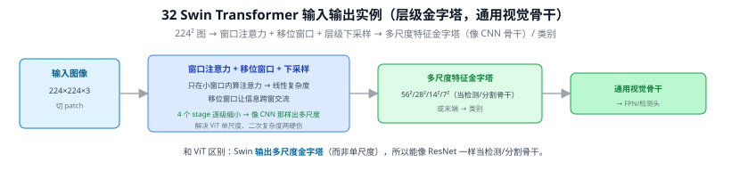
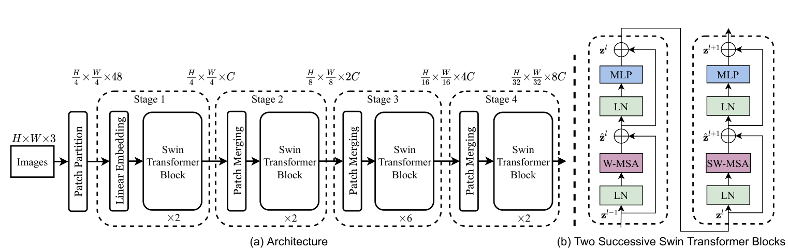
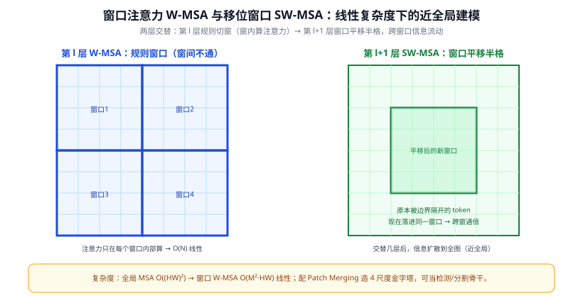
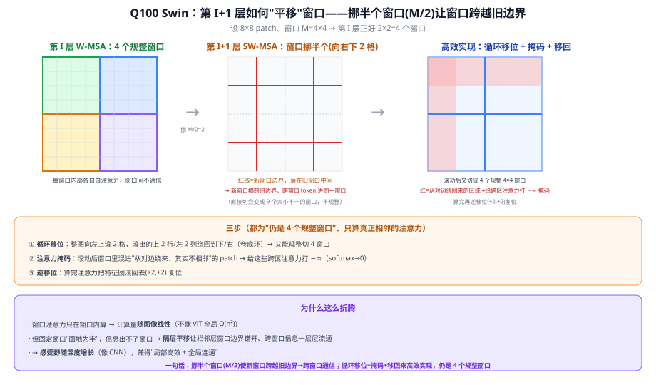
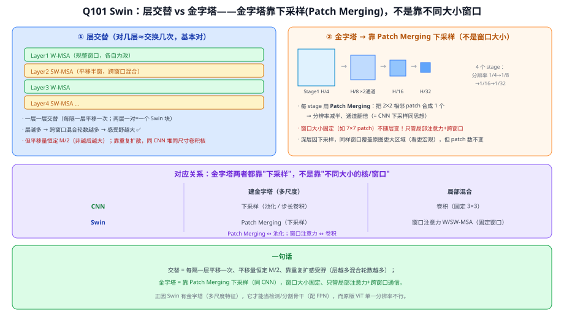

# 32 Swin Transformer：层级式视觉 Transformer

> 视觉 Transformer 与视觉语言模型 · 之二　|　⬅ 返回目录
> 关键词：窗口注意力 W-MSA / 移位窗口 SW-MSA / 层级金字塔 / 线性复杂度 / 通用视觉骨干
> **输入 / 输出**：图像 → 多尺度特征金字塔（当骨干）/ 类别

---

> 📥📤 **输入/输出实例（看一组具体数值）**：输入 **224×224×3** 图（切 patch）→ 窗口注意力（只在小窗口内算注意力 → 线性复杂度）+ 移位窗口（让信息跨窗交流）+ 4 个 stage 逐级下采样 → 输出**多尺度特征金字塔** 56²/28²/14²/7²（当检测/分割骨干）或末端 → 类别。和 31 ViT 的关键区别：Swin **输出多尺度金字塔**（而非单尺度）、复杂度线性（而非二次），所以能像 ResNet 一样当通用视觉骨干接 FPN/检测头。



> 📄 **论文原图对照**（图源：Liu et al., *Swin Transformer*, [arXiv:2103.14030](https://arxiv.org/abs/2103.14030) Figure 3，原文 [PDF](../papers/32_Swin_2103.14030.pdf)；仅笔记内学习引用，论文写作须自绘）：



> (a) 四阶段金字塔：Patch Merging 逐级降分辨率升通道（Q101）；(b) 两个连续块 = W-MSA/SW-MSA 交替（Q100 的平移窗口）。

## 一、提出背景：ViT 当骨干的两个硬伤

ViT（31 ViT）证明纯 Transformer 能做图像分类，但直接拿它当**检测/分割的骨干**有两个问题：

1. **计算量随分辨率平方爆炸**。全局自注意力对 $N$ 个 token 是 $O(N^2)$；图像 token 数 $N=\frac{HW}{P^2}$，分辨率一高就算不动。检测/分割偏偏需要高分辨率。
2. **单一尺度、无金字塔**。ViT 全程保持同一种 token 粒度（如 16×16 patch），输出只有一个尺度的特征图；而检测/分割依赖 FPN 式的**多尺度特征**（21 FPN），单尺度难以同时处理大小目标。

Swin Transformer（Liu et al., ICCV 2021 best paper）用两招解决：**窗口注意力**把复杂度降到线性，**层级下采样**造出多尺度金字塔——让 Transformer 像 CNN 骨干一样即插即用。

---

## 二、核心原理

### ① 窗口注意力 W-MSA：把全局自注意力关进小窗口
不再让每个 token 和全图所有 token 算注意力，而是把特征图切成不重叠的 **$M\times M$ 窗口（如 7×7）**，**只在窗口内部做自注意力**。

- 全局 MSA 复杂度：$O((HW)^2 \cdot C)$（随像素数平方）
- 窗口 W-MSA 复杂度：$O(M^2\cdot HW\cdot C)$（$M$ 固定 → **随像素数线性**）

代价：窗口之间不通信，信息被关在各自小屋里。

### ② 移位窗口 SW-MSA：让窗口之间互通
解法很巧：**相邻两层的窗口划分错开半个窗口（移位 $\lfloor M/2\rfloor$）**。第 $l$ 层规规矩矩切窗，第 $l{+}1$ 层把窗口整体平移，使得原本被边界隔开的 token 这一层落进了同一个新窗口。两层交替（W-MSA → SW-MSA），信息就能跨窗口逐步扩散到全图——既保住线性复杂度，又恢复了全局建模能力。

> 工程上移位会让边缘出现不规则窗口，Swin 用 **循环移位 + 掩码（cyclic shift + masking）** 把它高效地凑回规则的 $M\times M$ 批量计算。



### ③ 层级结构：Patch Merging 造金字塔
每过一个 stage，用 **Patch Merging** 把相邻 2×2 的 token 拼接再线性投影，**空间减半、通道翻倍**——和 CNN 的"池化 + 通道翻倍"金字塔（04 CNN 原理）异曲同工：

```
输入 224×224×3
Patch Partition (4×4)  → 56×56×C       Stage1: 2× Swin Block
Patch Merging          → 28×28×2C      Stage2: 2× Swin Block
Patch Merging          → 14×14×4C      Stage3: 6× Swin Block (主力)
Patch Merging          →  7×7×8C       Stage4: 2× Swin Block
```

得到 4 个尺度的特征（56/28/14/7），可直接喂给 FPN + 检测头——这正是它能当通用骨干的关键。

### ④ 相对位置偏置
窗口内注意力加一个**可学习的相对位置偏置** $B$：$\text{Attn}=\text{softmax}(QK^\top/\sqrt d + B)V$。比 ViT 的绝对位置编码（31 ViT）更适合视觉的平移等变性，涨点明显。

---

## 三、关键创新与历史地位

| 创新 | 解决的问题 |
|------|-----------|
| 窗口注意力 W-MSA | $O(N^2)\to O(N)$，高分辨率可算 |
| 移位窗口 SW-MSA | 恢复跨窗口/全局信息流 |
| Patch Merging 层级 | 造多尺度金字塔，适配检测/分割 |
| 相对位置偏置 | 契合视觉先验，涨点 |

历史地位：Swin 是**第一个全面胜任分类/检测/分割三大任务的纯 Transformer 骨干**，在 COCO 检测、ADE20K 分割上一举刷新 SOTA，证明"Transformer 可以替代 CNN 当通用视觉骨干"，是 ViT → 实用化的关键一步。后续 Swin V2 扩到更大模型与分辨率。

---

## 四、局限
- 窗口大小、移位是人为设计，仍有归纳偏置（不像 ViT 那么"纯"）。
- 移位窗口的掩码实现较复杂，部署不如纯卷积规整（呼应 08 答疑：结构花哨 ≠ 实测快）。
- 小数据集上仍不如 CNN 易训（Transformer 通病，需大数据或强增强/预训练）。

---

## ✏️ 具体实例（动手算一遍）

设 stage3 特征图 $14\times14$、窗口 $M=7$：

- **全局注意力**的 token 对数：$(14\times14)^2=196^2=38{,}416$ 次 q·k。
- **窗口注意力**：窗口数 $=(14/7)^2=4$ 个，每窗 $7\times7=49$ token，窗内对数 $49^2=2{,}401$，共 $4\times2{,}401=9{,}604$ 次。

→ 同一层，窗口注意力只需全局的 **9604/38416 ≈ 25%** 计算；分辨率越高，这个比例越悬殊（线性 vs 平方）。

再看 Patch Merging：把 $28\times28\times2C$ 的相邻 $2\times2$ 拼成 $14\times14\times8C$，再线性投影到 $14\times14\times4C$——空间 $28^2\to14^2$（÷4），通道 $2C\to4C$（×2），和 VGG/CNN 的金字塔规律（07 VGGNet）完全一致。

---

## 五、与本项目的关系
- **可选骨干升级**：若 YOLOv8 的 CNN 骨干（25 YOLO演进）在小目标/复杂背景上吃力，Swin 作为多尺度 Transformer 骨干是值得对比的备选（但要权衡推理延迟与小数据训练难度，见上"局限"）。
- **理解 CLIP/检测大模型的视觉端**：很多开放词汇检测器（如部分 GroundingDINO 变体，35 GroundingDINO）用 Swin 当视觉骨干；明白窗口注意力才看得懂它们的高分辨率处理。
- **承上启下**：Swin = "ViT 的全局注意力" + "CNN 的层级金字塔 + 局部性"，是理解 31 ViT 与 CNN 如何融合的最佳样本。

---

## 参考文献
1. Liu Z, Lin Y, Cao Y, et al. **Swin Transformer: Hierarchical Vision Transformer using Shifted Windows.** ICCV 2021 (Best Paper).
2. Liu Z, et al. **Swin Transformer V2: Scaling Up Capacity and Resolution.** CVPR 2022.
3. Dosovitskiy A, et al. **An Image is Worth 16×16 Words (ViT).** ICLR 2021.

---

## 📋 模型答疑（来自模型详解问答）

> 专属本模型的问答集中在此；跨模型的通用问答见答疑总目录。

---

## Q100. 第 I 层假设有 4 个窗口，第 I+1 层是如何实现"平移"的？

**一、"平移"的本质：挪半个窗口，让窗口跨越旧边界**
第 I 层 4 个窗口按 8×8 网格规整切分（各 4×4）。第 I+1 层把**窗口划分整体挪 M/2=2 个 patch（向右下）** → 新窗口边界正好落在旧窗口的**中间** → 新窗口**横跨了旧窗口的边界** → 旧窗口边界两侧、原本分属不同窗口的 token，现在被分进**同一个新窗口** → 跨窗口通信。

**二、高效实现：循环移位 + 掩码 + 逆移位**（直接切会得 9 个不规整窗口，故用此技巧保持 4 个规整窗口）
1. **循环移位（cyclic shift）**：整张特征图向左上滚 2 格，滚出去的上 2 行/左 2 列**绕回到下/右边**（卷成环）→ 又能规整地切成 **4 个 4×4 窗口**（和第 I 层一样多、一样大，效率不变）；
2. **注意力掩码（mask）**：滚动后某些窗口混进"从对边绕来、其实并不空间相邻"的 patch → 给这些跨区注意力打 **−∞**（softmax→0）→ 只在**真正相邻**的 patch 间算；
3. **逆移位**：算完注意力，把特征图滚回去（+2,+2）复位。

**三、为什么要这么折腾**
- 窗口注意力只在窗口内算 → 计算量**随图像线性增长**（ViT 全局是 O(n²)，高分辨率吃不消）；
- 但**固定窗口**会"画地为牢"，信息出不了窗口 → **隔层平移**让相邻两层窗口边界错开、跨窗口信息一层层流通 → **感受野随深度增长**（像 CNN 堆层），兼得"局部高效 + 全局连通"。这也呼应 Q94：Swin 把 CNN 式的**局部性/层级**加回 Transformer，成为更好的通用视觉骨干。

> **一句话**：第 I+1 层把窗口整体挪 **半个窗口（M/2）**，使新窗口**跨越旧窗口边界**实现跨窗口通信；工程上用"**循环移位 + 掩码 + 移回**"高效实现，仍保持 4 个规整窗口。W-MSA（规整）与 SW-MSA（平移）**成对交替**堆叠，就是 Swin 的核心。

**直觉版（"各自为政→下一层混合"，但混合方式要说准）**：大方向对——第 I 层窗口内独立（各自为政），第 I+1 层平移来混合。但**不是"1 占 2 的一半、2 再占 3 的一半"的链式接力**，而是**所有窗口同时挪半个、每个新窗口骑在两个旧窗口的边界上**：一维看，新窗口 = "**相邻两个旧窗口各出一半**"（新窗A=W1右半+W2左半、新窗B=W2右半+W3左半…，一次平移全体一起挪、非先后接力）。更准：你的"4 个窗口"是 **2×2**、四窗在中心十字点交汇，挪 (M/2,M/2) 后**中间那个新窗口骑在十字点上 → 含 4 个旧窗口各一个角(1/4)**、一次把 4 窗混起来；边上的新窗口混相邻 2 个的一半；角上"绕回来"的被掩码不真混。W-MSA↔SW-MSA 每交替一次、信息跨窗口扩散一圈，堆几层感受野即覆盖全图（像 CNN 堆层扩感受野）。



---

## Q101. Swin 金字塔靠不同大小窗口吗？两种窗口注意力每层都交替吗？

**① 层交替（对几层≈交换几次，基本对）**
Layer1 W-MSA → Layer2 SW-MSA → Layer3 W-MSA → Layer4 SW-MSA …**一层一层交替**（每隔一层平移一次；两层一对=一个 Swin 块）。层越多 → 跨窗口混合轮数越多 → 感受野越大 ✅。**但平移量恒定 M/2**（非越后越大），靠**重复**把信息一圈圈扩出去（同 CNN 用**同尺寸**卷积核堆层扩感受野）。

**② 金字塔靠 Patch Merging 下采样，不是"不同大小窗口"**

| | 建金字塔（多尺度） | 局部混合 |
|---|---|---|
| **CNN** | **下采样**（池化 / 步长卷积） | 卷积（固定 3×3） |
| **Swin** | **Patch Merging**（把 2×2 patch 合 1，下采样） | 窗口注意力 W/SW-MSA（**固定窗口**） |

- Swin 分 **4 个 stage**，每 stage 前用 **Patch Merging** → 分辨率 1/4→1/8→1/16→1/32、通道翻倍（像 ResNet 的 stage）；
- **窗口大小固定**、不随层变；**是特征图被下采样了**，所以深层的同样窗口覆盖原图更大区域；
- 对应：**Patch Merging ↔ 池化；窗口注意力 ↔ 卷积**；金字塔两者都靠"**下采样**"，不是靠"不同大小的核/窗口"。

> **一句话**：交替 = 每隔一层平移一次、**平移量恒定**、靠重复扩感受野；金字塔 = 靠 **Patch Merging 下采样**（同 CNN），窗口大小**固定**、只管局部注意力+跨窗口。正因 Swin 有**金字塔（多尺度特征）**，它才能当**检测/分割骨干**（配 FPN），而原版 ViT 单一分辨率做不到——这正是 Swin 的价值。



