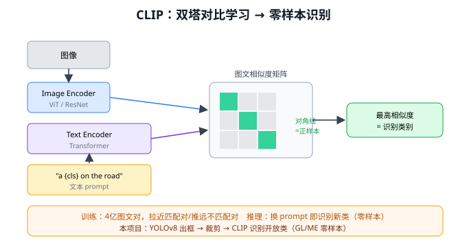
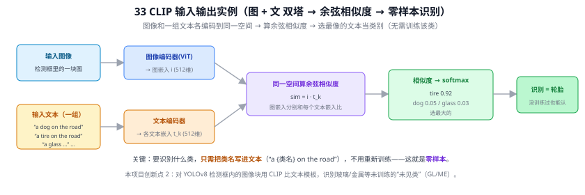
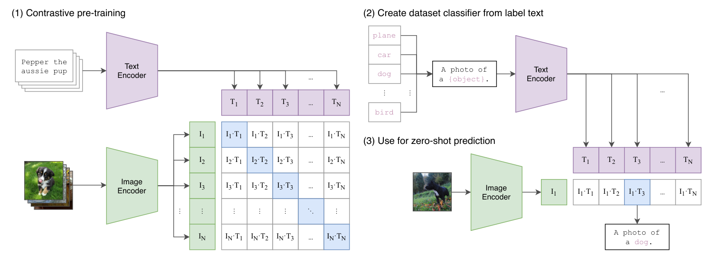
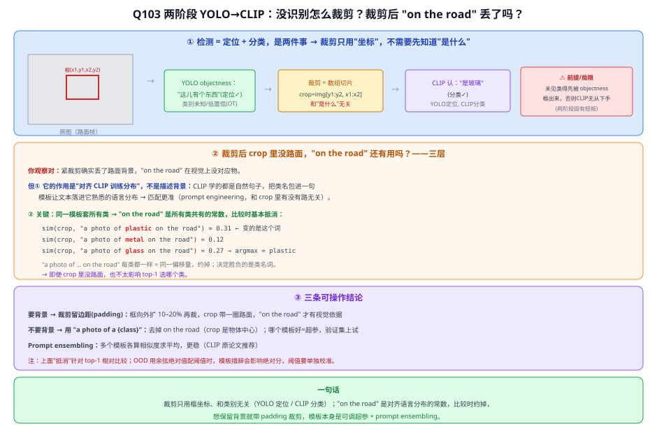
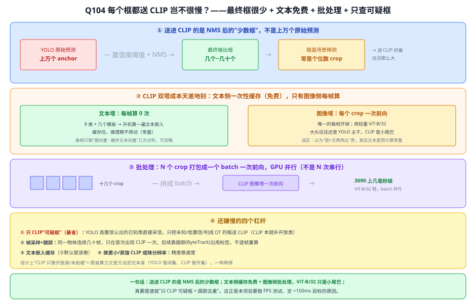
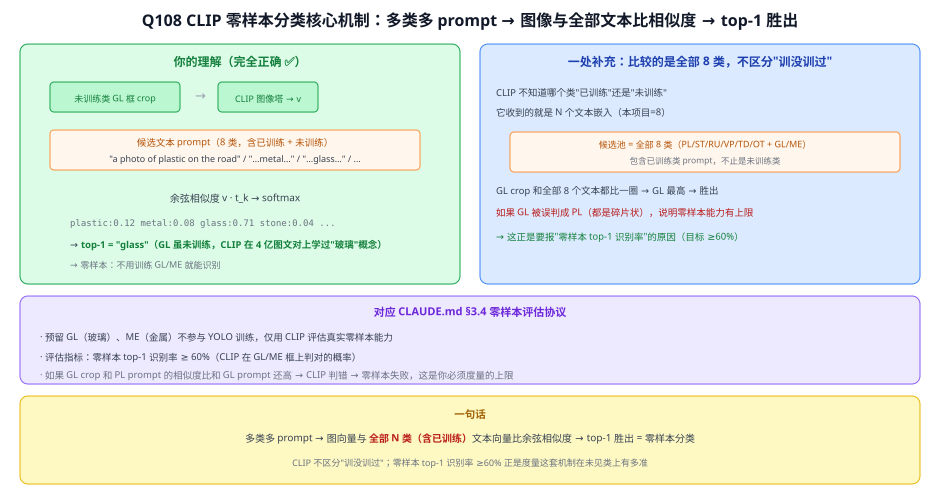
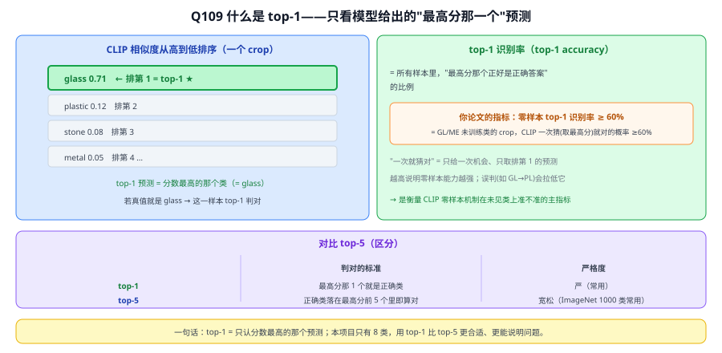

# 33 CLIP（Contrastive Language-Image Pre-training）⭐⭐

> 定位：**本项目核心模型（创新点 2）**。通过图文对比学习实现零样本识别，是开放词汇识别的基石。
> 作者：Radford 等（OpenAI），ICML 2021，论文名 *Learning Transferable Visual Models From Natural Language Supervision*。
>
> 📌 本文是"模型全景解读"。精读级笔记（Section 逐节、伪代码、实验数据、prompt 设计草稿）见 `learning/paper_notes_clip.md`，两者配合阅读。
> **输入 / 输出**：图像 + 文本（两个塔）→ 各自嵌入向量（同一空间）→ 余弦相似度

---



> 📥📤 **输入/输出实例（看一组具体数值）**：**两个塔**——图像塔输入一块检测框图 → 图像编码器（ViT）→ 图嵌入 $i$（512 维）；文本塔输入一组候选 "a dog on the road" / "a tire on the road" / "a glass…" → 文本编码器 → 各文本嵌入 $t_k$（512 维，同一空间）。在同一空间算**余弦相似度** $i{\cdot}t_k$ → softmax → $[\text{tire }0.92,\text{dog }0.05,\text{glass }0.03]$ → 识别 = **轮胎**。关键：要识别什么类**只需把类名写进文本**，不用为该下游类别重新训练——这就是零样本迁移。本项目创新点 2：对 YOLOv8 候选框图块用 CLIP 匹配文本模板，评估未参与检测器训练的 GL（玻璃）和 RU（橡胶）。



> 📄 **论文原图对照**（图源：Radford et al., *Learning Transferable Visual Models From Natural Language Supervision*, [arXiv:2103.00020](https://arxiv.org/abs/2103.00020) Figure 1，原文 [PDF](../papers/33_CLIP_2103.00020.pdf)；仅笔记内学习引用，论文写作须自绘）：



> 对照上面的输入/输出实例读原图：**(1) 对比预训练**＝一个 batch 的 N 对图文各自过两塔出嵌入，N×N 相似度矩阵里**对角线是正样本**、其余是负样本（InfoNCE，Q102）；**(2) 用类名文本造分类器**＝把候选类名嵌进模板 "A photo of a {object}"，文本塔一次算好缓存（[Q104](#q104-yolo-定位的很多框都要裁剪送-clip-对比岂不很慢) 的"文本是预计算常量"）；**(3) 零样本预测**＝图嵌入与全部文本嵌入比余弦相似度、取 top-1（[Q108](#q108-clip-零样本分类就是把未训练类别嵌入-prompt多类多-prompt未训练类与其中一种相似度最高对吗)/[Q109](#q109-对于-clip什么是-top-1)）——正是本项目对 YOLOv8 检测框做开放类识别的流程。

## 一、提出背景

传统视觉模型有个根本局限：**只能识别训练时见过的固定类别**。要加一个新类，就得重新标注、重新训练。但现实世界类别无穷无尽（本项目的路面抛洒物就五花八门，难以穷举标注）。

CLIP 的革命性思路：**用自然语言作为监督信号**。互联网上有海量"图片 + 配文"，何不直接学习"图像和文本如何对应"？学会之后，识别任意类别只需写一句话描述它——把分类问题变成了"图文匹配"问题。

---

## 二、核心方法

### 2.1 双塔对比学习 ⭐

```
图像 ──► Image Encoder（ViT 或 ResNet）──► 图像特征 ──► 归一化
文本 ──► Text Encoder（Transformer）   ──► 文本特征 ──► 归一化
                          │
              在一个 batch 内计算图文相似度矩阵
                          │
        对角线（匹配对）拉近，非对角线（不匹配对）推远
```

训练数据：**4 亿图文对**（WIT 数据集，互联网爬取）。一个 batch 取 N 对（论文用 32768），构成 N×N 相似度矩阵：

- **正样本**：对角线上的 N 对（图 i 配文 i）
- **负样本**：其余 N²−N 对

用**对称交叉熵损失**（图→文 + 文→图），让模型把图像和它真正的配文在向量空间里拉近。这是**对比学习**——不是预测固定标签，而是学习"什么图配什么文"。

### 2.2 零样本推理 ⭐⭐（本项目直接用）

训练好后，识别新图无需任何微调：

```
Step 1: 把候选类别写成文本 prompt
        ["a photo of a tire on the road", "a photo of a glass on the road", ...]
Step 2: 文本过 Text Encoder → N 个文本特征向量（可预先缓存）
Step 3: 图像过 Image Encoder → 1 个图像特征向量
Step 4: 算图像与每个文本的余弦相似度 → softmax
Step 5: 相似度最高的 prompt = 预测类别
```

**关键**：换一组 prompt 就能识别一组全新类别，完全不用重新训练——这就是"零样本（zero-shot）"和"开放词汇（open-vocabulary）"能力的来源。

### 2.3 Prompt Engineering

直接用类别词（"glass"）效果差，因为训练文本是完整句子。加模板 `"a photo of a {} on the road"` 让推理输入接近训练分布，能显著涨点（论文报告某些数据集 +5~16%）。**Prompt ensemble**（多模板取平均）进一步提升。详见 `paper_notes_clip.md` 的 prompt 设计草稿。

---

## 三、关键结论

- **ImageNet 零样本 76.2%**，与有监督训练的 ResNet-50 持平，却没用任何 ImageNet 训练样本。
- 在 27 个数据集中，16 个上零样本 CLIP 优于有监督 ResNet-50 线性探针。
- **局限**：细粒度区分弱（同类不同型号难分）、抽象任务差（计数、空间关系）、专业领域（医学、卫星）泛化差、对 prompt 措辞敏感。

---

## 四、与本项目的关系 ⭐⭐⭐（第四章核心）

CLIP 是本项目**创新点 2（开放类识别）**的全部基础：

### 4.1 工作流程（方法框架）
```
YOLOv8（改进后）检测出框 ──► 裁剪框内图像 ──► CLIP Image Encoder
                                                      │
路面抛洒物类别 prompt 库 ──► CLIP Text Encoder ──► 文本特征
                                                      │
                              余弦相似度 → top-1 = 开放类标签
                              到 6 个已知类的最大相似度 → OOD 异常判断
```

### 4.2 零样本评估协议（CLAUDE.md 已定）
- 预留 **GL（玻璃）、RU（橡胶）** 两类不参与 YOLOv8 训练，仅用于零样本评估
- 指标：零样本 top-1 ≥ 60%、OOD AUC ≥ 0.85、已知类 mAP 不显著下降

### 4.3 为什么 CLIP 适合本项目
- 路面抛洒物类别开放、稀缺类标注少 → CLIP 零样本正好补足
- 直接用预训练权重（ViT-B/32），不需要本项目的小数据重训 → 可行性高
- 文本模板灵活，可随时扩展新类别

### 4.4 已知风险与对策
- 路面场景细粒度、低对比度，CLIP 可能不够准 → 对策：prompt ensemble、必要时 prompt tuning（CoCoOp）或 linear probe / adapter 轻量微调（待 EXP-003 后决定，见 `paper_notes_clip.md`）

### 4.5 小论文（EI）选题
CLIP 开放类识别是本项目学术创新最强的部分，定为 EI 小论文核心内容（见 CLAUDE.md 决策记录）。

---

## 五、技术谱系（理解 CLIP 的前置知识）

```
[20 注意力] → [21 Transformer] → [24 ViT]（图像编码器）
                              └→ [23 GPT 式 Transformer]（文本编码器）
                              + 对比学习 + 4亿图文对 = CLIP
```

后续：34 BLIP（更强图文理解）、35 Grounding DINO（开放词汇检测，与本项目目标相近，作对比）。

---

## ✏️ 具体实例（动手算一遍 + 本项目用法）

**例：零样本分类怎么做（一张抛洒物图块判类别）**
```
① 图像塔(ViT)：图块 → 图像向量 v（如 512 维，已归一化）
② 文本塔(Transformer)：为每个候选类造句并编码：
   "a photo of plastic on the road"  → t₁
   "a photo of metal on the road"    → t₂
   "a photo of glass on the road"    → t₃
③ 算余弦相似度 = 点积（已归一化）：
   v·t₁=0.31,  v·t₂=0.12,  v·t₃=0.27
④ 对相似度 softmax → 取最高 → 判为 "plastic"
```
**关键**：没有用本项目类别样本重新训练分类器，只通过文本prompt定义类别——这就是零样本迁移（对比R-CNN每类训练SVM，见Q11）。增加新prompt即可尝试识别新类，但是否准确取决于CLIP预训练覆盖、裁剪质量和场景域差异。

**例：对比学习预训练（为什么图文能比相似度）**
一个 batch N 张图 + N 句配对文本 → 算 N×N 相似度矩阵 → 让**对角线（正确配对）相似度最高、其余最低**（InfoNCE 损失）。训练后图文被对齐到同一向量空间，所以图向量能直接和文本向量点积比相关性。

**例：本项目怎么接（创新点 2）**
YOLOv8 出候选框 → 裁剪框内图块 → CLIP 图像塔编码 → 和 8 类文本模板算相似度 → 给出语义标签；对预留的零样本类（GL 玻璃 / RU 橡胶）统计 top-1 识别率。OOD 分数则只看它到 6 个已知类文本的最大相似度，不能把 GL/RU 文本也纳入该最大值。

---

## 六、参考文献

- Radford A, et al. *Learning Transferable Visual Models From Natural Language Supervision.* ICML 2021.（arXiv:2103.00020）
- Zhou K, et al. *Conditional Prompt Learning for Vision-Language Models (CoCoOp).* CVPR 2022.

---

## 📋 模型答疑

> 本小节收录 CLIP 专属的问答。跨模型/通用问题见答疑总目录。

## Q103. YOLOv8 还没识别类别怎么裁剪框？裁剪后 prompt 里的 on the road 信息不就丢了吗？

**简答**：① "还没取得开放词汇标签就裁剪"不矛盾——YOLO 已经输出框坐标和闭集类别分数，裁剪只需坐标；CLIP负责再次做开放词汇命名。② "on the road" 是提示模板的一部分，但不能把共享词严格理解为向量空间里的常数并断言会数学抵消；不同模板会改变文本嵌入和绝对相似度，必须在验证集上比较。

**展开**：

**① 核心误区：把"检测"当一件事，其实是"定位 + 分类"两件事**

| 子任务 | 回答 | YOLOv8 输出 | 谁来做 |
|---|---|---|---|
| **定位** localization | 目标**在哪** | 框坐标与检测置信度 | YOLOv8 |
| **闭集分类** | 属于哪个训练类 | 6个训练类分数 | YOLOv8 |
| **开放词汇重分类** | 与哪个文本类别最匹配 | 图文相似度 | CLIP |

裁剪只依赖框坐标，不依赖最终采用哪个语义标签。但标准闭集YOLO的定位与分类是联合学习的，不能预设它会框出所有未见类。本项目必须用端到端实验测量GL/RU检测召回率：召回到的框再交给CLIP重分类，漏检目标则无法由下游CLIP补救。

> ⚠️ 论文要写的**前提/局限**：CLIP能不能认，取决于闭集YOLO是否对未见类仍输出超过阈值的候选框。YOLOv8没有独立objectness输出，应以最终候选框和按真值类别统计的召回率为准。若目标被漏检，CLIP就无从下手。

**② "on the road" 丢了吗——分三层**

1. **你观察对**：紧裁剪确实丢了路面背景，"on the road" 在视觉上没对应物。
2. **但它的作用是"对齐 CLIP 训练分布"，不是描述背景**：CLIP 在几亿条**自然语言图文对**上训练，见到的几乎都是完整句子，极少是孤零零一个词 "glass"。把类名包进模板，是让文本落进 CLIP 熟悉的语言分布 → 匹配更准（即 §2.3 的 prompt engineering），和 crop 里有没有路关系不大。
3. **同一模板有助于保持比较口径一致，但不会严格“抵消”**：

```
sim(crop, "a photo of plastic on the road") = 0.31   ← 变的是这个词
sim(crop, "a photo of metal   on the road") = 0.12
sim(crop, "a photo of glass   on the road") = 0.27   → argmax = plastic
```

文本编码器是非线性模型，整句会共同决定文本嵌入，不能把共有短语视为简单可约掉的常数。类名通常是主要差异来源，但背景词是否有益只能通过prompt消融或prompt ensemble验证。

**③ 三条可操作结论**
1. **要保留背景 → 裁剪留边距(padding)**：框向外扩 10–20% 再裁，crop 带一圈路面，"on the road" 才有视觉依据（常用技巧）。
2. **不要背景 → 用 "a photo of a {class}"**：去掉 on the road（crop 是物体中心的）。哪个模板好是**超参数**，验证集上试、零样本 top-1 高的用。
3. **Prompt ensembling**：多个模板（"a photo of a {class}"、"a {class} on the road"、"a close-up of {class}"…）各算相似度**求平均**，更稳（CLIP 原论文推荐）。

> 补充：本项目的OOD分数应基于**6个已知类**的最大相似度；8类文本池用于开放词汇命名。模板措辞会影响分数分布，阈值只能在验证集上校准，测试集仅用于最终报告。



---

## Q104. YOLO 定位的很多框都要裁剪送 CLIP 对比，岂不很慢？

**简答**：① "很多框"是误会——YOLO 内部有上万 anchor，但那是中间产物，经**置信度阈值 + NMS** 过滤后最终只剩几个到几十个框，抛洒物场景又稀疏，送 CLIP 的常是个位数。② CLIP 是双塔，**文本向量是开机预计算好的常量**，推理期每帧只把几个 crop 过一遍图像编码器、再和缓存文本向量做几次点积（点积可忽略）。③ 一帧的 crop 拼成 batch 一次算完，ViT-B/32 在 3090 上几毫秒级。真要提速，让 CLIP 只处理"可疑框"最有效。

**展开**：

**① 先纠"很多框"：最终框其实很少**
YOLO 的几千上万个预测是中间产物，经置信度阈值 + NMS（Q20）后**真正输出只剩几个~几十个**。路面抛洒物场景**稀疏**（一帧零星几个目标），送进 CLIP 的往往是**个位数到十几个** crop。

**② CLIP 双塔成本天差地别：文本侧几乎免费**

| | 每帧算几次 | 说明 |
|---|---|---|
| **文本塔** | **0 次**（一次性） | 8 类 × 几个模板的文本嵌入**开机算一遍缓存住**，推理期不再动 |
| **图像塔** | 每个 crop 一次前向 | 唯一的每帧开销 |

关键：常见误区是以为"图 × 文两两比对"很贵，其实**文本向量是预计算的常量**，每帧只需把几个 crop 过图像编码器 + 几次点积。

**③ 批处理：一次前向，不是 N 次串行**
一帧所有 crop **拼成一个 batch** 喂给 CLIP 图像编码器，GPU **并行**算完。用轻量 **ViT-B/32**，一个 batch（十几个 crop）在 3090 上**几毫秒**级；大头往往还是 YOLO 主干那一遍，**CLIP 是小尾巴**。

**④ 还嫌慢：四个杠杆**
1. **只 CLIP"可疑框"（最省）**：YOLO 已高置信认出的已知类**直接采信**，只把**未知/低置信/判成 OT** 的框送 CLIP——CLIP 本就是补"开放类识别"，不必抢 YOLO 已干好的活。
2. **帧采样 + 目标跟踪**：同一物体连续几十帧都在，**只在首次出现 CLIP 一次**，后续靠跟踪（ByteTrack）沿用标签，不逐帧重算。
3. **文本嵌入缓存**（②，默认就该做）。
4. **换更小/蒸馏的 CLIP 或降输入分辨率**，精度换速度。

> "CLIP 只管开放类/未知框"既是**省算力**手段，也是**方法定位**本身（YOLO 管闭集、CLIP 管开集），一举两得。



**⑤ 与本项目**
这正是要做 **FPS 测试**、定 **< 100ms** 目标（CLAUDE.md §八）的原因：两阶段延迟是**已知代价**，论文要如实测、如实报；设计上让 CLIP 只管开放类，兼顾速度与方法定位。

---

## Q108. CLIP 零样本分类：就是把未训练类别嵌入 prompt，多类多 prompt，未训练类与其中一种相似度最高，对吗？

**简答**：流程理解正确，但结果不是先验保证。CLIP预训练可能包含玻璃和橡胶相关概念；下游不使用GL/RU训练样本，只通过prompt定义候选类。YOLO候选框经CLIP编码后与8类文本向量比较，最高者作为top-1，实际能否正确识别必须由实验统计。

**展开**：

**① 你理解的流程（完全正确）**
```
未训练类的检测框 crop
    │  CLIP 图像塔编码
    ▼
图像向量 v   ←──→    t₁: "a photo of plastic on the road"
                     t₂: "a photo of metal   on the road"
                     t₃: "a photo of glass   on the road"  ← 相似度最高
                     ...
              算余弦相似度 → softmax → top-1 = "glass"
```
GL/RU不参与本项目检测器训练，CLIP也不使用本项目GL/RU样本进行下游训练；通过文本提示直接分类，构成本项目的零样本评估设置，但“不用训练”不等于“一定能认对”。

**② 一处补充：比较对象是全部 8 类，不是只和未训练类比**
CLIP 不知道哪个类是"已训练"还是"未训练"——它收到的就是 N 个文本嵌入（本项目 = 8 个），把 crop 和这 8 个**全部比一圈**，谁最高就判谁。所以：
- PL/ME/ST/VP/TD/OT（已知类）的prompt也在候选池里
- GL/RU crop需要和全部8类竞争；是否由对应prompt胜出是待测结果
- 这也恰好验证：如果 CLIP 把 GL 误判成 PL（都是碎片状），说明零样本能力在此场景有上限 → **这正是你要在论文里报"零样本 top-1 识别率 ≥ 60%"的原因**

**③ 对应 CLAUDE.md §3.4 的评估协议**
- 预留 GL/RU 不参与 YOLO 训练，仅用于零样本评估
- 指标：零样本 top-1 识别率 ≥ 60%
- 如果 GL crop 与 PL prompt 的相似度反而高于 GL prompt → CLIP 判错 → 零样本失败，这是论文里必须实证的上限



---

## Q109. 对于 CLIP，什么是 top-1？

**简答**：CLIP 对一个 crop 会得到一排"类别—相似度"分数，排序后取分数最高的类作为预测，这就是 top-1。若这个最高分类正好是真值就算判对；统计所有样本的判对比例，就是 top-1 识别率。

**展开**：

**① 用 CLIP 流程说**
```
glass    0.71   ← 排第 1（top-1）
plastic  0.12   ← 排第 2
stone    0.08   ← 排第 3
metal    0.05   ...
```
- **top-1 预测** = 分数最高的类（= glass）；
- **top-1 识别率** = 所有样本里"最高分那个正好是正确答案"的比例。

**② 对应本项目指标**
"零样本 top-1 识别率"是指：对GL/RU这些下游未训练类的crop，CLIP最高分文本类别恰好等于真值的比例。项目可以把60%作为工程目标，但论文必须报告实测值和样本数，不能把目标值写成方法成立的前提。

**③ 对比 top-5（区分）**

| | 判对的标准 | 严格度 |
|---|---|---|
| **top-1** | 最高分那 1 个就是正确类 | 严（常用） |
| **top-5** | 正确类落在最高分的前 5 个里即算对 | 宽松（ImageNet 1000 类时代常用） |

本项目只有 8 类，**用 top-1 更合适、更能说明问题**——只有 8 个候选，允许"蒙前 5"就太松了。



---
