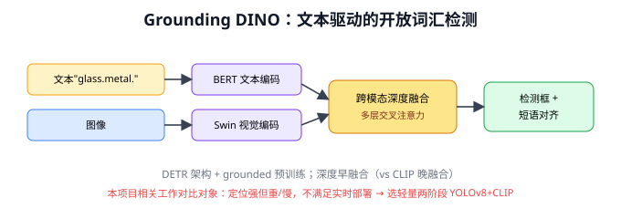
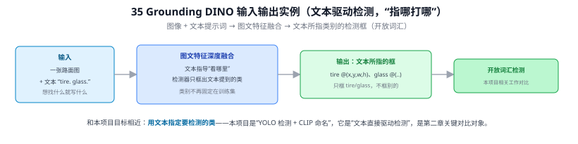
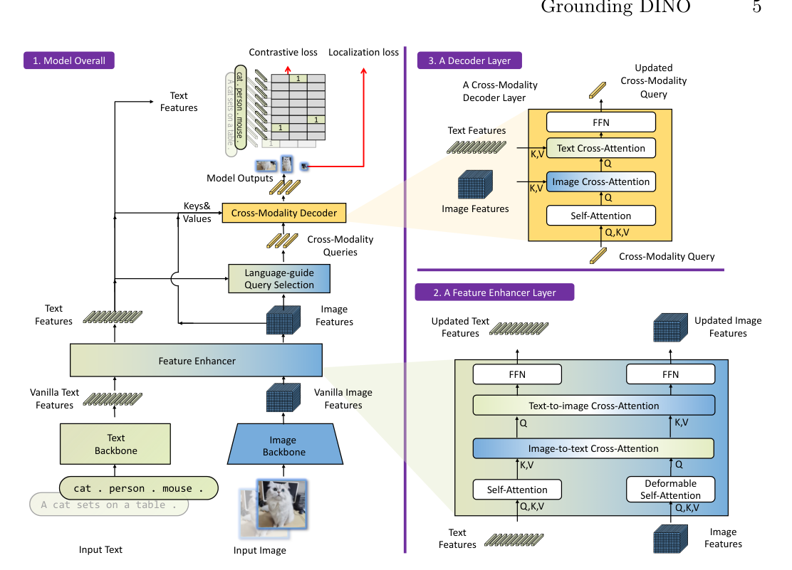
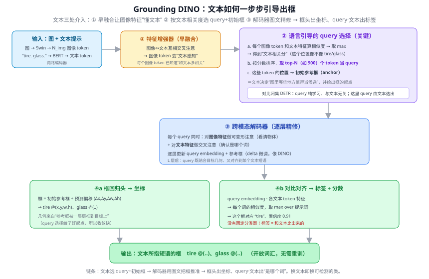
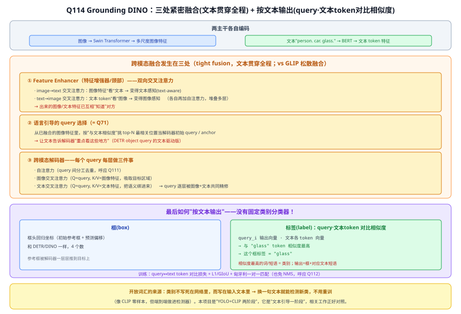
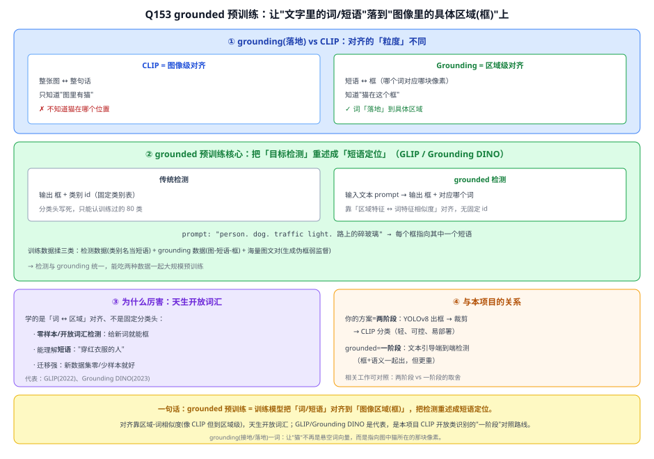
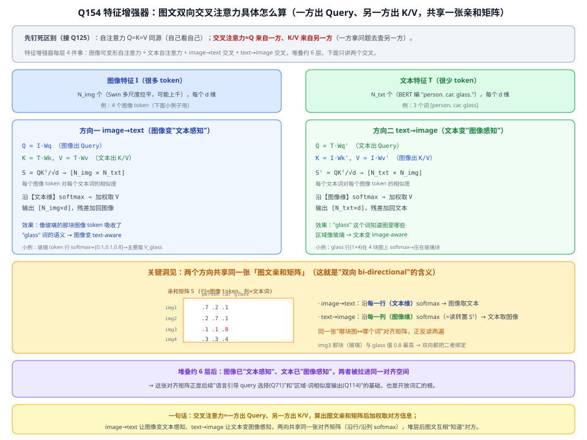

# 35 Grounding DINO

> 定位：开放词汇目标检测的代表作——用文本直接驱动检测（"指哪打哪"）。与本项目 CLIP 模块目标相近，是第二章相关工作的关键对比对象。
> 作者：Liu 等（IDEA Research），2023。
> **输入 / 输出**：图像 + 文本提示词 → 文本所指类别的检测框

---



> 📥📤 **输入/输出实例（看一组具体数值）**：输入一张路面图 + **文本提示词** "tire. glass."（想找什么就写什么）→ 图文特征深度融合（文本指导"看哪里"，检测器只框出文本提到的类）→ 输出**文本所指的框** tire @(x,y,w,h)、glass @(..)，**只框 tire/glass、不框别的**。类别不再固定在训练集——这就是**开放词汇检测**。和本项目目标相近（用文本指定要检测的类）：本项目是"YOLO 检测 + CLIP 命名"、它是"文本直接驱动检测"，是第二章关键对比对象。



> 📄 **论文原图对照**（图源：Liu et al., *Grounding DINO*, [arXiv:2303.05499](https://arxiv.org/abs/2303.05499) Figure 3，原文 [PDF](../papers/35_GroundingDINO_2303.05499.pdf)；仅笔记内学习引用，论文写作须自绘）：



> 整体框架：特征增强器图文双向融合 → 语言引导 query 选择 → 跨模态解码器——三处 tight fusion（Q71/Q114），标签由 query·文本相似度出。

## 一、提出背景

传统检测器（YOLO、Faster R-CNN）只能检测**训练时定义好的固定类别**。CLIP（33）能开放词汇**分类**，但它本身不会**定位**（不输出框）。能不能有一个检测器，**输入任意文本，就能在图中框出对应物体**？这就是开放词汇检测（Open-Vocabulary / Open-Set Detection），Grounding DINO 是其中的标杆。

它把两个东西结合：
- **DINO**：基于 DETR（28a）的强力闭集检测器
- **Grounded pre-training**：文本-图像对齐的预训练

---

## 二、核心方法

### 2.1 整体思路：文本驱动检测
```
文本 prompt（"glass . metal . plastic bucket"）──► BERT 文本编码器
图像 ──► Swin Transformer 视觉编码器
              │
        特征融合（多层跨模态注意力，文本↔图像深度交互）
              │
        DETR 式解码器（语言引导的 query 选择）
              │
        输出：与文本对应的检测框 + 短语对齐
```

### 2.2 三处特征融合 ⭐
Grounding DINO 的关键是**在多个阶段做视觉-语言融合**（不像 CLIP 只在最后算一次相似度）：
1. **Feature Enhancer**：图像特征和文本特征做双向交叉注意力
2. **Language-guided Query Selection**：用文本引导选择最相关的检测 query
3. **Cross-Modality Decoder**：解码时持续融合文本

这种"深度早融合"使它能精确地把文本短语对齐到图像区域，比 CLIP 的"晚融合点积"定位能力强得多。

---

## 三、能力与意义

- **零样本检测**：给一句话（甚至自然语言描述）就能检测，无需该类别的训练数据
- **短语定位（Phrase Grounding）**：把句子中的短语对应到图像框
- 与 36 SAM 组合（Grounded-SAM）：文本→框→精确分割，成为强大的"文本可控视觉感知"流水线

---

## 四、Grounding DINO vs 本项目方案（关键对比）⭐

| 维度 | Grounding DINO | 本项目（YOLOv8 + CLIP） |
|------|----------------|------------------------|
| 开放词汇方式 | **端到端**文本驱动检测（检测+识别一体） | **两阶段**：YOLOv8 检测 + CLIP 识别（解耦） |
| 视觉-语言融合 | 深度早融合（多层交叉注意力） | 晚融合（裁剪后算相似度） |
| 模型大小/速度 | 大、慢（Swin + BERT + DETR 解码） | 小、快（YOLOv8 + CLIP ViT-B/32） |
| 训练成本 | 高（需大规模 grounding 数据预训练） | 低（直接用预训练权重） |
| 适合场景 | 通用开放检测 | **实时、可部署的特定场景**（路面） |

**本项目为什么不直接用 Grounding DINO？**
- 太重、太慢，不满足实时 < 100ms 的部署目标
- 本项目要做的是"改进的小目标检测 + 轻量开放类识别"，两阶段方案更可控、更易做消融实验、计算成本低
- 但 Grounding DINO 是**必须讨论的相关工作**：它代表"开放词汇检测"的 SOTA 方向，本项目的方案是它的"轻量化、可部署"替代路线。这正是论文 differentiate（区分贡献）的好抓手。

---

## 五、与本项目的关系

- **相关工作核心对比对象**（第二章）：体现本项目对开放词汇检测全景的把握，并凸显本项目"轻量两阶段"路线的定位。
- **不直接使用**，但其"文本驱动 + 视觉语言融合"思想与本项目 CLIP 模块同源。
- 可作为论文中"未来工作/对比基线"的候选——若有算力，可跑 Grounding DINO 作为开放检测的上界参考。

---

## ✏️ 具体实例（走一张图）

**例：用一句文本提示去"框"出物体（开放词汇检测）**
```
输入：图 + 文本提示 "plastic . metal . debris ."（点号分隔多个待检类）
  ① 图像 → 图像特征；文本 → 文本特征
  ② 跨模态融合（特征增强 + 文本引导的 query 选择）
  ③ 输出：框 + 每个框对应文本里的哪个短语
输出：框1→"plastic"，框2→"debris" ...
```
**和闭集检测器（YOLOv8）的根本差别**：YOLOv8 只能检训练时定义的固定类；Grounding DINO 把"类别"换成**任意文本短语**，给新词就能检新物体（开放词汇），无需重训。

**例：与本项目的关系（相关工作对比）**
Grounding DINO 是"文本提示直接出框"的端到端开放检测；本项目走的是**两段式**——YOLOv8 出框 + CLIP 判类（33 CLIP）。第二章相关工作里，Grounding DINO 是开放词汇检测的重要对比基线（更强但更重、更慢，本项目要实时故不采用）。

---

## 六、参考文献

- Liu S, et al. *Grounding DINO: Marrying DINO with Grounded Pre-Training for Open-Set Object Detection.* 2023.
- Zhang H, et al. *DINO: DETR with Improved DeNoising Anchor Boxes.* ICLR 2023.

---

## 📋 模型答疑（来自模型详解问答）

> 专属本模型的问答集中在此；跨模型的通用问答见答疑总目录。

---

## Q71. Grounding DINO 的文本引导 query 选择如何一步步得到输出框？

**简答**：你问的"query 选择如何达到输出框"，要拆成**两件事**：query 选择负责"**框从哪儿起、哪些位置值得算**"，输出框的坐标其实由**解码器 + 回归头**完成、标签由**query 和文本对齐**完成。文本引导 query 选择 = 用文本相关度从海量图像位置里**挑出最可能是目标的 N 个当起点**（并把它们的位置当初始框），这相当于 DETR 里"object query"的**文本驱动版**；之后这些 query 进解码器逐层把框精修到目标上，再分别出"坐标"和"对应哪个文本短语"。

**展开**：

**① 先有两路编码 + 早融合（铺垫）**
图像过 Swin 骨干 → $N_{img}$ 个图像 token；文本提示 "tire. glass." 过 BERT → 文本 token。**特征增强器**让两者**互相交叉注意**（图像看文本、文本看图像），结果是**每个图像 token 都变得"文本感知"**——它的特征里已经编码了"我这个位置和 tire/glass 有多像"。这是后面能用文本挑 query 的前提。

**② 语言引导的 query 选择（你问的核心）**
这一步**不直接出框**，而是**挑出值得当 query 的图像位置**，三小步：
- **a. 打分**：每个图像 token 和文本特征算相似度，对所有文本词取 max → 得到该位置的"**文本相关分**"（这个位置像不像提示里的某个词）；
- **b. 选 top-N**：按分数排序，取**最高的 N 个（如 900）图像 token 当 query**；
- **c. 给初始框**：这些被选中 token 的**位置 → 初始参考框（anchor 框）**，特征 → 初始化 query。

一句话：**文本决定"图里哪些地方值得当候选"，并给出框的起跑线**。这和闭集 DETR 的根本区别是——DETR 的 query 是**纯学习、与文本无关**的固定一组；Grounding DINO 的 query 是**被文本选出来**的，所以它能"只关注文本提到的东西"。



**③ 跨模态解码器：把框"推"到目标上**
被选中的 query（带初始参考框）进入 DETR 式解码器，**每一层**里每个 query 同时做两件事：
- 对**图像特征**做**可变形注意力**（看清目标的样子、边界）；
- 对**文本特征**做**交叉注意力**（确认自己对应哪个词）。
每层都更新 query embedding 和它的参考框（预测一个 delta 微调，像 DINO 的迭代式 anchor 精修）。$L$ 层之后，query 既**贴合了目标几何**、又**对齐到了某个文本短语**。

**④ 两个输出头：坐标 + 标签**
- **④a 框回归头**：最终框 = **初始参考框 + 预测偏移** $(\Delta x,\Delta y,\Delta w,\Delta h)$ → tire @(x,y,w,h)。几何来自"参考框被一层层推到目标上"——正因为 query 选择给了**好起点**，收敛又快又准。
- **④b 对比对齐头**：把 query embedding 和**每个文本 token 特征做点积** → 每个词的相似度，对提示词取 max → 这个框**对应 "tire"、置信度 0.91**。**没有固定分类器**，标签是"和文本比出来的"。

**⑤ 为什么这套设计能开放词汇**
因为"是什么类"不靠固定分类层，而靠 **query 和文本特征的相似度**（④b）。**换一句文本提示**（比如加 "wood block."），就多了一个可对齐的目标，无需重训——这正是开放词汇检测的本质（思想上和 CLIP 的"图文比相似度"一脉相承，只是 Grounding DINO 把它端到端做进了检测器）。

**⑥ 与本项目（两段式 vs 端到端的对照）**
本项目走**两段式**：YOLOv8 先出框（25d）→ 对框内图块用 CLIP 比文本模板判类（33）。Grounding DINO 是**端到端**：文本从一开始就融进特征、引导 query、参与精修和判类。对照记忆：
- **本项目**：检测与命名**解耦**（YOLO 管"哪里有"、CLIP 管"是什么"），简单、实时（< 100ms），但两段误差会累积；
- **Grounding DINO**：文本**全程参与**，开放检测更强，但模型重、慢，不满足本项目实时要求。
所以它是第二章相关工作里"文本驱动检测"的**重要对比基线**，理解它的"文本引导 query 选择"，才说得清本项目为何选更轻的两段式方案。

---

## Q114. Grounding DINO 具体如何实现跨模态融合？最后又如何按文本输出？

Grounding DINO = DINO 检测器 + 文本引导，文本**贯穿全程**。两主干先各自编码（图像→Swin、文本→BERT，类别用句点分隔 "person. car. glass."）。

**跨模态融合三处**：
1. **Feature Enhancer（颈部）**：图文**双向交叉注意力**——image→text 让图像变文本感知、text→image 让文本变图像感知，堆叠多层后图文特征已互相"知道"对方；
2. **语言引导 query 选择（=Q71）**：从融合后的图像特征里按与文本相似度挑 top-N 当解码器初始 query（DETR object query 的文本驱动版）；
3. **跨模态解码器**：每 query 每层做自注意力（去重）+ 图像交叉注意力（吸目标区域）+ 文本交叉注意力（绑语义）。

**如何"按文本输出"（和普通检测器最本质的区别）**：**没有固定类别分类器**——框头回归坐标（同 DINO）；标签靠把每个 query 输出向量和**每个文本 token 算相似度（点积）**，最像哪个词就标哪个词。所以输出是"框 + 它对应到输入文本的哪个短语"，换文本即换类别 → 开放词汇（像 CLIP 零样本，但端到端做进检测器）。训练用 query↔token 对比损失 + L1/GIoU + 匈牙利匹配（免 NMS）。



> 相关工作对照（第二章有用）：

| | Grounding DINO | 本项目 YOLO+CLIP |
|---|---|---|
| 范式 | 一阶段、文本引导、端到端 | 两阶段：YOLO 检框→CLIP 分类 |
| 文本何时介入 | 全程（三处融合） | 只在最后 CLIP 比对 |
| 开放词汇 | 检测+识别一体 | 检测闭集 + CLIP 补开集 |
| 部署 | 重（Swin+BERT+融合） | 轻（YOLOv8s+CLIP ViT-B/32，<100ms） |

理解它的"三处融合 + 对比对齐输出"，才说得清本项目为何选更轻的两段式。

## Q153. 何为 grounded 预训练（grounded language-image pre-training）？

**简答**：grounded 预训练让模型学会"词/短语↔图像区域（框）"的对齐，把检测重述成短语定位。相比 CLIP 的图像级对齐（只知有没有、不知在哪），grounding 是区域级（知道在哪个框）。因为学的是词-区域相似度而非固定分类头，所以天生能开放词汇检测。GLIP、Grounding DINO 是代表。

**展开**：

**① grounding（落地）是什么意思**：让"猫"这个词不再是悬空的词向量，而是**指向图中猫所在的那块像素**。"接地/落地"= 把抽象符号（词）连到具体感知（图像区域）。

**② 和 CLIP 的粒度差别**：
- CLIP = **图像级**对齐：整张图 ↔ 整句话，能判"图里有没有猫"，但**不知道猫在哪**。
- Grounding = **区域级**对齐：短语 ↔ 框，知道"哪个词对应哪个框"。

**③ 核心：把检测重述成短语定位**：
- 传统检测：输出 框 + 类别 id（固定类别表，分类头写死，只认训练过的类）。
- grounded 检测：输入文本 prompt（如 `"person. dog. traffic light. 路上的碎玻璃"`）→ 输出每个框 + 它对应 prompt 里的哪个短语，靠**区域-词相似度**对齐、无固定 id。
- 训练数据统一了检测（类别名当短语）+ grounding（图-短语-框）+ 图文对（生成伪框弱监督），能大规模预训练。

**④ 为什么天生开放词汇**：学的是"词↔区域"对齐、不是固定分类头，所以给一个**训练时没见过的新词**也能把对应物体框出来（零样本/开放词汇检测）；还能理解带修饰的短语。

**⑤ 与本项目的关系**：
- 你的方案 = **两阶段**：YOLOv8 检测框 → 裁剪 → CLIP 分类（轻、可控、易部署，实时<100ms）。
- grounded（GLIP/Grounding DINO）= **一阶段**：文本引导端到端检测，框和语义一起出，但模型重（Swin+BERT+跨模态融合）。
- 第二章相关工作对照"两阶段 vs 一阶段"，说清本项目为何选更轻的两段式（对照 [Q71](#q71-grounding-dino-的文本引导-query-选择如何一步步得到输出框)/[Q114](#q114-grounding-dino-具体如何实现跨模态融合最后又如何按文本输出)）。



---

## Q154. 特征增强器里，图像和文本的双向交叉注意力具体如何进行？

**简答**：交叉注意力就是标准注意力，只不过 **Q 来自一个模态、K/V 来自另一个模态**。image→text 用图像当 Query 去查文本，把相关词的语义吸进来（图像变文本感知）；text→image 用文本当 Query 去查图像（文本变图像感知）。两个方向底下是**同一张图文相似度矩阵**，一个沿文本维 softmax、一个沿图像维 softmax。堆几层后图文对齐进同一空间。

**展开**：

**① 交叉 vs 自注意力（唯一区别）**
- 自注意力：Q、K、V 同源（图像看图像、文本看文本）——增强器里图像用可变形自注意力、文本用普通自注意力。
- 交叉注意力：**Q 来自一方、K/V 来自另一方**（Q125 里 Q=问题、K=索引、V=内容）。

**② 两组输入**
- 图像特征 I：N_img 个 token（Swin 多尺度拉平，可能上千），每个 d 维。
- 文本特征 T：N_txt 个 token（BERT 编 `"person. car. glass."`），每个 d 维。

**③ image→text（图像变"文本感知"）**
$$Q=I W_q,\quad K=T W_k,\quad V=T W_v$$
1. $S=\dfrac{QK^\top}{\sqrt d}$，形状 **[N_img×N_txt]**（每个图像 token 对每个文本词的相似度）；
2. 沿**文本维** softmax → 每个图像 token 在文本上的注意力分布；
3. 输出 $=\text{softmax}(S)V$ → [N_img×d]，**残差加回**图像特征。
- 效果：像玻璃的那块图像 token（设它对 glass 相似度最高，行 softmax≈[0.1,0.1,0.8]）→ 输出≈0.1·V_person+0.1·V_car+0.8·V_glass，主要吸收 `glass` 语义 → **text-aware**。

**④ text→image（文本变"图像感知"）**
$$Q=T W_q',\quad K=I W_k',\quad V=I W_v'$$
1. $S'=\dfrac{QK^\top}{\sqrt d}$，形状 **[N_txt×N_img]**；
2. 沿**图像维** softmax → 每个文本词在图像上的分布；
3. 输出 → [N_txt×d]，残差加回文本特征。
- 效果：`glass` 那一行（1×N_img）在图像 token 上 softmax，把注意力压在玻璃那块 → `glass` 吸收其视觉特征 → **image-aware**。

**⑤ 关键：两方向共享一张亲和矩阵**
image→text 的 $S_{[N_{img}\times N_{txt}]}$ 与 text→image 的 $S'_{[N_{txt}\times N_{img}]}$ 本质是**同一张"图↔词"对齐矩阵的两个读法**：一个沿行（文本维）softmax、一个沿列（图像维，=转置 $S^\top$）softmax。这就是"**双向 bi-directional 交叉注意力**"——一张亲和矩阵正反读两遍。矩阵里 img3(玻璃块)↔glass 值最高 → 双向都把二者绑定。

**⑥ 为什么这么做**
堆约 6 层后，图像特征已文本感知、文本特征已图像感知，两者被**拉进同一个对齐语义空间**。这样后面才能：语言引导 query 选择（[Q71](#q71-grounding-dino-的文本引导-query-选择如何一步步得到输出框)，按图文相似度挑 query）、以及最终"框的 query 向量 · 文本 token 相似度→标签"的开放词汇输出（[Q114](#q114-grounding-dino-具体如何实现跨模态融合最后又如何按文本输出)）。这就是"tight fusion"（紧融合）区别于 CLIP 那种"各编各的、最后才比一次"的地方。

> 与本项目：你的两阶段方案（YOLOv8→CLIP）里图文**只在最后 CLIP 比一次**（松融合）；Grounding DINO 的特征增强器是**全程紧融合**。理解这套双向交叉注意力，第二章相关工作才说得清"紧融合(重、强) vs 松融合(轻、可控)"的取舍（对照 [Q114](#q114-grounding-dino-具体如何实现跨模态融合最后又如何按文本输出) ⑤）。



---
