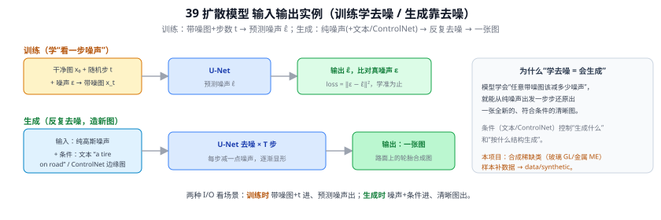
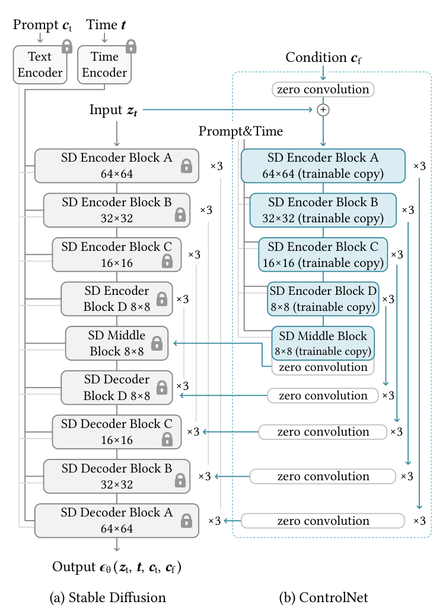
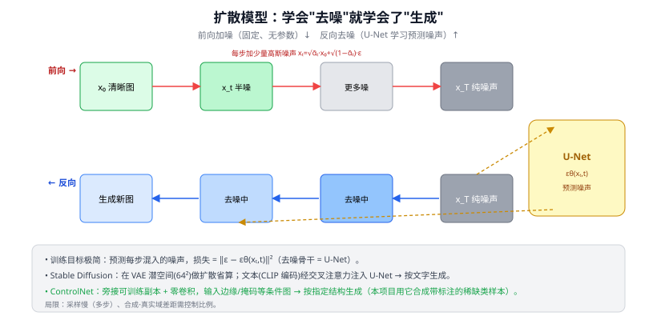

# 39 扩散模型：DDPM → Stable Diffusion → ControlNet

> 生成模型 · 之二（本项目数据增强引擎）　|　⬅ 返回目录
> 关键词：前向加噪 / 反向去噪 / U-Net 噪声预测 / 潜空间 LDM / 文本条件 / ControlNet 结构控制
> **输入 / 输出**：训练：带噪图 + 步数 t → 预测噪声 ε̂；生成：噪声（+文本/ControlNet 条件）→ 图像

---

> 📥📤 **输入/输出实例（看一组具体数值）**：分两个场景看 I/O。**训练时**（学"看一步噪声"）：干净图 $x_0$ + 随机步 $t$ + 噪声 $\varepsilon$ → 带噪图 $x_t$ → U-Net 预测噪声 $\hat\varepsilon$ → 损失 $\lVert\varepsilon-\hat\varepsilon\rVert^2$，学准为止。**生成时**（反复去噪造新图）：输入纯高斯噪声 +（文本 "a tire on road" / ControlNet 边缘图等条件）→ U-Net 去噪 × $T$ 步，每步减一点噪声逐渐显形 → 输出一张全新清晰图。"学会去噪 = 学会生成"：会判断任意带噪图该减多少噪声，就能从纯噪声还原出符合条件的图。本项目可把它作为稀缺类数据增强的辅助方案，但必须与零样本留出协议隔离。

> 📄 **论文原图对照**（图源：Zhang et al., *Adding Conditional Control to Text-to-Image Diffusion Models*, [arXiv:2302.05543](https://arxiv.org/abs/2302.05543) Figure 3，原文 [PDF](../papers/39_ControlNet_2302.05543.pdf)（DDPM 原图见 46）；仅笔记内学习引用，论文写作须自绘）：

> 冻结 SD 主干（左灰锁），可训练副本（右蓝）经 zero convolution 注入条件——零初始化保证训练起步完全不破坏原模型。

## 一、提出背景：为什么需要它

完整重建后的数据集内，稀缺类是 GL（124）、RU（257）和 ST（278）。**用生成模型合成路面抛洒物图像**是一种待验证的补数据手段。GL/RU 同时是零样本留出类，不能把其合成图加入主 YOLO 训练，否则会造成协议泄漏；主线如做增强，应优先从 ST 开始。当前未建立扩散增强模块；只有实际开展后再创建目录和实验入口。

核心直觉极简：**学会"去噪"，就学会了"生成"。** 如果一个网络能把"加了噪声的图"一点点还原成清晰图，那么从一张纯噪声出发反复去噪，就能"无中生有"造出一张全新的图。

---

## 二、核心原理

### ① 前向过程：逐步加噪（无需学习）
对真实图 $x_0$，分 $T$ 步（如 1000）不断加入少量高斯噪声，直到变成纯噪声 $x_T\sim\mathcal N(0,I)$：

$$x_t=\sqrt{\alpha_t}\,x_{t-1}+\sqrt{1-\alpha_t}\,\epsilon,\qquad \epsilon\sim\mathcal N(0,I)$$

这一步是**固定的、不含参数**的，只是按计划表往图里掺噪声。借助重参数化可一步直达任意 $t$：$x_t=\sqrt{\bar\alpha_t}\,x_0+\sqrt{1-\bar\alpha_t}\,\epsilon$。

### ② 反向过程：逐步去噪（要学习的部分）
训练一个网络 $\epsilon_\theta(x_t,t)$，**输入带噪图和步数 $t$，预测当中混进的噪声 $\epsilon$**。损失出奇简单——预测噪声与真实噪声的均方误差：

$$\mathcal L=\mathbb E_{x_0,t,\epsilon}\big[\;\lVert \epsilon-\epsilon_\theta(x_t,t)\rVert^2\;\big]$$

预测出噪声就能反推上一步更干净的图，迭代 $T$ 次：纯噪声 → … → 清晰图。这个"图进图出、预测同尺寸噪声图"的网络骨干，正是 **U-Net**（38 U-Net）——这就是为什么要先懂 U-Net。

### ③ Stable Diffusion（潜空间扩散 LDM）：把扩散搬进小空间
在 512×512 像素上跑 1000 步去噪太贵。LDM（Rombach et al., CVPR 2022）的关键提速：先用一个 **VAE 编码器**把图压到小得多的**潜空间**（如 64×64），在潜空间里做扩散，最后 VAE 解码器还原成像素图。算力大降，质量不减——这就是 **Stable Diffusion**。

### ④ 文本条件：让生成"听话"
要"a glass bottle on the road"这样按文字生成，就把**文本编码**（常用 CLIP 文本编码器，33 CLIP）通过**交叉注意力**注入 U-Net 的每一层，让去噪过程"看着文字"走。于是文本提示 → 对应图像。本项目可借此定向合成各类抛洒物。

### ⑤ ControlNet：加上"结构控制"（本项目最相关）
纯文本生成位置、形状不可控。**ControlNet**（Zhang et al., ICCV 2023）在冻结的 Stable Diffusion 上**旁接一个可训练副本**，输入一张**条件图**（边缘图 / 深度图 / 分割掩码 / 姿态等），用"**零卷积（zero-conv）**"逐步注入控制信号，使生成图在**保持给定结构**的前提下填充内容。

> 对本项目：可拿一张路面背景 + 指定抛洒物的**位置框/边缘/掩码**作为条件，生成"在指定位置、指定形状"的稀缺类样本——而且**结构已知 = 标注天然就有**，省去人工标注。这正是稀缺类数据增强最理想的形态。

---

## 三、关键创新与历史地位

| 模型 | 关键贡献 |
|------|---------|
| DDPM (2020) | 把扩散做成实用生成模型，简单的噪声预测损失 |
| LDM / Stable Diffusion (2022) | 潜空间扩散，算力大降，开源普及 |
| ControlNet (2023) | 结构可控生成，冻结主干 + 零卷积旁路 |

历史地位：扩散模型取代 GAN 成为图像生成主流（训练更稳、模式覆盖更全、可控性更强），是 AIGC 浪潮的技术底座；Stable Diffusion 的开源更让它成为研究与工业的事实标准。

---

## 四、局限
- **采样慢**：原始需几十~上千步去噪（GAN 一步出图）→ DDIM、LCM、蒸馏等加速。
- **合成-真实域差距**：生成图与真实采集图存在分布差异，直接混入训练需谨慎（控制比例、做域适配），否则可能引入偏差。
- **可控性仍有限**：细粒度属性、文字、计数等仍易出错。

---

## ✏️ 具体实例（动手算一遍：训练一步）

训练时**不需要**真的跑完 1000 步，每次只采一步：

1. 取一张真实抛洒物图 $x_0$，随机抽步数 $t=200$。
2. 抽一份高斯噪声 $\epsilon$，按 $x_t=\sqrt{\bar\alpha_{200}}\,x_0+\sqrt{1-\bar\alpha_{200}}\,\epsilon$ 一步合成带噪图 $x_{200}$（设 $\bar\alpha_{200}=0.6$：$x_{200}=\sqrt{0.6}\,x_0+\sqrt{0.4}\,\epsilon\approx0.775\,x_0+0.632\,\epsilon$）。
3. 把 $x_{200}$ 和 $t=200$ 喂进 U-Net，输出预测噪声 $\hat\epsilon=\epsilon_\theta(x_{200},200)$。
4. 损失 $=\lVert\epsilon-\hat\epsilon\rVert^2$，反向传播更新 U-Net。

**生成（推理）时**：从纯噪声 $x_T$ 开始，反复"预测噪声→去掉一点"，$T\to0$ 得到新图。条件生成则在每步把文本/ControlNet 信号注入 U-Net。

---

## 五、与本项目的关系
- **可选后续实验**：用 Stable Diffusion + ControlNet 生成结构可控的候选增强样本；主训练优先考虑 ST，GL/RU 必须保持零样本留出，除非另设一组明确标注为“非零样本”的独立实验。
- **去噪骨干 = U-Net**：38 U-Net 是前置；文本编码常用 CLIP（33 CLIP），与本项目创新点 2 共用 CLIP 生态。
- **写论文定位**：扩散增强属"辅助模块"（CLAUDE.md 已定调，非主要贡献），第五章作为数据增强对比项；务必报告**合成比例**与**对 mAP 的实际影响**，避免合成-真实域差距带来的虚高或偏差。

---

## 参考文献
1. Ho J, Jain A, Abbeel P. **Denoising Diffusion Probabilistic Models (DDPM).** NeurIPS 2020.
2. Rombach R, et al. **High-Resolution Image Synthesis with Latent Diffusion Models (Stable Diffusion).** CVPR 2022.
3. Zhang L, Rao A, Agrawala M. **Adding Conditional Control to Text-to-Image Diffusion Models (ControlNet).** ICCV 2023.
4. Song J, Meng C, Ermon S. **Denoising Diffusion Implicit Models (DDIM).** ICLR 2021.
