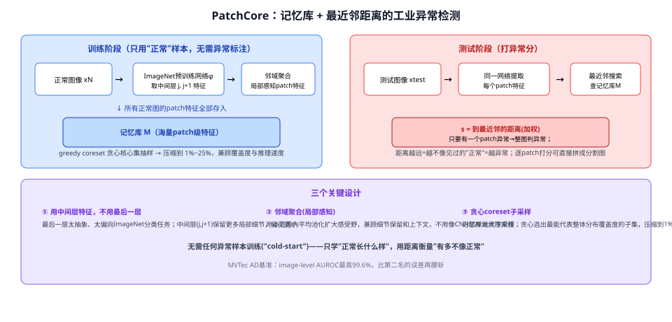
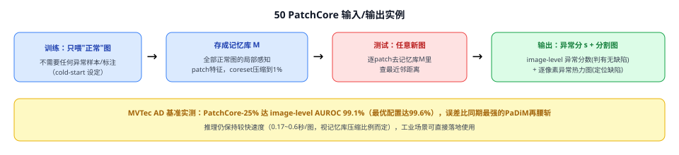
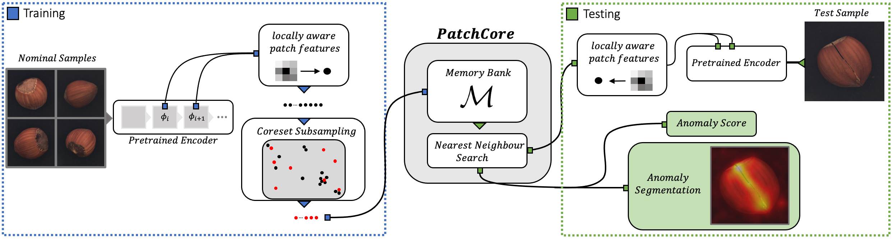
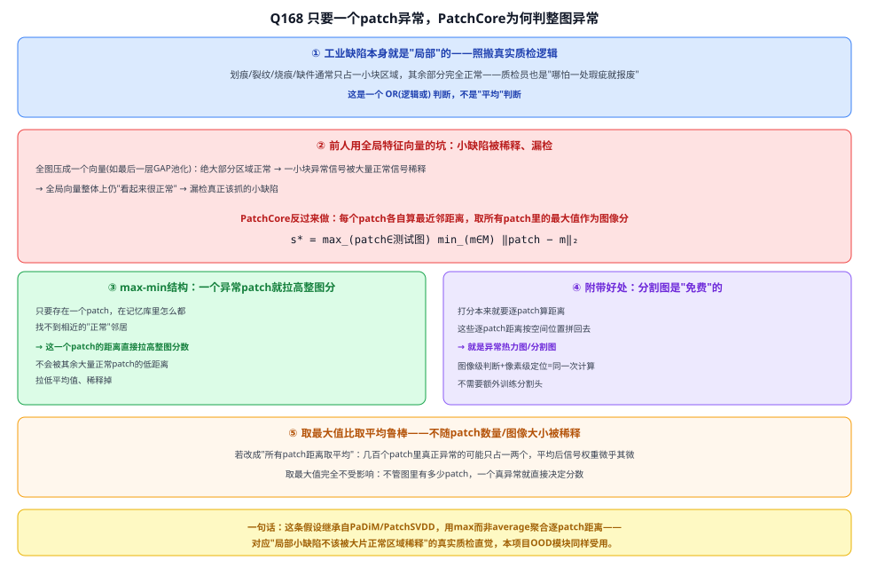
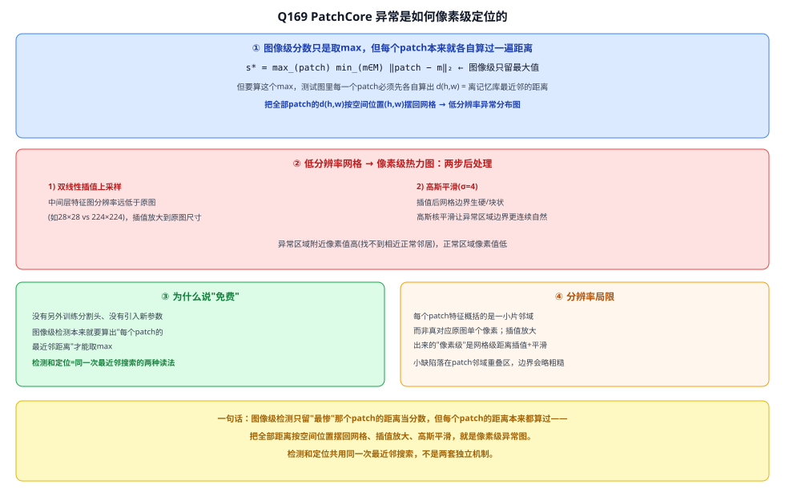

# 50 PatchCore

> 定位：工业**异常检测（OOD/one-class）**的代表作——只用"正常"样本训练，靠"离正常样本有多远"打异常分，不需要任何异常标注。是本项目"OOD 打分（余弦距离异常置信度）"辅助模块的直接理论依据。
> 作者：Roth 等（Amazon AWS / 图宾根大学），*Towards Total Recall in Industrial Anomaly Detection*，CVPR 2022（arXiv:2106.08265）。
> 前置：04 CNN 卷积神经网络原理（预训练特征提取）、33 CLIP（同属"用预训练特征做度量比较"的思路，度量对象不同）。
> **输入 / 输出**：（建库）大量"正常"图像 → 记忆库 M（patch 级特征集合）；（推理）任意新图 → 图像级异常分数 + 像素级异常热力图

---



> 📥📤 **输入/输出实例**：**建库阶段**——只喂"正常"（无缺陷）图像，过一个 ImageNet 预训练网络，取中间层（第 2、3 个 block）特征，做邻域聚合得到"局部感知 patch 特征"，把所有正常图的 patch 特征全部塞进记忆库 M，再用贪心 coreset 抽样压缩到 1%~25%。**推理阶段**——新图同样切成 patch 特征，逐个去记忆库里查**最近邻距离**；只要有一个 patch 离记忆库里所有正常特征都很远，整张图就判为异常；把每个 patch 的距离按空间位置拼回去，就是像素级异常分割图。全程**不需要一张异常样本**（cold-start 设定）。



> 📄 **论文原图对照**（图源：Roth et al., *Towards Total Recall in Industrial Anomaly Detection*, [arXiv:2106.08265](https://arxiv.org/abs/2106.08265) Figure 2，原文 [PDF](../papers/50_PatchCore_2106.08265.pdf)；仅笔记内学习引用，论文写作须自绘）：



> 正常样本 → 局部感知 patch 特征 → coreset 压缩记忆库；测试图逐 patch 查最近邻距离，既出图像级异常分又出像素级分割。

## 一、提出背景

工业质检有一个天然的"冷启动"难题：**能大量拿到"合格品"图像，却几乎拿不到"缺陷品"图像**——缺陷类型五花八门、难以穷举，靠有监督分类训练一个"缺陷检测器"行不通。这本质上是一个**分布外检测（Out-of-Distribution Detection）/ 单类分类（One-Class Classification）**问题：只学"正常长什么样"，测试时判断新样本"有多不像正常"。

在 PatchCore 之前，SPADE、PaDiM 等方法已经证明了一条有效路径：**直接用 ImageNet 预训练网络的深层特征做度量比较**，不需要在目标数据上重新训练，就有不错的异常检测效果。但它们各有短板——SPADE 用全图特征做图像级判断，损失了局部细节；PaDiM 需要训练图与测试图尺寸严格一致，且要对每个 patch 位置单独估计高斯分布（均值+协方差），对齐要求高、可扩展性差。PatchCore 的目标是：**在保留局部细节、不依赖图像对齐的前提下，把检测和定位精度都做到当时的最优，同时保持推理够快、能落地**。

---

## 二、核心方法 ⭐

### 2.1 三个关键设计

| 设计 | 做法 | 为什么 |
|---|---|---|
| **局部感知 patch 特征** | 取 ImageNet 预训练网络的**中间层**（如 WideResNet50 的 block 2+3），对每个空间位置做小邻域（如 3×3）平均池化聚合 | 最后一层太抽象、偏向 ImageNet 分类语义，和工业缺陷关系不大；中间层保留更多局部细节，邻域聚合又能在不牺牲分辨率的前提下扩大感受野、抗小幅空间偏移 |
| **记忆库 M** | 把所有"正常"训练图的 patch 特征**原样存起来**（不建模、不压缩成分布参数），M 就是一个海量特征点的集合 | 非参数化（non-parametric）——不像 PaDiM 那样假设每个位置的特征服从高斯分布，因此不需要训练图/测试图尺寸对齐，泛化性更好 |
| **贪心 coreset 子采样** | 用贪心 minimax facility location 算法，从 M 里挑出一个能最大程度覆盖原始分布"空间支撑"的小子集 $M_C$，压缩到 1%~25% | 随机抽样在多峰分布上会漏掉小簇，coreset 能保留分布形状的同时大幅减小检索库体积，兼顾精度与推理速度/存储 |

### 2.2 异常打分怎么算

测试图 $x_\text{test}$ 切出 patch 特征集合 $P(x_\text{test})$，对每个 patch 特征 $m_\text{test}$ 都去记忆库 $M$ 里找**最近邻** $m^*$，取欧氏距离：

$$s^* = \max_{m_\text{test}\in P(x_\text{test})} \min_{m\in M} \lVert m_\text{test} - m\rVert_2$$

直觉：**只要有一个 patch 在记忆库里找不到相近的"正常"邻居，这张图就判异常**——这正是"图像级异常=至少一个局部区域异常"的假设。论文进一步用最近邻自身在记忆库里是否"孤立"（周围邻居也很稀疏）对距离做重新加权，让打分对噪声更鲁棒。逐 patch 的距离按原空间位置拼回去，插值放大到原图分辨率，就是**像素级异常分割图**——检测和定位由同一套距离计算自然导出，不需要额外训练分割头。

### 2.3 训练与使用两阶段

1. **建库（无需异常样本）**：正常图 → 预训练网络中间层特征 → 邻域聚合 → 灌入记忆库 M → coreset 压缩。
2. **推理**：新图同样提特征 → 查最近邻距离 → 图像级异常分数 + 像素级异常图。

---

## 三、关键结论

- **MVTec AD 基准**：image-level 异常检测 AUROC 最高达 **99.6%**，把当时最强对手（PaDiM）的错误率再减半以上；1725 张测试图里最优阈值下仅 42 张误判。
- **像素级分割**：pixel-wise AUROC 98.1%（PaDiM 97.5%），PRO 指标 93.5%（PaDiM 92.1%），检测和定位同时达到当时最优。
- **coreset 压缩几乎不掉点**：记忆库压缩到 1%（PatchCore-1%）性能与不压缩（100%）几乎持平，同时推理时间大幅下降（0.6s→0.17s/图），压缩比与推理速度可按场景权衡。
- **少样本场景依然有竞争力**：即使只用一小部分正常训练数据，PatchCore 的表现仍能追平其他方法用全量数据的效果，样本效率高。
- **意义**：证明"预训练特征 + 非参数化最近邻比较"这条轻量路线，在工业异常检测上可以不需要任何目标域训练/异常标注就打到当时最优，是 SPADE→PaDiM→PatchCore 这条"预训练特征复用做 OOD"路线的集大成者。

---

## 四、与本项目的关系 ⭐（OOD 打分模块的直接理论依据）

- **对应关系**：PatchCore为“在预训练特征空间中用距离判断异常”提供相关理论背景，但不能把它写成本项目当前OOD实现的直接等价方法。PatchCore学习的是正常工业纹理的patch记忆库；本项目当前用CLIP检测框特征与六个已知类文本原型的相似度，两者的特征对象、参考集合和任务定义都不同。
- **当前简化实现**：开放词汇命名时与全部8类文本比较；OOD打分时只取到6个已知类文本的最大相似度，并取负值作为OOD分数。GL/RU文本不能参与该最大值，否则正确识别的零样本目标反而会获得较高“已知度”。如果未来改用YOLO中间特征、类别视觉原型或多样本记忆库，再讨论与PatchCore的更直接对应关系。
- **可借鉴的具体设计**：① 若未来使用YOLO视觉特征做OOD，可比较中间层与最终层；② 若从单原型升级为每类多个视觉原型，可研究coreset压缩；③ 两者都可用AUROC评价二分类排序能力，但本项目不能直接照搬PatchCore公式并称为同一评估协议，必须明确正负样本定义和打分函数。
- **局限提醒**：PatchCore 需要维护和检索一个（哪怕压缩后的）特征记忆库，本项目若追求极致轻量部署（ONNX/TensorRT，<100ms），更适合用"每类一个原型向量"的简化版本，而非完整记忆库+最近邻搜索。

---

## 五、技术谱系

```
ImageNet 预训练特征复用（无需目标域训练）
  │
  ├─→ SPADE（2020）：全图/多层级特征记忆库，kNN 判异常，图像级判断损失局部细节
  ├─→ PaDiM（2021）：patch 级位置高斯分布 + Mahalanobis 距离，但要求训练/测试图尺寸对齐
  └─→ PatchCore（2022，本文）：局部感知 patch 特征 + 非参数化记忆库 + coreset 压缩
         → 检测与定位同时达到最优，且不要求图像对齐
```

- 同类"用距离/相似度做判别"的思路：33 CLIP 的图文余弦相似度、Q113 Q-Former 等度量学习方法——PatchCore 度量的是"像不像正常"，CLIP 度量的是"像不像这句话描述的类别"，本质都是"预训练特征空间里比距离"。
- 后续：PatchCore 之后，工业异常检测方向进一步发展出基于 Transformer/扩散模型的重建式异常检测方法，但"预训练特征+记忆库/原型比较"这条非参数化路线至今仍是工业界落地的主流选择之一（推理快、无需为每个新产品类型重新训练）。

---

## ✏️ 具体实例（走一遍）

**例：PatchCore 怎么给一张路面图打异常分（假想场景，帮助理解机制）**
```
① 收集大量"正常路面"图像（无抛洒物、无破损）
② 过预训练网络中间层，每张图切出若干 patch 特征，邻域聚合
③ 全部正常 patch 特征灌入记忆库 M，贪心 coreset 压缩到 10%
④ 来一张新的路面图，同样切 patch、提特征
⑤ 每个 patch 去记忆库里查最近邻距离；某处有一块从没见过的"金属反光" patch，
   距离记忆库里所有正常路面 patch 都很远 → 该 patch 判异常
⑥ 该图像级异常分数被拉高，且异常分割图会精确指出"是哪一小块区域"
```
**关键**：全程没有用到任何"抛洒物"标注样本——只靠"这块 patch 是否长得像见过的正常路面"来判断，这正是本项目 OOD 打分模块想要的效果：**对训练时没见过的新型抛洒物类别，也能给出一个"可能是异常"的信号，而不是强行分进某个已知类**。

---

## 📋 模型答疑（来自模型详解问答）

> 专属本模型的问答集中在此；跨模型的通用问答见答疑总目录。

---

## Q168. 只要有一个 patch 异常，正常图就判异常，这是为什么？

**简答**：本质是用"逻辑或"而非"平均"聚合每个patch的异常信号——工业缺陷通常是局部的，取所有patch距离的**最大值**当图像分，一个异常patch就能直接拉高整图分数，不会被周围大片正常区域平均稀释掉；这也是这套方法能同时免费得到像素级分割图的原因（逐patch距离本来就要算，拼回去就是分割图）。



---

## Q169. 异常是如何像素级定位的？

**简答**：图像级分数只留了"最惨"那个 patch 的距离，但每个 patch 的距离本来都各自算过一遍、天然带位置信息。把全部 patch 距离按空间位置摆回网格 → 插值放大到原图尺寸 → 高斯平滑，就是像素级异常图。检测和定位共用同一次最近邻搜索的结果，不需要额外训练分割头，只是分辨率受限于 patch 网格粗细，插值出来的边界不会像真正逐像素计算那样精确。



---

## 六、参考文献

- Roth K, Pemula L, Zepeda J, et al. *Towards Total Recall in Industrial Anomaly Detection (PatchCore).* CVPR 2022.（arXiv:2106.08265）
- Cohen N, Hoshen Y. *Sub-Image Anomaly Detection with Deep Pyramid Correspondences (SPADE).* 2020.（记忆库路线前作）
- Defard T, et al. *PaDiM: a Patch Distribution Modeling Framework for Anomaly Detection and Localization.* ICPR 2021.（patch 级高斯分布路线前作）
