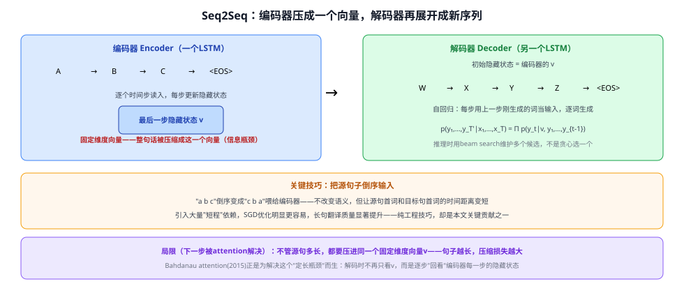

# 02a Seq2Seq

> 定位：**编码器-解码器（Encoder-Decoder）架构的奠基之作**——第一次证明用纯神经网络（两个 LSTM）就能端到端做"任意长度序列→任意长度序列"的任务（机器翻译）。是 注意力机制、Transformer 编码器-解码器结构的直接前身。
> 作者：Sutskever, Vinyals, Le（Google），NeurIPS 2014（arXiv:1409.3215）。
> 前置：02 RNN、03 LSTM（本文的编码器/解码器都是 LSTM）。
> **输入 / 输出**：源语言句子（变长）→ 固定维度向量 → 目标语言句子（变长）

---



> 📥📤 **输入/输出实例**：源句子逐词输入**编码器 LSTM**，读到句尾 `<EOS>` 后，编码器最后一步的隐藏状态就是这句话的**固定维度向量表示** $v$；把 $v$ 当作**解码器 LSTM** 的初始隐藏状态，解码器像语言模型一样自回归地逐词生成目标句子（每步把上一步刚生成的词当作下一步的输入），直到生成 `<EOS>` 停止。推理时用 **beam search** 维护多个候选序列，而不是每步贪心选最高概率的词。


## 一、提出背景

深度神经网络在分类等"定长输入→定长输出"任务上很强，但机器翻译、语音识别、问答这类任务的输入输出都是**长度不固定、且长度还不一样**的序列——DNN 原生并不能处理这种情况。之前有工作尝试用一个 RNN 把整个输入序列映射成一个向量、再用另一个 RNN 从这个向量展开生成输出，但普通 RNN 難处理长距离依赖，直接这么做训练很困难。本文的思路很直接：**RNN 换成 LSTM**（专门擅长长程依赖），看这个"编码器 LSTM 压缩 + 解码器 LSTM 展开"的组合是否能真正跑通一个有实际价值的任务（英法翻译）。

## 二、核心方法 ⭐

### 2.1 两个独立的 LSTM：编码器与解码器

- **编码器**：逐时间步读入源句子的每个词，不断更新隐藏状态；读到句尾，**最后一步的隐藏状态** $v$ 就是整句话的固定维度向量表示。
- **解码器**：是另一个**独立**的 LSTM（不与编码器共享参数），把 $v$ 当作自己的**初始隐藏状态**，之后的生成方式和标准语言模型一样——自回归地逐词预测下一个词，直到生成结束符：
$$p(y_1,\dots,y_{T'}\mid x_1,\dots,x_T) = \prod_{t=1}^{T'} p(y_t\mid v, y_1,\dots,y_{t-1})$$

用**两个独立**的 LSTM（而不是一个共享的），是为了在几乎不增加计算量的前提下增加模型容量，也让同一套框架能自然地扩展到"多语言对训练"。

### 2.2 两个关键工程技巧

| 技巧 | 做法 | 效果 |
|---|---|---|
| **深层 LSTM** | 用 4 层 LSTM 堆叠，而非单层 | 显著优于浅层 LSTM |
| **源句倒序输入** ⭐ | 把源句子 "a b c" 倒过来喂成 "c b a"（目标句子顺序不变） | 不改变语义，但让源句**首词**和目标句**首词**的时间距离变短，引入大量"短程"依赖，SGD 优化明显更容易——长句翻译质量因此显著提升。这是一个纯粹的数据处理技巧，却是本文最关键的贡献之一 |

### 2.3 推理：beam search 而非贪心解码

生成时不是每步只选概率最高的一个词（贪心解码，容易一步错步步错），而是维护 $B$ 个当前最可能的部分假设（beam），每步为每个假设扩展所有候选词、只保留总概率最高的 $B$ 个，直到遇到 `<EOS>`。论文发现哪怕 $B=2$ 也已经拿到了 beam search 的大部分收益。

---

## 三、关键结论

- **WMT'14 英法翻译**：5 个 LSTM 集成模型直接翻译达到 **BLEU 34.8**，超过传统统计机器翻译基线（33.3）；用 LSTM 对 SMT 系统的 1000-best 候选重排序，BLEU 提升到 36.5。
- **首次证明"纯神经网络端到端"路线可行**：不需要人工设计的对齐、短语表等传统 SMT 组件，一个通用的"编码器压缩+解码器生成"框架就能超过精心调过的统计方法。
- **学到的句向量有语义结构**：$v$ 对词序敏感、对主动/被动语态表达相对不变，说明训练目标（翻译）逼着模型学到了"抓住句子含义"的表示，而不只是字面词序列。
- **局限（★ 后续被 attention 解决）**：不管源句多长，都要压缩进**同一个固定维度**的向量 $v$——源句越长，压缩损失越大，这是一个明显的信息瓶颈。Bahdanau attention（2015） 正是为了解决这个"定长向量瓶颈"而提出：解码时不再只依赖 $v$，而是让解码器每一步都能"回看"编码器每个时间步的隐藏状态，按需加权聚合。

---

## 四、与本项目的关系

本项目不直接使用 Seq2Seq 做序列生成任务，但它是理解整条"注意力→Transformer"技术脉络的**历史起点**——27 注意力机制 就是直接为了解决 Seq2Seq 的定长瓶颈而提出的，28 Transformer 的编码器-解码器结构（含 DETR 的集合预测框架）也是 Seq2Seq"编码压缩+解码生成"这套范式的直接延伸（只是把 LSTM 换成了自注意力）。理解 Seq2Seq，有助于理解为什么 Transformer 要设计成编码器-解码器两部分、以及 cross-attention 在其中扮演的角色本质上是什么。

---

## 五、技术谱系

```
RNN/LSTM 语言模型（只能处理"预测下一个"）
  │
  └─→ Seq2Seq（本文）：编码器压成定长向量 v + 解码器自回归展开
        │  局限：定长向量瓶颈，长句压缩损失大
        ▼
   Bahdanau Attention（2015）：解码器每步"回看"编码器全部隐藏状态，解除定长瓶颈
        ▼
   Transformer（2017）：自注意力替代 LSTM，编码器/解码器均可并行计算
```

---

## ✏️ 具体实例（走一遍）

**例：把 "A B C" 翻译成 "W X Y Z"**
```
① 源句倒序输入编码器：C → B → A → <EOS>
② 编码器最后一步隐藏状态 = v（固定维度向量，压缩了整句"ABC"的含义）
③ 解码器以 v 为初始状态，自回归生成：
   输入<BOS> → 输出W → 输入W → 输出X → 输入X → 输出Y → 输入Y → 输出Z → 输入Z → 输出<EOS>
④ beam search维护若干候选序列，最终选总概率最高的一条
```
**关键**：解码器每一步都能看到 $v$（编码器压缩的"全句摘要"），但看不到编码器中间任何一步的细节——这正是下一代模型（attention）要解决的地方。

---

## 六、参考文献

- Sutskever I, Vinyals O, Le Q V. *Sequence to Sequence Learning with Neural Networks.* NeurIPS 2014.（arXiv:1409.3215）
- Cho K, et al. *Learning Phrase Representations using RNN Encoder-Decoder for Statistical Machine Translation.* EMNLP 2014.（同期提出的编码器-解码器思路）
- Bahdanau D, et al. *Neural Machine Translation by Jointly Learning to Align and Translate.* ICLR 2015.（解决定长瓶颈的 attention 机制，见 27 注意力机制）
