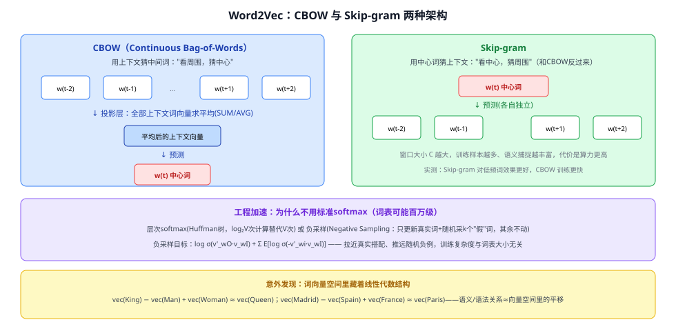
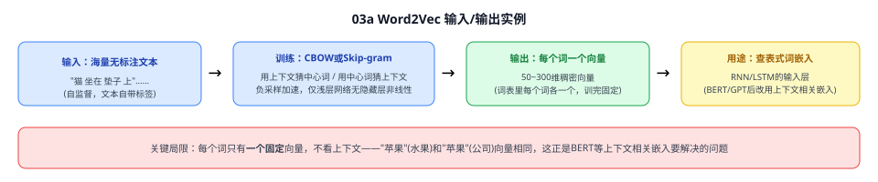
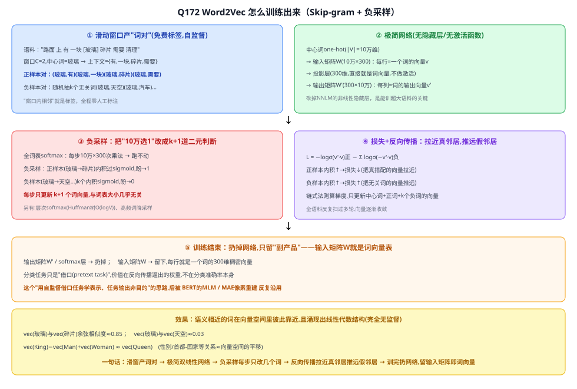

# 03a Word2Vec

> 定位：**词嵌入（word embedding）的开山之作**——第一次证明"用浅层神经网络在海量无标注文本上自监督训练，就能学到带线性语义结构的词向量"。是 RNN/LSTM（02/03）等序列模型"怎么把词变成向量喂进网络"这一步的历史起点，也是 BERT/GPT 上下文相关词向量的直接前身。
> 作者：Mikolov 等（Google），两篇合并精读：*Efficient Estimation of Word Representations in Vector Space*（ICLR 2013，arXiv:1301.3781，提出 CBOW/Skip-gram）+ *Distributed Representations of Words and Phrases and their Compositionality*（NeurIPS 2013，arXiv:1310.4546，提出负采样+高频词降采样，工程加速关键篇）。
> 前置：无（浅层网络，不依赖 RNN/Transformer）。
> **输入 / 输出**：海量无标注文本（自监督）→ 每个词一个固定的稠密向量（50~300 维）

---



> 📥📤 **输入/输出实例**：喂进海量无标注语料（如新闻语料 60 亿词），用 **CBOW**（拿上下文猜中心词）或 **Skip-gram**（拿中心词猜上下文）训一个**没有非线性隐藏层**的浅层网络；训练目标不是"预测"本身，是**副产品**——训练过程中反向传播逼出来的**输入层权重矩阵**，每一行就是一个词的**稠密向量**。训练结束后，网络本身被丢弃，只留这张"词→向量"的查询表，供下游任务（RNN/LSTM 的输入层）直接查表使用。



## 一、提出背景

在 Word2Vec 之前，NLP 系统大多把词当成**离散符号**（one-hot、词表里的一个索引），词与词之间没有"相似度"概念——"猫"和"狗"在这种表示下和"猫"与"石头"一样"毫不相干"。此前也有神经网络语言模型（NNLM）尝试学习词的连续向量表示，但都带着**非线性隐藏层**，在十亿词级别的语料上训练极慢。Word2Vec 的目标很直接：**能不能设计一个足够简单（去掉非线性隐藏层）的模型，在一天内、用几十亿词训出高质量词向量**？

## 二、核心方法 ⭐

### 2.1 两种架构：CBOW 与 Skip-gram

| 架构 | 训练任务 | 特点 |
|---|---|---|
| **CBOW**（Continuous Bag-of-Words） | 用上下文词（前后各 N 个）的**向量平均**，预测中心词 | 训练更快；对高频词效果好 |
| **Skip-gram** | 用中心词，分别预测窗口内的每个上下文词 | 训练稍慢；对低频词、稀有搭配效果更好（本项目若用于路面场景的稀缺类描述文本，Skip-gram 更合适） |

两者都**去掉了 NNLM 里的非线性隐藏层**——投影层直接就是词向量本身（或其平均），大幅降低了计算复杂度，这是 Word2Vec 能训练超大语料的关键简化。

### 2.2 训练目标不是"预测"，是副产品——权重矩阵才是真正想要的东西

网络结构表面上是在做一个分类任务（从上下文猜中心词，或反过来），但**真正的产物不是预测准确率，而是训练过程中被反向传播逐渐调整好的输入层权重矩阵**——这个矩阵的每一行，就是对应词的稠密向量。预测任务只是**逼出好向量的一个"借口"（pretext task）**，这个"用一个自监督借口任务去学表示，任务本身的输出不是目的"的思路，后来被 BERT 的 MLM、MAE 的像素重建 反复沿用。

### 2.3 工程加速：词表太大，标准 softmax 算不动

标准 softmax 要对整个词表（可能上百万词）算一次归一化，代价随词表线性增长。论文给出两种加速：
- **层次 softmax**：用 Huffman 二叉树表示词表，把 $O(V)$ 降到 $O(\log_2 V)$；
- **负采样（Negative Sampling）**⭐：不再对整个词表归一化，而是把训练目标改成——拉近"真实搭配"（中心词与真上下文词）的向量、同时推远随机抽取的 $k$ 个"假搭配"（噪声词）：
$$\log\sigma(v'_{w_O}\!\cdot v_{w_I}) + \sum_{i=1}^{k}\mathbb{E}_{w_i\sim P_n(w)}\left[\log\sigma(-v'_{w_i}\!\cdot v_{w_I})\right]$$
  每步只需要更新 $k+1$ 个词向量（而非整个词表），训练复杂度与词表大小几乎无关，这是 Word2Vec 能在一天内跑完百亿词级语料的核心工程贡献。此外还提出对**高频词做降采样**（如"the"这种功能词过于频繁、携带信息少，训练时按概率跳过一部分），进一步提速并提升低频词的向量质量。

---

## 三、关键结论

- **词向量空间里藏着线性代数结构**：$vec(\text{King}) - vec(\text{Man}) + vec(\text{Woman}) \approx vec(\text{Queen})$；$vec(\text{Madrid}) - vec(\text{Spain}) + vec(\text{France}) \approx vec(\text{Paris})$——语义/语法关系（性别、首都-国家）近似对应向量空间里的**平移**，这是完全无监督训练涌现出的性质，论文专门设计了一套类比测试集（如 "big:bigger :: small:smallest"）来定量验证。
- **效率**：去掉非线性隐藏层 + 负采样，能在单机一天内、百亿词级语料上训练完成，远快于此前的神经网络语言模型。
- **词向量维度和数据量要一起增加**：单独加大维度或单独加大数据量，边际收益都会递减，需要同步放大。
- **局限（★ 后续模型解决的方向）**：**每个词只有一个固定向量，不看上下文**——"苹果"（水果）和"苹果"（公司）向量完全相同，多义词/歧义无法区分。这正是 BERT/GPT 用 Transformer 自注意力生成**上下文相关**词表示要解决的核心问题。

---

## 四、与本项目的关系

本项目主线用 CLIP 的文本编码器（Transformer）处理类别文本模板，不直接使用 Word2Vec 这类静态词向量。但理解 Word2Vec 有两点现实意义：① 它是"用自监督借口任务学表示、任务本身不是目的"这一思路的最早成功案例，CLIP 的图文对比学习、MAE 的像素重建都是这个思路的延伸，理解 Word2Vec 有助于理解这条方法论主线的起点；② 若未来需要对路面抛洒物的文本描述做轻量级、离线的相似词/同义词检索（不需要上下文相关性、且不想承担 Transformer 的推理开销），Word2Vec/fastText 这类静态词向量仍是一个足够轻量、可离线预计算的备选方案。

---

## 五、技术谱系

```
one-hot/词表索引（无相似度概念）
  │
  ├─→ NNLM（前馈神经网络语言模型，有非线性隐藏层，训练慢）
  │
  └─→ Word2Vec（本文）：去非线性隐藏层 + 负采样 → CBOW/Skip-gram，快、且涌现线性语义结构
        │
        ├─→ GloVe（2014，基于全局共现矩阵的替代路线）
        ├─→ fastText（2016，词向量+子词/字符级信息，处理未登录词）
        └─→ 上下文相关词表示：ELMo(2018,双向LSTM) → BERT/GPT（Transformer自注意力，同一个词在不同句子里向量不同）
```

---

## ✏️ 具体实例（走一遍）

**例：Skip-gram 怎么从一句话里学词向量**
```
① 语料一句话："路面 上 有 一块 玻璃 碎片"
② 窗口 C=2，中心词="玻璃" → 上下文 = {上, 有, 一块, 碎片}
③ Skip-gram 目标：用"玻璃"的向量，分别去预测这4个上下文词
④ 负采样：额外随机采几个不相关的词（如"天空""汽车"）当负例，
   拉近"玻璃"与真实上下文的向量、推远"玻璃"与负例的向量
⑤ 全语料反复训练后，"玻璃"的向量会和"碎片""反光""透明"这类
   语义相关的词在向量空间里彼此靠近
```
**关键**：全程没有用到任何人工标注——文本本身的"词的邻居是谁"就是免费标签，这正是自监督学习的雏形。

---

## 六、参考文献

- Mikolov T, Chen K, Corrado G, et al. *Efficient Estimation of Word Representations in Vector Space.* ICLR 2013.（arXiv:1301.3781）
- Mikolov T, Sutskever I, Chen K, et al. *Distributed Representations of Words and Phrases and their Compositionality.* NeurIPS 2013.（arXiv:1310.4546）
- Pennington J, et al. *GloVe: Global Vectors for Word Representation.* EMNLP 2014.（替代路线）
- Bojanowski P, et al. *Enriching Word Vectors with Subword Information (fastText).* 2016.（子词级改进）

---

## 📋 模型答疑（来自模型详解问答）

> 专属本模型的问答集中在此；跨模型的通用问答见答疑总目录。

---

## Q172. Word2Vec 具体是怎么训练出来的？

**简答**：不是"训练一个分类器然后用它预测"，而是"借一个分类任务，把词向量当权重顺带训出来"。滑动窗口从语料里免费造出"中心词↔上下文词"的正样本对，再随机抽无关词当负样本；一个没有隐藏层的极简网络反复做"这两个词是不是真搭配"的判断，反向传播不断拉近真搭配的向量、推远假搭配的向量；训练结束后网络本身丢掉，只留下输入权重矩阵——它的每一行就是一个词的向量。

**展开**（Skip-gram + 负采样，最经典组合）：

**① 准备数据：滑动窗口采"词对"（免费标签）**
语料只是一串词 `路面 上 有 一块 玻璃 碎片 需要 清理`。设窗口 C=2，滑窗逐词扫过，每个中心词与窗口内上下文词组成**正样本对**：中心词"玻璃" → {有, 一块, 碎片, 需要}。全程零人工标注——"窗口内相邻"就是免费标签，这就是自监督（标签来自数据结构本身）。

**② 网络结构：极简，无隐藏层、无激活函数**
```
中心词 one-hot(|V|=10万维) → 输入矩阵W(10万×300) → 投影层(300维,直接就是词向量,不激活)
→ 输出矩阵W'(300×10万) → softmax(每个候选词得分)
```
W 每一行是一个词的"输入向量"，W' 每一列是一个词的"输出向量"。和此前 NNLM 的根本区别就是**砍掉了非线性隐藏层**——投影层直接就是词向量，这是能在百亿词语料上训练的关键简化（见本文 §2.1）。

**③ 负采样：把"10万选1"改成 k+1 道二元判断**
若对整个词表做 softmax，每一步都要 10万×300 次内积再归一化，十亿词级语料根本跑不动。负采样不归一化整个词表，而是对每个正样本对：
- **正样本**（玻璃→碎片）：算内积 $v'_{碎片}\cdot v_{玻璃}$，过 sigmoid，希望 → 1
- **负样本**（玻璃→天空/汽车…）：随机抽 k 个（通常 5~20），分别算内积过 sigmoid，希望都 → 0

相当于把"10万选1"的分类题，拆成 k+1 道独立的"是不是真搭配"二元判断。每步只更新 k+1 个词的向量，计算量与词表大小几乎无关（见本文 §2.3）。

**④ 损失 + 反向传播：拉近真邻居、推远假邻居**
$$\mathcal{L} = -\log\sigma(v'_{w_O}\cdot v_{w_I}) - \sum_{i=1}^{k}\log\sigma(-v'_{w_i}\cdot v_{w_I})$$
第一项让正样本对内积变大（拉近向量），第二项惩罚负样本对内积变大（推远向量）。链式法则算梯度，**只更新**中心词那一行 + 正样本词和 k 个负样本词那几列，其余 10 万个词本轮不动。

**⑤ 训完扔掉网络，只留"副产品"**
训练结束：输出矩阵 W'、softmax 层 **扔掉**；输入矩阵 W **留下**——每一行就是一个词的 300 维稠密向量。这才是 Word2Vec 真正的产物：一张"词→向量"查表字典。那个分类任务只是**借口（pretext task）**，价值在训练过程中逼出的权重，不在分类准确率本身。这个"用自监督借口任务学表示、任务输出非目的"的思路，后被 BERT 的 MLM、MAE 的像素重建 反复沿用。

**最终效果**：语义相近的词在向量空间彼此靠近（vec(玻璃) 与 vec(碎片) 余弦≈0.85，与 vec(天空)≈0.03），并涌现出**线性代数结构**（vec(King)−vec(Man)+vec(Woman)≈vec(Queen)）——完全无监督训练自动学出的性质。



---
