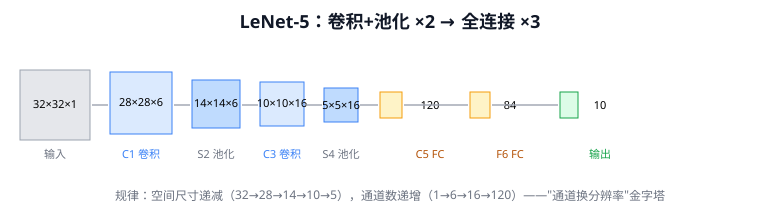
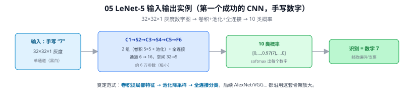

# 05 LeNet-5

> 定位：第一个成功落地的卷积神经网络，定义了"卷积+池化+全连接"的经典范式。
> 作者：Yann LeCun 等，1998。应用：美国邮政手写数字/支票金额识别。
> **输入 / 输出**：32×32×1 灰度图 → 10 类（手写数字）概率

---



> 📥📤 **输入/输出实例（看一组具体数值）**：输入一张手写数字 **32×32×1** 灰度图（如 "7"）→ C1→S2→C3→S4→C5→F6（两组"卷积 5×5 + 池化"，通道 6→16、空间 32→5，约 6 万参数）→ 输出 **10 类概率** $[0,\dots,0.97(7),\dots,0]$ → argmax = **数字 7**。它奠定了"**卷积提局部特征 → 池化降采样 → 全连接分类**"这套经典范式，后续 AlexNet/VGG 都沿用并放大。



## 一、提出背景

1990 年代，手写数字识别（如邮政编码、银行支票）有巨大商业需求。传统方法靠人工设计特征 + 分类器，对位置、笔迹变化鲁棒性差。LeCun 提出：让网络**自己从像素学特征**，并利用图像的两个先天结构特性——

1. **局部相关性**：相邻像素关系紧密 → 用局部连接（卷积核）而非全连接
2. **平移不变性**：数字出现在哪里都该被识别 → 用权重共享（同一卷积核扫全图）

这就是卷积的核心动机，也是 CNN 远比 MLP 适合图像的根本原因。

---

## 二、网络结构

LeNet-5 输入 32×32 灰度图，共 7 层（不含输入）：

```
输入 32×32×1
  │ C1: 6 个 5×5 卷积      → 28×28×6
  │ S2: 2×2 平均池化        → 14×14×6
  │ C3: 16 个 5×5 卷积      → 10×10×16
  │ S4: 2×2 平均池化        → 5×5×16
  │ C5: 120 个 5×5 卷积(全连接式) → 120
  │ F6: 全连接              → 84
  └ 输出: 全连接            → 10（对应 0~9）
```

关键设计：
- **卷积层**提取局部特征（边缘、笔画），通道数逐层增加（6→16→120）
- **池化层（下采样）**降低分辨率、增强平移不变性、减少计算
- **特征图尺寸递减、通道数递增**——这个金字塔形状被此后所有 CNN 沿用
- 激活函数用 Tanh/Sigmoid（当时还没有 ReLU）

---

## 三、三大核心思想（影响至今）

| 思想 | 含义 | 现代延续 |
|------|------|----------|
| 局部感受野 | 每个神经元只看图像的一小块 | 所有 CNN 卷积层 |
| 权重共享 | 同一卷积核扫过整张图 | 大幅减少参数，平移不变 |
| 下采样/池化 | 逐步降低空间分辨率 | MaxPool、stride 卷积 |

---

## 四、历史地位与局限

- **地位**：证明 CNN 在真实任务可用，在支票识别系统大规模商用，是现代 CNN 的"始祖"。
- **局限**：受限于当时的数据规模（小）和算力（无 GPU），无法加深加宽，难以推广到自然图像（如 ImageNet 这种千类彩色图）。沉寂十余年，直到 06 AlexNet 用 GPU + 大数据把这套思想放大才引爆深度学习。

---

## ✏️ 具体实例（动手算一遍）

**例：一张手写数字 "7"（28×28，补边到 32×32）逐层走一遍**
```
输入        32×32×1                                     一张灰度数字图
C1 卷积  6@5×5     → 28×28×6    参数(5×5×1+1)×6 = 156    浅层：探到笔画边缘/方向
S2 池化  2×2       → 14×14×6                             下采样，尺寸减半
C3 卷积  16@5×5    → 10×10×16                            中层：组合成"横、竖、拐角"
S4 池化  2×2       →  5×5×16                             再减半
C5 卷积  120@5×5   →  1×1×120  (=全连接)                深层：汇成 120 维特征
F6 全连接          →  84                                 进一步压缩
输出 全连接        →  10        每类一个分数             argmax = 7 ✓
```
关键规律一目了然：**空间尺寸递减（32→28→14→10→5）、通道数递增（1→6→16→120）**——"用通道换分辨率"的金字塔（见 [Q4](#q4-lenet-的层数通道与-6-个-55-卷积如何理解)），这一规律一直延续到 YOLOv8。最后 10 个输出里"7"对应的分数最大，即判为数字 7。

---

## 六、参考文献

- LeCun Y, Bottou L, Bengio Y, Haffner P. *Gradient-based learning applied to document recognition.* Proceedings of the IEEE, 1998.

---

## 📋 模型答疑（来自模型详解问答）

> 以下问答原属"答疑记录"系列，因专属本模型已并入此处便于集中查阅；跨模型的通用问答仍留在答疑分册。

---

## Q4. LeNet 的层数、通道与 6 个 5×5 卷积如何理解？

**简答**：① **通道 = 一张特征图（H×W 矩阵）**，灰度图 1 通道、RGB 3 通道；一个卷积核扫全图产生一个输出通道。② "6 个 5×5"= 用 6 个 5×5 大小的核各学一种局部特征 → 输出 6 个通道；6 和 5×5 都是**经验超参数**，非理论必然。③ 7 层是"卷积+池化 ×2 → 全连接 ×3"流水线的结果，深度受限于 1998 年的算力与梯度消失，是"当年能训得动的上限"。

**展开**：

**① 何为通道（最基础）**
通道就是一张二维特征图。输入灰度图 = 1 通道，彩色 = R/G/B 3 通道。卷积后，**一个卷积核扫完整图产生一张新特征图 = 一个输出通道**，记录该核在每个位置的响应。通道数 = 用了多少个核 = 提取了多少种局部特征。可类比"一组探测器各自的报告"：一个通道探竖边、一个探弧线、一个探端点。
```
输入 32×32×1 ──6个核──► 28×28×6
   1通道(灰度)          6通道(6张特征图)
```

**② 为什么 6 个 5×5**
- **5×5 = 核大小（感受野）**：核在 32×32 上滑动，每处对 5×5 像素加权求和得一个数，滑遍全图 → 28×28（32−5+1）。5×5 是经验值：够罩住一段笔画，又计算便宜。
- **6 个 = 6 个不同核 → 6 个输出通道**。为什么是 6？**无深刻理论，是 LeCun 在硬件约束下试出的超参**；多则能力强但慢，6 个对数字识别够用。
- ⚠️ 心态：LeNet 的 6、16、120 都是经验超参，**别过度解读具体数字**。要记的是规律：层越深，**特征图尺寸递减（32→28→14→10→5）、通道数递增（1→6→16→120）**——"通道换分辨率"的金字塔，一直延续到 YOLOv8。

**③ 为什么 7 层**
7 层（不含输入）：`C1卷积→S2池化→C3卷积→S4池化→C5卷积→F6全连接→输出`，是固定流水线的结果：
```
[卷积+池化]×2  →  [全连接]×3
 提特征、逐步降维     汇总、分类
```
两轮"卷积→池化"先抓局部细节（边缘）再抓更大组合（笔画→部件）；后三层全连接拍平汇总输出 10 类得分。
**为什么不更深**：1998 年更深训不动——梯度消失（见 Q2）+ 算力不足。直到 2012 年 AlexNet 用 ReLU+GPU 才做到 8 层乃至几十层。所以"7 层"是当年能训动的深度上限附近的工程选择。
> "LeNet-5"的"5"通常指 5 个带可学习参数的层（3 卷积 + 2 全连接，池化无参不计），各资料数法略有出入，不必纠结。

