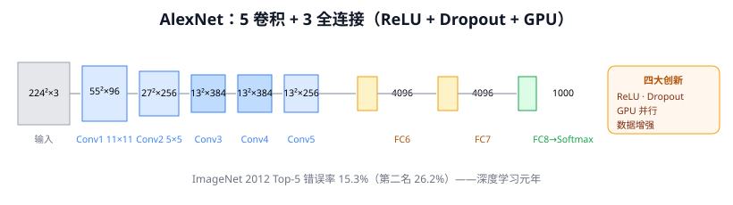
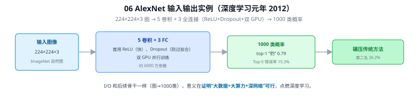

# 06 AlexNet

> 定位：深度学习元年（2012）的引爆点。证明"大数据 + 大算力 + 深网络"范式可行。
> 作者：Alex Krizhevsky, Ilya Sutskever, Geoffrey Hinton。
> 战绩：ImageNet 2012（ILSVRC）Top-5 错误率 **15.3%**，碾压第二名（26.2%，传统方法）。
> **输入 / 输出**：224×224×3 图像 → 1000 类（ImageNet）概率

---



> 📥📤 **输入/输出实例（看一组具体数值）**：输入 **224×224×3** ImageNet 图 → 5 卷积 + 3 全连接（首用 **ReLU** 加速、**Dropout** 防过拟合、**双 GPU** 并行，约 6000 万参数）→ **1000 类概率**（top-1 "豹" 0.79）→ 类别输出。I/O 和后续骨干一样（图→1000 类），它的意义在于**证明"大数据 + 大算力 + 深网络"范式可行**，Top-5 错误率 15.3% 碾压传统方法的 26.2%，点燃深度学习。



## 一、提出背景

到 2012 年，三个条件同时成熟：

1. **数据**：ImageNet 提供 120 万张标注图、1000 个类别——足够喂饱深网络
2. **算力**：GPU（CUDA）让大规模矩阵运算成为可能
3. **算法积累**：ReLU、Dropout 等技巧解决了深网络的训练难题

AlexNet 把 LeNet 的思想放大到前所未有的规模（8 层、6000 万参数），一举把 ImageNet 错误率砍掉近一半，让学术界和工业界瞬间转向深度学习。

---

## 二、网络结构

输入 224×224×3 彩色图，5 个卷积层 + 3 个全连接层：

```
输入 224×224×3
 Conv1: 96×11×11, stride 4 + ReLU + MaxPool + LRN   → 55×55×96
 Conv2: 256×5×5  + ReLU + MaxPool + LRN              → 27×27×256
 Conv3: 384×3×3  + ReLU
 Conv4: 384×3×3  + ReLU
 Conv5: 256×3×3  + ReLU + MaxPool                    → 13×13×256
 FC6:   4096 + ReLU + Dropout
 FC7:   4096 + ReLU + Dropout
 FC8:   1000 → Softmax
```

特点：大卷积核起步（11×11），逐层减小；双 GPU 并行（受当时 3GB 显存限制，把网络拆到两块 GTX 580 上）。

---

## 三、四大关键创新

### 3.1 ReLU 激活函数 ⭐

$$
\text{ReLU}(x) = \max(0, x)
$$

替代 Sigmoid/Tanh。优势：
- **缓解梯度消失**：正区间导数恒为 1，深层网络梯度不衰减
- **加速收敛**：论文报告比 Tanh 快约 6 倍
- **计算简单**：只需一次比较

这是解决 01 中梯度消失问题的关键一步，沿用至今（YOLOv8 用其变体 SiLU）。

### 3.2 Dropout

训练时随机"关闭"一部分神经元（如 50%），强迫网络不依赖单个神经元，等价于训练大量子网络的集成。有效抑制全连接层的过拟合。

### 3.3 GPU 并行训练

首次系统性用 GPU 训练大型 CNN，把训练时间从数月压到数天，让"深"成为现实可能。

### 3.4 数据增强

随机裁剪、水平翻转、PCA 色彩抖动，把数据量"放大"，提升泛化。**这套增强思路直接延续到 YOLO 的 Mosaic、本项目的数据增强方案。**

> 另含 LRN（局部响应归一化），后被 Batch Normalization 取代，现已少用。

---

## 四、历史地位

- 深度学习的"寒武纪大爆发"起点，此后 CV 全面转向 CNN。
- 确立的"卷积堆叠 + ReLU + Dropout + 数据增强 + GPU"配方，成为之后所有网络的标准起手式。

**局限**：结构仍偏经验化（卷积核大小不统一），参数集中在全连接层（占绝大部分），不够优雅——这促成了 07 VGG 的极简化和 08 Inception 的高效化。

---

## ✏️ 具体实例（动手算一遍）

**例：一张 227×227 彩色图走一遍 AlexNet**
```
输入       227×227×3
Conv1  96@11×11 s4  → 55×55×96  → ReLU → 池化 → 27×27×96
Conv2  256@5×5      → 27×27×256 →        池化 → 13×13×256
Conv3-5            → 13×13×256 →        池化 →  6×6×256
FC6 4096 → FC7 4096 → FC8 1000 → softmax → 1000 类概率
```
（卷积层提特征，三层全连接汇总分类；FC 占了 6000 万参数里的绝大部分。）

**例：ReLU 为什么不饱和（对比 Sigmoid）**
输入 $[-3,\,0.5,\,-0.1,\,2]$：
- ReLU → $[0,\,0.5,\,0,\,2]$（负的清零、正的原样，**正区间导数恒为 1**，连乘不衰减）
- Sigmoid → $[0.047,\,0.62,\,0.475,\,0.88]$（两端饱和，导数最大才 0.25，连乘易梯度消失）

这就是 AlexNet 用 ReLU 替代 Sigmoid 能训深的关键（见 Q2）。

---

## 六、参考文献

- Krizhevsky A, Sutskever I, Hinton G E. *ImageNet Classification with Deep Convolutional Neural Networks.* NeurIPS 2012.
