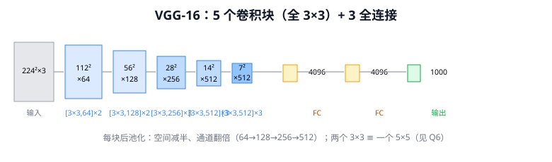
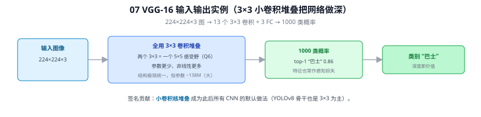
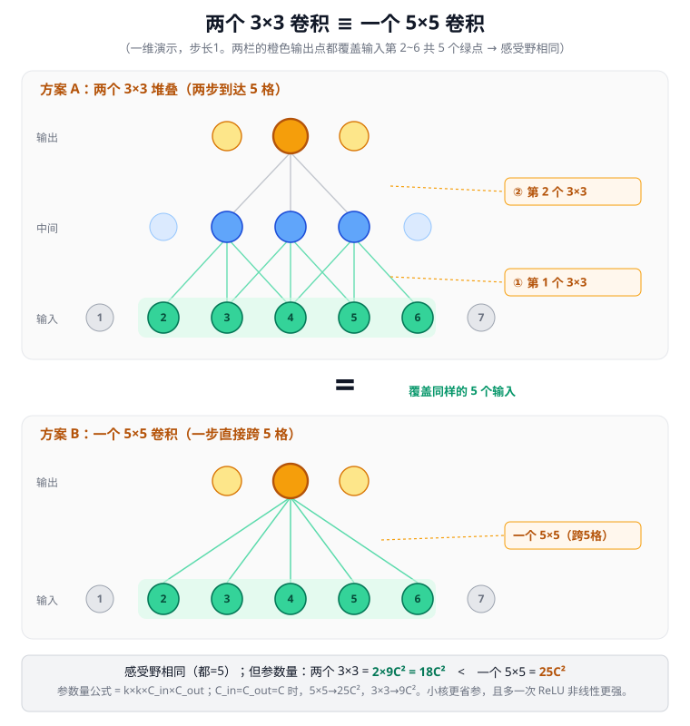

# 07 VGGNet

> 定位：用极简、统一的"3×3 小卷积堆叠"把网络做深，证明深度本身的价值。
> 作者：Simonyan & Zisserman（牛津 Visual Geometry Group），ICLR 2015。
> 战绩：ImageNet 2014 定位赛冠军、分类亚军（仅次于 GoogLeNet）。
> **输入 / 输出**：224×224×3 图像 → 1000 类概率

---



> 📥📤 **输入/输出实例（看一组具体数值）**：输入 **224×224×3** 图 → 13 个 **3×3 卷积** + 3 全连接 → **1000 类概率**（top-1 "巴士" 0.86）→ 类别输出。签名贡献是"**全用 3×3 小卷积堆叠**"——两个 3×3 等效一个 5×5 感受野但参数更少、非线性更多（Q6）；代价是参数 ~138M 偏大。这套"小卷积核堆叠"成为此后所有 CNN 的默认做法（YOLOv8 骨干也以 3×3 为主）。



## 一、提出背景

AlexNet 之后的核心问题是：**如何系统性地把网络做深？** 此前卷积核大小五花八门（11×11、5×5、3×3）。VGG 提出一个干净的设计哲学：**全部用 3×3 小卷积核，只靠堆叠层数加深网络**，用控制变量的方式研究"深度"对性能的影响。

---

## 二、核心思想：小卷积核堆叠

### 2.1 两个 3×3 = 一个 5×5（感受野等价）

```
两层 3×3 卷积串联的感受野 = 5×5
三层 3×3 卷积串联的感受野 = 7×7
```

但堆叠小卷积核更优：

| 对比项 | 一个 5×5 | 两个 3×3 |
|--------|----------|----------|
| 感受野 | 5×5 | 5×5（等价） |
| 参数量（C 通道） | 25C² | 2×9C² = 18C²（少 28%） |
| 非线性次数 | 1 次 ReLU | 2 次 ReLU（表达力更强） |

**结论**：小卷积核堆叠在相同感受野下参数更少、非线性更多——这个洞见影响了之后几乎所有网络。

### 2.2 结构

VGG-16 = 13 个卷积层 + 3 个全连接层，分 5 个 block，每个 block 后接 MaxPool：

```
输入 224×224×3
 Block1: [3×3,64]×2   → pool → 112×112×64
 Block2: [3×3,128]×2  → pool → 56×56×128
 Block3: [3×3,256]×3  → pool → 28×28×256
 Block4: [3×3,512]×3  → pool → 14×14×512
 Block5: [3×3,512]×3  → pool → 7×7×512
 FC: 4096 → 4096 → 1000
```

规律：每次池化后通道数翻倍（64→128→256→512），空间减半——"以通道换分辨率"的经典配比。

---

## 三、优点与局限

**优点**：
- 结构极其规整统一，易理解、易迁移
- 证明了深度是提升性能的关键因素
- 特征提取能力强，VGG 的卷积部分至今常被当作**感知损失（perceptual loss）**、风格迁移、特征匹配的标准骨干

**局限**：
- **参数量巨大**（VGG-16 约 138M），其中三个全连接层就占了约 90%（FC1 单层就有 1 亿+ 参数）
- 计算/显存开销大，推理慢
- 没有 BN、没有残差，更深（如 VGG-19 之后）就难训了

---

## 四、历史地位

VGG 是"暴力加深"路线的代表，与同年的 GoogLeNet（"高效"路线）形成对比。它的 3×3 卷积哲学被 ResNet、YOLO 等几乎全部继承；但它的全连接重量级设计被后来的全卷积、全局平均池化取代。

---

## ✏️ 具体实例（动手算一遍）

**例 1：两个 3×3 vs 一个 5×5（C=64 通道，算给你看）**
- 一个 5×5 卷积：参数 $=5\times5\times64\times64=102{,}400$
- 两个 3×3 卷积：参数 $=2\times(3\times3\times64\times64)=73{,}728$（**省约 28%**）

两者**感受野都是 5×5**（堆两层 3×3，一个输出点能看到原图 5×5），但小核还**多一次 ReLU**（非线性更强）。这就是 VGG"只用 3×3 堆叠"的理由（详见 [Q6](#q6-vgg为何两个-33-等效一个-55结构如何逐层演变)）。

**例 2：VGG-16 整图尺寸流（224×224×3）**
```
Block1 [3×3,64]×2  → 224×224×64  → pool → 112×112×64
Block2 [3×3,128]×2 → 112×112×128 → pool →  56×56×128
Block3 [3×3,256]×3 →  56×56×256  → pool →  28×28×256
Block4 [3×3,512]×3 →  28×28×512  → pool →  14×14×512
Block5 [3×3,512]×3 →  14×14×512  → pool →   7×7×512
拍平 → FC4096 → FC4096 → FC1000 → softmax
```
规律：**每次池化空间减半、通道翻倍补偿**（64→128→256→512），让每层计算量大致均衡——这套金字塔被后续检测网络（含 YOLOv8 的 P3/P4/P5）继承。

---

## 六、参考文献

- Simonyan K, Zisserman A. *Very Deep Convolutional Networks for Large-Scale Image Recognition.* ICLR 2015.

---

## 📋 模型答疑（来自模型详解问答）

> 以下问答原属"答疑记录"系列，因专属本模型已并入此处便于集中查阅；跨模型的通用问答仍留在答疑分册。

---

## Q6. VGG：为何两个 3×3 等效一个 5×5，结构如何逐层演变？

**简答**：① "等于"指**感受野相同**——感受野是"一个输出点能看到的输入区域"。两层 3×3 堆叠后，一个输出点能看到原图 5×5，与单个 5×5 核覆盖相同。公式：堆 $n$ 个 $k×k$ 核（stride 1）等效感受野 $=1+n(k-1)$，$k=3,n=2$→5，$n=3$→7。② 拆成小核更省参（18C² < 25C²）、非线性更多（2 次 ReLU）。③ VGG 结构遵循"卷积增通道不改空间、池化空间减半、通道翻倍补偿"的金字塔规律。

**展开**：

**① 为什么两个 3×3 = 一个 5×5（感受野）**
一维演示（核大小3、步长1）：L1 的一个点看输入 3 个；L2 的一个点看 L1 的 3 个，而每个 L1 点又看输入 3 个，合起来看输入 5 个 → 两层 3×3 的感受野 = 5。二维同理。



> 图解（上下两栏对照）：
> - **上栏 方案A（两个 3×3）**：橙色输出点经 ①②两次 3×3 卷积（橙框标出"第1个/第2个 3×3"），两步回溯覆盖输入第 2~6 共 **5 个绿点**。
> - **下栏 方案B（一个 5×5）**：橙色输出点一步直接跨 5 格，同样覆盖第 2~6 共 5 个绿点。
> - 中间大"="：两栏覆盖**同样的 5 个输入** → 感受野相同，故"两个 3×3 ≡ 一个 5×5"。

**② 为什么参数量是 25C² 和 18C²**
卷积层参数量公式：$k\times k\times C_{in}\times C_{out}$。其中 $C_{in}\times C_{out}$（即 $C^2$）来自"每个输出通道都要连接全部输入通道"，每种通道组合配 $k^2$ 个权重。令 $C_{in}=C_{out}=C$：
- 一个 5×5：$5\times5\times C\times C=25C^2$
- 两个 3×3：$2\times(3\times3\times C\times C)=2\times9C^2=18C^2$

$18C^2<25C^2$，省约 28%（忽略偏置）。核越大 $k^2$ 增长越快（7×7 是 49C²），故小核堆叠在参数上一直占优。

**③ 为什么拆小核更好**

| | 一个 5×5 | 两个 3×3 |
|---|---------|---------|
| 感受野 | 5×5 | 5×5（相同） |
| 参数量（C 通道） | 25C² | **18C²**（少 28%） |
| 非线性 | 1 次 ReLU | **2 次 ReLU**（更强） |

同样视野下小核更省参、多非线性 → 之后 ResNet/YOLO 几乎只用 3×3+1×1，不再用大核。

**④ VGG-16 结构与逐层变化**
```
输入 224×224×3
Block1: [3×3,64]×2  → 224×224×64  → pool → 112×112×64
Block2: [3×3,128]×2 → 112×112×128 → pool → 56×56×128
Block3: [3×3,256]×3 → 56×56×256   → pool → 28×28×256
Block4: [3×3,512]×3 → 28×28×512   → pool → 14×14×512
Block5: [3×3,512]×3 → 14×14×512   → pool → 7×7×512
拍平 → FC4096 → FC4096 → FC1000 → Softmax
```
（13 卷积 + 3 FC = 16，故 VGG-16；VGG-19 后三块各多一卷积。）

**为什么这样变（三规律，皆有道理）**：
- **卷积层**：3×3 带 padding=1，**不改 H×W**，只在当前分辨率把特征学厚、提通道。
- **池化层**：2×2 stride2 **空间减半**——减计算、**变相扩大感受野**（小图上同样的核罩住原图更大区域，越深越宏观）、增强平移不变性。
- **通道翻倍补偿**（64→128→256→512）：每次池化丢一半空间信息，就把通道翻倍补回——"用通道换分辨率"（Q4 金字塔规律），且让每层计算量大致均衡（空间缩4倍×通道增4倍≈持平）。
> 整体：前面小核堆叠把特征学厚（增通道）、池化逐级缩小看得更宏观（降空间）、最后全连接汇总成类别得分——从"看边缘"走到"认物体"。

**⑤ 与本项目**：YOLOv8 骨干/颈部全是 3×3+1×1（VGG 哲学延续），不用大核；"空间减半/通道翻倍"金字塔是 YOLOv8 输出 80→40→20 三尺度的由来；第三章加 P2 层就是在金字塔上**往浅层（高分辨率）再接一级**，捞被多次池化"缩没"的小目标。

