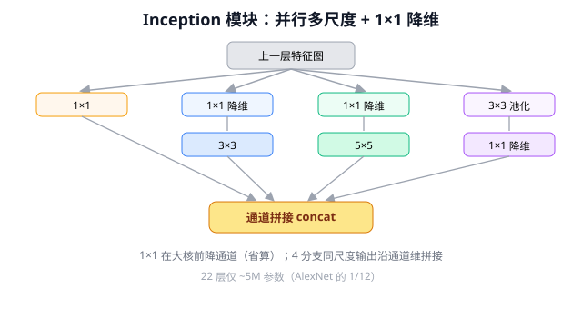
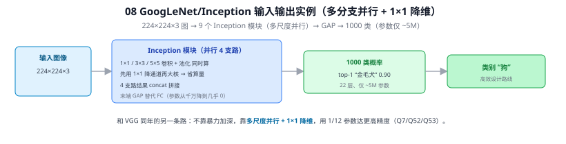
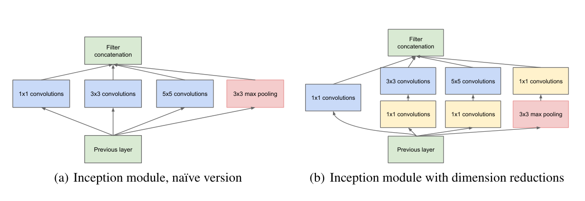
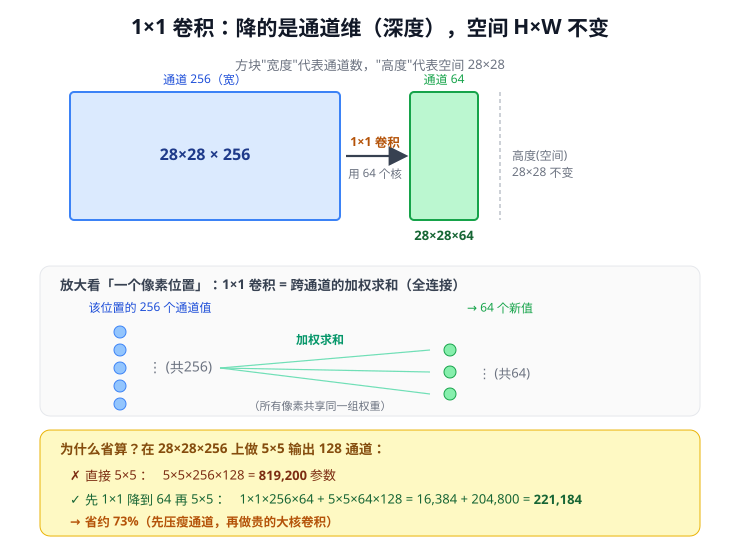
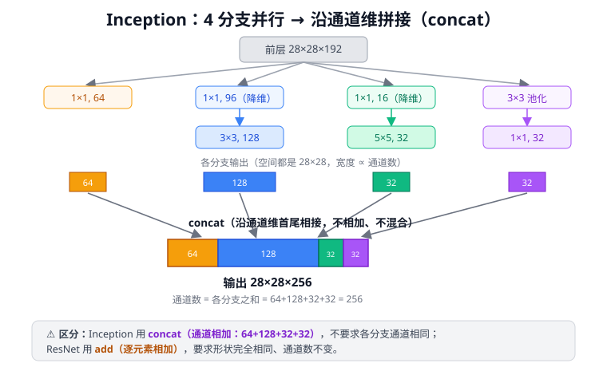
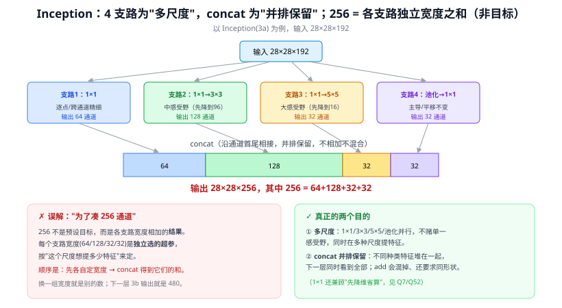

# 08 GoogLeNet / Inception

> 定位：与 VGG 同年的另一条路线——不靠"暴力加深"，而靠"高效设计"，用 1/12 的参数达到更高精度。
> 作者：Szegedy 等（Google），CVPR 2015。
> 战绩：ImageNet 2014 分类冠军。22 层，参数仅约 5M（AlexNet 的 1/12）。
> **输入 / 输出**：224×224×3 图像 → 1000 类概率（末端用 GAP 替代 FC）

---



> 📥📤 **输入/输出实例（看一组具体数值）**：输入 **224×224×3** 图 → 9 个 **Inception 模块**（每个并行 4 支路：1×1 / 3×3 / 5×5 卷积 + 池化同时算，先用 1×1 降通道再大核省算量，4 支路结果 concat）→ 末端 **GAP 替代 FC** → **1000 类概率**（top-1 "金毛犬" 0.90）。22 层但参数仅 **~5M**（AlexNet 的 1/12）。和 VGG 同年的另一条路：不靠暴力加深，靠**多尺度并行 + 1×1 降维**（Q7/Q52/Q53）。



> 📄 **论文原图对照**（图源：Szegedy et al., *Going Deeper with Convolutions*, [arXiv:1409.4842](https://arxiv.org/abs/1409.4842) Figure 2，原文 [PDF](../papers/08_GoogLeNet_1409.4842.pdf)；仅笔记内学习引用，论文写作须自绘）：



> Inception 模块：1×1/3×3/5×5/池化四支路并行再 concat（Q53），带 1×1 先降维省算力（Q52）。

## 一、提出背景

加深网络（VGG 路线）带来两个问题：参数爆炸、易过拟合、计算昂贵。GoogLeNet 想回答：**能否在不无限堆深的前提下，让网络同时"看到"多种尺度的特征，并大幅压缩计算？** 答案是 Inception 模块。

---

## 二、核心创新

### 2.1 Inception 模块：并行多尺度

同一层内**并行**使用多种卷积核，再把结果在通道维拼接：

```
            输入特征图
       ┌──────┬──────┬──────┬────────┐
     1×1    3×3    5×5   3×3 MaxPool
       └──────┴──────┴──────┴────────┘
              通道维拼接（concat）
                    ↓
                 输出特征图
```

直觉：网络不必预先决定"该用大核还是小核"，而是**同时用多种尺度并让网络自己学习权重**。这天然适合目标尺寸差异大的场景——与本项目"路面抛洒物大小不一"的痛点相关。

### 2.2 1×1 卷积做降维（计算效率革命）⭐

直接并行 5×5 卷积计算量极大。Inception 在 3×3、5×5 前先用 **1×1 卷积压缩通道数**（瓶颈结构 bottleneck）：

```
原始: 输入 256 通道 → 5×5×128 卷积     （计算量巨大）
改进: 256 →1×1→ 64 →5×5→ 128          （先降到 64，计算量降一个量级）
```

1×1 卷积的三大作用（影响深远）：
1. **降维/升维**：灵活调整通道数，控制计算量
2. **跨通道信息融合**：在通道维度做线性组合
3. **增加非线性**：后接 ReLU

> 1×1 卷积成为之后所有高效网络（ResNet bottleneck、MobileNet、YOLO）的标配组件。

### 2.3 辅助分类器（Auxiliary Classifier）

在网络中间插入两个辅助 softmax 分支，训练时一起算损失，缓解深层网络梯度消失（变相给中间层注入梯度）。推理时丢弃。这是 BN 和残差出现前的临时方案。

### 2.4 全局平均池化（GAP）替代全连接

最后用全局平均池化代替 VGG 式的巨型全连接层，参数量大减，也减轻过拟合。

---

## 三、Inception 的演进

| 版本 | 关键改进 |
|------|----------|
| Inception v1（GoogLeNet） | 原始多尺度并行 + 1×1 降维 |
| v2/v3 | 引入 BN；用两个 3×3 替代 5×5；非对称卷积（1×7 + 7×1 分解） |
| v4 / Inception-ResNet | 融合残差连接，进一步提升 |

---

## 四、历史地位与局限

- **地位**：开创"高效网络设计"路线，1×1 瓶颈、多尺度并行、GAP 都成为通用组件。
- **局限**：模块结构复杂、超参多（每个分支通道数需手工设计），不如 ResNet 优雅通用。残差连接出现后，ResNet 因其简洁成为主流骨干，Inception 逐渐退居二线。

---

## ✏️ 具体实例（动手算一遍）

**例 1：1×1 卷积"瓶颈"省了多少（在 28×28×256 上做 5×5 出 128 通道）**
- 直接做 5×5：参数 $=5\times5\times256\times128=819{,}200$
- 先 1×1 降到 64 再做 5×5：$\underbrace{1\times1\times256\times64}_{16{,}384}+\underbrace{5\times5\times64\times128}_{204{,}800}=221{,}184$（**省约 73%**）

空间尺寸不变（28×28），只把通道"压瘦再做大核"（详见 [Q7](#q7-googlenet11-卷积如何降维多分支输出如何拼接)）。

**例 2：Inception 模块四分支并行 + 通道拼接（concat）**
```
输入 28×28×256
分支1 1×1            → 28×28×64
分支2 1×1→3×3(pad1)  → 28×28×128
分支3 1×1→5×5(pad2)  → 28×28×32
分支4 池化→1×1       → 28×28×32
concat（通道首尾相接）→ 28×28×(64+128+32+32)=28×28×256
```
四个分支用不同大小的核"同时看"（多尺度），输出沿**通道维拼接**（不是相加，区别于 ResNet 的 add，见 [Q7](#q7-googlenet11-卷积如何降维多分支输出如何拼接)）。注意：并行是为"多尺度"，省参靠 1×1，**参数少 ≠ 跑得快**（见 [Q8](#q8-googlenet-的并行与降维就等于更快吗参数量-vs-实测延迟)）。

---

## 六、参考文献

- Szegedy C, et al. *Going Deeper with Convolutions.* CVPR 2015.（GoogLeNet / Inception v1）
- Szegedy C, et al. *Rethinking the Inception Architecture for Computer Vision.* CVPR 2016.（v3）

---

## 📋 模型答疑（来自模型详解问答）

> 以下问答原属"答疑记录"系列，因专属本模型已并入此处便于集中查阅；跨模型的通用问答仍留在答疑分册。

---

## Q7. GoogLeNet：1×1 卷积如何降维，多分支输出如何拼接？

**简答**：① 1×1 卷积"降维"降的是**通道维（深度）**，不动 H×W——在每个像素位置把 $C_{in}$ 个通道加权求和成 $C_{out}$ 个（$C_{out}<C_{in}$ 即降维），相当于逐像素的跨通道全连接。② 并行分支输出后**沿通道维堆叠（concat）**，通道数相加；前提是各分支 H×W 相同（靠 padding 保证）。

**展开**：

**① 1×1 卷积如何降维**
1×1 核空间只盖 1 像素，但深度方向贯穿全部输入通道。用 $C_{out}$ 个核 → 把 $C_{in}$ 通道压成 $C_{out}$ 通道，空间不变。本质 = 每个像素位置做一次 $C_{in}\to C_{out}$ 的全连接（跨通道线性组合，所有像素共享权重）。
```
输入 28×28×256 ──1×1卷积，64个核──► 输出 28×28×64
（空间 28×28 不变，通道 256→64 降维4倍）
```
**省计算（Inception 瓶颈设计）**：在 28×28×256 上做 5×5 输出 128 通道——
- 直接做：$5×5×256×128 = 819{,}200$ 参数
- 先 1×1 降到 64 再做：$1×1×256×64 + 5×5×64×128 = 16{,}384 + 204{,}800 = 221{,}184$ 参数（省约 73%）

故 Inception 在 3×3/5×5 前放 1×1，先压瘦通道再做大核。



**② 并行卷积后通道如何拼接**
4 分支并行，各自输出后**在通道维堆叠（concatenation）**，非相加。前提：H×W 必须一致（靠 padding，如 3×3 pad1、5×5 pad2、池化 stride1）。
```
分支1 1×1            → 28×28×64
分支2 1×1→3×3(pad1)  → 28×28×128
分支3 1×1→5×5(pad2)  → 28×28×32
分支4 池化→1×1       → 28×28×32
concat（通道首尾相接）→ 28×28×(64+128+32+32)=28×28×256
```
拼接 = 把 4 摞特征图在深度方向并排放好，不相加不混合，下一层同时看到全部 256 通道（含多尺度特征）。



**⚠️ 与 ResNet 区分**：
- Inception **concat**：通道数相加，不要求各分支通道相同
- ResNet **add**（09 ResNet）：逐元素相加，要求形状完全相同，通道数不变

---

## Q8. GoogLeNet 的并行与降维就等于更快吗（参数量 vs 实测延迟）？

**简答**：① "1×1 降维 → 少参数/少计算 → 更省更快"✅ 正确。② 但"并行加快速度"⚠️ 有误解：Inception 的多分支**并行主要是为多尺度特征**，本身反而**增加**计算；速度优势来自 1×1 降维，不来自并行。③ "GPU 并行让计算快"是另一回事（所有网络通用），且多分支结构对硬件并不友好。**GoogLeNet 的卖点是"高效（省参数/FLOPs）"，不等于"低延迟（跑得快）"。**

**展开**：

**① 1×1 降维更省更快——对**
1×1 压瘦通道，后面大核在更少通道上算，参数/计算大降（Q7 那笔账省 ~73%）。GoogLeNet 22 层仅 ~5M 参数（AlexNet 8 层 60M），主要靠 1×1 瓶颈。

**② 结构并行（多分支）≠ 更快**
Inception 摆 1×1/3×3/5×5/池化 4 分支，目的是**同时用多种感受野看特征**（多尺度），不是省时间。4 条分支本身**增加**计算 → 再用 1×1 降维把成本压回去。净效果："既多尺度又省"，但**省来自 1×1，不来自并行**。

**③ GPU 并行 ≠ Inception 专属，且多分支对硬件不友好**
"并行让计算快"的另一层意思是 GPU 能同时算很多运算——但这对 VGG/ResNet 同样成立。反而 Inception 多分支、形状杂、要 concat，GPU 调度更碎、访存更复杂。故工业部署偏爱规整结构（VGG 纯 3×3、RepVGG 重参数化成单分支）。**理论 FLOPs 低 ≠ 实际延迟低。**

| 说法 | 对不对 | 真正原因 |
|------|--------|---------|
| 1×1 降维 → 更省更快 | ✅ | 通道压瘦，大核计算量降 |
| 并行多分支 → 更快 | ❌ | 并行是为多尺度，本身增加计算 |
| GPU 并行 → 更快 | ✅ 但非 Inception 专属 | 所有网络通用；多分支反而不友好 |

**一句话**：GoogLeNet 靠"多分支"换多尺度能力，靠"1×1 降维"压下多分支代价，在低参数量下达高精度。卖点是**高效**，不是**低延迟**——工程上是两个指标。

**④ 与本项目（关键，影响 FPS 实验）**
- 评价模型别只看参数量/FLOPs，要**实测延迟（latency/FPS）**，两者常不一致（多分支、注意力模块可能 FLOPs 不高但实际慢）。
- 第三章加 **CBAM**（16 CBAM）也是"多一条注意力支路"，可能 FLOPs 增不多但拖慢推理 → **必须实测每张图延迟**，这正是 EXP-002 要测 FPS 的原因。
- 选 YOLOv8 而非更花哨结构，部分因其结构相对规整、ONNX/TensorRT 部署友好（呼应实时 < 100ms 目标）。

---

## Q52. GoogLeNet 的 1×1 卷积是如何降维的？"64 个 1×1"是降维用的吗？

**短答**：1×1 卷积通过减少滤波器数量在**通道维度**做线性压缩，H×W 空间不变；"64"是 Inception(3a) 第一条支路的**直接输出通道数**，真正的降维 1×1 是接在 3×3 / 5×5 之前的 **96** 和 **16**。

---

### ① 1×1 卷积降维的本质

```
输入特征图：H × W × 192ch
              ↓  96 个 1×1 滤波器（每个滤波器长度 = 192）
输出特征图：H × W × 96ch     ← 通道 192→96，空间 H×W 不变
```

每个 1×1 滤波器对同一空间位置的 192 个通道值做**加权求和**，输出 1 个数值；96 个滤波器输出 96 个通道。本质是每个像素位置做一次**跨通道线性组合**：

$$[y_1,\dots,y_{96}] = W_{96\times192}\cdot[x_1,\dots,x_{192}]$$

所有空间位置共享同一组权重 $W$，参数量仅 $192\times96=18{,}432$。

---

### ② Inception(3a) 各支路一览

| 支路 | 1×1 的作用 | 滤波器数 |
|------|-----------|---------|
| 纯 1×1 分支 | 直接输出（不降维） | **64**（输出） |
| 1×1 → 3×3 | **降维**（192→96），再接 3×3 | 96（降维）→ 128（输出） |
| 1×1 → 5×5 | **降维**（192→16），再接 5×5 | 16（降维）→ 32（输出） |
| MaxPool → 1×1 | 投影（控制通道数） | 32（输出） |

→ **"64 个 1×1"是第一条支路的输出通道数，不是降维。** 降维用的是 96 和 16。

---

### ③ 降维节省了多少计算量

以 3×3 分支（输入 192ch，输出 128ch）为例：

| 方案 | 每像素计算量 |
|------|-----------|
| 直接 3×3（无降维） | $3\times3\times192\times128 = 221{,}184$ |
| 1×1(96) → 3×3(128) | $1\times1\times192\times96\ +\ 3\times3\times96\times128 = 18{,}432 + 110{,}592 = 129{,}024$ |

**节省约 42%**；5×5 分支（192→16→32）节省幅度更大（约 91%）。

---

### ④ 1×1 卷积的通用规律

| 滤波器数 vs 输入通道 | 效果 |
|---------------------|------|
| **<** 输入通道 | **降维**（GoogLeNet 降维、SE-Net squeeze） |
| **>** 输入通道 | **升维**（MobileNetV2 倒残差 expand，见 11 MobileNet） |
| **=** 输入通道 | 跨通道特征混合，通道数不变 |

---

### ⑤ 与本项目的关联

YOLOv8 的 **C2f** 和 **SPPF** 内部大量使用 1×1 卷积做通道投影；**CBAM** 的通道注意力（SE-like）也用 1×1（或等价全连接）做 squeeze-excitation。理解"1×1 = 跨通道线性变换"是读懂这些模块的前提。

---

## Q53. Inception 为什么用 4 个支路再 concat？256 通道是"凑"出来的目标吗？

**简答**：Inception 把 1×1、3×3、5×5、池化四种操作**并行**算，是为了同时在多种尺度上提特征、让训练决定各自权重（多尺度）。用 **concat（沿通道堆叠）**而非 add，是要**并排保留**这些不同种类的特征供下一层用（[Q7](#q7-googlenet11-卷积如何降维多分支输出如何拼接)）。而输出 256 通道并不是一个"要去凑"的目标——它是各支路输出宽度 64/128/32/32 **相加的副产品**；每个宽度是设计者按"这个尺度想提多少特征"独立定的超参，换一组就是别的数。

**展开**：

**① 为什么 4 个支路（多尺度，对）**
不同特征/物体出现在不同尺度。与其赌一个核大小，Inception 全都要、并行算：
| 支路 | 作用 | 输出通道 |
|------|------|---------|
| 1×1 | 逐点 / 跨通道精细组合 | 64 |
| 1×1→3×3 | 中等感受野（先 1×1 降到 96 省算） | 128 |
| 1×1→5×5 | 大感受野（先 1×1 降到 16 省算） | 32 |
| 池化→1×1 | 主导 / 平移不变特征，1×1 控通道 | 32 |

> 1×1 在这里身兼两职：① 当支路（精细特征）；② 接在 3×3/5×5 前**先降维省算**（[Q52](#q52-googlenet-的-11-卷积是如何降维的64-个-11是降维用的吗)）。

**② 为什么 concat 而非 add**
四个支路提的是**不同种类**的特征，要沿通道**并排堆叠保留**，下一层才能同时看到全部多尺度信息。add 会把它们**逐元素混在一起**、抹掉区别，且要求形状完全相同（[Q7](#q7-googlenet11-卷积如何降维多分支输出如何拼接) 的 concat vs ResNet add 对比）。

**③ 256 是结果，不是目标（纠误解）**
$$\underbrace{64}_{1\times1}+\underbrace{128}_{3\times3}+\underbrace{32}_{5\times5}+\underbrace{32}_{池化}=256$$
关键：**每个支路的宽度是独立选的超参**，concat 把它们首尾接起来，和自然就是 256。顺序是"**先各自定宽度 → concat 得到它们的和**"，不是"先定 256 → 让支路去凑"。256 本身没有特殊含义——下一个 Inception(3b) 输出就是 480。



**④ 一句话**
4 个支路是为**多尺度**（对）；concat 是为**并排保留不同尺度特征**（不是为凑通道数）；256 只是各支路独立宽度之和的**副产品**。

**⑤ 与本项目**
YOLOv8 的颈部也做**多尺度特征融合**（21 FPN 思想），但用的是跨层级的拼接/相加，而非 Inception 式同层多核并行；理解"多尺度并行 + concat 保留"有助于看懂检测网络为何要融合不同感受野的特征来兼顾大小目标。

