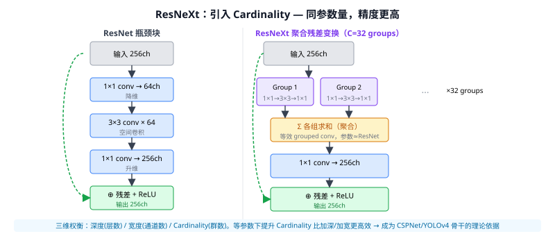

# 09a ResNeXt

> 定位：在 ResNet 的基础上引入第三个维度 **Cardinality（基数/分组数）**，用分组卷积取代单一大卷积，同等参数预算下精度更高。
> 作者：谢赛宁（Saining Xie）等，Facebook AI Research，CVPR 2017。
> 战绩：ResNeXt-101 32×8d 在 ImageNet Top-1 精度上以更少参数超过同深度 ResNet；在 MS COCO 目标检测/分割中也稳定优于 ResNet 对应版本。
> **输入 / 输出**：图像 → 分类概率（同 ResNet，骨干可替换）

---



## 一、提出背景

09 ResNet 已经证明残差连接可以训很深的网络，但如何在有限参数预算内进一步提升精度？两条路线：
1. **加深**（更多层）—— 计算成本 $O(L)$，收益递减。
2. **加宽**（更多通道）—— 参数翻倍，效果有限。

作者借鉴 08 GoogLeNet/Inception 的"多分支并行"思想，系统化为第三个可量化维度：**Cardinality $C$（变换群数）**，并以实验证明等参数下提升 Cardinality 比加深/加宽更高效。

---

## 二、核心创新

### 2.1 聚合残差变换（Aggregated Residual Transformations）

将 ResNet 瓶颈块（单组卷积）拆成 $C$ 个低宽度并行分支，分支输出**求和（聚合）**后再接 1×1 升维：

$$\mathbf{y} = \mathbf{x} + \sum_{i=1}^{C} \mathcal{T}_i(\mathbf{x})$$

每个 $\mathcal{T}_i$ 是：`1×1 conv → 3×3 conv → 1×1 conv`（与单组瓶颈相同结构，但宽度只有 $d = W/C$）。

### 2.2 等价实现：Grouped Convolution

三种等价表达方式（论文图3）：
| 写法 | 说明 |
|------|------|
| **分支求和** | C 个独立分支，最后 element-wise 相加 |
| **早期拼接** | 各分支 1×1 后 concat → 一次分组 3×3 → concat → 1×1 |
| **分组卷积** | 直接用 `groups=C` 参数的 GroupedConv3×3 — **实际最高效** |

PyTorch 实现核心：
```python
# 标准 ResNet 瓶颈
nn.Conv2d(256, 64, 1)
nn.Conv2d(64, 64, 3, padding=1)
nn.Conv2d(64, 256, 1)

# ResNeXt（C=32, d=4）
nn.Conv2d(256, 128, 1)
nn.Conv2d(128, 128, 3, padding=1, groups=32)  # groups=C
nn.Conv2d(128, 256, 1)
```

### 2.3 超参设置（论文默认）

```
C = 32  (Cardinality)
d = 4   (每组宽度)
→ 总参数 ≈ ResNet-50 的瓶颈块参数
```

作者约定 `C×d = 128`（恒定），实验了多种 $(C, d)$ 组合，32×4 效果最优。

---

## 三、优点与局限

**优点**：
- **同参数更高精度**：ResNeXt-50 32×4d ≈ ResNet-101 精度，参数减半。
- **设计正交**：Cardinality 可与 SE-Net（通道注意力）、FPN 等任意组合。
- **分组卷积对 GPU 友好**：现代 GPU 对 `groups` 参数的分组矩阵乘法有专门优化。

**局限**：
- 分组卷积打破了通道间全局交互（每组内部信息流通，组间不通）；需靠 1×1 conv 在组间混合信息。
- 过大 Cardinality（如 C=64）每组宽度 $d=2$ 太窄，精度反而下降。

---

## 四、历史地位

ResNeXt 是检测/分割"骨干替换"的标准选项：
- **Mask R-CNN** 论文给出 ResNeXt-101-FPN 的检测指标作为强基线；
- **CSPNet**（YOLOv4 骨干）把 ResNeXt 的分组思想与跨阶段部分连接合并；
- **RegNet**（Facebook 2020）进一步把 Cardinality 推广为设计空间搜索。

放进脉络：ResNet（深度）→ **ResNeXt（Cardinality）** → CSPDarknet（YOLOv4 骨干）→ EfficientNet（复合缩放，见 12）。

---

## 五、与本项目的关系

- **间接来源**：YOLOv4/v5 的 CSPDarknet 骨干用了 ResNeXt 的分组卷积思想（CSP 把特征图切两路，一路参与残差计算，另一路直接跳到末尾），本项目基线 YOLOv8 继承了这一骨干家族。
- **消融基准**：如果论文"相关工作"要写骨干演进，ResNeXt 是 ResNet→YOLOv8 骨干这条脉络中不可跳过的节点。
- 不直接用 ResNeXt 本体；作原理引用。

---

## 参考文献

- Xie S, Girshick R, Dollár P, Tu Z, He K. *Aggregated Residual Transformations for Deep Neural Networks.* CVPR 2017.
