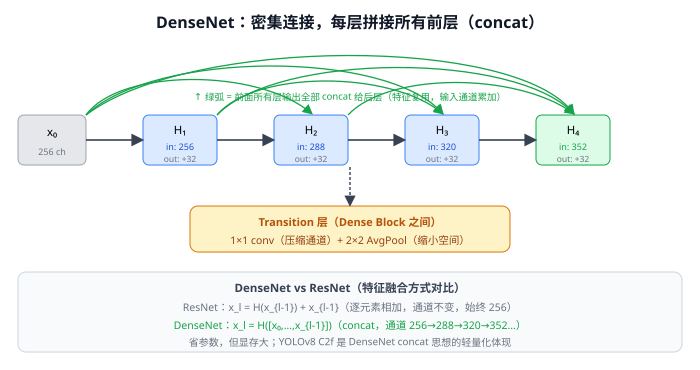
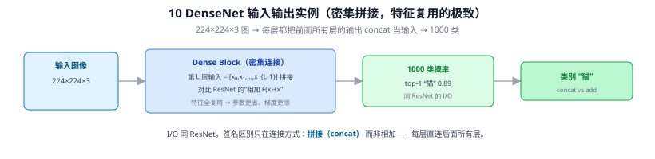
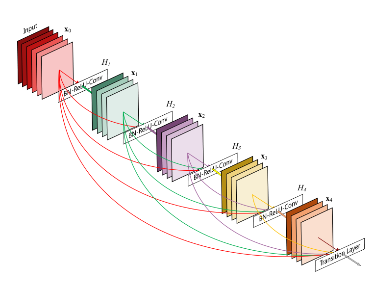

# 10 DenseNet（密集连接网络）

> 定位：把 ResNet 的"相加"换成"密集拼接"，让每层都直接连接到后面所有层。特征复用的极致。
> 作者：Huang 等，CVPR 2017（最佳论文）。
> **输入 / 输出**：224×224×3 图像 → 1000 类概率



> 📥📤 **输入/输出实例（看一组具体数值）**：I/O 与 09 ResNet 相同（**224×224×3** 图 → 1000 类，top-1 "猫" 0.89），签名区别只在**连接方式**——Dense Block 里第 L 层的输入是前面所有层输出的**拼接** $[x_0,x_1,\dots,x_{L-1}]$，而非 ResNet 的"相加 $F(x){+}x$"。特征全复用 → 参数更省、梯度更顺。一句话记忆：**ResNet 加法、DenseNet 拼接**。



---

> 📄 **论文原图对照**（图源：Huang et al., *Densely Connected Convolutional Networks*, [arXiv:1608.06993](https://arxiv.org/abs/1608.06993) Figure 1，原文 [PDF](../papers/10_DenseNet_1608.06993.pdf)；仅笔记内学习引用，论文写作须自绘）：



> Dense Block：每层把前面所有层的输出 concat 当输入——对照 ResNet 的"相加"。

## 一、提出背景

ResNet（09 ResNet）用残差连接 $y=F(x)+x$ 解决了深层训练问题。DenseNet 把这个思想推到极端：**与其相加，不如直接拼接所有前层的特征**，让信息和梯度在层间最大程度地流动与复用。

---

## 二、核心：密集连接（Dense Connectivity）

在一个 Dense Block 内，第 $l$ 层接收**前面所有层**的特征图作为输入（沿通道维拼接，concat，见 Q7）：

$$
x_l = H_l([x_0, x_1, \dots, x_{l-1}])
$$

对比 ResNet：
- **ResNet**：$x_l = H_l(x_{l-1}) + x_{l-1}$（逐元素相加，通道数不变）
- **DenseNet**：$x_l = H_l([x_0,\dots,x_{l-1}])$（拼接，通道数累加）

### 关键设计
- **增长率（growth rate, k）**：每层只新产生 $k$ 个通道（如 k=32），很小——因为能复用前层特征，不需要每层都很宽。
- **Transition 层**：Dense Block 之间用 1×1 卷积 + 池化压缩通道和空间（控制总通道数膨胀）。
- **瓶颈层**：1×1 先降维再 3×3，省算（同 Inception 思想）。

---

## 三、优点与局限

**优点**：
- **参数效率高**：特征复用使得用很少参数达到 ResNet 相当精度
- **梯度流极顺畅**：每层直连损失，缓解梯度消失，易训练
- **隐式深监督**：浅层也能直接受后层监督

**局限**：
- **显存占用大**：要保存大量中间特征图用于拼接，训练时显存吃紧
- **访存密集**：concat 操作多，实际推理速度不一定快（又是"参数少≠跑得快"，见 Q8）

---

## ✏️ 具体实例（动手算一遍）

**例：Dense Block 里通道怎么"越接越多"（增长率 k=32）**
每层都把自己的输出（k=32 个新通道）**拼接**到之前所有层的输出上，作为下一层输入：
```
输入        64 通道
Layer1 → 出 32 → 拼接后 64+32 = 96  通道
Layer2 → 出 32 → 拼接后 96+32 = 128 通道
Layer3 → 出 32 → 拼接后 128+32= 160 通道
Layer4 → 出 32 → 拼接后 160+32= 192 通道
```
第 L 层能直接"看到"前面所有层的特征（特征复用）。

**对比 ResNet（关键区别）**：
- ResNet：$y=F(x)\mathbf{+}x$ —— 逐元素**相加**，通道数不变；
- DenseNet：$y=[x_0,x_1,\dots]$ —— 沿通道**拼接**（concat），通道数累加。

相加是"叠加修正"，拼接是"保留全部历史特征"——后者参数更省、梯度路径更多，但显存占用大（拼接的特征图越来越厚）。

---

## 五、参考文献

- Huang G, et al. *Densely Connected Convolutional Networks.* CVPR 2017.
