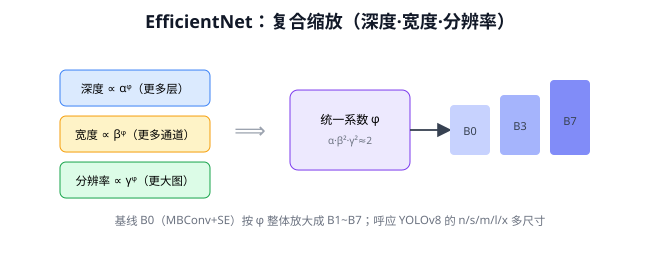
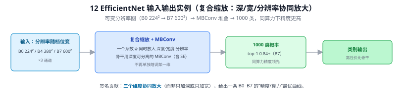
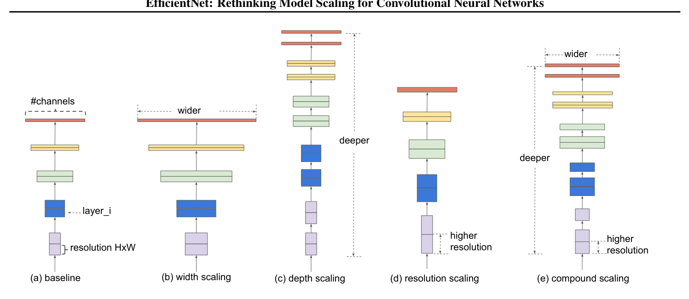

# 12 EfficientNet

> 定位：用"复合缩放"系统性地平衡网络深度、宽度、分辨率，在同等算力下达到更高精度。
> 作者：Tan & Le（Google），ICML 2019。
> **输入 / 输出**：可变分辨率×3 图像 → 1000 类概率



> 📥📤 **输入/输出实例（看一组具体数值）**：输入分辨率**随档位变**（B0 224² / B4 380² / B7 600²，×3 通道）→ MBConv（深度可分离 + SE）堆叠，靠一个系数 φ **同时放大深度·宽度·分辨率** → **1000 类概率**（B7 top-1 0.84+）。签名贡献是"**复合缩放**"——不再单独瞎调某一维，而是三维协同，给出一条 B0–B7 的"精度/算力"最优曲线。



---

> 📄 **论文原图对照**（图源：Tan & Le, *EfficientNet: Rethinking Model Scaling*, [arXiv:1905.11946](https://arxiv.org/abs/1905.11946) Figure 2，原文 [PDF](../papers/12_EfficientNet_1905.11946.pdf)；仅笔记内学习引用，论文写作须自绘）：



> (a)基线→(b-d)单独放大宽度/深度/分辨率→(e)复合缩放：三个维度按固定比例一起放大——本文核心主张。

## 一、提出背景

以前放大网络靠拍脑袋：要么加深（更多层）、要么加宽（更多通道）、要么加大输入分辨率。EfficientNet 提出一个核心问题：**这三个维度应该怎么配比一起放大，才最高效？**

---

## 二、核心：复合缩放（Compound Scaling）

观察：深度、宽度、分辨率三者不是独立的——分辨率大了，就需要更多层（更大感受野）和更多通道（捕捉细节）来匹配。EfficientNet 用一个**复合系数 $\phi$** 统一缩放三者：

$$
\text{深度} = \alpha^\phi,\quad \text{宽度} = \beta^\phi,\quad \text{分辨率} = \gamma^\phi
$$

其中 $\alpha,\beta,\gamma$ 由小网格搜索定出（约束 $\alpha\cdot\beta^2\cdot\gamma^2\approx 2$，保证每加一档算力翻倍）。

```
基线 EfficientNet-B0（NAS 搜出的高效结构，含 MBConv + SE）
   │ 统一按 φ 放大深度/宽度/分辨率
   ▼
B1 → B2 → ... → B7（精度递增，算力递增）
```

- **基线 B0** 用 NAS 搜索，主体是 **MBConv**（MobileNetV2 的倒残差，11 MobileNet）+ SE 注意力（15 SE-Net）。
- B0→B7 只是按复合系数放大，不改基本结构。

---

## 三、意义与局限

**意义**：
- 同等精度下，参数/FLOPs 比当时的 ResNet/SENet 少一个数量级
- 提供了"如何放大模型"的原则性方法，影响后续大量工作（EfficientDet 检测器即基于它）

**局限**：
- 大分辨率 + 深度可分离卷积对显存/访存不友好，实际训练慢
- 又是 Q8 的老问题：FLOPs 低 ≠ 实测延迟低（EfficientNet 在 GPU 上的实际速度常不如 FLOPs 暗示的那么快）→ 后续 EfficientNetV2 针对训练速度优化。

---

## ✏️ 具体实例（动手算一遍）

**例：复合缩放（compound scaling）怎么协同放大三个维度**
EfficientNet 用一个系数 $\phi$ 同时缩放**深度 d、宽度 w、分辨率 r**，而非只加深或只加宽：
$$d=\alpha^{\phi},\quad w=\beta^{\phi},\quad r=\gamma^{\phi},\qquad \alpha\cdot\beta^2\cdot\gamma^2\approx2$$
作者搜得 $\alpha=1.2,\beta=1.1,\gamma=1.15$。取 $\phi=1$：
- 深度 ×1.2（多 20% 层）、宽度 ×1.1（多 10% 通道）、分辨率 ×1.15（如 224→260）。
- 约束 $\alpha\beta^2\gamma^2\approx2$ 保证 $\phi$ 每加 1，**FLOPs 约翻倍**——算力预算可控。

**为什么要协同**：只加深→梯度难训；只加宽→抓不到细节；只升分辨率→感受野跟不上。三者按比例一起放大，精度/算力效率最优。这就是 B0→B7 系列由同一套规则放大得来。

---

## 五、参考文献

- Tan M, Le Q. *EfficientNet: Rethinking Model Scaling for Convolutional Neural Networks.* ICML 2019.
- Tan M, et al. *EfficientDet: Scalable and Efficient Object Detection.* CVPR 2020.

---

## 📋 模型答疑（来自模型详解问答）

> 专属本模型的问答集中在此；跨模型的通用问答见答疑总目录。

---

## Q151. EfficientNet 为什么要约束 α·β²·γ²≈2？是怎么得出的？

**简答**：指数 1/2/2 来自 FLOPs 正比于 深度·宽度²·分辨率²（宽度和分辨率都是平方级贡献算力）。把 α·β²·γ² 固定为 2，是让 φ 每加 1、总 FLOPs 翻倍，作为可控的算力预算刻度。α/β/γ=1.2/1.1/1.15 是在这个约束下网格搜出来的最优配比。

**展开**：

**① 复合缩放的形式**：用一个系数 φ 同时放大三维：深度 $d=\alpha^\varphi$、宽度 $w=\beta^\varphi$、分辨率 $r=\gamma^\varphi$（α,β,γ≥1）。φ 是"规模旋钮"，α/β/γ 是三维各自的放大配比。

**② 为什么指数是 1、2、2（核心）**：卷积 FLOPs 正比于三者——
- 深度（层数）翻倍 → FLOPs **×2**（线性）→ 贡献指数 **1**；
- 宽度（通道）翻倍 → 每层乘加 ∝ $C_{in}\cdot C_{out}$ 是**平方** → **×4** → 指数 **2**；
- 分辨率翻倍 → $H\times W$ 面积**平方** → **×4** → 指数 **2**。

代入得总 FLOPs 放大 ≈ $(\alpha\cdot\beta^2\cdot\gamma^2)^\varphi$。

**③ 为什么钉成 ≈2**：令 α·β²·γ²=2，则总 FLOPs ≈ $2^\varphi$——**φ 每加 1、算力翻倍**。这是一个人为设的、便于换算的"算力预算刻度"，让 B0→B7 的算力按 2 的幂整齐递增、可预测。

**④ α/β/γ 的值怎么来**：固定 φ=1（预算翻倍一次），在约束 α·β²·γ²≈2 下**网格搜索**使精度最高的一组 → **α=1.2, β=1.1, γ=1.15**（$1.2\times1.1^2\times1.15^2\approx1.92\approx2$✓）。然后**冻结这组比例，只增大 φ** 得到 B1~B7，不再重新搜。

**⑤ 为什么要协同（而非单调一个）**：单加深度→梯度难传、收益饱和；单加宽度→抓不到高层语义、易过拟合；单升分辨率→感受野/通道跟不上、浪费像素。三者按固定比例一起放大，精度/算力效率最优——这就是"复合缩放"。补充：B0 基线本身是用 NAS（Q150）搜出来的，EfficientNet = NAS 搜基线 + 复合缩放放大。


---
