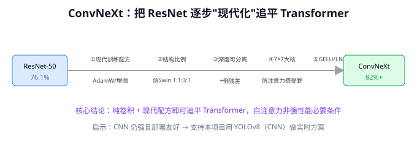
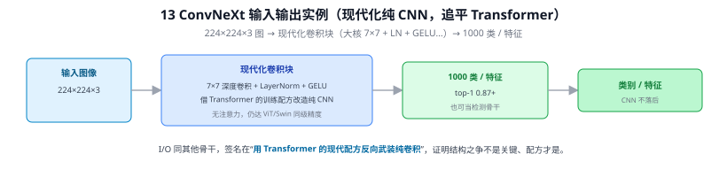
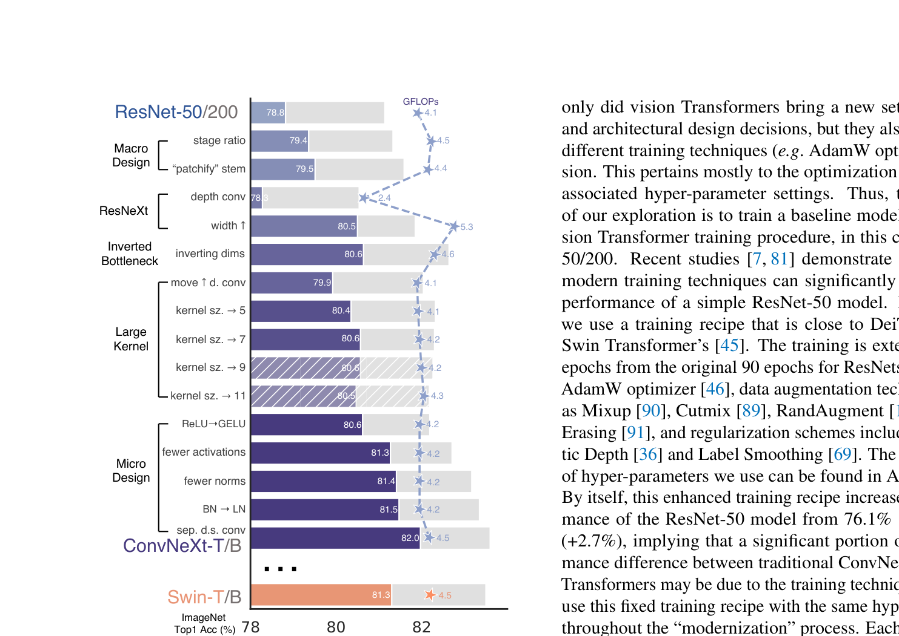
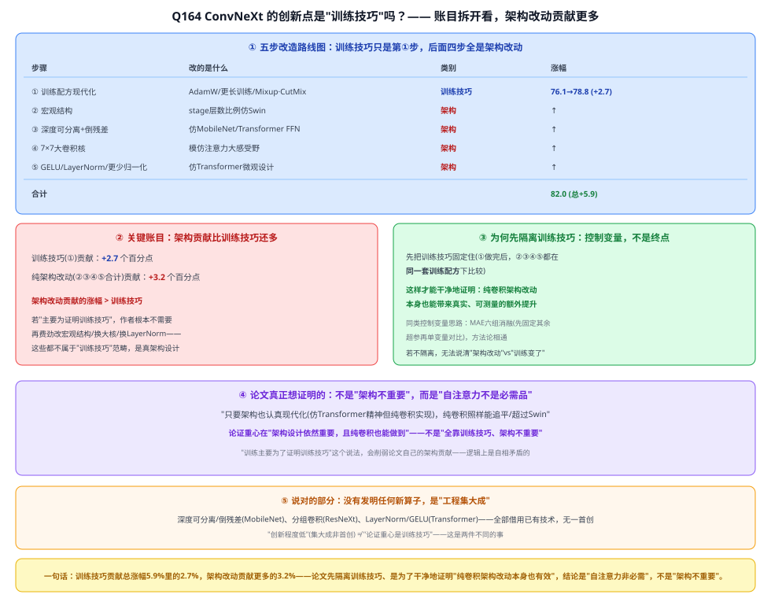

# 13 ConvNeXt

> 定位：用 Transformer 的"现代化训练配方"反向改造纯 CNN，证明 CNN 不落后于 Transformer。
> 作者：Liu 等（Facebook AI），CVPR 2022，论文名 *A ConvNet for the 2020s*。
> **输入 / 输出**：224×224×3 图像 → 1000 类 / 特征



> 📥📤 **输入/输出实例（看一组具体数值）**：输入 **224×224×3** 图 → 现代化卷积块（**7×7 深度卷积 + LayerNorm + GELU**，借 Transformer 的训练配方改造纯 CNN）→ **1000 类 / 特征**（top-1 0.87+），也可当检测骨干。I/O 同其他骨干，签名在"**用 Transformer 的现代配方反向武装纯卷积**"——无注意力却追平 ViT/Swin，证明结构之争不是关键、训练配方才是。



---

> 📄 **论文原图对照**（图源：Liu et al., *A ConvNet for the 2020s*, [arXiv:2201.03545](https://arxiv.org/abs/2201.03545) Figure 2，原文 [PDF](../papers/13_ConvNeXt_2201.03545.pdf)；仅笔记内学习引用，论文写作须自绘）：



> 从 ResNet-50 出发逐步"现代化"（大核/LN/GELU/倒瓶颈…）每一步的涨点路线图，终点超过 Swin——纯卷积也能打。

## 一、提出背景

2020—2021 年 ViT（31 ViT）、Swin Transformer 在视觉任务上风头盖过 CNN，似乎"Transformer 取代 CNN"成了趋势。ConvNeXt 提出一个尖锐问题：**到底是 Transformer 的"自注意力"本质更强，还是只是它带来的一整套训练技巧和设计更现代？** 作者从标准 ResNet-50 出发，**逐步借鉴 Swin 的设计**，看纯 CNN 能追到哪。

---

## 二、核心：把 ResNet "现代化"

ConvNeXt 不发明新算子，而是把一系列已被验证的改进**叠加到 ResNet 上**：

```
ResNet-50（76.1%）
  │ ① 训练配方现代化（更长训练、AdamW、数据增强 Mixup/CutMix）
  │ ② 宏观结构（调整各 stage 层数比例，仿 Swin 1:1:3:1）
  │ ③ 深度可分离卷积 + 倒残差（仿 MobileNet/Transformer）
  │ ④ 大卷积核（7×7，模仿注意力的大感受野）
  │ ⑤ 微观：GELU 激活、LayerNorm 替 BN、更少激活/归一化
  ▼
ConvNeXt（82%+，追平甚至超过同级 Swin）
```

**关键洞见**：纯卷积网络，只要用上现代训练配方和设计，**性能可与 Transformer 持平**——自注意力并非视觉强性能的必要条件。

> 有意思的反转：早期 VGG 证明小核（3×3）好（07 VGG），而 ConvNeXt 又用回 7×7 大核——因为配合深度可分离卷积，大核的计算代价可接受，且能模拟注意力的大感受野。设计是随约束变化的，没有绝对答案。

---

## 三、意义与局限

**意义**：
- 给"CNN vs Transformer"之争提供了有力的 CNN 一方论据
- 结构规整、纯卷积 → **部署友好**（比 Transformer 更易 ONNX/TensorRT 优化），这点对工程落地很有价值

**局限**：
- 本质是"工程集大成"，理论创新有限
- 超大规模数据下，Transformer 的可扩展性仍有优势

---

## ✏️ 具体实例（说明"现代化"改了什么）

**例：把 ResNet 一步步"改装"成 ConvNeXt（每步涨点）**
ConvNeXt 的本质是"用 Transformer 的训练配方和宏观设计来武装纯 CNN"。作者从 ResNet-50（76.1% ImageNet top-1）逐项改造：

| 改动 | 借鉴自 | 效果 |
|------|--------|------|
| 训练配方（AdamW、300 epoch、强增强） | ViT/Swin | 76.1 → 78.8 |
| 阶段计算量比例改成 (3,3,9,3) | Swin | ↑ |
| **7×7 大核深度卷积** | Swin 的大窗口注意力 | ↑（大感受野） |
| 倒置瓶颈（中间宽两头窄） | Transformer FFN | ↑ |
| GELU 替 ReLU、LayerNorm 替 BatchNorm、更少激活/归一化 | Transformer | ↑ |
| 合计 | | **→ 82.0%（追平/超过同级 Swin）** |

**结论**：Transformer 之所以强，很大一部分来自**训练方法和宏观结构**，而非"自注意力"本身魔法。把这些搬到纯卷积上，CNN 一样能打——这对本项目有现实意义：选骨干时不必盲目追 Transformer，结构规整、部署友好的现代 CNN（含 YOLOv8 骨干）同样有竞争力（呼应实时 <100ms）。

---

## 五、参考文献

- Liu Z, et al. *A ConvNet for the 2020s (ConvNeXt).* CVPR 2022.
- Woo S, et al. *ConvNeXt V2.* CVPR 2023.

---

## 📋 模型答疑（来自模型详解问答）

> 专属本模型的问答集中在此；跨模型的通用问答见答疑总目录。

---

## Q164. ConvNeXt 的创新点就是引入现代化训练技巧而已，主要就是为了证明这个，对吗？

**简答**：不完全对。训练技巧只贡献了总涨幅(5.9个百分点)里的2.7，剩下3.2来自纯架构改动(宏观结构/大核/倒残差/LayerNorm)——架构贡献其实更多。论文先单独隔离训练技巧这一步，是控制变量、排除混淆因素，好让后面的架构改动能"干净地"证明自己有独立效果，不是说训练技巧才是重点。真正的结论是"自注意力不是必需品，纯卷积只要架构和训练都现代化，一样能打"，而不是"架构不重要"。

**展开**：

**① 先看账目：训练技巧只占总涨幅不到一半**

| 步骤 | 改的是什么 | 类别 | 涨幅 |
|------|-----------|------|------|
| ① 训练配方现代化 | AdamW、更长训练、Mixup/CutMix | **训练技巧** | 76.1→78.8 (+2.7) |
| ② 宏观结构 | stage 层数比例仿 Swin | 架构 | ↑ |
| ③ 深度可分离+倒残差 | 仿 MobileNet/Transformer FFN | 架构 | ↑ |
| ④ 7×7 大卷积核 | 模仿注意力大感受野 | 架构 | ↑ |
| ⑤ 微观设计 | GELU、LayerNorm 替 BN、更少归一化 | 架构 | ↑ |
| 合计 | | | **82.0 (+5.9)** |

训练技巧(①)贡献 **+2.7**；纯架构改动(②③④⑤合计)贡献 **+3.2**——**架构改动贡献的涨幅比训练技巧还多**。如果论文的重点真是"证明训练技巧"，作者没有理由再去改宏观结构、换大核、换 LayerNorm——这些改动不属于"训练技巧"，是实打实的架构设计变化。

**② 为什么先隔离训练技巧：这是控制变量，不是终点**

论文把训练技巧单独作为第①步做完之后，**后面②③④⑤每一步都固定在同一套训练配方下比较**。这样设计的目的，恰恰是为了排除"训练变了"这个混淆变量，才能干净地说清"架构改动"本身有没有独立效果。如果不先隔离训练技巧，你没法分辨后面的涨点到底是训练变强了、还是架构真的变强了。这套"先固定其余变量、再单独测一个变量"的方法论，和 MAE 的六组消融实验（固定其余超参、只变一个维度做对比）是同一个逻辑。

**③ 论文真正想证明的：架构依然重要，只是自注意力不是必需品**

如果论文的主张是"训练技巧才是关键"，那等于在削弱自己的贡献——说"架构不重要，全靠调参"。但论文实际做的事恰恰相反：**在训练技巧已经拉平的前提下，纯卷积架构改动依然能带来额外的、可测量的提升**。真正的结论是：**自注意力（self-attention）不是视觉性能强的必要条件**——只要把架构也认真现代化（借鉴 Transformer 的设计精神，但用纯卷积实现，不需要真正的自注意力机制），纯卷积照样能追平甚至超过 Swin。这个结论的重心落在"架构设计依然重要，而且纯卷积也能做到 Transformer 的水准"，不是"架构不重要、全靠训练技巧"。

**④ 你说对的部分：确实没有发明新算子**

ConvNeXt 用到的每一个招数都是别处已有的技术——深度可分离卷积+倒残差借自 MobileNet、分组卷积借自 ResNeXt、大核设计呼应大感受野的注意力窗口、LayerNorm/GELU 借自 Transformer——**没有发明任何一个新算子**，是"工程集大成"而非首创，这一点是准确的（呼应本文 §三"局限"）。但"创新程度低（集大成非首创）"和"论证重心是训练技巧"是两件不同的事：前者说的是**创新层级**，后者说的是**论文想证明什么**——而论文想证明的是"架构改动本身也有独立贡献、自注意力非必需"，不是"训练技巧才是全部"。



---

## Q173. 仿 Swin 的"1:1:3:1"比例是何意？GELU 是什么？

**简答**：① **比例说的是"块数"**。CNN 骨干分 4 个 stage，每过一个 stage 分辨率减半、通道翻倍；每个 stage 内部把同一种 block 重复堆若干次。"1:1:3:1"就是这四个 stage 各堆几个 block 的**相对数量**——ConvNeXt 具体取 (3,3,9,3)，即第 3 个 stage 堆 9 个、其余各堆 3 个。它照搬自 Swin，因为 Swin 的四个 stage 块数比例正是 1:1:3:1。② **GELU 是激活函数**，作用和 ReLU 一样（决定某个神经元的输出"留多少"），但曲线更平滑：ReLU 是 `max(0,x)`（负数硬切成 0），GELU 是 `x·Φ(x)`（Φ 是标准正态的累积分布函数），近 0 处平滑过渡、负半轴略微下探而非硬 0。Transformer（BERT/GPT/ViT）默认用 GELU，ConvNeXt 把它搬到纯卷积里替换 ReLU。

**展开**：

**① "1:1:3:1"到底指什么——是 block 数量，不是别的**

现代 CNN 骨干（ResNet、ConvNeXt 都一样）把网络分成 4 个 **stage（阶段）**。每进入下一个 stage，特征图的**分辨率下采样一半、通道数翻倍**（这是"下采样×通道翻倍"的固定套路）。而在**同一个 stage 内部**，网络会把**同一种残差 block 重复堆叠若干次**——堆几次，就是这个 stage 的"深度"。

- **ResNet-50** 的四个 stage 块数是 **(3, 4, 6, 3)**，比例约 1:1.3:2:1；
- **Swin-T** 的四个 stage 块数比例是 **1:1:3:1**；
- **ConvNeXt** 为对齐 Swin，把 ResNet 的 (3,4,6,3) 改成 **(3,3,9,3)**——正好是 1:1:3:1（3:3:9:3 约分即 1:1:3:1）。

所以"1:1:3:1"里的那个"3"，指的是**第 3 个 stage 堆的 block 数是其他 stage 的 3 倍**，把算力集中堆在这一段。它**不是**分辨率之比、**不是**通道数之比，就是纯粹的"每段堆几个块"。

**② 为什么第 3 个 stage 堆最多**

第 3 个 stage（相对输入是 16 倍下采样）分辨率适中、通道数较高，是"语义抽象最关键"的层级——特征既不太糙（还没抽象到丢光细节）也不太抽象，把大部分计算预算（块数）压在这里性价比最高。这是很多视觉网络的经验规律，Swin 和 ConvNeXt 都遵循。不过要说明：这一步在 ConvNeXt 的消融里**涨点很小（约 +0.1%）**，作者改它主要是为了"和 Swin 对齐、排除这个变量的干扰"，不是它单独有多大魔力（呼应 [Q164](#q164-convnext-的创新点就是引入现代化训练技巧而已主要就是为了证明这个对吗) 的控制变量思路）。

**③ GELU 是什么——比 ReLU 更平滑的激活函数**

**激活函数**是网络里给线性运算加"非线性"的部件，直观理解是"决定某个神经元的输出应该留多少、压多少"。没有它，多层网络会退化成一个大线性变换，学不了复杂模式。

| | ReLU | GELU |
|---|---|---|
| 公式 | $\max(0,x)$ | $x\cdot\Phi(x)$（Φ=标准正态 CDF） |
| 负数处理 | 一刀切成 0 | 保留一点小负值（软压制） |
| 形状 | 在 0 处有硬转折、不可导 | 处处平滑可导 |
| 直觉 | 负的全丢、正的原样通过 | 按输入大小"平滑加权"：越大越可能保留，越小越可能压掉 |

GELU 的"软门"由 $\Phi(x)$（输入服从标准正态时，"小于 x"的概率）充当：输入越大，被保留的比例越高；输入越小（越负），被压制得越狠，但**不是硬切成 0**。工程上常用近似 $x\cdot\sigma(1.702x)$（和 Swish/SiLU 很接近，YOLOv8 用的 SiLU 就是同一家族）。

为什么 ConvNeXt 要换：GELU 是 Transformer（BERT/GPT/ViT）里的默认激活。ConvNeXt 的整条思路就是"把 Transformer 验证过的设计逐项搬进纯卷积"，GELU 替 ReLU、LayerNorm 替 BatchNorm 都属于本文 §二的第 ⑤ 步"微观设计现代化"——单项涨点都不大，但和其余改动叠加起来，让纯卷积追平了 Swin。


---
